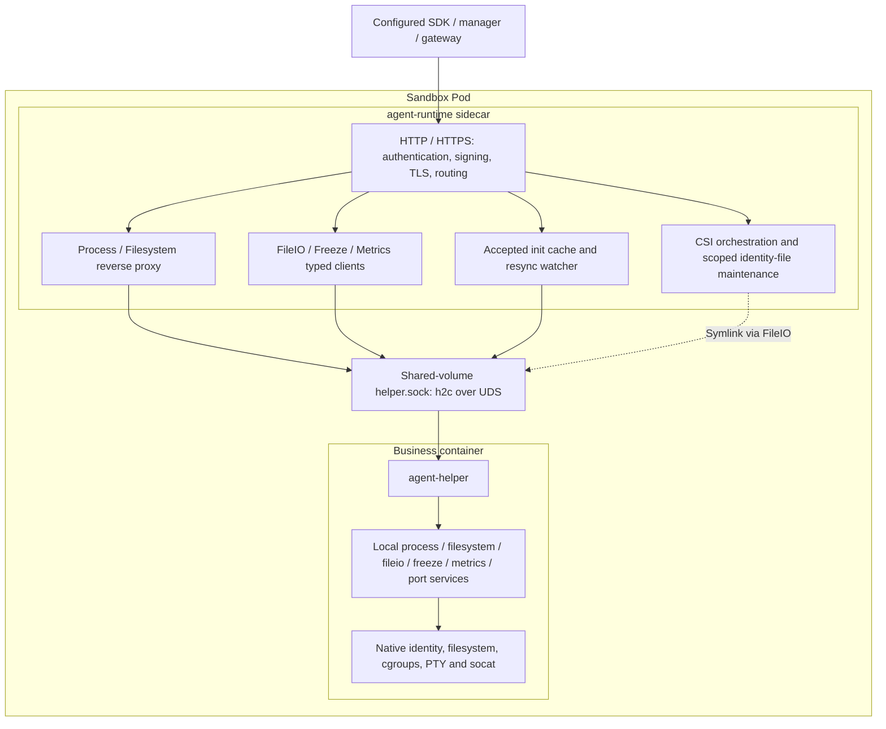
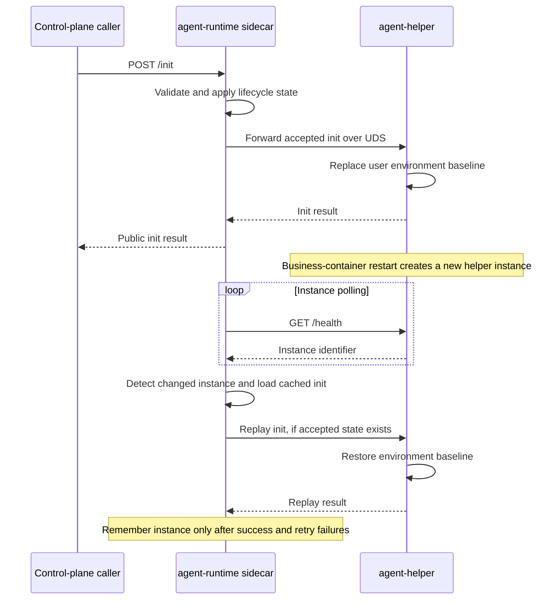

# Agent Runtime Helper Mode (in-container helper over socket)

## Table of Contents

- [Summary and Status](#summary-and-status)
- [Motivation](#motivation)
- [Mode Selection](#mode-selection)
- [Architecture](#architecture)
- [Design Decisions](#design-decisions)
- [Request Placement](#request-placement)
- [Initialization and Restart Flow](#initialization-and-restart-flow)
- [Security and Deployment Constraints](#security-and-deployment-constraints)
- [Contribution and Upgrade Plan](#contribution-and-upgrade-plan)
- [Test Plan](#test-plan)
- [Alternatives](#alternatives)
- [Implementation History](#implementation-history)

## Summary and Status

Helper-backed deployment runs the agent-runtime API/control plane in a sidecar and a lightweight `agent-helper`
process in the business container. The helper performs native process, filesystem, file-transfer, cgroup, metrics,
and port-forward operations over an existing ConnectRPC contract carried by a UNIX domain socket (UDS).

This is a sub-module of the [complete runtime proposal](./20260720-agent-runtime-component.md). The design has an
implementation intended for contribution; it is not a claim that the helper server, public delivery, or automatic
injection has already merged into the community repository.

Helper use is selected by `--runtime-mode=helper` **and** the Alpha `HelperDataPlane` gate, which defaults to false.
With that gate disabled, the sidecar topology uses business-container envd instead. Helper-dependent identity-file
placement, cross-UID access, initialization fields, and failure supervision need acceptance tests or follow-up work
before describing the combination as production-ready.

## Motivation

Running the full runtime in the business container provides native execution fidelity but co-locates HTTP serving,
authentication, TLS, and control-plane lifecycle with tenant workloads. Executing tenant commands from an isolated
sidecar would instead use the wrong filesystem, identity, and process/cgroup context.

A helper keeps native services in the business container while the sidecar owns external API policy and relay.
Reusing complete local services avoids rebuilding PTY, process registry, watch, and streaming state across a remote
primitive protocol. It does not make the helper independent of the business container's trust boundary or lifecycle.

## Mode Selection

| Configuration | Runtime placement | Backend behavior |
|---|---|---|
| `--runtime-mode=local` | Business container | Native handlers in agent-runtime; no helper delegation |
| `--runtime-mode=helper`, gate false | Sidecar | envd backend; no helper readiness wait or general helper proxy |
| `--runtime-mode=helper`, gate true | Sidecar plus business-container helper | UDS clients, proxy, readiness, and init resync |

Relevant server configuration:

```text
--runtime-mode=local|helper
--feature-gates=HelperDataPlane=true
--helper-socket=/var/run/agent-helper/helper.sock
--helper-ready-timeout=120s
```

The implementation stores these in `ServerConfig`; `DelegatesToHelper()` is true only for the last row. `EnvdURL`
selects the envd address for the gate-disabled sidecar's init forwarding and storage symlink execution. `envd` is not
an accepted third server mode.

Backend launch is a separate deployment choice. The business-container launcher must start agent-helper when the
gate is enabled and envd when disabled; the gate cannot switch a process that was already launched. Public image,
launcher, injection, and caller routing must therefore be delivered together.

## Architecture



No process or socat payload data plane is implemented by entering the business container's namespaces from the
sidecar. The UDS carries service calls and process/file streams; socat forwarding itself remains local to the helper.
CSI publish and mount-root orchestration remain on the runtime side, with required mount propagation to the business
container.

## Design Decisions

### D1. UDS over a shared volume

The default socket is `/var/run/agent-helper/helper.sock`. Both containers must mount the same shared volume at the
configured path. The socket is mode `0600`; newly created parent directories use `0700`.

The helper does not uniformly tighten existing parent directories: a shared volume mount root can already exist
with deployment-managed permissions. Injection must explicitly validate its ownership, permissions, and mutability.
Permissions are enforced before peer UID checks; adding a UID to an allowlist does not bypass `0600` access rules.

The helper exposes no TCP listener. Loopback TCP is an alternative considered but not implemented in this proposal.

### D2. Existing ConnectRPC specs over h2c

The helper mounts the existing service handlers on an HTTP mux wrapped with h2c (cleartext HTTP/2). The sidecar
uses a shared UDS dial/transport policy for reverse proxying and typed RPC clients.

Process and filesystem relay preserve procedure paths and unary/streaming payloads; the reverse proxy flushes
without intentional buffering. This is not a substitute for testing client-streaming, backpressure, cancellation,
trailers, and long-lived connections on the actual transport.

FileIO streams identity bytes and metadata. The sidecar retains HTTP-level download/upload semantics, including
signing, gzip, Range, multipart parsing, and response/error mapping.

### D3. Helper owns native service state

The helper owns the process registry, PTYs, stdin, filesystem watches, port forwarding, and its cgroup/freezer
operations. The sidecar does not mirror those registries.

Local mode and helper mode use the same native services. Storage has a dedicated `HelperMountExecutor` in
`pkg/agent-runtime/openapi/extendedapi/storage/executor_helper.go`: CSI work stays local to the runtime, and symlink
creation calls helper FileIO. The envd alternative is implemented separately in `executor_envd.go` through the
storage CLI run by envd; it is not a fallback after helper failure.

### D4. Initialization has explicit, limited ownership

The sidecar owns external authentication, the latest locally applied init body, and its lifecycle timestamp gate.
It forwards authorized `/init` to the helper's **internal plain HTTP `POST /init`** over the UDS even when the sidecar
skips local application because of a stale timestamp. The helper ignores timestamps, so that stale forward can
replace helper env without changing sidecar env. End-to-end stale-request protection remains a correctness gap.

The current helper init handler applies **environment variables only**, using replacement semantics that preserve
runtime-injected internal variables. It does not hold the access token, install a CA bundle, or apply relayed default
user/workdir. Helper user identity comes from startup configuration and the process's own identity.

Default user/workdir changes need concurrency-safe state handling and compatibility tests before they can be
promised to match local `/init` behavior. Relaying the original JSON body does not mean every field is consumed.

### D5. Delivery, readiness, and supervision

Delivery uses an artifact volume populated by the runtime image, consistent with the community envd delivery
mechanism. The business-container startup hook/launcher must start agent-helper without blocking its application
command or losing argument boundaries. The sidecar runs agent-runtime with matching helper configuration.

When `DelegatesToHelper()` is true, the sidecar waits for helper readiness with a bounded timeout before accepting
traffic. When false, it must not wait on an absent helper. Do not make a native sidecar startup probe depend on the
helper if Kubernetes requires that probe to succeed before starting the business container.

`agent-helper health` provides a one-shot UDS health check. Automatic probe injection must follow repository
admission rules; the availability of this subcommand does not imply an exec probe can be injected unconditionally.

A business-container restart relaunches its startup hook and replaces the helper. A standalone helper crash is a
different case: postStart does not supervise a background process. Public delivery must define and test supervision,
failure propagation, or a business-container restart policy before claiming automatic crash recovery.

### D6. Native cgroup and metrics behavior

The helper builds its cgroup manager in the business container, uses native FD-based placement where supported, and
serves freeze/thaw through that manager. Cgroup-less environments can use no-op behavior; this is not an effective
pause/freeze guarantee. Snapshot integration requires Linux cgroup v2 validation.

Metrics are sampled through the helper's configured host provider. Verify the actual CPU/memory/disk scope and
limits; being in the business container does not by itself make all host-provider values container-limited.

The port scanner and socat forwarder are owned by the helper when enabled. The PortForward RPC is mounted only
when forwarding is enabled, and it is not automatically a public runtime RPC prefix.

### D7. Diagnostics and transport errors

The sidecar publishes authenticated `/debug/relay-stats`; the helper publishes UDS-only `/stats` with its instance
identifier. Counters cover transparent proxies, typed clients, init relay, and helper service handling.

On a broken transparent relay the sidecar reports a gateway error rather than executing locally. Typed backends
propagate errors through the native API's mapping; freezer absence and RPC failure are distinct cases, and no-op
freezer behavior must not be described as an availability error. Error codes and cancellation must be checked in
the API compatibility tests.

## Request Placement

| Request/capability | Sidecar | Helper |
|---|---|---|
| Process RPC | Authenticate and proxy | Native process/PTY/stream state |
| Tenant Filesystem RPC | Authenticate and proxy | Native metadata operations and watches |
| Control-plane token ListDir/Remove | Scoped local handler when explicitly selected | Must not inspect tenant paths as a substitute |
| `/files` and `/files/compose` | HTTP authorization, encoding, Range and response handling; configured local exceptions | Native byte operations when delegated |
| `/freeze`, `/unfreeze` | Public lifecycle policy and RPC adaptation | Configured freezer operations |
| `/metrics` | Public response mapping | Metrics provider sample |
| `/init` | Validate/cache/forward accepted body | Internal env-baseline update only |
| `/envs` | Accepted sidecar environment | No corresponding external endpoint |
| `/v1/storage/mounts` | CSI publish, mount-root, provider policy | FileIO user-facing symlink |
| Port forwarding | No duplicate autonomous scanner in helper mode | Scanner, socat and enabled PortForward service |
| `/health` | Public runtime reachability | UDS health and instance identifier |
| Diagnostics | Authenticated relay counters | UDS-only service counters |

Identity-file placement requires additional care: helper-backed native file transfer can place ordinary files in the
business container, while CSI identity lookup and scoped maintenance require sidecar-owned state. Public integration
must route identity writes, maintenance, and CSI reads to the same location. The existing scoped filesystem fork is
not by itself proof that all three operations are consistent.

## Initialization and Restart Flow



`helperclient/resync.go` watches instance identity rather than a health down/up edge, so a restart between two healthy
polls is detectable. It replays cached state only when available and retries failed synchronization without marking
the instance synchronized.

This is best-effort body replay, not guaranteed environment convergence or a transaction blocking commands until
replay. Two additional correctness gaps need explicit handling:

- The cache stores the latest applied request, not complete effective state. An env-bearing init followed by an
  env-omitting init leaves the restarted helper's earlier environment unrestored.
- Resync obtains a cached copy and forwards outside the init lock. A newer init can complete before the older replay
  overwrites helper env; the successful replay then marks that instance synchronized and need not replay again.

Process registries, PTYs, watches, existing streams, and in-flight operations are not reconstructed by `/init`.
Tests must cover these gaps and commands arriving before replay; the normal flow above is not a convergence proof.

## Security and Deployment Constraints

The helper trusts transport access, not the external access token. The proposed implementation uses UDS permissions
and an optional peer-UID allowlist on Linux:

- Kernel peer credentials identify the connecting UID; a UID outside a configured allowlist is rejected.
- An empty allowlist disables peer checks. Unsupported platforms and peer-credential read failures currently allow
  the connection; those error paths are logged. These fail-open paths are known hardening gaps.
- UID verification cannot distinguish a legitimate sidecar from an attacker with the same UID. PID pinning is not
  used and would be fragile across restarts; UID-only verification is not process/container attestation.
- With the current `0600` socket, non-root sidecar/helper deployments generally need matching effective ownership
  or a separately reviewed access design. A permissive socket mode is not an acceptable shortcut.
- The helper inherits the business container's identity. It does not grant extra privileges, but services can run
  explicit user operations that the current identity is already permitted to perform.
- Tenant code able to modify the shared socket directory or artifact volume can disrupt/replace the helper path.
  Deployment must validate those boundaries instead of relying only on the socket file's mode.
- Helper transport does not require host PID visibility or `CAP_SYS_ADMIN`. CSI/FUSE privileges and read-only root
  filesystem constraints remain separate deployment concerns.

The security objective is constrained local access, **not isolation against same-UID hostile tenant code**. Stronger
identity separation, fail-closed production enforcement, and any application-layer authentication require explicit
follow-up design and tests; they are not presented here as implemented behavior.

## Contribution and Upgrade Plan

The umbrella proposal owns the overall PR sequence. Helper contribution depends on protocol sources, native
services, and the runtime API:

1. Import helper server/client and command assembly with the Alpha gate disabled by default.
2. Wire Process/Filesystem proxy, typed FileIO/Freeze/Metrics, init relay/resync, relay counters, and mount symlink.
3. Preserve the gate-disabled envd topology: no helper wait/proxy, correct init forwarding and envd symlink executor.
4. Deliver public binaries, matching business-container startup, shared-volume configuration and caller routing.
5. Resolve or explicitly exclude unsupported identity-file and user/workdir combinations, and verify UID access,
   cgroups, supervision and restart semantics before enabling helper in production examples.
6. Integrate with existing RuntimeAIO or separated runtime/CSI deployment without inventing a new mode.

Community image/launcher/injection changes remain contribution work even where corresponding implementation exists
elsewhere. Preserve existing community staging, startup-wrapper, and storage behavior; do not mark cross-component
integration as complete simply because the helper binary builds.

The runtime binary defaults to HTTP `49983` and optional HTTPS `49984`. In envd coexistence, envd owns `49983`, so the
sidecar uses HTTPS and/or a distinct HTTP port. Helper-only deployment may expose the standard HTTP port if no other
process owns it. Client routes and auth configuration must be tested rather than assumed unchanged.

An operator rolls back by coordinating image, gate, backend startup and caller routing. Disabling the gate while
leaving only agent-helper running produces a broken envd-backed deployment, not backward compatibility.

## Test Plan

- Mode matrix: local, helper+gate false, helper+gate true; verify no local tenant execution or helper wait in envd mode.
- UDS permissions: new/existing parent directories, matching and mismatched non-root UIDs, allowed/denied peers,
  credential-read failures and unsupported platforms. Use short temporary socket paths on macOS.
- Service/proxy integration: process start/connect/stdin/signal/PTY resize, filesystem CRUD/watch, client/server
  streaming, trailers, backpressure, disconnect, cancellation and transport timeout behavior.
- File HTTP contract: raw/multipart/gzip, Range/conditional downloads, compose, symlink propagation and user-data
  preservation with local and helper implementations.
- Initialization: env replacement, stale timestamp forwarding, env-bearing then env-omitting init followed by restart,
  ignored user/workdir fields, first sync, restart between healthy polls, replay failure/retry, concurrent newer init
  versus older replay, and commands arriving before resync.
- Identity storage: write/maintain/read placement, scoped token deletion, ordinary tenant filesystem requests,
  path escape rejection and CSI agent-identity mounts.
- Linux cgroups: real placement, freeze/thaw across supported process groups, no-op limitations and non-root errors.
- Lifecycle: standalone helper crash, business-container restart, sidecar restart, long-lived streams, port forwarding,
  shutdown deadlines and diagnostics across instance changes.
- Public delivery: amd64/arm64 image builds, legacy envd, sidecar+envd, sidecar+helper, startup ordering and AIO where
  enabled; satisfy repository admission and permission constraints.

These are acceptance requirements, not claims that Linux or Kubernetes E2E tests have already passed.

## Alternatives

- **Local runtime only:** simpler, but keeps external control-plane serving inside the business container.
- **Thin helper primitives:** moves registries to the sidecar but requires a second process/stream orchestration model.
- **Loopback TCP:** easier reachability but network-visible to all Pod processes; not the implemented transport.
- **Separate remote executor per service:** more adapters and duplicate streaming handling; complete local helper
  services plus proxy/typed clients keep the existing wire protocol and execution ownership.
- **CRI/DaemonSet execution:** requires different privilege and infrastructure assumptions and is outside this scope.

## Implementation History

- 2026-07-08: Initial helper-mode draft.
- 2026-07-20: Expanded service and relay design.
- 2026-11-19: Corrected mode/gate semantics and contribution status; added init/restart and architecture diagrams,
  internal init/stats endpoints, scoped identity-file handling, accurate socket/UID limitations, and public delivery
  acceptance criteria.
