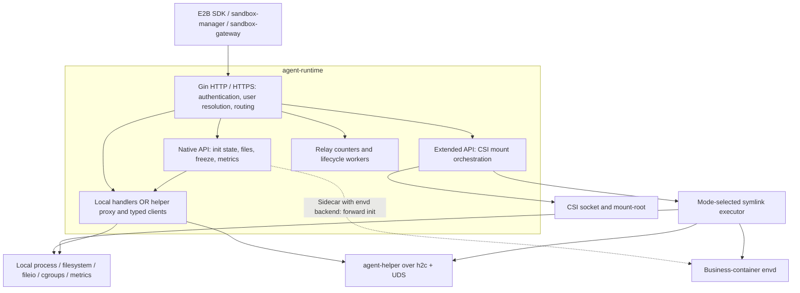
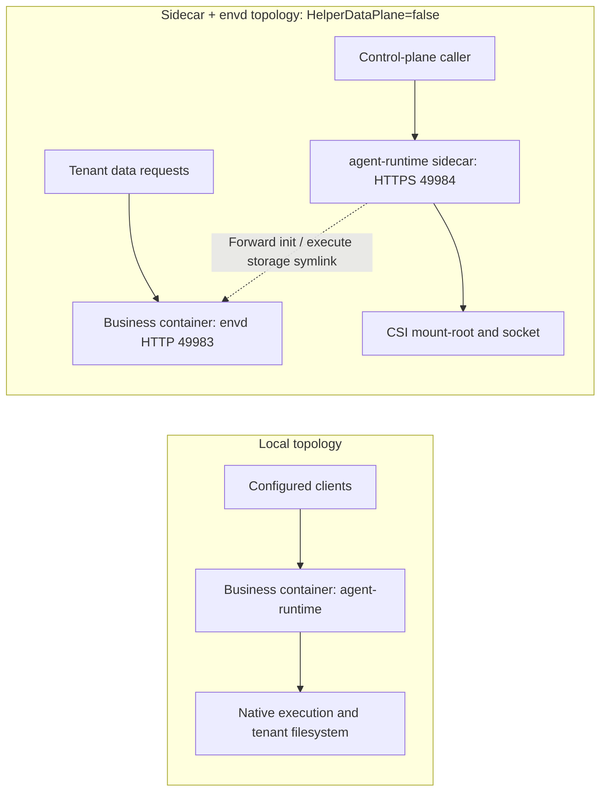
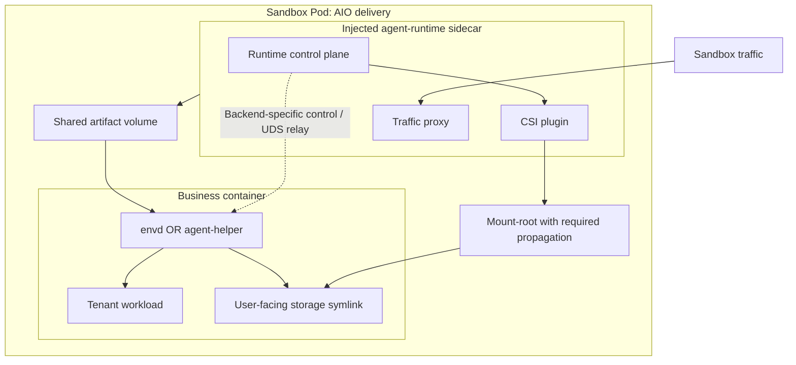
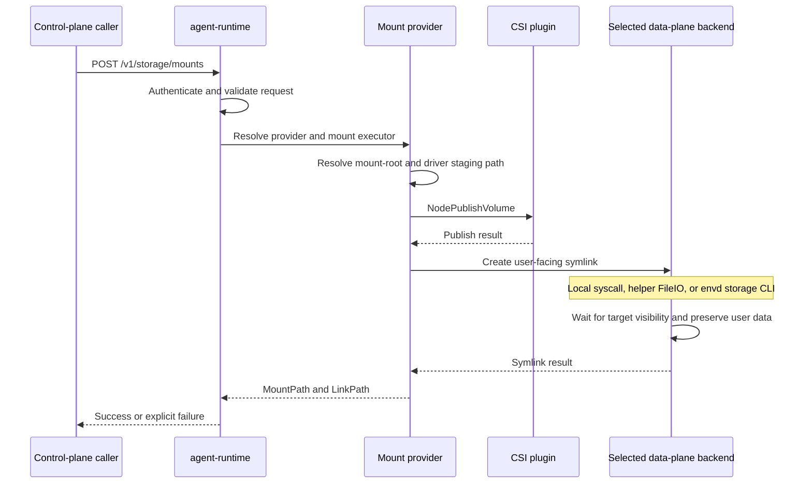

# Agent Runtime (envd-compatible sandbox runtime)

## Table of Contents

- [Summary](#summary)
- [Motivation and Scope](#motivation-and-scope)
- [Architecture](#architecture)
- [API and Service Surface](#api-and-service-surface)
- [Deployment Topologies](#deployment-topologies)
- [Lifecycle and Security](#lifecycle-and-security)
- [Storage Request Flow](#storage-request-flow)
- [Community Contribution Plan](#community-contribution-plan)
- [Upgrade Strategy](#upgrade-strategy)
- [Risks and Alternatives](#risks-and-alternatives)
- [Test Plan](#test-plan)
- [Implementation History](#implementation-history)

## Summary

This proposal describes the complete `agent-runtime` component and its staged contribution to OpenKruise Agents.
It provides an E2B/envd-compatible sandbox API, native process and filesystem execution, CSI storage integration,
and an optional in-container `agent-helper` data plane. The helper is a sub-module of agent-runtime, not a separate
platform component.

**Implementation status:** this document describes an existing implementation intended for contribution. It does
not claim that the full runtime server or helper has already merged into the community repository. Existing
community functionality includes envd artifact delivery, the storage CLI, mount-path policy, and startup wrappers.
The implementation sections below describe the target code layout; the contribution plan defines the remaining
upstreaming work.

Compatibility is an API-level objective, not a promise that every deployment has the same route placement or
requires no client configuration. In particular, the envd-backed sidecar serves runtime control-plane requests
separately from tenant requests that continue to reach envd.

## Motivation and Scope

The community runtime image currently delivers envd into the business container. Contributing the complete runtime
makes its API behavior, storage orchestration, authentication, execution, and lifecycle handling reviewable and
maintainable in the same repository as the controller, sandbox-manager, and gateway.

Goals:

- Contribute the full runtime dependency closure, source protocols, tests, and reproducible public builds.
- Preserve E2B/envd wire compatibility for process, filesystem, and file-transfer operations.
- Keep tenant execution in the business container rather than accidentally executing it in the sidecar.
- Make deployment, data-plane selection, and their limitations explicit.
- Reuse service implementations between local mode and helper mode.
- Build on existing CSI and RuntimeAIO integration instead of replacing them with a parallel mechanism.

Non-goals:

- A new sandbox lifecycle API or changes to the existing E2B SDK protocol.
- A generic CRI/DaemonSet executor, arbitrary CSI-driver support, or privilege elevation.
- A claim that helper isolation protects against an adversary with the same effective UID.
- Installing the `/init` CA bundle, which remains a separately scoped capability.
- Shipping provider-specific infrastructure, private image sources, or deployment credentials.

## Architecture

### Component view

The principal packages are:

| Responsibility | Target location |
|---|---|
| Server configuration, listeners, and route composition | `pkg/agent-runtime/server.go`, `routers.go` |
| Native API and initialization | `pkg/agent-runtime/openapi/nativeapi/` |
| Storage API, provider registry, and mount executors | `pkg/agent-runtime/openapi/extendedapi/storage/` |
| Native execution services and their protocols | `pkg/agent-runtime/services/`, `services/spec/` |
| Helper server and UDS transport adapters | `pkg/agent-runtime/helper/`, `helperclient/` |
| Authentication, users, metrics, logging, and relay counters | `auth/`, `permissions/`, `host/`, `logs/`, `relaystats/` under `pkg/agent-runtime/` |
| Binary assembly and flags | `cmd/agent-runtime/`, `cmd/agent-helper/` |
| Existing storage CLI and path policy | `pkg/agent-runtime/storage-cli/`, `mountpath/` |

### Control plane and data plane

The runtime control plane owns HTTP semantics, authentication/signing, TLS, routing, accepted `/init` state,
streaming relay, and CSI orchestration. The data plane owns native process/PTY/stdin/signal state, tenant filesystem
and file bytes, cgroup placement/freezing, metrics sampling, and port forwarding.

Local mode co-locates these responsibilities. Sidecar mode must not turn a missing backend into local tenant
execution. Process and filesystem are either local handlers or transparent helper proxies. FileIO, Freeze, and
Metrics use typed helper clients when the helper backend is selected.

`ProcessExecutor` and `FilesystemExecutor` isolate native execution within their services; they are not a claim
that a separate remote executor is implemented for every backend. The storage `MountExecutor` has local, helper,
and envd variants in `openapi/extendedapi/storage/executor_*.go`. `routers.go` selects these through
`pickMountExecutor`, `pickFreezer`, and `pickInitForwarder`.

Control-plane identity files are a restricted exception to tenant filesystem placement: token maintenance uses
scoped `ListDir`/`Remove` operations. A maintenance header selects this path, but the handler's path scope and normal
authentication enforce the boundary. It must never reopen arbitrary sidecar filesystem access.

## API and Service Surface

### Public runtime endpoints

| Method and path | Responsibility |
|---|---|
| `GET /health` | Public reachability endpoint: `204 No Content`, `Cache-Control: no-store`. |
| `GET /envs` | The runtime's accepted default environment. |
| `GET /files` | Authorized file download, with gzip, Range, and conditional-response handling. |
| `POST /files` | Authorized raw or multipart upload, including gzip decoding and user ownership. |
| `POST /files/compose` | Compose ordered sources into a destination. |
| `POST /init` | Initialize token, environment, default user/workdir, and resume-related state. |
| `POST /freeze`, `POST /unfreeze` | Freeze/thaw through the configured backend. |
| `GET /metrics` | CPU, memory, and disk metrics through the configured provider. |
| `POST /v1/storage/mounts` | Validate and publish a CSI volume, then expose it through a user-facing symlink. |
| `GET /debug/relay-stats` | Authenticated per-procedure counters for received and delegated requests. |

Native routes are registered in `openapi/nativeapi/api_def.go`; the extended storage route is registered in
`openapi/extendedapi/api_def.go`. `routers.go` registers health, debug counters, and Process/Filesystem RPC prefixes.

This table is the component's surface, not a statement that all operations on a sidecar automatically target envd.
The sidecar+envd topology intentionally does not mount general tenant Process/Filesystem handlers. File, freeze,
and metrics placement in that topology must be validated separately from the full helper-backed surface.

### Execution services

| Service | Native capabilities | Public placement |
|---|---|---|
| Process | List, start, attach/connect, update, stdin streams, signals, PTY allocation/resize | Local runtime or helper proxy |
| Filesystem | Stat, mkdir, move, list, remove, directory watches and watcher lifecycle | Local runtime or helper proxy; scoped control-plane exception |
| FileIO | Ranged reads, streamed writes, compose, symlink creation | Helper RPC backing native file endpoints; local implementations otherwise |
| Freeze | cgroup freeze/unfreeze with serialized operations | Helper RPC or configured local freezer |
| Metrics | Metrics provider sampling | Helper RPC or configured local provider |
| PortForward | Port list/watch/open/close and autonomous scanner/forwarder | Helper-internal RPC when enabled; socat traffic is not relayed over UDS |

The helper serves all applicable services over its UDS. FileIO/Freeze/Metrics/PortForward are not thereby registered
as new public ConnectRPC prefixes on agent-runtime. The local runtime starts its own port scanner/forwarder;
sidecar mode leaves this to the business-container backend.

## Deployment Topologies

### Selection model

There are **two server modes**, with an independent feature gate:

| Server mode | `HelperDataPlane` | Tenant execution placement |
|---|---|---|
| `local` (default) | Not used for delegation | agent-runtime inside the business container |
| `helper` | `false` (Alpha default) | Existing envd inside the business container; runtime is a sidecar control plane |
| `helper` | `true` | agent-helper inside the business container, reached over UDS |

`ServerConfig.DelegatesToHelper()` requires both helper mode and the enabled gate. `envd` is a backend/topology,
not a third `--runtime-mode` value. The backend process launched in the business container must match the server's
selection; changing only the gate is insufficient.

The server binary defaults to HTTP `49983` and, when enabled, HTTPS `49984`. Containers in a Pod share networking,
so envd and the sidecar cannot both bind `49983`. In the envd-backed topology, disable the sidecar HTTP listener or
configure a distinct port; use `49984` for configured TLS/mTLS control-plane access. TLS is optional at binary level
and requires deployment-provided certificates.

### Local and envd-backed deployment

The legacy image remains an artifact-delivery sidecar: it stages envd and startup scripts, and the business
container starts envd. Delivering the new server does not require silently switching that default.

Local mode executes in the business container's identity and filesystem. Helper-backed deployment keeps the
runtime server in the sidecar and launches agent-helper in the business container. Its UDS, lifecycle, request
placement, and security limitations are specified in the [helper-mode proposal](./20260708-agent-runtime-helper-mode.md).

### RuntimeAIO integration

The community's RuntimeAIO integration combines runtime, CSI, and traffic-proxy delivery in one injected
`agent-runtime` sidecar. AIO is an image/container topology, not another server mode or data-plane backend.

AIO integration must preserve each component's credential, capability, and filesystem boundaries. Helper transport
itself needs neither host PID visibility nor `CAP_SYS_ADMIN`; CSI/FUSE operation requirements are separate and are
not removed by the helper design.

## Lifecycle and Security

### Initialization and recovery

`POST /init` validates lifecycle state, applies token/environment/user/workdir under a timestamp gate, and attempts
resume thaw through the configured freezer. Native initialization persists an initialized marker and can recover
from a projected state file using `init_file_watcher.go`.

`init_forwarder.go` forwards authorized initialization to envd or helper in sidecar mode, including requests skipped
by the sidecar's timestamp gate. The helper currently consumes environment variables only, not default user/workdir,
access tokens, or timestamps. A stale authorized request can therefore replace helper env while sidecar env stays
unchanged; the timestamp protection is not end-to-end.

Helper health includes an instance identifier; `helperclient/resync.go` attempts replay of the latest locally applied
init body after restart. This cache is not a complete state snapshot: an env-omitting init can replace an earlier
env-bearing cached body, and replay can race a newer init outside the init lock. Successful replay therefore does
not guarantee the current environment baseline is restored. These stale-request, incomplete-cache, and replay-order
gaps require follow-up fixes and acceptance tests. Replay never reconstructs process registries or PTY sessions.

The runtime no longer polls MMDS for metadata. `host/mmds.go` retains metadata options used by log export; host
metrics come from the configured provider. Metrics sampled in the business container still require verification
of container/cgroup scope rather than an assumption that every gopsutil value is container-limited.

### Authorization and user identity

- Bearer middleware checks `X-Access-Token` against the token accepted by `/init`.
- File routes implement their own token/signed-request checks despite middleware allowlisting.
- `RequireSigningBeforeInit` closes unauthenticated file access before initialization; the proposed deployment must
  preserve the secure setting.
- Initialization before token establishment requires a trusted control-plane access path; token middleware alone
  does not secure an uninitialized, reachable listener.
- With a CA configured, TLS uses `RequireAndVerifyClientCert`, TLS 1.2 or later, and optional client CN/DNS-SAN
  restrictions. An empty identity allowlist trusts any otherwise valid certificate from the configured CA.
- Missing request users use the configured default user, initialized from the process identity and replaceable by
  local `/init.defaultUser`. The helper does not yet apply that relayed field. Explicit UID/user operations retain
  native permission failures; non-root deployments must not silently demand root.
- Logs must omit access tokens, CSI Secrets, and credential-bearing publish context.

### cgroups, shutdown, and observability

Native execution uses a cgroup v2 manager with FD-based placement where supported, with a no-op fallback when the
required environment is unavailable. Freeze/thaw targets workload process groups, not the runtime's control process.
A no-op fallback is not evidence of successful workload freezing; snapshot/pause integration must test real cgroups.

Listener startup failures terminate the runtime rather than leaving a live but unreachable process. SIGINT/SIGTERM
trigger bounded graceful shutdown. Long-lived streams, transport cancellation, and helper restarts need dedicated
integration tests.

Sidecar `/debug/relay-stats` and helper `/stats` expose per-procedure counters. Helper statistics carry its instance
identifier so consumers can account for restarts. These are diagnostics, not a replacement for E2E verification or
an assumption that two independently sampled counters are transactionally consistent.

## Storage Request Flow

CSI socket access, mount-root discovery, and publish orchestration stay with the runtime mount executor. In sidecar
mode only the user-facing symlink is created in the business container. Mount propagation and target visibility
are deployment prerequisites, not consequences of a shared network namespace.

The current built-in provider handles NAS, OSS, and CustomFuse CSI driver names; the registry does not imply
arbitrary drivers are supported. Agent-identity storage requests require a consistent token write/maintenance/read
location. Helper-mode identity-file placement is a known integration gap to resolve before that combination is
supported for production.

Preserve the existing storage CLI's base64-encoded CSI request contract. The HTTP storage request model and its
control-plane encoder must be reviewed together; this proposal does not redefine their payload format. Path policy
and symlink operations must reject unsafe paths and replacement of user data, preserve read-only semantics, and
honor cancellation.

Mount journaling and shutdown unpublish are a follow-up contribution. The API currently being proposed here does
not add a new public DELETE/unmount endpoint. The follow-up must define persistence, partial failure, idempotent
cleanup, and instance ownership rather than importing deployment-specific assumptions unchanged.

## Community Contribution Plan

### Contribution boundary

Contribute runtime service sources, required protocol sources/generated outputs, tests, minimal module changes,
public build artifacts, and integration examples. Do not transfer private repository history, image/registry defaults,
provider credentials, deployment-only overlays, or unrelated controller/CI changes.

Before importing code:

- Preserve E2B-derived file attribution and the applicable Apache-2.0 obligations.
- Include matching `.proto` sources and pinned generation instructions; do not hand-edit generated files.
- Audit divergence between `proto/envd/` and `services/spec/`, including filesystem metadata fields.
- Use the community root package name `agentruntime` so existing startup-wrapper tests remain buildable.
- Preserve the existing root `run_with_envs.sh` PID-1/deferred-startup semantics; distinct environment-sync wrappers
  must not overwrite that script.
- Base changes to existing runtime/CLI/path-policy files on current community implementations, not directory copies.
- Public images build from pinned public sources and the in-repository storage CLI without private network access.

### Reviewable phases

| Phase | Contribution | Acceptance |
|---|---|---|
| P1 | Protocol sources/generation, attribution, required dependencies, auth/permissions/logging/types/host | Reproducible generation; existing packages still build |
| P2 | cgroups, process, filesystem, shared symlink behavior | Native execution and filesystem tests |
| P3 | FileIO, Freeze, Metrics, PortForward services | Streaming, cancellation, and service tests |
| P4 | Native/extended APIs, listeners, local runtime assembly and flags | Complete local API path, auth/TLS/storage tests |
| P5 | Helper server/client, feature gate, proxy, init relay/resync and sidecar wiring | UDS and both gate states verified |
| P6 | Public image/staging, launch scripts, topology examples, injection/routing integration and targeted CI | Public builds and supported deployments verified |
| P7 | Generic mount journal and shutdown cleanup | Persistence, restart and partial-failure tests |
| P8 | Remaining control-plane CSI/token-maintenance contracts | Neutral dependency boundaries and caller compatibility |

Every phase must compile independently. Helper-specific imports and route wiring enter with P5, not as missing
dependencies in P4. Deliver the minimal shared contracts before dependent integration changes; P6/P8 may need
coordination rather than a rigid numerical order.

The implementation's existence does not mark these phases as merged. Review fixes must stay synchronized with
other consumers of the shared code; community-owned files should not evolve as permanent parallel implementations.

## Upgrade Strategy

1. Preserve current envd artifact-delivery deployments while adding the new binaries and explicit launch support.
2. Validate local mode independently before integrating sidecar control-plane routing.
3. Introduce sidecar+envd with `HelperDataPlane=false`; verify init forwarding, storage, TLS and route selection.
4. Enable helper only after matching business-container launch, UDS access, identity-file placement, real cgroup
   behavior, and caller routes have passed integration tests.
5. Reuse RuntimeAIO where configured, without changing the selected data-plane semantics.

The community launcher changes are contribution work, not assumed existing defaults. The business-container
`envd-run.sh` helper/local options and sidecar launch configuration must be delivered and tested together. A native
sidecar may wait for helper readiness in its process, but a Kubernetes startup probe must not block the business
container from starting the very helper it awaits. Any probes must also respect repository admission constraints.

Rollback uses a validated image and coordinated backend/routing configuration. Flipping the helper gate alone while
leaving the wrong backend running is not a rollback strategy.

## Risks and Alternatives

- **Placement drift:** a route executes tenant work in the sidecar. Keep explicit topology wiring and test sidecar
  filesystem access, identity files, freeze, and metrics separately.
- **Helper trust:** permissions and peer UID cannot exclude an attacker with the same UID. Document the threat model
  and deployment identity constraints; do not promise stronger isolation than implemented.
- **API compatibility:** status/header/streaming differences can break SDKs. Use real SDK contract tests in addition
  to unit tests.
- **Mount propagation:** shared volumes alone do not guarantee propagation. Test delayed visibility, non-root paths,
  read-only behavior, and refusal to overwrite user data.
- **Recovery:** helper restart restores init state but loses process/stream state. Decide how standalone helper
  crashes trigger supervision or business-container restart; postStart alone is not process supervision.
- **Source/build drift:** missing proto sources or overwritten startup scripts undermine reproducibility. Validate
  generation and preserve existing community tests.

Alternatives are retaining envd-only delivery, running the full runtime locally, or using a thin helper with remote
primitive execution. The proposed helper reuses complete local services to avoid duplicating process and streaming
state in the sidecar. CRI execution and loopback TCP helper transport are not implemented alternatives in this scope.

## Test Plan

- Unit tests for auth/signing, user resolution, path policy, file encodings/Range/compose, init idempotency, storage
  providers/executors, TLS identities, scoped filesystem routing, relay counters, helper transport and init resync.
- Preserve existing community storage CLI, mountpath, and startup-wrapper tests when importing runtime code.
- Protocol regeneration and wire-compatibility checks, including divergent filesystem metadata fields.
- Linux integration for cgroup v2, UDS peer credentials/permissions, non-root operation, PTY, long-lived streams,
  cancellation, backpressure, helper failure/restart, and socat lifecycle.
- E2B SDK compatibility tests for process/filesystem/file operations and lifecycle behavior.
- Kubernetes deployment tests for legacy envd, local, sidecar+envd, sidecar+helper, and applicable AIO/CSI combinations.
- Build and validate Linux amd64/arm64 public images without private dependencies.

These are required acceptance tests, not results claimed by this proposal. macOS package tests do not validate
Linux cgroup/peer-credential behavior or Kubernetes deployment correctness.

## Implementation History

- 2026-07-20: Initial component-level proposal.
- 2026-11-19: Reworked as the full-runtime contribution proposal; clarified implementation versus community status,
  two server modes plus HelperDataPlane, envd coexistence, TLS authorization, init recovery, AIO integration,
  architecture/request-flow diagrams, and phased contribution acceptance.
