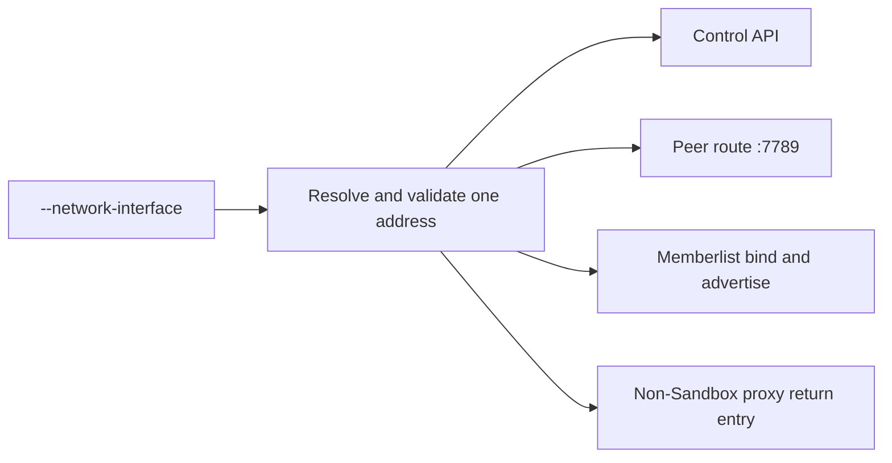
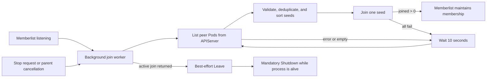

# Sandbox Manager Network Interface Binding and Reliable Peer Discovery

## Summary

Sandbox Manager accepts an optional `--network-interface` flag. When it is set,
one validated global-unicast address from that interface, preferring IPv4 over
IPv6, becomes the process-wide sandbox-cluster address for the control API,
peer route service, memberlist, and the local return entry used by non-Sandbox
proxy requests. When it is empty, the
existing non-hosted network behavior is preserved. A second optional flag,
`--disable-envoy-ext-proc`, skips the Envoy ext-proc gRPC listener on port
`9002` for deployments whose data plane does not consume ext-proc; the peer
route service starts regardless.

Peer discovery lists selector-matching Pods through a live, uncached Kubernetes
client built from the process `rest.Config`. Sandbox Manager and Sandbox Gateway
share that bounded listing contract: namespace and selector are required at
startup, each retry cycle performs at most one List while unjoined, and listing
stops after a successful join. After memberlist begins listening, seed
discovery and joining run in the background with retry. Shutdown stops new
discovery and retries; an active join returns under its network deadlines. One
lifecycle owner runs Leave and Shutdown exactly once. This keeps temporary peer
absence from blocking the control API without creating competing cleanup paths.

## Background

A hosted Sandbox Manager is a Sandbox Manager deployed outside the sandbox
cluster, meaning the cluster that runs sandbox orchestration. That Pod has both
a platform network and a sandbox-cluster network. Endpoints that serve or
advertise sandbox-cluster traffic must consistently use the sandbox-cluster
network; selecting different local addresses can make a process reachable
through one protocol but isolated through another.

Peer Pods also start and stop independently. A one-time Kubernetes list or a
single synchronous join turns ordinary startup ordering into permanent
isolation. Reliable discovery therefore retries a namespace- and
selector-scoped live Pod list until a join succeeds, then hands membership to
memberlist. That retry is independent of API readiness.

## Target Design

### One sandbox-cluster address

`--network-interface` has the following contract:

- An empty value preserves the established non-hosted behavior. The control
  API and peer route service listen on all local addresses. Memberlist uses
  `POD_IP` when present, otherwise the first non-loopback IPv4 address. The
  non-Sandbox proxy return entry remains on loopback.
- A non-empty value is an exact operating-system interface name. The interface
  must exist, be up, and have exactly one global-unicast address in the
  preferred family: IPv4 when the interface has any global-unicast IPv4
  address, otherwise IPv6. Missing, down, addressless, or multiple addresses
  in the preferred family make startup fail. The process never falls back to
  another interface.
- The address is resolved and validated once during startup. Address changes
  take effect after a process restart.
- The same address is used by the control API listener, the peer route listener
  on port `7789`, and memberlist's bind and advertised address. The non-Sandbox
  proxy return entry uses this address as well, so return traffic does not
  silently switch to loopback after the listeners move to the sandbox-cluster
  network.
- Interface selection controls local listeners and advertised peer identity. It
  does not use `SO_BINDTODEVICE`, select outbound routes, or change DNS policy.

The ext-proc listener on port `9002`, pprof, metrics, and other observability
listeners are outside this address contract. Their exposure is a separate
concern; only ext-proc enablement is covered below.

### Optional ext-proc listener

`--disable-envoy-ext-proc` has the following contract:

- The default keeps the established behavior: the Envoy ext-proc gRPC server
  and its gRPC health service listen on port `9002` on all local addresses.
- When set, neither the port `9002` listener nor the gRPC server is created.
  The peer route service on port `7789`, route ingestion, and route
  distribution are unaffected, so the replica still participates in route
  synchronization.
- The flag does not change the ext-proc address or protocol. An Envoy that is
  configured to call ext-proc must not target a replica started with this
  flag; that pairing is a deployment configuration error.
- Both listeners bind synchronously during startup. A bind failure of either
  enabled listener fails startup before the process serves requests.

### Controller-initiated route synchronization

After a successful Sandbox status patch, the controller compares the old and
new `Route.CanRouteTraffic()` values and IP addresses. A change to either
triggers a route update to the receiving memberlist peers. Both projections
use `sandboxroute.RouteFromSandbox`; the outgoing route carries the API server's
returned UID, resourceVersion, and full route attributes, never the pre-write
version. The status merge patch explicitly writes `podInfo.podIP`, including an
empty string, so `omitempty` cannot preserve a stale address. Other PodInfo
fields retain their existing serialization rules.

- Synchronization is best-effort acceleration. Failed patches, NotFound, and
  unchanged status do not send. Projection and delivery errors are logged without
  rolling back status or retrying reconcile for that error. Manager and gateway
  Sandbox informers still provide eventual convergence.
- Delivery runs before `recordSandboxLifecycleCompletions` and
  `recordSandboxMetrics`, so metric locks cannot delay dispatch. The local status
  is updated before invoking the sender; completion accounting retains the old
  status for transition detection.
- Sending remains synchronous to avoid an unbounded background queue or
  detached goroutines. The controller supplies a **200ms total context budget**
  covering parallel fanout, requests, and retry backoff;
  cancellation or an earlier reconcile deadline can shorten it. Network waiting
  adds at most this budget, subject to scheduling, rather than the shared
  sender's approximately 1.1s retry budget. Manager/gateway retry behavior is
  unchanged. During sustained outages, workers may still pay up to 200ms per
  triggered update; this is an explicit trade-off, not non-blocking delivery.
- The controller callback directly delegates to the shared
  `refresh.SyncRouteWithPeers`, which takes the receiving-peer snapshot and skips
  an empty snapshot immediately. No controller-specific success or empty-peer
  logs or rate-limit state are added; delivery errors retain reconciler logging.
- Changes to message or resourceVersion alone do not send. Two different
  nonempty IP addresses do send, even if routability is unchanged. Spec, Ready
  conditions, and pool ownership still determine routability through the shared
  projection; an IP change is an independent trigger.
- The controller joins memberlist as `sc-<node-name>` and participates in TCP/UDP
  gossip, but does not serve `:7789/refresh`. Every member's `GetPeers()` excludes
  the `sc-` prefix; `GetAllMembers()` retains these nodes for membership
  inspection. The controller does not need the manager/gateway seed Pod labels.
- The Alpha FeatureGate `SandboxRouteSync` is disabled by default. With the gate
  disabled, the controller does not resolve the interface or selector, create
  the peer client, or start the peer listener. `--peer-selector` defaults to
  `agents.kruise.io/sandbox-manager-peer-finder=ack-sandbox-manager`; a nonempty
  selector alone cannot enable synchronization, and an explicit empty selector
  disables it. Peer discovery uses the shared namespace `sandbox-system`.
  `--memberlist-bind-port` defaults to 7946; non-positive values use that default,
  and values above 65535 fail enabled startup. A disabled gate skips port
  validation. Custom ports also provide the seed port for Pods without a
  `memberlist-url` annotation and must match receivers. All three components
  share `HOSTNAME -> POD_NAME` lookup; with neither set, manager/controller use
  an eight-character UUID prefix, while gateway retains its startup error.
- `--network-interface` defaults to `eni1` and reuses the manager's address
  resolver. The selected address overrides `POD_IP` for memberlist binding and
  advertising. Enabled startup fails for a missing/down interface, no eligible
  address, or multiple addresses in the preferred family. Explicitly setting
  `--network-interface=` retains `POD_IP -> first non-loopback IPv4` fallback.
  The flag does not control outbound HTTP routing; network routes and security
  groups must still permit connectivity. Selector, interface, and port flags
  remain optional overrides and cannot individually enable synchronization.
  For ACK deployments using plaintext peers, these defaults allow adding only
  `SandboxRouteSync=true` to existing `options.featureGate`, without editing
  Deployment YAML. Encrypted or mTLS-enabled peers require matching explicit
  security configuration. The gate is read through `--feature-gates` at process
  startup and cannot be changed live.
- The controller uses the same peer path as manager/gateway: a separate
  controller-runtime client built from the process `rest.Config` is passed to
  `peers.NewMemberlistPeers` and `peersecurity.Load`. No dedicated Pod/Secret
  informer is added, and the manager's `APIReader` is not used. Filtering in the
  main Sandbox Pod cache does not affect peer discovery. Shared discovery lists
  only selector-matching seed Pods in `sandbox-system`, at most once per retry
  cycle while unjoined, and stops listing after a successful join. Security
  material is retrieved by referenced Secret Get, never by Secret List.
- Manager, gateway, and controller all call the neutral
  `refresh.InitializePeers(ctx, reader, peerManager, inputs)`. It calls
  `peersecurity.Load` once within the shared 30-second startup budget, installs
  the gossip key on the existing memberlist instance, and creates the outbound
  refresh client. No controller-specific inputs or loader, security retry loop,
  or change to manager/gateway receive policy is introduced. All three
  controller flags default to empty strings:
  `--peer-key-secret`, `--peer-tls-server-secret`, and `--peer-tls-client-secret`.
  Empty references are valid. With all three empty, `Load` reads no Secrets,
  memberlist gossip is unencrypted, and refresh uses plaintext HTTP without
  mTLS. This does not disable discovery or route synchronization when the gate
  is enabled. A key reference independently enables gossip encryption; TLS
  requires both server and client references, or neither.
- When explicitly enabling security, reuse the same material as the receiving
  manager/gateway. For example, KDM `v0.6.8-release.*` configures `sandbox-api`
  with these references; they are optional overrides, not controller defaults:
  - `--peer-key-secret=sandbox-system/ack-sandbox-manager-peer-key`
  - `--peer-tls-server-secret=ack-agent-identity/ack-agent-identity-agent-runtime-server-cert`
  - `--peer-tls-client-secret=ack-agent-identity/ack-agent-identity-agent-runtime-sandbox-manager-client-cert`
  Configured references are read through the controller's existing user-cluster
  kubeconfig; the sandbox-api kubeconfig targets the same user cluster. Existing
  ACK controller RBAC allows Secret Get; other deployments must provide the
  corresponding read permissions. The controller does not create Secrets or
  generate an independent key or certificate identity.
- When configured, the shared `Load` validates the 32-byte gossip key and the
  server/client certificate chains, validity periods, usages, and identity
  separation. The server Secret's `ca.crt` verifies client identity; the client
  Secret's `ca.crt` trusts receiving servers. The two may use different CAs.
  Shared initialization installs the key and uses the client TLS configuration
  for outbound refresh. The controller ignores the returned server TLS snapshot
  and serves no refresh requests, but still performs full TLS-pair validation.
  HTTPS retains the fixed SNI `agentruntime.sandbox.agents.kruise.io` and TLS
  >= 1.2. Missing or invalid explicitly configured material never causes a
  fallback to plaintext or skipped certificate verification. Explicitly empty
  references disable the corresponding security capability by configuration.
- Peer security does not depend on the controller's runtime certificate mounts;
  the existing `--runtime-client-cert-dir` behavior is unchanged. Runtime,
  ingress, and OIDC TLS do not replace peer security. Gate-only enablement with
  empty security references requires compatible plaintext receivers and the
  necessary network connectivity, not pre-existing Secrets. When security is
  configured, the referenced Secrets must exist, be readable, and pass shared
  validation. Gossip encryption requires a matching receiver key; mTLS requires
  receivers to accept the existing sandbox-manager client identity. Template
  references do not prove runtime interoperability. The controller gate does
  not trigger KDM key creation.
- Like manager/gateway, setup calls shared initialization before publishing the
  sending callback. Missing, unreadable, or invalid configured Secrets fail
  controller startup; no controller-specific security retry loop or readiness
  wait is added. Empty security inputs succeed without Secret reads. The returned
  `PeerOutbound` remains read-only after publication. The controller
  process entrypoint directly calls the shared `MemberlistPeers.Start` before
  `mgr.Start`, on every replica independently of leader election; no separate
  peer runnable or controller-specific lifecycle wrapper is needed. Shared
  `Start` launches discovery in the background. Seed discovery and join retries
  remain entirely in `MemberlistPeers`; unavailable seeds do not fail startup.
  Until membership is available, the shared `GetPeers()` returns an empty
  snapshot and sending is an immediate no-op.
- Keys and TLS configurations are startup snapshots, without hot rotation or
  support for waiting on late-arriving Secrets during startup. Material changes
  require coordinated restarts; peers with different key generations cannot
  communicate. Unsent updates are not queued for replay; receiving informers
  provide eventual convergence. The process cancellation signal also cancels
  startup Secret reads. Shutdown cancels shared discovery, performs memberlist
  Leave/Shutdown, and closes idle outbound connections.

`SyncRouteWithPeers` and `PeerOutbound` move from `pkg/proxy` into the neutral
`pkg/sandboxroute/refresh` package. Proxy keeps its instance wrapper;
manager/gateway and controller share the sending implementation. The controller
callback only supplies its peer manager and initialized outbound client to
`refresh.SyncRouteWithPeers`. This new dependency closure contains neither
API-layer nor sandbox-manager packages. Existing `sandbox_peers` and
`sandbox_peer_outbound_tls_errors_total` move with the implementation; no new
metric names are introduced, and the controller registers these existing metrics.

Shared initialization accepts an existing `peers.Peers` instance rather than
creating another member owner or starting it. All three owners keep using
`peers.NewMemberlistPeers` with their existing node identity, namespace, and
selector. Manager constructs this instance in `Build` and initializes security
inside `StartTransports`, before `proxy.Run`; gateway constructs it in `Start`
and publishes it after binding its route listener; controller initializes it
before injecting the callback. Manager's existing no-reader/plaintext no-op
and injected peer implementations remain supported; a configured gossip key
requires `MemberlistPeers`. Neither memberlist nor a route listener starts inside
`InitializePeers`.

The returned server TLS config leaves `ClientAuth` to receivers. Manager retains
`RequireAndVerifyClientCert`; gateway retains `VerifyClientCertIfGiven` plus
refresh-handler verification, preserving certificate-free probes. Proxy's
`SetPeerOutbound` accepts the already initialized client, closes idle connections
on its previous client, and does not reconstruct a transport. Its existing
plaintext default remains available to standalone callers before initialization.
Controller does not start a receive listener.

Neither `POD_NAME` nor `POD_IP` requires a new configuration entry. Dual-interface
deployments use `eni1` by default; other interface names need an override. Allow
bidirectional controller/peer TCP/UDP 7946 and controller-to-receiver TCP 7789.
Update receivers' `sc-` filtering before enabling the gate: older receivers
mistake the controller for a refresh target. `config/manager/manager.yaml`
provides commented gate/override examples only; it does not enable the feature,
add a controller refresh Service, or change probes.

Retained controller status tests cover routability changes in both directions,
Ready/IP/phase combinations, nonempty IP changes, unchanged routability,
sending failures and deadlines, failed/NotFound patches, and returned
resourceVersion. Shared peer tests cover node naming, sender-only member
filtering, scoped discovery, and the non-blocking start/stop lifecycle. Shared
security tests cover empty inputs, canceled loading, Secret references, key
validation, invalid/expired certificates, and independent-CA trust verification.
Refresh tests cover common initialization's empty inputs, bounded Secret reads,
cancellation, fail-fast errors without retries, and real encrypted joins with
matching, mismatched, or absent receiver keys. They retain real mTLS and rejection
of missing client identity, wrong server names, and untrusted servers. Manager
tests retain the builder's member instance and startup order; gateway tests
check receive policy and publication of the same initialized member and outbound;
proxy tests check that installing the client preserves its identity. Tests
coupled to the removed controller wrapper are removed with that layer; they do
not validate the new entrypoint wiring. This describes retained coverage, not a
passing validation result: tests, builds, and lint were not run in this round,
and the previous status test remains paused. Ordinary validation does not
deploy a cluster or run E2E tests.

### Bounded peer listing

The Sandbox Manager builder constructs an uncached controller-runtime client
from the same `rest.Config` already supplied to the process. It does not add a
Pod informer to the shared sandbox cache, and it does not list through
`APIReader`. Peer code receives that client as a reader; it does not import or
read the cache, and it does not read through Infra.

Listing is restricted by both of these required inputs:

- a non-empty system namespace; and
- a non-empty, syntactically valid peer label selector.

Invalid or absent scope is a startup error rather than an unfiltered Pod list.
Sandbox Manager also requires a non-nil `rest.Config` so assembly can build the
live client.

Sandbox Manager and Sandbox Gateway share this listing contract. Gateway builds
the same kind of live client from in-cluster configuration. While unjoined,
each retry cycle performs at most one live Pod list and stops listing after a
successful join. API availability therefore affects peer convergence, not
control-API or Gateway readiness.

### Trusted seed addresses

Each listed, selector-matching Pod can contribute at most one seed:

- Without a `memberlist-url` annotation, the seed is the Pod's `status.podIP`
  plus the configured memberlist port. IPv4 and IPv6 PodIPs are both eligible;
  IPv6 seeds use the bracketed host:port form.
- With the annotation, its host must be the same valid IP as
  `status.podIP`; only the port may differ. An annotation cannot redirect peer
  traffic to another Pod, tenant, or external address.
- Pods with an empty or invalid PodIP, invalid annotated address, the local
  memberlist address, or a duplicate address are excluded.
- Pods in the terminal `Succeeded` or `Failed` phase are excluded: no container
  remains to accept memberlist traffic, so each would only cost a dial timeout
  per retry cycle.

**Warning:** A Sandbox Manager started with `--network-interface` must not be a
memberlist seed. Seed addresses are always derived from `status.podIP`, which
can differ from the selected interface address that memberlist actually binds
and advertises. If the peer selector matches that Manager Pod, other members
join `status.podIP` and never reach the listener. The peer selector must not
select those Pods.

This constraint belongs to the deployment that owns the peer selector. Sandbox
Manager deliberately adds no in-process guard: the process knows only its own
flag value and bound address, while the unreachable join happens in other
members, so a local check could pass while the topology stays wrong. A
misconfigured selector therefore keeps this process starting normally and
surfaces as the affected members repeatedly logging join failures against the
hosted Manager's PodIP. Correcting it is an orchestration change to the peer
selector, not a code change.

Those Managers still join memberlist by contacting a seed that listens on its
PodIP, typically a Sandbox Gateway or a Sandbox Manager started without
`--network-interface`. After a successful join, gossip advertises the selected
interface address, so later members discover the hosted Manager that way
rather than through Kubernetes seed listing.

The Kubernetes seed set is therefore only the selector-matching Pods that
listen on `status.podIP`. Sandbox Gateway and non-hosted Sandbox Manager
replicas remain valid seeds. Hosted Managers may appear in memberlist
membership after they join, but they are not seed sources. The local member is
excluded. A Kubernetes Service and its mirrored or selected backends are
routing objects, not peer membership or seed sources.

Pod readiness and non-terminal phases do not filter the seed set. They are not
reliable membership signals: a newly starting peer may already accept
memberlist traffic, while memberlist itself owns ongoing liveness after a join.

Seeds are sorted into a stable order, and every seed is joined, one Join call
per seed, without stopping at the first success. Per-seed calls keep each
failure attributable, because a bulk Join discards errors once any seed
succeeds, and honor cancellation between dials.

### Non-blocking join lifecycle

The peer route listener on port `7789` starts before memberlist begins
listening, so a replica never advertises itself to peers before it can accept
their route refreshes. Memberlist then begins listening before seed discovery
starts, and Sandbox Manager runs the following lifecycle in the background:

1. List eligible peer Pods from the API server and derive trusted seed
   addresses.
2. Join every seed in stable order, one Join call per seed, without stopping
   at the first success.
3. Stop discovery after a cycle in which any join reports `joined > 0`.
4. If the list fails, no seeds exist, or every join fails, wait 10 seconds
   after the attempt finishes and retry.

Joining is not a readiness condition and does not delay control API startup. A
replica may temporarily operate as a single member; successful joining hands
ongoing membership changes to memberlist, so periodic Kubernetes rediscovery is
unnecessary. A replica whose selector never yields a seed, such as a
single-replica deployment, keeps listing once per retry interval for the life
of the process; the empty seed set is logged at the default verbosity on the
first cycle and at verbosity 2 afterwards, while list failures are logged as
errors on every cycle.

Kubernetes listing and the 10-second retry wait stop immediately when the peer
lifecycle context is canceled. Memberlist's join API has no context parameter,
so an already-started join returns under memberlist's existing network
deadlines rather than being interrupted by cancellation. Its default connection
and stream deadlines are each 10 seconds, and a complete push/pull can cross
more than one deadline window. No new join or retry starts after cancellation.

Known limit: there is no single 10-second upper bound for a complete in-flight
join. If shutdown must interrupt that work immediately or enforce one overall
deadline, the upgrade path is a context-aware memberlist transport that
preserves memberlist's dynamic-port and cleanup semantics. That transport is
not part of this proposal.

### Startup and shutdown boundary

Startup fails before serving requests when the selected interface, resolved
address, namespace, selector, peer client, control API listener,
peer route listener, or memberlist listener is invalid. The initial seed set
and join result are deliberately not startup requirements. This startup and
shutdown contract applies to the Sandbox Manager process. Sandbox Gateway
process lifecycle is outside this proposal.

Each peer instance establishes one lifecycle owner when memberlist starts. That
owner remains until cleanup finishes, including after seed discovery succeeds.
An explicit stop request or parent-context cancellation cancels the peer
lifecycle context; the owner then runs Leave and Shutdown exactly once. The
peer's Start is called exactly once and its Stop at most once, after Start has
returned, by the component that owns it; a second Start is rejected, and
concurrent or repeated Stop calls are outside the contract. A caller's wait
deadline does not transfer cleanup ownership or create a competing close path:
when Stop returns because its context expired, the owner still completes Leave
and Shutdown. Stop on a peer whose Start never succeeded is a no-op, so a
component can run its shutdown sequence after a failed Start without special
cases.

Sandbox cache synchronization completes before the process serves requests. A
termination signal that arrives while startup is still running follows the
crash model described below rather than the graceful Stop path: the process
exits immediately without waiting for startup to finish and without
per-component cleanup, so memberlist Leave and primary lease release are
skipped. Other members remove the stale entry through failure detection and
the lease expires through its TTL; both self-heal without operator action. A
signal that arrives once startup has completed, including one observed
together with the completion, runs the graceful Stop path. Running the
graceful chain for an interrupted startup is the upgrade path if graceful
cleanup during startup ever becomes a requirement.

The lifecycle owner prevents new discovery work, allows an in-flight join to
return under the network-deadline boundary described above, and then attempts
`Leave` before `Shutdown`. `Leave` is best effort and has a five-second limit;
its failure is reported but never prevents `Shutdown` while the process remains
alive. No code path calls `Leave` after `Shutdown`, and the join worker never
races a separate stop caller for ownership of memberlist cleanup.

If the process is forcibly terminated before the active join returns or the
leave message is delivered, other members temporarily retain a stale active
member and remove it through memberlist's normal failure detection. This is the
same cluster-level failure model as a process crash, OOM, node loss, or network
partition. Peer membership is not a quorum or authorization source. A stale
peer may add only bounded per-peer fanout delay or error: it must not roll back
local route state, change the outcome of an authoritative Sandbox mutation, or
prevent parallel synchronization to other live peers.

Failure detection removes an unreachable member from the surviving members'
view. It does not promise that two isolated memberlist partitions will merge
again without an external seed after connectivity returns; successful seed
discovery intentionally stops its Kubernetes retry loop.

### Compatibility and ownership

The original Manager address design adds two optional CLI flags,
`--network-interface` and `--disable-envoy-ext-proc`. The controller extension
also adds the optional peer-security overrides described above. Neither changes
CRDs, HTTP models, Secret schemas, or the memberlist wire protocol. Both
in-cluster configuration and `KUBECONFIG` continue to supply the sandbox-cluster
Kubernetes client.

Process peer discovery and peer lifecycle belong to the Manager layer because
they coordinate Sandbox Manager processes rather than implement a Sandbox
backend. Interface address resolution is a policy-neutral helper in
`pkg/utils/network`. Command entrypoints only accept the flags, resolve the
interface address once, and assemble these capabilities; the Manager builder
constructs the live peer client from the supplied `rest.Config`. API protocol
behavior and Infra backend behavior remain unchanged.

Sandbox Gateway now requires non-empty `PEER_NAMESPACE` and
`PEER_LABEL_SELECTOR`; an empty value fails peer startup instead of listing
Pods across all namespaces. The reference manifest under
`config/sandbox-gateway` already sets both. Self-authored Gateway manifests
must set them before upgrading, and the release notes for the first release
containing this change must call this out.

The following are outside the original Manager address design:

- changes to memberlist encryption and peer-route mTLS policy; the controller
  extension above reuses the existing security implementation and materials;
- changing the address or port of the `9002` ext-proc listener;
- metrics, pprof, or observability listener isolation;
- Deployment, RBAC, KDM, or rollout configuration;
- Sandbox Gateway process lifecycle, including SIGTERM handling and peer-route
  listener bind sequencing;
- an informer refactor for Sandbox Gateway;
- address hot reload or periodic seed reconciliation.

No RBAC change is required for Sandbox Manager: its existing Pod permissions
already include `get`, `list`, and `watch`. Peer discovery treats listed Pods as
read-only objects and never mutates them.

Deployment changes remain outside this proposal, but hosted activation depends
on them. Kubernetes TCP probes without an explicit host target the Pod IP; when
the control API and peer route bind only to a different sandbox-cluster
address, those probes cannot reach the listeners and can restart the Pod.
Hosted rollout configuration must make the `8080` and `7789` probes reach the
selected sandbox-cluster address before enabling `--network-interface`.

Hosted activation also depends on seed topology. The peer selector must not
match Sandbox Manager Pods started with `--network-interface`. At least one
PodIP-reachable seed must remain in that selector, and the selected interface
must be able to reach that seed's memberlist address. New hosted replicas
cannot join if every such seed is gone, because Kubernetes listing stops after
the first successful join.

## Risks

- Live Pod listing during retry depends on APIServer availability. Namespace and
  label filtering bound each list to the peer Pods for one Sandbox Manager
  scope, and listing stops after the first successful join. A replica that
  never finds a seed keeps issuing one bounded list per retry interval.
- A canceled process can remain in a memberlist join across multiple 10-second
  network-deadline windows. An immediate-cancellation requirement has a defined
  transport-based upgrade path.
- Forced termination, or a termination signal during startup, can skip Leave
  and temporarily retain a stale member. Memberlist failure detection removes
  it; the stale entry may add bounded per-peer fanout failure but cannot change
  authoritative Sandbox state. A primary lease acquired during startup is held
  until its TTL expires.
- An interface address can change while the process is running. Resolving once
  avoids split listener identity; operational recovery is a restart.
- The API may become ready while the replica is still a single member. This is
  intentional: background retry repairs startup races without making peer
  availability a control-plane availability dependency.
- A hosted Manager whose Pod is still selected as a seed will advertise one
  address and be joined at another. Peer selector configuration must exclude
  those Pods.
- After the first successful join, a new hosted replica cannot join unless a
  PodIP-reachable seed is still available.

## Alternatives

- A shared Pod informer on the sandbox cache is rejected because seed discovery
  lists a handful of process Pods until join succeeds, then stops. A
  process-lifetime watch expands cache filters, startup registration, and tests,
  and makes memberlist wait on informer sync.
- Listing through the manager `APIReader` is rejected. That reader is the
  cache-bypass Get fallback, not a substitute for informers. Assembly constructs
  a dedicated uncached client from `rest.Config`, matching Gateway.
- Picking the first address from a multi-address interface is rejected because
  address ordering is not a stable network identity.
- Trusting an arbitrary `memberlist-url` host is rejected because Pod metadata
  must not redirect peer traffic outside the selected Pod identity.
- Publishing the selected interface address as a Kubernetes seed is rejected.
  Hosted Managers join through a PodIP-reachable seed and then rely on
  memberlist gossip; the peer selector must not list them as seeds.
- A custom cancellable memberlist transport is deferred because this scope
  accepts memberlist's existing network-deadline behavior, and a correct
  transport must preserve more than dialing alone.
- Continuous Kubernetes seed reconciliation after a successful join is
  rejected because memberlist already owns membership convergence.
