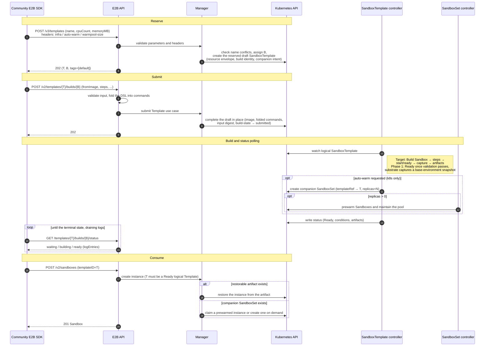

# Sandbox Template Build and E2B Compatibility

## Table of Contents

- [Glossary](#glossary)
- [Summary](#summary)
- [Motivation](#motivation)
  - [Goals](#goals)
  - [Non-Goals/Future Work](#non-goalsfuture-work)
- [Proposal](#proposal)
  - [User Stories](#user-stories)
  - [Architecture Overview](#architecture-overview)
  - [Resource Model](#resource-model)
  - [Interface Design](#interface-design)
  - [Build and Consumption](#build-and-consumption)
  - [Implementation Details](#implementation-details)
  - [Phased Delivery](#phased-delivery)
  - [Security and Isolation](#security-and-isolation)
  - [Risks and Mitigations](#risks-and-mitigations)
- [Alternatives](#alternatives)
- [Upgrade Strategy](#upgrade-strategy)
- [Test Plan](#test-plan)
- [Implementation History](#implementation-history)
- [References](#references)

## Glossary

- **Logical Template**: a user-named environment template, persisted as a SandboxTemplate created through one of the build entries. Its name is written as T below; T is also the public templateID.
- **Build**: the single build of a logical Template, identified by a server-assigned UUID written as B below.
- **backend**: the backend that runs the build and holds the artifact, either `k8s` or `substrate`; the default is `k8s`. The wire value `k8s` maps to the internal sandboxcr backend type.
- **Build artifact**: a reference to the restorable snapshot captured by the build. It is a Checkpoint on the k8s backend and an ActorTemplate referencing a Golden Snapshot on the substrate backend.
- **Build Sandbox**: the temporary execution environment that runs provisioning and captures the artifact during a build.
- **Name binding**: the reserved draft SandboxTemplate created for T/B in the E2B reserve phase. It carries the build identity (B, input digest, build state), the reserved resource envelope, and the companion intent, and is completed in place by the submit phase; the state transitions among reserved, submitted, expired, and deleted are atomic.
- **Companion SandboxSet**: a same-named SandboxSet owned by the logical Template that references T through `templateRef`, created when auto-warm is requested, so that the template can be consumed through the existing instance-creation and pooling paths.

## Summary

This proposal introduces user-named logical Templates. Users submit a complete PodTemplate through the custom Template API, or describe a single-container environment with the Template DSL of the community E2B SDK. Both inputs are converted into an immutable SandboxTemplate of the same shape. A new SandboxTemplate controller runs provisioning in a temporary execution environment and captures a checkpoint/snapshot artifact within the declared scope. Later instances are restored from the artifact without repeating initialization steps such as dependency installation.

The proposal defines the compatibility scope of the E2B Template protocol, covering reserve, submit, status query, existence query, details, and deletion; unsupported capabilities are rejected by contract. Callers can request auto-warming through private headers: when the build succeeds, a companion SandboxSet that references T through `templateRef` is created, connecting the template to the existing E2B instance-creation and pooling paths.

Build execution is delivered in phases. Phase 1 fully accepts and persists build inputs and creates consumable templates without executing build commands; command execution, artifact capture, and runtime-state capture land in later phases. See [Phased Delivery](#phased-delivery).

## Motivation

SandboxTemplate currently serves as a workload template, with fields for the PodTemplate, persistent contents, runtimes, pause strategy, and probes. SandboxSet generates a subordinate SandboxTemplate for each workload revision, and the checkpoint path also generates a same-named template owned by the Checkpoint. These resources serve the existing materialization and restore flows. SandboxTemplate has no backend, build options, or build status, and there is no dedicated build controller, so users cannot directly define and build an environment template.

On the E2B side, the existing routes provide template listing, details, and deletion: listing and details project SandboxSets, deletion has checkpoint semantics, and there is no reserve, submit, or status protocol, so `Template.build()` of the community SDK cannot be used. Instance creation resolves a templateID only to a SandboxSet (claim) or a Checkpoint (clone). The Python SDK only provides an E2B compatibility patch and has no standalone Template resource SDK.

Users need to build an environment once declaratively, persist initialization results such as installed dependencies as a restorable artifact, and create instances quickly from that artifact, while continuing to use the community E2B SDK for both building and instance creation.

### Goals

- Introduce logical Templates and their single Build: user-named, namespace-isolated, with a spec that is immutable after acceptance; both entries share identity, status, and artifacts.
- Provide a custom Template API and a Python SDK that express a complete PodTemplate, build options, and provisioning commands.
- Stay compatible with the Template build flow of the community E2B SDK 2.56.0, accepting the DSL according to the capability mapping and rejecting unsupported capabilities by contract.
- Produce restorable artifacts with a runtime-environment build: start a temporary execution environment from the base image, run provisioning, and capture a checkpoint/snapshot.
- Connect logical Templates to the existing instance-creation and pooling paths through the companion SandboxSet.
- Complete cleanup synchronously on deletion, leaving no tasks, artifacts, name bindings, or companion resources behind.

### Non-Goals/Future Work

- Building or publishing new OCI images.
- File upload and COPY, E2B private registry credentials, and `minFreeDiskMb`.
- Same-name rebuilds, build history, rollback, and historical build selection; tag query, assignment, and removal will be designed together with multiple Builds.
- Listing logical Templates, and E2B public updates.
- New pooling or scaling policies, or a new instance lifecycle API; the companion SandboxSet reuses the existing SandboxSet semantics.
- Backend registration and routing. This proposal defines `spec.backend` and its selection contract; backend capabilities are provided by the platform deployment.
- Storage selection for name bindings, build logs, and task progress. This document defines only the persistence, recovery, and cleanup requirements.
- Business start commands (startCommand/readyCommand) and a delayed-start policy for the custom entry, to be designed together with runtime-state capture.

## Proposal

This section describes the target design. The scope of Phase 1 and its differences from the target design are collected in [Phased Delivery](#phased-delivery).

### User Stories

#### Story 1: Build a template with the community E2B SDK

A developer specifies a base image and dependency installation commands with the E2B DSL and calls `Template.build()` to build a template named `python-agent`. After the build completes, `Sandbox.create("python-agent")` of the community SDK creates instances directly. The instances keep the dependencies installed during the build and do not reinstall them at startup.

#### Story 2: Define a prewarmed environment with a complete PodTemplate

A platform team's workload has multiple containers, volumes, and a custom runtime, which the E2B DSL cannot express. The team submits a complete PodTemplate through the Kruise SDK without build capture, requests auto-warming with a warm-pool size, and claims instances from the prewarmed pool.

#### Story 3: Choose the substrate backend

A user wants instances to start from snapshots and selects the substrate backend at build time. The build artifact is an ActorTemplate, instances are restored from the snapshot by the substrate backend, and the calling protocol is the same as with the default backend.

### Architecture Overview

The custom Template API accepts a complete workload and build options, and the E2B Template API accepts the community DSL. After protocol conversion, the API layer calls the same set of Template use cases in the Manager, producing an immutable SandboxTemplate of the same shape. The SandboxTemplate controller completes the build from the persisted neutral input and is unaware of which protocol the caller used.

```text
Kruise SDK                                  Community E2B SDK
    │                                              │
    ▼                                              ▼
Custom Template API                         E2B Template API
full PodTemplate + options + backend        reserve → submit → status
    │                                              │
    └─────────────────┬────────────────────────────┘
                      ▼
       Manager: Template use cases and name binding
                      │
                      ▼
     SandboxTemplate (workload + build input, immutable)
                      │
                      ▼
            SandboxTemplate controller
   Build Sandbox → provisioning → capture artifact
   status: phase / conditions / artifacts
                      │
            ┌─────────┴───────────┐
            ▼                     ▼
  restore from artifact    companion SandboxSet (optional)
                           existing claim and pooling paths
```

The two entries are registered as independent route groups on separate ports and do not call each other over HTTP. The API layer handles authentication, protocol validation, and response conversion; the Manager provides protocol-neutral Template use cases; the SandboxTemplate controller is an independent operator whose dependency closure does not include the API or Manager packages.

backend takes the value `k8s` or `substrate` and defaults to `k8s`; the custom request body, the SDK enum, the E2B header, and `spec.backend` use the same values. The wire value `k8s` maps to the internal sandboxcr backend type. The k8s artifact is a Checkpoint, and its Build Sandbox and capture flow are finalized in the build-execution phase. substrate runs provisioning in a temporary execution environment, captures a Golden Snapshot, and references the artifact through an ActorTemplate. Each backend validates at admission whether it can faithfully materialize the workload and capture the declared contents: unsupported fields return 400 with the field path, a backend that the platform has not configured returns 501, and a configured but temporarily unavailable backend returns 503.

### Resource Model

#### Template and Build Identity

A logical Template is a user-named resource within a namespace, and `SandboxTemplate.metadata.name` is the public templateID T. B is the SandboxTemplate's `metadata.uid`: one Build corresponds to exactly one CR lifecycle, so the CR's native identity is the Build identity. B is assigned by the apiserver when the reservation creates the draft CR and is returned to the caller by both entries — the E2B entry at reservation and the custom entry at creation. No separate buildID field is generated or stored: the same logical resource returns the same T/B regardless of the entry used to query it, and deleting and recreating a template yields a new UID, which is a new B and never reuses old tasks or artifacts. This also leaves the multi-Build extension open: if build history ever lands, each Build becomes its own CR instance and its UID remains that Build's identifier, so the identity scheme does not change.

The entire spec of a logical Template is immutable after acceptance, including backend; an omitted backend is materialized as k8s at creation. B lives in `metadata.uid`, outside spec, and never changes. Recreating a template with the same name after deletion yields a new UID and a new B, and never reuses old tasks or artifacts.

The name is also a resource isolation boundary. Creation or reservation rejects names that collide with a SandboxSet, Checkpoint, or SandboxTemplate in the same namespace; the companion SandboxSet does not count as a conflict. The name `tags` overlaps with the path of the community tag routes (see [Interface Inventory](#interface-inventory)) and is reserved, returning 400. When external writes create a same-name collision after acceptance, queries and consumption return 409 instead of selecting a resource by implicit priority.

#### API Changes

SandboxTemplate keeps its existing workload and runtime fields and adds the following fields:

```go
type SandboxTemplateSpec struct {
    // ... existing fields unchanged ...
    Backend      string                       `json:"backend,omitempty"`
    BuildOptions *SandboxTemplateBuildOptions `json:"buildOptions,omitempty"`
}

type SandboxTemplateBuildOptions struct {
    FromTemplate      string                 `json:"fromTemplate,omitempty"`
    Steps             []TemplateBuildCommand `json:"steps,omitempty"`
    StartCommand      *TemplateBuildCommand  `json:"startCommand,omitempty"`
    ReadyCommand      *TemplateBuildCommand  `json:"readyCommand,omitempty"`
}

type TemplateBuildCommand struct {
    Command string            `json:"command"`
    User    string            `json:"user,omitempty"`
    Cwd     string            `json:"cwd,omitempty"`
    Env     map[string]string `json:"env,omitempty"`
}
```

B is not a request parameter and is not stored as a spec field: it is the CR's `metadata.uid`, assigned by the apiserver at creation and surfaced to the caller by the API layer. A SandboxTemplate created through a build entry is a logical Template; admission validation keeps its spec immutable, and existing subordinate templates are not affected.

fromTemplate, when set, names an existing logical Template as the base of the build: the base's accepted workload is copied at submission, and build execution restores the Build Sandbox from the base's artifact (see [E2B Capability Mapping](#e2b-capability-mapping)).

steps is the provisioning command sequence. Each command carries its own execution identity, working directory, and environment variables, which matches how the platform runs run_code: envd's ProcessConfig carries the command, directory, and environment, and the runtime resolves the executing user inside the container from the identity header. The controller executes the commands one by one without maintaining implicit context across them; each command runs in its own shell, so `cd` and `export` do not persist across commands. startCommand and readyCommand use the same command model and run after provisioning and before capture (see [Build Execution and Capture](#build-execution-and-capture)).

The command fields are validated as follows:

| Field | Rule |
| --- | --- |
| command | Required; a non-empty single shell string. The SDK joins list-form commands with `&&` before submission. |
| user | Optional; when empty, the default identity of the container and runtime is used. User names are resolved inside the container and are not Kubernetes UIDs. |
| cwd | Optional; when empty, the default directory is used; when set, it must be an absolute path inside the container. |
| env | Optional; the complete environment of the command, with string values. It is not written to the permanent Pod env and does not become the default environment of processes started after restore. |

A startCommand or readyCommand that is present with an empty command returns 400. steps, startCommand, and readyCommand all require checkpoint to be true, since the build result could not be kept otherwise; requests that violate this return 400. The checkpoint and image_acceleration options themselves are deferred: neither is persisted on the CR nor accepted by the entries until build execution lands, and the steps-require-checkpoint rule takes effect together with them (see [Phased Delivery](#phased-delivery)).

#### Build Status and Artifacts

The build status is written by the controller through the status subresource, and the API only reads and projects it. SandboxTemplate gains a Status field:

```go
type SandboxTemplate struct {
    metav1.TypeMeta
    metav1.ObjectMeta
    Spec   SandboxTemplateSpec   `json:"spec"`
    Status SandboxTemplateStatus `json:"status,omitempty"`
}

type SandboxTemplateStatus struct {
    ObservedGeneration int64                     `json:"observedGeneration,omitempty"`
    Phase              SandboxTemplateBuildPhase `json:"phase,omitempty"`
    Artifacts          []SandboxTemplateArtifact `json:"artifacts,omitempty"`
    Conditions         []metav1.Condition        `json:"conditions,omitempty"`
}

type SandboxTemplateArtifact struct {
    Type string `json:"type"`
    Name string `json:"name"`
}
```

phase takes one of four values:

```text
Pending ──▶ Building ──▶ Ready
   │            │
   └────────────┴────▶ Failed
```

| phase | Meaning |
| --- | --- |
| Pending | The spec is accepted and build execution has not started. Before the controller writes status, the API also projects Pending. |
| Building | Build execution is in progress: preparing the Build Sandbox, running provisioning and start/ready, and capturing the artifact. |
| Ready | All declared work is complete and the requested companion SandboxSet has been created; the template can be consumed. |
| Failed | Terminal failure. There is no interface to modify the input or restart this Build. |

A template with checkpoint set to false needs no build execution: once validation passes, image acceleration completes, and the requested companion SandboxSet is created, it moves directly from Pending to Ready with no artifact. A template with checkpoint set to true enters Ready only after producing a restorable artifact that satisfies the scope declared in `spec.persistentContents`. The reason, message, and lastTransitionTime of the conditions provide a machine-readable reason, a redacted message, and the transition time; observedGeneration is the spec generation processed by the controller.

artifacts holds immutable artifact references, at most one per type: the k8s backend uses `checkpoint`, whose name is the backend-generated Checkpoint name; substrate uses `actorTemplate`, whose name points to the ActorTemplate that contains this build's snapshot. No image artifact type is introduced.

```yaml
status:
  phase: Ready
  artifacts:
    - type: checkpoint
      name: <backend-generated Checkpoint name>
```

The artifact type only describes the form of the reference; the capture scope is still declared by the spec. A snapshot identifier must not be written into a container image, and the artifact type alone does not imply that memory was captured.

### Interface Design

#### Build Result and SDK Conventions

The Build results of both SDKs share the same core fields:

```text
BuildInfo
  template_id
  build_id
  name
  alias
  tags
```

name and the compatibility field alias both take the name passed to the SDK call, and tags is always `["default"]`. BuildInfo does not include status, logs, or artifacts; build status and resource details are queried separately.

The community E2B SDK keeps its existing behavior: `Template.build()` returns BuildInfo after the build completes, `build_in_background()` returns BuildInfo right after submission, and `get_build_status(build_info)` returns a separate build status object. The Kruise SDK also creates templates with `Template.build()` and offers a `wait_until_ready()` convenience method on the returned BuildInfo, which polls resource details without adding serialized fields. Every poll checks T/B; when the resource no longer exists or B has changed, polling stops and reports that the original build identity is no longer valid, instead of following a new Build of the same name. `Template.get(name)` returns resource details such as T/B, spec, options, backend, status, and artifacts.

#### Custom Template API

The custom entry expresses a complete PodTemplate. The SDK's SandboxTemplateSpec flattens the PodTemplate metadata, the complete PodSpec, and the Sandbox-level fields (volumeClaimTemplates, persistentContents, runtimes, pauseStrategy, probes, and autoPausePolicy) without nesting a pod_template. On persistence, the PodTemplate part is written to `spec.template` and the other fields to the same-named SandboxTemplate fields. The PodTemplate models are generated from a pinned version of the Kubernetes OpenAPI schema rather than maintained by hand as a subset of container, volume, or security fields.

The following example uses the proposed `openkruise_agents` package:

```python
from openkruise_agents import Template
from openkruise_agents.models import (
    Container,
    ResourceRequirements,
    RuntimeConfig,
    SandboxTemplateSpec,
    TemplateBuildCommand,
    TemplateBuildOptions,
)

build = Template.build(
    name="code-interpreter",
    spec=SandboxTemplateSpec(
        containers=[Container(
            name="runtime",
            image="example/code-interpreter@sha256:<digest>",
            command=["/usr/local/bin/start"],
            resources=ResourceRequirements(
                requests={"cpu": "1", "memory": "2Gi"},
            ),
        )],
        runtimes=[RuntimeConfig(name="agent-runtime")],
        persistent_contents=["filesystem"],
    ),
    options=TemplateBuildOptions(
        steps=[TemplateBuildCommand(
            command="python -m pip install numpy",
            user="root",
        )],
    ),
    api_headers={
        "x-e2b-kruise-auto-warm": "true",
        "x-e2b-kruise-warmpool-size": "2",
    },
)
build.wait_until_ready(timeout=300)
```

The backend parameter takes the same values as the wire format; it defaults to k8s, and `backend=TemplateBackend.SUBSTRATE` selects substrate. api_headers is a passthrough parameter: auto-warming is requested through private headers in it, with the same semantics as on the E2B entry (see [Companion SandboxSet](#companion-sandboxset)), so new private headers require no new SDK fields. The custom entry accepts only these two private headers and selects the backend from the request body; any other header with the `x-e2b-kruise-` prefix, including `x-e2b-kruise-infra`, returns 400.

The build options determine the work of the Build:

| Option | Semantics |
| --- | --- |
| checkpoint | Defaults to false. When true, a restorable artifact is captured within the scope declared in `spec.persistentContents`; an empty persistentContents, or a scope that the backend cannot fully capture and restore, returns 400. |
| image_acceleration | Defaults to false. Enables platform image acceleration without prescribing a caching, distribution, or pre-pull mechanism; the template does not enter Ready until the required images are prepared, and no new image is produced. |
| steps | The provisioning command sequence, using the same model as the E2B conversion result; each command carries its own user/cwd/env. Requires checkpoint to be true. |

checkpoint and image_acceleration are deferred with build execution: requests carrying them return 400 until then.

The custom entry does not expose startCommand or readyCommand yet, and requests that carry them return 400; whether to expose them, together with a delayed-start policy, will be designed with runtime-state capture. The execution container of steps in multi-container workloads is finalized together with build execution.

The custom HTTP API follows the E2B path style and adds no extra prefix. It is not a Kubernetes API proxy: the namespace is derived from the API key, and requests cannot specify another namespace. The routes resolve only logical Templates and never fall back to existing resources such as SandboxSets. The route group is registered on a dedicated port, separate from the E2B listener; the port, not a path prefix, isolates the two entries.

| Method | Path | Response |
| --- | --- | --- |
| POST | `/templates` | 201 with resource details, from which the SDK extracts BuildInfo. A repeated request with the same name and the same input (including private headers) returns 200 with the existing resource; a different input returns 409. |
| GET | `/templates/{name}` | 200 with the same detail structure as POST; supports logsOffset to return build logs incrementally. |
| DELETE | `/templates/{name}` | 204 after synchronous cleanup completes; see [Synchronous Deletion](#synchronous-deletion). |

Create request and response:

```text
POST /templates
X-API-Key: <API key>
x-e2b-kruise-auto-warm: true
x-e2b-kruise-warmpool-size: 2

{
  "name": "python-agent",
  "backend": "k8s",
  "spec": {
    "containers": [
      {"name": "runtime", "image": "python:3.12-slim"}
    ],
    "persistentContents": ["filesystem"]
  },
  "options": {
    "steps": [{"command": "python -m pip install numpy", "user": "root"}]
  }
}

→ 201
{
  "templateID": "python-agent",
  "buildID": "<B>",
  "name": "python-agent",
  "alias": "python-agent",
  "tags": ["default"],
  "backend": "k8s",
  "spec": {
    "containers": [
      {"name": "runtime", "image": "python:3.12-slim"}
    ],
    "persistentContents": ["filesystem"]
  },
  "options": {
    "steps": [{"command": "python -m pip install numpy", "user": "root"}]
  },
  "status": {"phase": "Pending"},
  "logs": [],
  "logEntries": []
}
```

spec is the complete projection of the original workload. Build logs use the same stable entry index as the E2B status interface, so SDK waiting and log callbacks do not replay entries that were already read.

#### E2B Template API

The E2B entry serves the community single-container DSL, using only methods and parameters that already exist in the community Python SDK 2.56.0:

```python
from e2b import Template

recipe = (
    Template()
    .from_image("python:3.12-slim")
    .run_cmd("python -m pip install numpy", user="root")
)

build = Template.build(
    recipe,
    "python-agent",
    cpu_count=1,
    memory_mb=1024,
    api_headers={
        "x-e2b-kruise-infra": "k8s",
        "x-e2b-kruise-auto-warm": "true",
        "x-e2b-kruise-warmpool-size": "2",
    },
)
```

The call returns after provisioning and artifact capture complete; restored instances keep the installed numpy and do not rerun the installation command. A filesystem build does not keep background processes started by RUN alive; start/ready is used when business runtime state must be preserved (see [E2B Capability Mapping](#e2b-capability-mapping)).

The E2B entry uses the platform's default envd runtime; its builds always carry checkpoint semantics, and the persisted checkpoint and image_acceleration options land together with build execution. A complete workload and an explicit capture scope are expressed through the custom entry. `from_dockerfile` is parsed inside the SDK into fromImage, steps, and optional startCmd/readyCmd before submission. The server does not parse Dockerfiles and accepts the subset described in the capability mapping.

api_headers is a native passthrough parameter of the community SDK, and X-API-Key is native authentication. The reserve, submit, and status routes interpret only the following private headers; any other header with the `x-e2b-kruise-` prefix returns 400, and all other headers are not interpreted as build options:

| Header | Values | Semantics |
| --- | --- | --- |
| `x-e2b-kruise-infra` | `k8s`, `substrate` | Selects the backend and is written to `spec.backend`; defaults to k8s. The value k8s maps to the internal sandboxcr backend type. Empty, unknown, and repeated values return 400; a valid backend that the platform has not configured returns 501. |
| `x-e2b-kruise-auto-warm` | `true`, `false` | When true, auto-warming is enabled: a companion SandboxSet is created after the build succeeds and maintains prewarmed instances; when omitted or false, none is created; other values return 400. Applies only to the k8s backend; combining it with substrate returns 400. |
| `x-e2b-kruise-warmpool-size` | non-negative integer | The initial size of the warm pool, that is, the initial replicas of the companion SandboxSet; defaults to 0. Returns 400 when auto-warm is not requested. |

The three headers are bound at reservation and are part of the reservation parameters: a retry with different values returns 409; later submit and status requests that omit them inherit the bound values, and explicitly different values return 400. CPU/memory, steps, startCmd/readyCmd, and force stay in the community request body.

A build consists of three protocol calls, reserve, submit, and status query; the native paths and the `/kruise/api` prefixed paths behave identically. Reservation creates a reserved draft SandboxTemplate carrying the name, B, the resource parameters, the backend, and the companion flags; the draft's container image is left empty, and no build runs until submission completes the input:

```text
POST /v3/templates
X-API-Key: <API key>
x-e2b-kruise-infra: k8s
x-e2b-kruise-auto-warm: true
x-e2b-kruise-warmpool-size: 2

{"name": "python-agent", "cpuCount": 1, "memoryMB": 1024}

→ 202
{
  "templateID": "python-agent",
  "buildID": "<B>",
  "public": false,
  "aliases": [],
  "names": ["python-agent"],
  "tags": ["default"]
}
```

cpuCount and memoryMB default to 1 and 1024 when omitted; explicit zero or invalid values return 400. The name is an ordinary resource name within the namespace and may carry a `:default` suffix; other tags and team-qualified names return 400. An unsubmitted reservation is valid for one hour: a retry with the same namespace, name, and reservation parameters returns the original T/B, while different parameters or an already submitted reservation return 409. After expiry, the controller fails the draft so the name can be taken over by the next reserve call, and queries for the old T/B return 404. Because the binding is a Kubernetes object rather than in-process state, the two-phase protocol is safe across restarts and replicas: a manager failover between reserve and submit leaves the draft readable, and the submission replays from the persisted build identity.

Submission validates all input, converts it as described in [From DSL to Workload](#from-dsl-to-workload), completes the reserved draft in place, and persists the bound companion intent as an annotation on the CR:

```text
POST /v2/templates/python-agent/builds/{B}

{
  "fromImage": "python:3.12-slim",
  "force": false,
  "steps": [
    {"type": "RUN", "args": ["python -m pip install numpy", "root"], "force": false}
  ]
}

→ 202
```

Submission normalizes the parsed fields and records an input digest. A retry with the same T/B and the same input returns the original Build without starting a second task; a different input returns 409. When the CR has been persisted but the response was lost, the submission record is recovered from the CR itself — B is the CR's uid, and the input digest annotation decides whether the retry replays or conflicts — without creating another resource. Submission, deletion, and expiry are serialized by atomic state transitions on the draft annotations: submission first claims a valid reservation by flipping the build-state annotation, and expiry reclamation cannot release a claimed draft. When it races with deletion, the submission is cancelled and the draft (with any companion intent) is included in the synchronous cleanup; once deletion returns, no CR can be created for the old T/B.

The status query returns the status and incremental logs of the bound Build:

```text
GET /templates/python-agent/builds/{B}/status?logsOffset=N

→ 200
{
  "templateID": "python-agent",
  "buildID": "<B>",
  "status": "building",
  "logs": [],
  "logEntries": []
}
```

| Resource state | E2B status |
| --- | --- |
| Reservation not yet submitted, or phase Pending | waiting |
| Building | building |
| Ready | ready |
| Failed | error |

On failure the response carries reason.message, and step failures add reason.step. logEntries consist of timestamp, level, and message, and the legacy logs field is always an empty array. logsOffset is a zero-based stable entry index: when omitted, entries are returned from zero; beyond the tail, an empty array is returned; negative or invalid values return 400. limit accepts 1 to 100: the generated Python client sends limit=100 by default, and the JS SDK sends only the optional logsOffset. level filtering is not supported and returns 400 when present. Final logs are persisted before the terminal state, so the SDK does not miss the last output when draining logs at the terminal state.

#### E2B Query and Management Compatibility

Community HTTP routes and SDK methods do not map one to one. Logical Templates behave as follows for queries and management, and the method set of the community SDK stays unchanged:

| Capability | Community HTTP route | Community SDK method | Behavior |
| --- | --- | --- | --- |
| Build status | GET `/templates/{T}/builds/{B}/status` | `Template.get_build_status` | Returns the status and logs of the bound Build. |
| Existence | GET `/templates/aliases/{alias}` | `Template.exists` | Returns 200 when the logical name (optionally with `:default`) exists, and 404 otherwise. |
| Details | GET `/templates/{T}` | none | Projects the logical Template first; when no logical resource exists, the existing SandboxSet details are kept. |
| Deletion | DELETE `/templates/{T}` | none | A logical Template is deleted synchronously; when no logical resource exists, the existing checkpoint deletion semantics are kept. |
| Listing | GET `/v2/templates` | none | Not registered; returns 404. |
| Tag query, assignment, and removal | GET `/templates/{T}/tags`, POST and DELETE `/templates/tags` | `get_tags`, `assign_tags`, `remove_tags` | Not registered; see [Interface Inventory](#interface-inventory) for how the router handles them. Designed together with multiple Builds. |
| Public update | PATCH `/v2/templates/{T}` | none | Not registered; returns 404. |

`Template.exists()` decides purely by status code: 404 means false and 200 means true; the community service uses 403 for "exists but not owned by the caller", which the SDK also treats as true. This entry resolves names only within the caller's namespace: a template with the same name in another namespace is treated as nonexistent and returns 404, never 403. exists being true does not mean that the template is Ready.

Details use the community TemplateWithBuilds structure, and builds contains only this Build. All required fields, including templateID, public, aliases, names, createdAt, updatedAt, lastSpawnedAt, spawnCount, and builds, are returned: public is always false, aliases is empty, and names contains T. The creation and update times come from the resource and its status; this proposal does not count consumption, so lastSpawnedAt is null and spawnCount is 0. A builds entry provides B, the status, creation and update times, and CPU/memory, and finishedAt takes the time of the terminal condition. Only templates with a single container, complete and equal CPU and memory requests and limits, a positive whole number of CPU cores, and a positive whole number of MiB of memory can be projected; other custom Templates return 400, with no value filled in, no one-sided resource picked, no rounding, and no modification of the original workload.

#### E2B Capability Mapping

The accepted scope of the community DSL and parameters, and where each lands in SandboxTemplate, is listed below; paths omit the `spec.` prefix. Conclusions fall into three tiers: Supported, meaning the contract is delivered by this proposal; Next phase, meaning the contract is defined and ships with runtime-state capture; and Not supported, meaning the capability is rejected as described. Execution and capture of build commands land according to [Phased Delivery](#phased-delivery).

| Capability | Conclusion | Mapping | Example |
| --- | --- | --- | --- |
| `from_image` / `from_base_image` | Supported | `template.spec.containers[0].image` | `from_image("python:3.12-slim")` → `image: python:3.12-slim`; `from_base_image()` is `e2bdev/base` |
| build `cpu_count` / `memory_mb` | Supported | `template.spec.containers[0].resources`, with equal requests and limits | `cpu_count=1, memory_mb=1024` → `cpu: "1"`, `memory: 1024Mi` |
| build `name` | Supported; `name:tag` accepts only default | `metadata.name` | `name="python-agent"` → `metadata.name: python-agent` |
| `run_cmd` | Supported | `buildOptions.steps[]` | `{command: pip install numpy, user: root}`; user applies to this command only |
| `remove` / `rename` / `make_dir` / `make_symlink` / `pip_install` | Supported; expanded to RUN by the SDK | `buildOptions.steps[]` | `pip_install("numpy")` → `{command: pip install numpy, user: root}` |
| `set_user` / `set_workdir` / `set_envs` | Supported | Folded into the user, cwd, and env of later commands and start/ready | RUN after `set_workdir("/app")` → `{command: …, cwd: /app}` |
| `skip_cache` / force | Supported; step results are not cached, and every force value runs the full build | no field | Both the SDK default `force=false` and the `force=true` set by `skip_cache()` are accepted |
| `from_dockerfile` | The SDK-parsed subset is supported | Lands as fromImage, steps, and optional startCmd/readyCmd | RUN/WORKDIR/USER/ENV/ARG → steps; CMD/ENTRYPOINT → start/ready; COPY/ADD → 400 |
| `from_template` | Supported | `buildOptions.fromTemplate`; the workload is copied from the base template | `from_template("python-agent")` → `fromTemplate: python-agent`; steps run on top of the base |
| `set_start_cmd` | Next phase | `buildOptions.startCommand` | `{command: python -m http.server 8000, cwd: /app}`; not written to `containers.command` |
| `wait_for_port` / `wait_for_url` / `wait_for_timeout` | Next phase | `buildOptions.readyCommand` | `wait_for_timeout(5000)` → `{command: sleep 5}`; not a readinessProbe |
| `on_build_logs` | Supported; the callback runs locally in the SDK | `logEntries` of the status interface | Returned incrementally by `logsOffset`; the default `limit=100` is accepted |
| `build_in_background` / `get_build_status` | Supported | Reserve, submit, and status interfaces | waiting / building / ready / error |
| `exists` | Supported | Existence interface | Returns 404 when absent, so the SDK gets false |
| `api_key` / `domain` / `api_url` | Supported; native connection settings that do not enter the spec | Authentication and service address | `E2B_API_KEY`, `E2B_DOMAIN`, `E2B_API_URL` |
| `x-e2b-kruise-infra` | Supported | `spec.backend` | `k8s` / `substrate` |
| `x-e2b-kruise-auto-warm` / `x-e2b-kruise-warmpool-size` | Supported; k8s only | A companion SandboxSet is created after the build succeeds | `true` and `2` → the warm pool starts with 2 prewarmed instances |
| `copy` | Not supported | — | The upload-link route is not registered (404); a COPY step in the submission returns 400 with field path `steps[].type` |
| `from_image(username, password)` | Not supported | — | 400, field path `fromImageRegistry` |
| `minFreeDiskMb` | Not supported | — | 400, field path `minFreeDiskMb` |
| Tag query, assignment, and removal; same-name rebuild | Not supported | — | See [E2B Query and Management Compatibility](#e2b-query-and-management-compatibility); a repeated reservation of the same name returns 409 |

When start/ready and the minimum disk size are not set, the SDK omits the corresponding fields, so basic builds are not rejected because of default input. Unknown fields in the request body return 400 instead of being accepted and ignored.

from_template uses an existing logical Template as the build base. The submission carries `fromTemplate` instead of `fromImage` — the SDK keeps them mutually exclusive — and it must name an existing Ready logical Template on the same backend in the caller's namespace and a name other than the new one; violations return 400 with the field path `fromTemplate`. The base's accepted workload is copied once at submission, the reserved cpuCount/memoryMB are applied as with from_image, the base is recorded in `buildOptions.fromTemplate`, and steps run on top of the base. Build execution restores the Build Sandbox from the base's artifact and captures a new artifact, after which the derived template no longer depends on the base; until build execution lands, from_template copies the workload and records the steps like any other accepted input.

#### Error Semantics

Both entries use the same status code semantics:

| Status code | Meaning |
| --- | --- |
| 400 | Invalid fields, steps, options, or headers, and input that the backend does not support. |
| 401/403 | The API key is missing or invalid, or the caller is not allowed to perform the operation. |
| 404 | No accessible resource exists in the caller's namespace, or the resource is being deleted; unregistered routes also return 404. |
| 405 | The request path overlaps a registered route but the method is not registered, for example POST `/templates/tags`. |
| 409 | Name conflict, different input for the same identity, ambiguous identity, or a resource that is still referenced. |
| 501 | The platform has not configured the selected backend. |
| 503 | The backend or resource management is temporarily unavailable, or synchronous deletion did not complete within the deadline. |

Request validation and asynchronous build failures are handled separately: build failures are expressed through phase, conditions, or the E2B error status, and never rewrite a create or submit response that has already been returned.

### Build and Consumption

#### From DSL to Workload

The E2B base image and resource parameters produce a single business container persisted in `spec.template.spec`; build commands stay in `buildOptions`. A from_template submission instead copies the base template's accepted workload into `spec.template.spec`, with the reserved resources applied, and keeps build commands in `buildOptions` as usual. For `fromImage=python:3.12-slim`, `cpuCount=1`, and `memoryMB=1024`:

```yaml
containers:
  - name: runtime
    image: python:3.12-slim
    resources:
      requests:
        cpu: "1"
        memory: 1024Mi
      limits:
        cpu: "1"
        memory: 1024Mi
```

The platform injects envd and the necessary startup configuration into the Build Sandbox; the example shows only the workload generated by the protocol. CPU/memory constrain the business container both in instances and in the Build Sandbox; build concurrency, executors, and capture quotas are configured by the platform. Only the image and resources that enter the permanent workload of instances are written to `spec.template`: RUN is not written to `containers.command`, the RUN user is not written to securityContext, and build-time ENV is not written to the permanent env.

The conversion also writes backend and declares `runtimes: [agent-runtime]` when the template declares no runtime: E2B sandboxes always carry the envd runtime and the DSL has no field to declare it, so the build declares it once on behalf of the caller (the k8s backend only; substrate runs envd in the guest itself). B needs no conversion: it is the draft CR's uid, already assigned by the reserve call. Basic builds use persistentContents `[filesystem]`; when startCmd or readyCmd is present, memory is added and the backend's process capture and restore capability is validated at admission. E2B steps carry ordered context, which the conversion layer folds into self-contained commands with a context cursor; the CR does not store the E2B HTTP DTO:

| Wire step | Conversion result |
| --- | --- |
| RUN | One TemplateBuildCommand carrying the cursor's current user, cwd, and env; the RUN's own user overrides only this command. |
| WORKDIR | Updates the cursor's cwd, applied to later commands and start/ready; must be an absolute path inside the container. |
| USER | Updates the cursor's user, applied to later commands and start/ready. |
| ENV | Merged into the cursor's env, with same-name variables overridden, applied to later commands and start/ready. |
| COPY, ADD, and other types | Return 400. |

USER, WORKDIR, and ENV that come after the last RUN still apply to startCommand and readyCommand. The following recipe shows the complete mapping:

```python
recipe = (
    Template()
    .from_image("python:3.12-slim")
    .set_workdir("/app")
    .set_envs({"PIP_INDEX": "https://example.internal/simple"})
    .run_cmd("python -m pip install numpy")
    .set_start_cmd("python -m http.server 8000", wait_for_port(8000))
)
```

The resulting SandboxTemplate:

```yaml
metadata:
  name: python-agent
  # uid is B, assigned by the apiserver
spec:
  backend: k8s
  persistentContents: [filesystem, memory]
  template:
    spec:
      containers:
        - name: runtime
          image: python:3.12-slim
          resources:
            requests: {cpu: "1", memory: 1024Mi}
            limits: {cpu: "1", memory: 1024Mi}
  buildOptions:
    steps:
      - command: python -m pip install numpy
        cwd: /app
        env: {PIP_INDEX: "https://example.internal/simple"}
    startCommand:
      command: python -m http.server 8000
      cwd: /app
      env: {PIP_INDEX: "https://example.internal/simple"}
    readyCommand:
      command: '[ -n "$(ss -Htuln sport = :8000)" ]'
      cwd: /app
      env: {PIP_INDEX: "https://example.internal/simple"}
```

Steps and optional startCmd/readyCmd produced by `from_dockerfile` use the same mapping.

#### Build Execution and Capture

The controller manages build tasks from the immutable input, and each task is bound to the logical Template's UID, B, and input digest:

```text
controller:
  verify the logical resource identity; bind the task to Template UID / B / input digest
  resolve the base image and pin its digest; prepare the Build Sandbox and platform runtime
  run steps in order; persist progress and incremental logs
  run startCommand / readyCommand as declared
  capture the Checkpoint / Golden Snapshot within spec.persistentContents
  confirm the artifact is restorable; persist all terminal logs
  create the companion SandboxSet if requested
  write artifacts and terminal conditions; set Ready
  clean up the Build Sandbox
```

The resolved base-image digest is kept in the task progress; task recovery reuses the same result and never writes it back to the original spec.

startCommand starts a tracked process through envd and does not wait for long-running processes to exit. readyCommand runs repeatedly within a bounded deadline, and capture starts only after it exits with zero. With only readyCommand, the check runs against the already running environment; with only startCommand, capture happens after the process starts successfully and the platform runtime is available; with both, the process is started first and then checked. A failed start, a check that does not pass within the deadline, or a tracked process that exits abnormally before capture moves the Build to Failed. Both commands carry the final user, cwd, and env resolved by the conversion layer, sharing the context of the preceding commands; the permanent environment of instances still comes from the original workload and image. startCommand and readyCommand are not mapped to the container command or a readinessProbe; see [Alternatives](#alternatives) for the reasons.

Both entries validate the capture scope at admission: an E2B start/ready or a custom memory declaration that the selected backend cannot satisfy returns 400, instead of degrading to filesystem capture after acceptance. Restoring from an artifact does not rerun provisioning or startCommand, and does not turn readyCommand into a probe after restore.

#### Companion SandboxSet

Existing instance creation resolves a templateID only to a SandboxSet or a Checkpoint. The companion SandboxSet connects logical Templates to this path: after the caller requests auto-warm through the private headers, the submission or custom creation persists the companion intent as an annotation on the CR, and the controller creates a same-named SandboxSet after the build succeeds and before setting Ready:

```yaml
apiVersion: agents.kruise.io/v1alpha1
kind: SandboxSet
metadata:
  name: python-agent
  ownerReferences:
    - apiVersion: agents.kruise.io/v1alpha1
      kind: SandboxTemplate
      name: python-agent
      uid: <Template UID>
      controller: true
spec:
  replicas: 2
  templateRef:
    name: python-agent
  persistentContents: [filesystem]
```

The companion SandboxSet applies only to the k8s backend. A SandboxSet materializes instances through the internal sandboxcr backend, while instances of substrate templates are restored from the artifact by the substrate backend, so combining substrate with the companion headers returns 400.

When a SandboxSet references a template through templateRef, the existing SandboxSet controller uses the referenced SandboxTemplate directly without generating a subordinate template, and claims without stock also resolve the Pod template through templateRef to create new instances. The Pod template is therefore not copied and remains a single source of truth. The Sandbox-level fields of new instances come from the SandboxSet itself, so the companion SandboxSet mirrors the logical Template's volumeClaimTemplates, persistentContents, runtimes, pauseStrategy, probes, and autoPausePolicy. Because the logical Template's spec is immutable, the mirror is written once at creation and cannot drift. replicas takes the bound value; the default 0 means no prewarming, and when it is greater than 0, prewarming and replenishment follow the existing SandboxSet semantics. This proposal does not design a new pooling policy.

Creating the companion is part of the build delivery: when a non-companion SandboxSet with the same name exists, the Build moves to Failed; other creation failures keep the template not Ready while the controller retries. Ready therefore means consumable, with no window in which the companion is not yet in place. The companion SandboxSet is identified as owned through an ownerReference and a label; the GET `/templates` listing filters companions by label, and name-conflict checks do not count companions as conflicts.

Instances in the companion pool are materialized from the original workload, which matches the consumption path of templates without artifacts. When a template has a restorable artifact, instance creation restores from the artifact first (see [Instance Consumption](#instance-consumption)); how the companion pool materializes from artifacts will be designed in the build-execution phase.

#### Instance Consumption

E2B instance creation resolves T to a logical Template, and only templates in phase Ready can be consumed. A template that is not Ready or is being deleted is treated as nonexistent and receives the same response that the create path returns when no template is found, so internal state is not exposed; prewarmed instances follow the same rule. Resolution proceeds in this order:

1. When the template has a restorable artifact, the instance is restored from it: the k8s backend clones from the Checkpoint, and substrate restores from the ActorTemplate through its backend.
2. When there is no artifact but a companion SandboxSet exists, the existing claim path takes an instance from the pool, or creates one on demand when the pool has no stock.
3. When neither exists, the request is handled as template not found.

A same-named SandboxSet that is not this template's companion returns 409 instead of being selected implicitly. Instances are delivered after request-level initialization (environment variables, identity, and dynamic mounts), without rerunning provisioning or writing back to the spec. Processes restored from a snapshot do not automatically receive environment variables added after restore.

#### Synchronous Deletion

Logical Template DELETE on both entries waits synchronously for cleanup: 204 means that the task has stopped and that the owned artifacts, companion resources, and records have been cleaned up, not merely that the request was accepted. For an unsubmitted reservation, submission is blocked and the reserved draft is cleaned up before 204 is returned.

Submitted resources are checked for references first. References include non-companion SandboxSets or Sandboxes in the same namespace whose templateRef points to T, in-flight builds whose fromTemplate points to T, instances that still depend on its artifacts (as determined by the backend), and instance creations that were admitted but have not completed. When references exist, 409 is returned and deletion does not start; the reference check is serialized with new consumption admission so that no reference is added after the check passes.

Once deletion starts, a deletion marker is persisted and the CR is kept by a finalizer until cleanup completes; new submissions and consumption are rejected immediately, and status, details, existence, and log queries return 404 without falling back to existing resources. Cleanup stops the task, deletes the companion SandboxSet, cleans up the Build Sandbox and owned artifacts, cleans up progress and logs, and finally confirms that the CR is gone. Deleting the companion SandboxSet reclaims the unclaimed instances in its pool; claimed instances were detached from the SandboxSet at claim time and hold their own copy of the workload, so they are not affected. Only artifacts owned by the Template and not referenced elsewhere are deleted; shared base images and other Templates' snapshots are never deleted. The name is released only after the task, the companion resources, and the CR are all cleaned up, and the old B never resolves to a new resource of the same name.

When cleanup fails or exceeds the server-side waiting deadline, 503 is returned while the deletion marker and finalizer remain and cleanup keeps retrying. A repeated DELETE attaches to the same cleanup and returns 204 when it completes; a client timeout or disconnect does not cancel an accepted deletion, so the SDK request_timeout should cover the synchronous wait and the DELETE can be retried after a timeout. A nonexistent resource with no cleanup in progress returns 204 idempotently.

### Implementation Details

#### Interface Inventory

New E2B routes use the existing RegisterE2BRoute dual registration under the native and `/kruise/api` prefixes, and existing routes keep their current registration:

| Interface | Type | Behavior |
| --- | --- | --- |
| POST `/v3/templates` | New | Reserve: check name conflicts, assign B, bind the backend and companion flags, and create the reserved draft SandboxTemplate with an expiry; the draft image is empty and no build runs. |
| POST `/v2/templates/{T}/builds/{B}` | New | Submit: validate and fold, claim the reserved draft, complete it in place, and persist the companion intent annotation; idempotent by input digest. |
| GET `/templates/{T}/builds/{B}/status` | New | Project the CR status and persisted logs into E2B status and logEntries. |
| GET `/templates/aliases/{alias}` | New | Existence query for logical names. |
| GET `/templates/{T}` | Existing, extended | Project the logical Template first; when no logical resource exists, keep the existing SandboxSet details. |
| DELETE `/templates/{T}` | Existing, extended | Delete logical Templates synchronously; when no logical resource exists, keep the existing checkpoint deletion semantics. |
| GET `/templates` | Existing, unchanged | Project the SandboxSet list, filtering out companions and excluding logical Templates. |
| POST, GET, DELETE `/templates` | New | Creation, details, and synchronous deletion for the custom entry, registered on its dedicated port; creation assigns B and submits in one call. |

The community listing, tag, public update, and file upload-link routes are not registered, and no route is registered only to reject an unsupported capability: listing has no caller in the community SDK, and its consumers are the community console and CLI; tags carry no version-pointer semantics under the single-Build contract; file upload serves the unsupported COPY. The router handles these requests by pattern matching: GET `/v2/templates`, GET `/templates/{T}/tags`, PATCH `/v2/templates/{T}`, and GET `/templates/{T}/files/{hash}` return 404; POST `/templates/tags` overlaps the path of registered routes and returns 405; DELETE `/templates/tags` matches the existing deletion route, so the deletion handler treats this path as unregistered and returns 404 without entering the existing deletion semantics, which is why `tags` is a reserved name for logical Templates.

#### Request Handling and Layering

All interfaces share the same request pipeline. The CheckApiKey middleware resolves the caller from X-API-Key and derives the namespace; handlers perform protocol parsing, field and header validation, DSL folding, and error status mapping; the Manager provides protocol-neutral Template use cases, owns the name binding, and persists logical Template coordination records through a narrow TemplateStore boundary and asks Infra only for backend name occupancy; the SandboxTemplate controller runs as an independent operator that watches logical Templates, executes builds, and creates companion SandboxSets.

Among the build interfaces, reservation creates the reserved draft; submission rejects unsupported fields and folds the DSL in the API layer, and the Manager claims the draft, records the input digest, and completes the CR. Custom creation is the atomic combination of reservation and submission: after validating the complete workload, it assigns B directly and creates a submitted CR of the same shape, without exposing a reservation window to the caller. The two-phase shape of the E2B entry is dictated by the fixed call order of the community SDK: a foreground `Template.build()` calls reserve and submit, then polls the status until the terminal state and drains the logs, while `build_in_background()` calls only the two write interfaces. Interfaces return as soon as the CR is persisted, and the controller takes over the build.

Query interfaces are read-only: the status interface projects the CR status and persisted logs, and details and existence read the logical identity, with no build side effects. The deletion interface follows [Synchronous Deletion](#synchronous-deletion); when no logical resource exists, the deletion path of existing resources is unaffected.

#### Build Sequence



#### Name Binding and Task Recovery

The name binding is the reserved draft SandboxTemplate itself. Its spec carries the namespace, T, backend, resource envelope, and companion flags; B is the CR's uid and the input digest and build state (reserved or submitted) live in annotations; no credentials are ever stored. All atomic state transitions among reservation, submission, expiry, and deletion happen on the draft's build-state annotation, guarded by resourceVersion conflicts; the controller reads only the build state to hold a reserved draft in Pending and to fail drafts past their expiry, and the layers coordinate recovery and deletion through the neutral namespace, T, and B. Because the binding is a Kubernetes object, no additional store is required and the two-phase protocol stays correct across manager restarts and replicas.

The controller manages build tasks, execution progress, and logs, and only one executor may continue a given task. Before each command runs, Running is persisted; after it finishes, the exit code and Completed are persisted. When the controller restarts, it reattaches to tasks that are still alive; when a task is lost and the result of an in-flight command cannot be confirmed, the Build moves to Failed instead of replaying commands that may already have had side effects. Image resolution, runtime readiness, provisioning, start/ready, and capture all have bounded deadlines; the platform configuration is fixed when the task is created, and timeouts are not retried indefinitely.

Build logs are appended to persistent storage with stable indexes and segmented by size; the status interface reads the same source without relying on in-request buffers, and logs are never written to the CR status. Snapshot data is stored by the backend, and the CR keeps only artifact identifiers; the names of backend-internal Checkpoints and ActorTemplates are derived from the logical Template's UID and B rather than from T.

#### Permissions

sandbox-manager needs read and write access to SandboxTemplates and keeps its existing SandboxSet, Sandbox, and Checkpoint permissions. The SandboxTemplate controller needs read and write access to SandboxTemplates and their status, permission to create and delete companion SandboxSets, and permission to manage the artifact resources of the selected backend. Build Sandboxes are granted no control-plane permissions.

### Phased Delivery

Phase 1 delivers the resource model, the APIs and SDKs of both entries, E2B query and management compatibility, and synchronous deletion. Build input is fully accepted and persisted, but build commands are not executed:

| Aspect | Phase 1 behavior |
| --- | --- |
| Build options | checkpoint and image_acceleration are neither persisted on the CR nor accepted by the entries; they land with build execution, together with the rule that steps, startCommand, and readyCommand require checkpoint. |
| Build input | steps, startCommand, and readyCommand are validated by the rules and persisted, but not executed; validation of the backend's capture capability takes effect with build execution. |
| from_template | The base's accepted workload is copied at submission; restoring the Build Sandbox from the base's artifact lands with build execution. |
| k8s | The template enters Ready once spec validation passes (template present, containers carry images), with no artifact; instances are created from the original workload through the companion SandboxSet. The build-execution phase replaces this with the Checkpoint capture flow. |
| substrate | Following the checkpoint declaration, a Golden Snapshot of the base environment, without provisioning, is captured as the actorTemplate artifact; instances are restored from that snapshot. |
| Companion SandboxSet | Not delivered in Phase 1; the persisted-intent form (annotations or typed fields) is settled when the companion design lands. |
| Status | For templates that accepted build commands, the message of the Ready condition states that the commands were not executed. |

Consequently, in Phase 1 the Ready of a checkpoint template does not require an artifact that satisfies the capture scope, and the substrate base-environment snapshot represents only the original workload, without the effects of steps. Templates created in Phase 1 have an immutable spec, and later phases never execute their commands retroactively; templates that accepted build commands must be deleted and recreated to obtain execution results. Templates created after build execution lands are validated against the full artifact rules.

Later phases deliver capabilities without a fixed order in this proposal:

- Build execution and filesystem capture: the controller executes steps and captures filesystem artifacts; the k8s Build Sandbox and Checkpoint capture flow is finalized; validation of the backend's capture capability takes effect; instance creation restores from artifacts. How the companion pool materializes from artifacts, and the execution container of steps in multi-container workloads, are designed together.
- Runtime-state capture: startCommand and readyCommand are executed and memory is captured. Whether the custom entry exposes startCommand and readyCommand, together with a delayed-start policy, is designed at the same time.
- Multiple Builds and tag management.

### Security and Isolation

Both entries verify the namespace, T/B, and resource ownership against the API key, and callers cannot specify another namespace. Build Sandboxes are isolated from each other and subject to quotas, and mount neither control-plane Kubernetes credentials nor the host Docker socket. The platform provides the runtime and capture capability; when the required runtime is unavailable the build fails, and base images are never assumed to ship envd.

The E2B entry does not accept private registry credentials. Business Secrets referenced by the custom entry may be captured together with the filesystem or memory after namespace and permission checks; reading and restoring snapshots is authorized within the same tenant, and artifacts and logs are protected as sensitive data. Credentials of the platform, the control plane, and snapshot storage must never enter the user environment, spec, status, logs, or user snapshots, and user commands cannot access these identities. Full memory capture does not promise automatic redaction of business Secrets.

### Risks and Mitigations

- **Insufficient snapshot coverage**: if Ready depended only on successful object creation, templates missing declared contents could be delivered. Ready is based on a restorable artifact that satisfies the declared scope (see [Phased Delivery](#phased-delivery) for the Phase 1 relaxation), and business processes already captured are not assumed to receive dynamic configuration after restore.
- **Accepted but not executed in Phase 1**: callers may assume that build commands took effect. The Ready condition states that the commands were not executed, and the SDK documentation explains that the template must be deleted and recreated; templates created after build execution lands are validated against the full rules.
- **Command replay and races**: races between execution and deletion, or between submission and expiry, could replay commands, mix up names, or delete shared artifacts. Tasks are bound to the UID, B, and input digest, and fail instead of replaying when the result is uncertain; the name binding and finalizer are kept until cleanup completes, and references are checked before artifacts are deleted.
- **Same-name ambiguity**: external writes may give a logical Template the same name as an existing resource. Queries and consumption return 409 instead of choosing by implicit priority, and companion creation fails the Build when it meets a non-companion SandboxSet of the same name.
- **Companion pool and artifact mismatch**: instances in the companion pool are materialized from the original workload and do not contain build results. Instance creation restores from artifacts first, and how the companion pool materializes from artifacts will be designed in the build-execution phase.
- **Community tag requests hitting existing routes**: the tag routes are not registered, but DELETE `/templates/tags` overlaps the path pattern of the existing deletion route. Unhandled, it would enter the existing deletion semantics and return 204 for a nonexistent resource, making `remove_tags` report false success. The deletion handler treats this path as unregistered and returns 404, and `tags` is a reserved name, so the tag methods of the community SDK fail explicitly; tag capabilities ship together with multiple Builds.
- **Log growth**: build logs can be large. Logs are stored in segments with stable indexes, are never written to the CR status, and the terminal state is published only after the final logs are committed.

## Alternatives

1. **Build and publish a new OCI image.** An image can only persist the filesystem and cannot cover runtime state such as processes and memory, and it requires an image push pipeline and registry credentials. This proposal uses a runtime-environment build and keeps the result as a checkpoint/snapshot.
2. **Map E2B build semantics to Pod fields.** Writing startCmd to `containers.command` would start the business process with the container before provisioning completes. Turning readyCmd into a readinessProbe would change a one-time check before capture into continuous health monitoring after restore, and the fixed `sleep` produced by `wait_for_timeout(ms)` does not correspond to the probe's `timeoutSeconds`. Turning steps into initContainers would repeat provisioning in every restored instance, init-container changes to the rootfs would not reach the business container, and USER, WORKDIR, and ENV context across steps could not be expressed. Therefore only the image and resources that enter the permanent workload of instances are written to `spec.template`, and the ordered build context stays in `buildOptions`.
3. **Keep typed steps.** Persisting USER, WORKDIR, and ENV as standalone entries would require the controller to interpret context across commands. Since each run_code invocation already carries its full context, folding at the conversion layer lets the controller simply execute commands one by one, which keeps the model simpler.
4. **Create the companion SandboxSet at submission.** With replicas greater than 0, instances without provisioning results would be prewarmed before the build completes, and failed builds would leave prewarmed instances waiting to be reclaimed. This proposal creates the companion after the build succeeds.
5. **Express the companion SandboxSet with request body fields.** The custom API's request body could carry structured options, but the two entries would then have two different forms of expression. This proposal uses private headers on both entries and extends them through the SDK passthrough parameter, so new options require no new SDK fields.
6. **Split the custom entry into reserve and submit as well.** The Kruise SDK has no caller that submits in two steps, so splitting would only introduce reservation expiry, expiry reclamation, and dangling states. This proposal keeps creation to a single call and shares the same use cases with the E2B entry inside the Manager.
7. **Reject unexecuted build commands in Phase 1.** Rejection would avoid templates that lack provisioning effects, but community recipes almost always contain RUN, so rejection would make E2B builds practically unusable in Phase 1 and prevent end-to-end validation of the build protocol and persistence path. This proposal accepts and persists the commands and states in the Ready condition that they were not executed.

## Upgrade Strategy

All new fields are optional and do not change existing workload fields or how they are generated, so upgrades need no migration. The SandboxTemplate controller manages only SandboxTemplates created through the build entries (no ownerReferences, carrying the build-state annotation): it does not start builds or write new status for the subordinate templates of existing SandboxSets or Checkpoints, and checkpoint subordinate templates remain owned by their Checkpoints.

Existing E2B routes keep their semantics. GET `/templates` keeps projecting the SandboxSet list and filters out companions; details and deletion first identify the logical identity, use the new use cases when a logical resource exists, and otherwise keep the existing behavior, with existing deletion not converted to the synchronous contract. Queries for a logical Template that is being deleted return 404 without falling back to existing resources, and same-name ambiguity returns 409. The only behavior change on the existing deletion route is that the path `/templates/tags` returns 404; existing Checkpoint names are generated by the server with a `<sandbox name>-` prefix and never collide with it.

## Test Plan

| Scenario | What is verified |
| --- | --- |
| Identity and SDK | T/B and the core BuildInfo fields are consistent across both entries; status and artifacts never leak into BuildInfo; old handles do not follow a new Build of the same name. |
| Admission and isolation | API key and namespace, name conflicts and reserved names, backend defaults and conflicts, unconfigured backends; undefined private headers and unsupported fields return 400, and native connection and authentication headers are not interpreted as build options. |
| E2B protocol | Foreground and background builds, status polling (including the default limit=100), the default tag, draining logs at the terminal state, and force values; the 404 and 405 behavior of unregistered routes, with DELETE `/templates/tags` returning 404 without entering the existing deletion semantics; unsupported capabilities rejected by contract. |
| from_template | Base resolution within the caller's namespace and backend, mutual exclusion with fromImage, workload copy with the reserved resources, in-flight builds as deletion references, and restore-from-base during execution. |
| Custom API | Projection of the complete PodTemplate and Sandbox-level fields, creation idempotency, combined validation of steps and checkpoint, and rejection of startCommand and readyCommand; the routes are served only on the dedicated port and are not registered on the E2B listener. |
| Companion SandboxSet | Headers counted as reservation parameters; k8s only; created after the build succeeds and mirroring the Sandbox-level fields; Build failure on a non-companion same-name resource; list filtering; consumption of a template that is not Ready handled as not found; deletion reclaims pool instances without affecting claimed instances. |
| Phased behavior | Phase 1 accepts build commands without executing them and states this in the Ready condition; the substrate base-environment snapshot excludes the effects of steps; templates created after build execution lands are validated against the full artifact rules. |
| Execution and capture | Folding of WORKDIR, USER, and ENV, local override by the RUN user, and ENV applied to start/ready but not to permanent fields; non-zero exits fail; snapshots keep installation results and restores do not rerun commands; start/ready validates the backend capability before execution. |
| Recovery and cleanup | Repeated submission, lost responses, reservation expiry, controller and task restarts, uncertain results, capture failures, timeouts, deletion during a build, and same-name recreation; 204 is returned only after cleanup completes. |
| Regression of existing behavior | Existing subordinate templates are not taken over, existing query and deletion semantics are unchanged, and no existing workload field is lost. |

The cluster addresses, kubeconfigs, API keys, certificates, account and resource identifiers, and private image addresses needed by end-to-end tests are provided through environment variables, are not written to the repository, and run logs are not committed.

## Implementation History

- [x] 2026-09-16: Proposed the Sandbox Template build interface design.
- [x] 2026-10-19: Completed the review of the E2B compatibility scope and the custom entry, and settled the Phase 1 delivery scope.
- [x] 2026-10-20: Applied reviewer feedback: renamed the companion private headers to `x-e2b-kruise-auto-warm` and `x-e2b-kruise-warmpool-size`, renamed the wire backend identifier to `k8s` (mapping to the internal sandboxcr type), and added `from_template` support.
- [x] 2026-10-20: Dropped the custom API path prefix in favor of E2B-style paths served on a dedicated port.
- [x] 2026-10-23: Deferred the checkpoint and image_acceleration build options to the build-execution phase: they are neither persisted on the CR nor accepted by the entries until then, and the steps-require-checkpoint rule lands with them. The E2B conversion no longer writes `checkpoint: true`.
- [x] 2026-10-23: Deferred the companion SandboxSet out of Phase 1; whether the persisted intent is expressed as annotations or typed `spec.buildOptions` fields is settled when the companion design lands.
- [x] 2026-10-26: Refined the Request Handling layering wording: the Manager persists logical Template coordination records through a narrow TemplateStore, and Infra is asked only for backend name occupancy. Coordination records are process state, not Sandbox backend capability, so they follow the primary-election and sandbox-ID worker precedents rather than the Sandbox-backend Infra capabilities.
- [ ] Open the proposal PR.

## References

OpenKruise Agents:

- [Existing SandboxTemplate fields](https://github.com/openkruise/agents/blob/7dc85e9491d8ca6203abd24b0a24b9612ea9d00b/api/v1alpha1/sandboxtemplate_types.go#L25)
- [E2B route registration](https://github.com/openkruise/agents/blob/7dc85e9491d8ca6203abd24b0a24b9612ea9d00b/pkg/servers/e2b/routes.go#L42)
- [Method and path patterns of routes](https://github.com/openkruise/agents/blob/7dc85e9491d8ca6203abd24b0a24b9612ea9d00b/pkg/servers/web/framework.go#L59)
- [E2B Template listing, details, and deletion](https://github.com/openkruise/agents/blob/7dc85e9491d8ca6203abd24b0a24b9612ea9d00b/pkg/servers/e2b/templates.go#L34)
- [Template resolution in instance creation](https://github.com/openkruise/agents/blob/7dc85e9491d8ca6203abd24b0a24b9612ea9d00b/pkg/servers/e2b/create.go#L103)
- [HasTemplate resolves SandboxSets by name](https://github.com/openkruise/agents/blob/7dc85e9491d8ca6203abd24b0a24b9612ea9d00b/pkg/sandbox-manager/infra/sandboxcr/infra.go#L341)
- [SandboxSet materialization and templateRef](https://github.com/openkruise/agents/blob/7dc85e9491d8ca6203abd24b0a24b9612ea9d00b/pkg/controller/sandboxset/template_materialize.go#L61)
- [Field sources when creating a Sandbox from a SandboxSet](https://github.com/openkruise/agents/blob/7dc85e9491d8ca6203abd24b0a24b9612ea9d00b/pkg/controller/sandboxset/utils.go#L133)
- [Claim detaches the Sandbox from its SandboxSet](https://github.com/openkruise/agents/blob/7dc85e9491d8ca6203abd24b0a24b9612ea9d00b/pkg/sandbox-manager/infra/sandboxcr/claim.go#L863)
- [Checkpoint and its subordinate template](https://github.com/openkruise/agents/blob/7dc85e9491d8ca6203abd24b0a24b9612ea9d00b/pkg/sandbox-manager/infra/sandboxcr/clone.go#L471)
- [Controller registration](https://github.com/openkruise/agents/blob/7dc85e9491d8ca6203abd24b0a24b9612ea9d00b/pkg/controller/controllers.go#L42)

Community E2B (Python SDK 2.56.0):

- [Template.build and BuildInfo construction](https://github.com/e2b-dev/E2B/blob/62a17dfc3f11439d1d06bfb9bb515eadc5adfcd3/packages/python-sdk/e2b/template_sync/main.py#L192)
- [BuildInfo fields](https://github.com/e2b-dev/E2B/blob/62a17dfc3f11439d1d06bfb9bb515eadc5adfcd3/packages/python-sdk/e2b/template/types.py#L185)
- [Reserve and build submission](https://github.com/e2b-dev/E2B/blob/62a17dfc3f11439d1d06bfb9bb515eadc5adfcd3/packages/python-sdk/e2b/template_sync/build_api.py#L47)
- [Reserve response schema](https://github.com/e2b-dev/E2B/blob/62a17dfc3f11439d1d06bfb9bb515eadc5adfcd3/spec/openapi.yml#L1358)
- [Build status conversion](https://github.com/e2b-dev/E2B/blob/62a17dfc3f11439d1d06bfb9bb515eadc5adfcd3/packages/python-sdk/e2b/template_sync/build_api.py#L234)
- [Default limit=100 in status queries](https://github.com/e2b-dev/E2B/blob/62a17dfc3f11439d1d06bfb9bb515eadc5adfcd3/packages/python-sdk/e2b/api/client/api/templates/get_templates_template_id_builds_build_id_status.py#L14)
- [Log draining loop at the terminal state](https://github.com/e2b-dev/E2B/blob/62a17dfc3f11439d1d06bfb9bb515eadc5adfcd3/packages/python-sdk/e2b/template_sync/build_api.py#L266)
- [Community HTTP listing, details, and deletion](https://github.com/e2b-dev/E2B/blob/62a17dfc3f11439d1d06bfb9bb515eadc5adfcd3/spec/openapi.yml#L3753)
- [TemplateWithBuilds and TemplateBuild](https://github.com/e2b-dev/E2B/blob/62a17dfc3f11439d1d06bfb9bb515eadc5adfcd3/spec/openapi.yml#L1393)
- [File upload-link route](https://github.com/e2b-dev/E2B/blob/62a17dfc3f11439d1d06bfb9bb515eadc5adfcd3/spec/openapi.yml#L3799)
- [Tag assignment and removal routes](https://github.com/e2b-dev/E2B/blob/62a17dfc3f11439d1d06bfb9bb515eadc5adfcd3/spec/openapi.yml#L4152)
- [Status-code handling of exists](https://github.com/e2b-dev/E2B/blob/62a17dfc3f11439d1d06bfb9bb515eadc5adfcd3/packages/python-sdk/e2b/template_sync/build_api.py#L324)
- [SDK calls for tag assignment and removal](https://github.com/e2b-dev/E2B/blob/62a17dfc3f11439d1d06bfb9bb515eadc5adfcd3/packages/python-sdk/e2b/template_sync/build_api.py#L356)
- [Native api_headers parameter](https://github.com/e2b-dev/E2B/blob/62a17dfc3f11439d1d06bfb9bb515eadc5adfcd3/packages/python-sdk/e2b/connection_config.py#L90)
- [DSL, ENV, and start/ready](https://github.com/e2b-dev/E2B/blob/62a17dfc3f11439d1d06bfb9bb515eadc5adfcd3/packages/python-sdk/e2b/template/main.py#L627)
- [force semantics of skip_cache](https://github.com/e2b-dev/E2B/blob/62a17dfc3f11439d1d06bfb9bb515eadc5adfcd3/packages/python-sdk/e2b/template/main.py#L654)
- [Client-side parsing in from_dockerfile](https://github.com/e2b-dev/E2B/blob/62a17dfc3f11439d1d06bfb9bb515eadc5adfcd3/packages/python-sdk/e2b/template/main.py#L1023)
- [Default input serialization](https://github.com/e2b-dev/E2B/blob/62a17dfc3f11439d1d06bfb9bb515eadc5adfcd3/packages/python-sdk/e2b/template/main.py#L1265)
- [Dockerfile instruction conversion and default start/ready](https://github.com/e2b-dev/E2B/blob/62a17dfc3f11439d1d06bfb9bb515eadc5adfcd3/packages/python-sdk/e2b/template/dockerfile_parser.py#L237)
- [Shell generation for wait_for_port, wait_for_url, and wait_for_timeout](https://github.com/e2b-dev/E2B/blob/62a17dfc3f11439d1d06bfb9bb515eadc5adfcd3/packages/python-sdk/e2b/template/readycmd.py#L16)
- [Execution context inherited by start/ready](https://github.com/e2b-dev/runtime/blob/ef1b99a7c7241ef4c0284b99951bc02ec6aa1cd8/packages/orchestrator/pkg/template/build/sandboxtools/command.go#L139)
- [Start and check in the final build phase](https://github.com/e2b-dev/runtime/blob/ef1b99a7c7241ef4c0284b99951bc02ec6aa1cd8/packages/orchestrator/pkg/template/build/phases/finalize/builder.go#L313)
