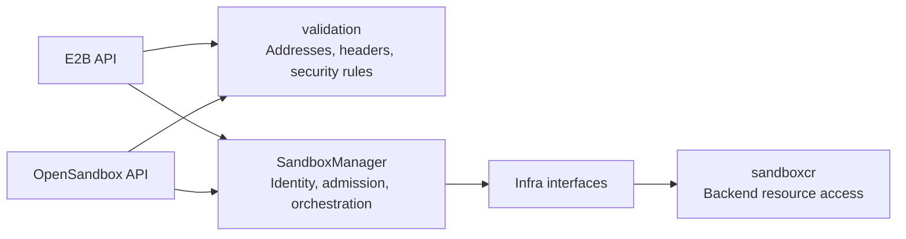
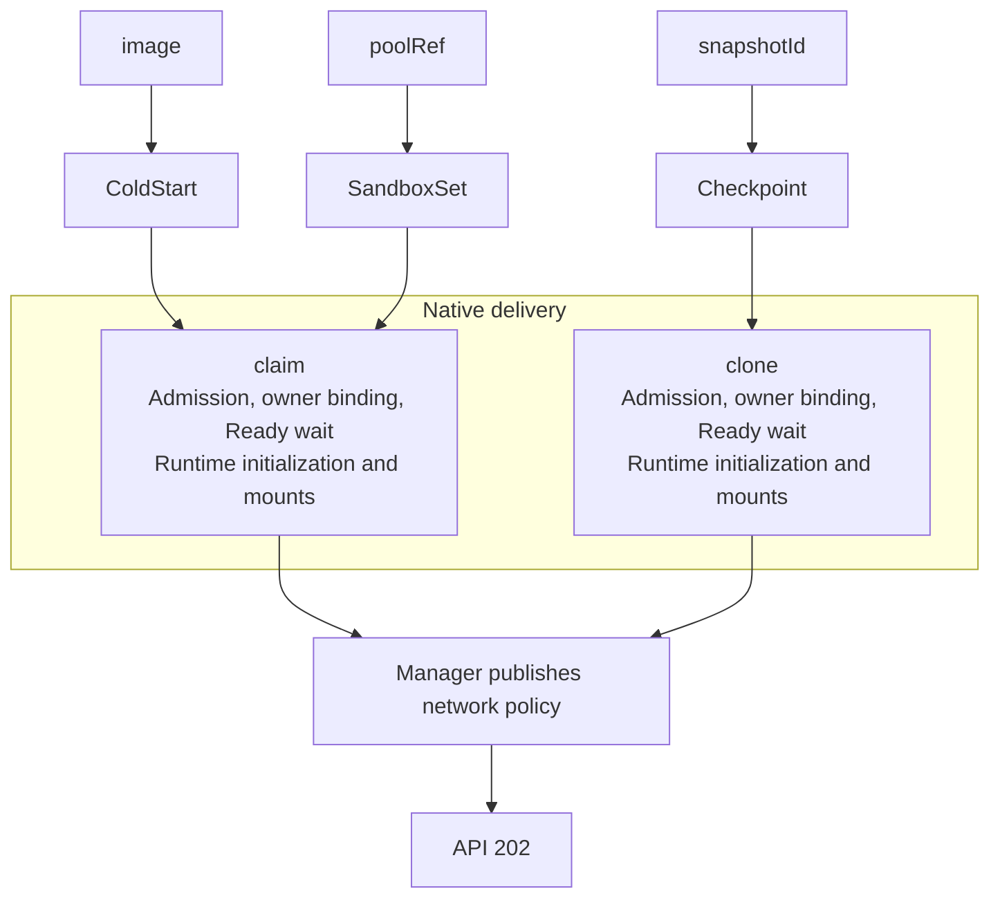
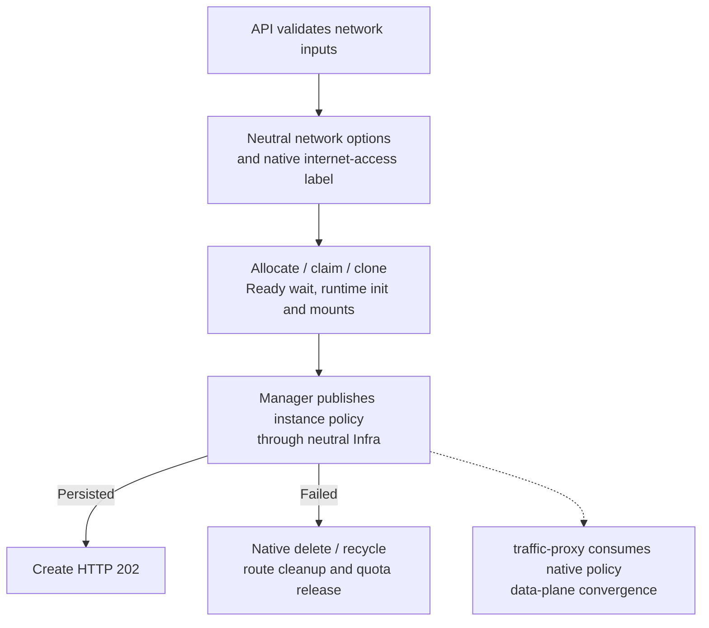
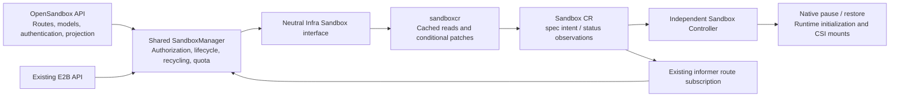
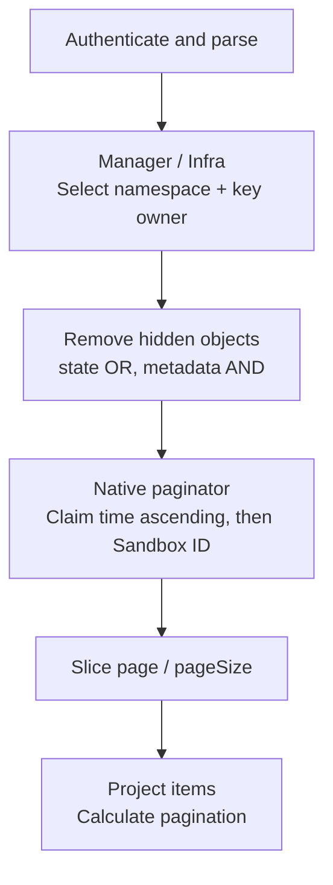
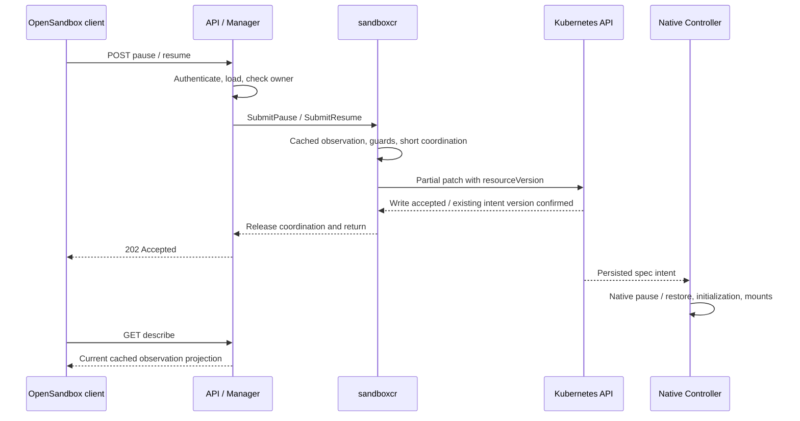
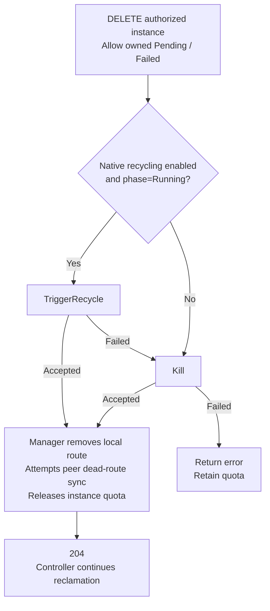
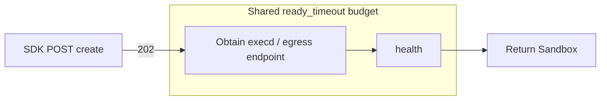

# OpenSandbox Control-Plane API Compatibility

## Table of Contents

- [Glossary](#glossary)
- [Summary](#summary)
  - [Creation modes](#creation-modes)
- [Motivation](#motivation)
  - [Goals](#goals)
  - [Non-Goals/Future Work](#non-goalsfuture-work)
- [Proposal](#proposal)
  - [User Stories](#user-stories)
    - [Story 1: Create from a source](#story-1-create-from-a-source)
    - [Story 2: Manage an instance](#story-2-manage-an-instance)
  - [Requirements (Optional)](#requirements-optional)
    - [Functional Requirements](#functional-requirements)
    - [Non-Functional Requirements](#non-functional-requirements)
  - [Implementation Details/Notes/Constraints](#implementation-detailsnotesconstraints)
    - [Architecture and responsibilities](#architecture-and-responsibilities)
    - [Baseline and validation](#baseline-and-validation)
    - [Creation identity](#creation-identity)
    - [Responses and errors](#responses-and-errors)
    - [Creation sources and execution order](#creation-sources-and-execution-order)
    - [Create field contract](#create-field-contract)
    - [Network access control compatibility](#network-access-control-compatibility)
      - [Network inputs and observable differences](#network-inputs-and-observable-differences)
      - [Native TrafficPolicy mapping](#native-trafficpolicy-mapping)
      - [Policy scope, publication and cleanup](#policy-scope-publication-and-cleanup)
      - [Endpoint and credential protection](#endpoint-and-credential-protection)
      - [Runtime network-policy interfaces](#runtime-network-policy-interfaces)
      - [Network access-control acceptance criteria](#network-access-control-acceptance-criteria)
    - [Control-plane lifecycle](#control-plane-lifecycle)
      - [Lifecycle method coverage](#lifecycle-method-coverage)
      - [Six-method comparison and native mapping](#six-method-comparison-and-native-mapping)
      - [Lifecycle execution layers](#lifecycle-execution-layers)
      - [Lifecycle authentication and authorization](#lifecycle-authentication-and-authorization)
      - [Description and state compatibility](#description-and-state-compatibility)
      - [List compatibility](#list-compatibility)
      - [Pause and resume compatibility](#pause-and-resume-compatibility)
      - [Concurrency, idempotency and version checks](#concurrency-idempotency-and-version-checks)
      - [Expiration renewal compatibility](#expiration-renewal-compatibility)
      - [Deletion compatibility and resource ownership](#deletion-compatibility-and-resource-ownership)
      - [Lifecycle errors and recovery](#lifecycle-errors-and-recovery)
      - [Deferred lifecycle methods and omitted behavior](#deferred-lifecycle-methods-and-omitted-behavior)
      - [SDK composition and local resources](#sdk-composition-and-local-resources)
      - [Lifecycle acceptance criteria](#lifecycle-acceptance-criteria)
    - [Data plane and SDK](#data-plane-and-sdk)
  - [Risks and Mitigations](#risks-and-mitigations)
    - [Failure cleanup and compatibility](#failure-cleanup-and-compatibility)
- [Alternatives](#alternatives)
- [Upgrade Strategy](#upgrade-strategy)
- [Additional Details](#additional-details)
  - [Test Plan \[optional\]](#test-plan-optional)
  - [Full API coverage and deferred capabilities](#full-api-coverage-and-deferred-capabilities)
- [Design History](#design-history)
- [Reference evidence and verification scope](#reference-evidence-and-verification-scope)
  - [Fixed versions and source entrypoints](#fixed-versions-and-source-entrypoints)
  - [Verification evidence and remaining scope](#verification-evidence-and-remaining-scope)

## Glossary

| Term | Meaning |
| --- | --- |
| API adapter | Translates the OpenSandbox protocol and calls shared Manager operations |
| Cold creation / Pool / snapshot | Construct a new Sandbox, claim SandboxSet inventory, or clone a Checkpoint |
| Best-effort update | Apply updates under native conditions; missing, zero-valued or ineligible resize fields may be skipped |
| Runtime initialization | Install or restore daemon configuration, separately from workload entrypoint startup |
| Endpoint / health | Subsequent SDK steps for obtaining data-plane addresses and checking availability |

## Summary

Add an OpenSandbox control-plane adapter to sandbox-manager for creation,
queries, listing, pause, resume, renewal and deletion. It shares the listener,
SandboxManager and KeyStorage with E2B. Protocol models and error formatting
stay in the API layer; execution follows native E2B behavior. Enable the adapter
with `--enable-opensandbox-compat`, which defaults to false.

This proposal defines the control-plane compatibility contract for creation,
identity and authorization, network access control, and instance lifecycle
management. It specifies supported mappings, observable differences, deferred
interfaces and unsupported behavior.
Endpoint and runtime integration have the separate boundary described in
[Data plane and SDK](#data-plane-and-sdk).

### Creation modes

| Creation mode | Delivered capability |
| --- | --- |
| Image cold creation | Construct a workload from an image; apply argv, env, CPU/memory, platform selection and existing-PVC mounts |
| Named Pool claim | Claim SandboxSet inventory; apply native image and CPU/memory updates, runtime initialization and CSI mounts |
| Snapshot recovery | Clone a Checkpoint, inherit recovery configuration and initialization credentials, and handle mounts under native conditions |

All three modes share API-key identity, quota/admission, instance ownership,
network-policy translation and failure cleanup.

## Motivation

[Adapter proposal #690](https://github.com/openkruise/agents/issues/690) calls for
an API adapter in the same process that reuses Agents orchestration, accepts the
OpenSandbox wire shape and documents behavioral differences between the systems.

### Goals

- Provide three creation sources using native allocation, initialization,
  mounting and networking.
- Provide instance queries, listing, pause, resume, renewal and deletion with
  explicit acceptance and completion boundaries.
- Preserve E2B defaults, validation and inheritance, and describe the actual
  execution result of each field.
- Separate protocol adaptation, business orchestration and backend
  implementation while preserving identity and ownership constraints.

### Non-Goals/Future Work

Input handling is defined in the field contract. The following capabilities are
outside the compatibility scope for the stated reasons:

| Capability | Reason |
| --- | --- |
| A separate Lifecycle Server, reference provider topology and complete reference-schema validation | Reuse native checks and orchestration in the Agents process |
| image.auth, Pool platform and extended-resource overrides | No equivalent native request input; use platform image credentials and source preconfiguration |
| Snapshot startup-configuration and resource overrides | Clone restores recorded configuration and initialization credentials; it does not rewrite arbitrary workloads |
| secureAccess and credentialProxy | Endpoint-token delivery and credential-proxy lifecycle differ from native runtime tokens, header transforms and preconfigured platform security |
| preStart/periodic hooks | Native create has no equivalent request-level hook executor or scheduler |
| PVC provisioning/deletion, host and inline OSSFS | Mounting consumes identified existing storage; it does not add provisioning, shared-resource deletion ownership or inline credential management |
| Access-triggered renewal, execd isolation and other execution extensions | Storing strings does not provide the integration or runtime execution mechanism |
| A first-traffic barrier for request policies and strict resize confirmation | Preserve native policy publication order and best-effort updates without adding convergence waits or per-field confirmation |
| A new lifecycle task service, CRD, Controller state machine or global async switch | Persisted spec and native reconciliation execute the work; additional Submit entrypoints express acceptance |
| New Prometheus metrics | Lifecycle delivery adds no collectors or instrumentation |

**Deferred capabilities:**

- Standalone `templateId` and `templateId + poolRef`: evaluate public template
  artifacts, version matching and an independent capacity model.
- Pool request entrypoint overrides: evaluate a process-start mechanism for each
  allocation.
- Automatic image prewarming, virtual templates and automatic pool selection:
  evaluate inventory, matching and recycling policy.
- Metadata updates, log/event diagnostics and snapshot management: define each
  contract separately before delivery.
- Public template creation, queries, listing and deletion: follow the artifact
  and build model rather than mapping directly to native SandboxTemplate.
- Endpoints, signed access, health, runtime network-policy management and execd
  command/file protocols: integrate runtime and credentials through a separate
  data-plane proposal.

Deferred capabilities require their own contracts before integration.

## Proposal

### User Stories

#### Story 1: Create from a source

A caller supplies an image for a new workload, `extensions.poolRef` for existing
inventory, or a Checkpoint in the authenticated key's namespace for cloning.
The delivered instance belongs to the current key ID. Updates and recovery
contents follow the contract for the selected source.

#### Story 2: Manage an instance

A caller queries or lists their instances, submits pause/resume and polls actual
state. Ready marks restored availability. Renewal extends the instance deadline.
When finished, the caller requests deletion; shared Manager operations recycle
or delete the instance under native policy.

### Requirements (Optional)

#### Functional Requirements

**FR1: Creation sources and field mapping**

Allocate through the three sources. Apply, inherit, ignore overrides or store
inputs according to the field contract. Reject source conflicts and explicitly
unsupported execution inputs before allocation.

**FR2: Identity and lifecycle contracts**

Reuse KeyStorage identity and Manager authorization. Queries and operations use
the same namespace/owner constraints. The OpenSandbox API owns response projection
and error bodies. Pause/resume acceptance requires persisted intent, while the
Controller advances actual state. Explicit renewal returns its result after
successfully updating the deadline.

#### Non-Functional Requirements

**NFR1: Isolation and compatibility**

Preserve native E2B behavior and protect its existing lifecycle paths. User input
cannot overwrite system owner, token or route state, modify shared sources, or
acquire deletion ownership of existing volumes.

**NFR2: Layering, failure handling and verification**

Maintain `API -> Manager -> Infra` and the independent Controller boundary.
Bound cleanup work. Verify orchestration, real backend behavior and SDK flows
separately.

### Implementation Details/Notes/Constraints

#### Architecture and responsibilities

| Layer | Responsibility |
| --- | --- |
| `pkg/servers/opensandbox` | Routes, wire models, protocol authentication, source selection, responses and HTTP error mapping |
| `pkg/servers/validation` | Shared address/header validation and native security-rule normalization |
| Manager | Protocol-neutral identity, admission, allocation and lifecycle orchestration |
| Infra / `infra/sandboxcr` | Neutral Sandbox capabilities, concrete clients/caches and backend operations |
| Runtime / independent Controller | Daemon initialization and mounting / reconciliation from Sandbox CR to Pod |
| `cmd/sandbox-manager` | Assemble dependencies and register routes before the listener starts |

The API passes neutral Manager arguments. KeyStorage and metadata extension
parsing reuse existing components. OpenSandbox does not depend on the E2B root
package or handlers. Shared validation has no dependency on protocol packages,
Manager or Infra. The Controller's dependency closure remains independent of
API, Manager and Infra.

#### Baseline and validation

The reference release is [OpenSandbox 1.1.0](https://github.com/opensandbox-group/OpenSandbox/releases/tag/release-1.1.0),
with Python SDK `opensandbox==1.1.0`. Public fields are checked against its
[Lifecycle OpenAPI](https://github.com/opensandbox-group/OpenSandbox/blob/release-1.1.0/specs/sandbox-lifecycle.yml).
Server behavior explains provider conditions; the SDK explains client defaults
and serialization. Agents execution, defaults and validation follow native E2B.
The reference release resolves to commit
`b1a29cf93a823a95913f7943010febb3f29de05c`. The native Agents baseline for this
implementation is `7dc85e9491d8ca6203abd24b0a24b9612ea9d00b`.

- For create, retain a single Go JSON Decode: ignore unknown fields, handle null
  according to the destination type, and reject incompatible types during decoding.
- Retain authentication, source selection, quota/admission, metadata protection
  and actual network, mount and update constraints. Reference required fields,
  reserved env names and blanket field-combination bans are not automatically
  adopted.
- Omitted/null/zero timeout becomes 300 seconds, checked against the native
  30-second minimum and configured maximum. Ordinary metadata uses annotation
  semantics.

#### Creation identity

Creation authenticates through the same KeyStorage and Team/key-ID mapping as
[lifecycle authentication and authorization](#lifecycle-authentication-and-authorization).
The authenticated Team determines source namespace, and the key ID binds the
delivered instance owner and quota identity. Client input cannot replace that
identity. Subsequent lifecycle operations enforce the same ownership rules.

#### Responses and errors

**Responses and readiness**

Create returns HTTP 202. The reference response requires id, status, createdAt
and entrypoint, with optional metadata, extensions, platform and expiresAt.
Status requires state and optionally carries reason, message and lastTransitionAt.

The id is opaque. createdAt/expiresAt describe the delivered instance's lifetime;
absent entrypoint is emitted as an empty array. Metadata echoes user data,
labels and allowed diagnostic fields while filtering internal annotations.
The server writes `opensandbox.kruise.io/sandbox-resource` last, using the actual
namespace/name. Consumed native extensions are not echoed as ordinary metadata.
Pool/clone request entrypoint is protocol echo only.

The current create response omits the reference platform and
status.lastTransitionAt fields. It returns 202 after source orchestration and
network publication; SDK availability is established separately by endpoint/health.

**Errors**

The API maps domain errors to `{"code":"...","message":"..."}`, without adding
header or request-ID fields to the body.

| Scenario | Mapping |
| --- | --- |
| Invalid JSON, conflicting sources, unsupported execution input or native parameter rejection | 400 / INVALID_REQUEST |
| Missing/invalid key | 401 / UNAUTHORIZED |
| Native quota exceeded | 403 / FORBIDDEN |
| Create-source lookup failure | Preserve the native operation's error classification: domain ErrorNotFound maps to 400; unclassified errors map to 500 |
| Native conflict | 409 / CONFLICT |
| Internal execution, readiness or network-publication failure | Preserve native classification; generic failure is 500 / INTERNAL_ERROR |

For create, domain ErrorBadRequest and ErrorNotFound map to 400,
ErrorQuotaExceeded to 403, and ErrorConflict to 409, matching native E2B create.
Lifecycle mapping is defined in
[Lifecycle errors and recovery](#lifecycle-errors-and-recovery). Internal and
unclassified errors, including cancellation errors without a domain
classification, map to 500. Lookup timing and retries remain with the native
operation; the adapter does not replace clone failures with a boolean existence
check.

#### Creation sources and execution order

**Supported source combinations**

Creation supports three entrypoints. OpenSandbox selects its backend through
deployment configuration. Ordinary Pool below means BatchSandbox Pool; snapshot
behavior first describes the container backend.

| Creation input | OpenSandbox 1.1.0 implementation | Agents adaptation |
| --- | --- | --- |
| `image.uri` | Docker pulls an image and creates a container; Kubernetes creates BatchSandbox or agent-sandbox resources whose Controllers create Pods. Request env/entrypoint configure the new workload | Translate to `ColdStartOptions`; Manager/Infra constructs a Sandbox and reuses claim admission, persistence, Ready waiting and initialization |
| Named `extensions.poolRef` | Create a BatchSandbox allocation referencing an existing Pool; taskTemplate executes env/entrypoint for that allocation. Workload image and resources come from the Pool | Select a SandboxSet and `ClaimSandbox` inventory. Apply native image/CPU/memory updates and runtime-init env. Retain the Pod entrypoint; request entrypoint is only echoed |
| `snapshotId` | Resolve a Ready snapshot for the current tenant, use `restore_config.image` as the restore image, and create a workload with current request configuration | Select a Checkpoint and `CloneSandbox`; inherit image, startup configuration and initialization credentials. Handle overrides according to the field contract |

Agents preserves the request entrypoints and applies native update/inheritance
rules. Image plus a named poolRef means a Pool image update; an ordinary
OpenSandbox Pool uses its pool-defined image/resources. FastSandbox snapshots
dispatch separately using the recorded backend identity; actual restored
contents depend on that backend.

See [BatchSandbox creation and Pool dispatch](https://github.com/opensandbox-group/OpenSandbox/blob/release-1.1.0/server/opensandbox_server/services/k8s/batchsandbox_provider.py)
and [snapshot restore resolution](https://github.com/opensandbox-group/OpenSandbox/blob/release-1.1.0/server/opensandbox_server/services/snapshot_restore.py).

Agents execution order:

Configuration overrides, requests/limits defaults, metadata precedence and mount
inheritance are defined below. Named Pools retain native revision and inventory
selection, with no-stock creation from the selected Set enabled by default.
Claim/clone returns after applicable initialization and mounts, then Manager
publishes network policy.

#### Create field contract

**The two matrices below describe Agents server behavior when receiving an
OpenSandbox create request.** Source selectors choose the execution branch;
configuration fields configure that source. Each row identifies a request field
or subfield, the three source columns describe Agents input handling, and the
last column states rejection conditions and unsupported capabilities. “Native”
means existing Agents E2B, Manager and Infra capabilities.

**Apply** means the value enters execution inputs; **inherit** retains source
configuration; **ignore override** accepts input without replacing execution
configuration; **store/echo only** preserves protocol data; **deferred/unsupported**
marks the compatibility scope. Each cell assumes a resolved source and
successful applicable validation.

The matrices define source behavior. Field notes add defaults, material
differences and reasons for exclusions; verification is collected in the test plan.

**Source selectors**

`extensions.poolRef` is a subfield of the extensions string map. Other extensions
are configuration fields. Image with a named poolRef selects Pool claim and
requests an image update. An effective snapshotId conflicts with other effective
sources. templateId retains its field contract, but template creation is unsupported.
Effective selectors use nonblank values. Reject competing image/snapshot/template
selectors, snapshot plus poolRef, and requests without a supported source before
backend allocation. Image plus poolRef selects Pool rather than cold creation.

| OpenSandbox request field / Agents creation source | Image cold creation | Named Pool claim | Snapshot recovery | Agents rejection / unsupported capability |
| --- | --- | --- | --- | --- |
| image | Apply | Native update | Inherit | Non-null auth; nonempty clone image update |
| snapshotId | Not selected | Not selected | Native clone | Competing source combinations |
| [templateId](#templateid-compatibility) | Unsupported in the creation interface | Unsupported in the creation interface | Unsupported in the creation interface | Public artifact-to-source/capacity mapping is undefined; effective nonblank values, including template plus Pool, return 400; see details below |
| extensions.poolRef | Not selected | Select SandboxSet | Not selected | Effective snapshotId combination, automatic selection `*`, template plus Pool |

**image**

- **Wire/defaults:** Optional object with uri and optional auth.username/password.
  Reference image mode requires URI, entrypoint and resourceLimits; Agents selects
  the source using an effective URI without copying those required-field checks.
- **Mapping:** Apply URI in cold creation. Image plus poolRef requests a native
  named-Pool image update; native metadata image extensions take precedence.
  Snapshot rejects nonempty image updates.
- **Rejection and difference:** Non-null `image.auth` returns 400; no request-level
  pull secret is created or managed, and auth.username/password do not enter
  execution. Image pulling uses existing platform credentials. Automatic
  prewarming is deferred.

**snapshotId**

- **Wire/defaults:** Optional string; omitted/null/blank values select no source.
  An effective value conflicts with image/templateId/ordinary poolRef. Reference
  container recovery uses an image artifact and current request configuration;
  Agents preserves checkpoint configuration and recovery-content semantics.
- **Mapping:** Explicit snapshotId directly calls Manager → Infra CloneSandbox.
  Native clone owns Checkpoint lookup, cache retries and cancellation. The API
  performs no preliminary HasCheckpoint query, and no Manager existence-query
  wrapper is added. There is no same-name Set fallback. Reference provider
  restrictions are not all reproduced.
- **Inheritance and rejection:** Inherit image, command/env, scheduling and runtime
  credentials. Ignore request env/entrypoint/platform overrides; reject nonempty
  image/resource updates.

**templateId**

OpenSandbox templateId selects a successfully built golden-image artifact.
Native Agents E2B templateID selects a SandboxSet or Checkpoint. Standalone
templates and template plus Pool are deferred because the adapter does not
alias these identities. Native claim, clone and SandboxTemplate configuration
capabilities remain available; the missing contract connects public template
identity, artifacts and capacity.

The reference below is the FSB (FastSandbox microVM) template path at OpenSandbox
1.1.0 commit `b1a29cf93a823a95913f7943010febb3f29de05c`. On the kubernetes runtime,
an effective templateId routes to FSB; ordinary container Pool creation follows
a separate path. Template restrictions do not apply wholesale to ordinary Pools.
See the [OpenAPI template contract][template-os-spec] and
[runtime dispatch][template-os-routing].

| Concern | OpenSandbox templateId | Native Agents E2B templateID |
| --- | --- | --- |
| Preparation and identity | POST /v1/templates declares an asynchronous build with its own ID, source image, resources, entrypoint, readiness and publication settings. Pending/Building leads to Succeeded or Failed | Select an existing SandboxSet name or Checkpoint ID. SandboxTemplate stores PodTemplateSpec, runtime, storage and recovery configuration. E2B template queries mainly project SandboxSets, without an equivalent public golden-image build workflow |
| Lookup and visibility | Resolve within the requester's FSB namespace and refresh build status. Missing, other-namespace and non-Succeeded templates all return 404 | HasTemplate checks a namespaced SandboxSet first; HasCheckpoint checks a Checkpoint only otherwise. Neither found returns 400. A same-name Set wins; claim failure does not fall back to Checkpoint |
| Artifact and revision | resolve_template_artifact returns the template-specific artifact index and recorded entrypoint. Two builds of one source image retain distinct artifact identities, without falling back to the source image's latest build | ClaimSandbox prefers updateRevision inventory but can fall back to older revisions. With no stock, native defaults create from the Set unless create-on-no-stock is disabled. CloneSandbox reads the Checkpoint and associated SandboxTemplate; recovery depends on recorded persistent contents and backend support |
| Workload configuration | The golden image fixes workload shape. Non-null entrypoint, env, resourceLimits, resourceRequests, volumes, platform, credentialProxy and lifecycle are rejected, including empty objects/arrays. secureAccess=true is rejected; false does not trigger that conflict | Claim retains inventory/Set entrypoint and Pod configuration, allows native image and CPU/memory updates, and supplies envVars during applicable runtime initialization rather than rewriting a running entrypoint's environment. Clone inherits template/recovery configuration and recorded runtime credentials, rejecting image/resource in-place updates |
| Capacity selection | The template supplies the artifact; poolRef independently selects shared Fastlet capacity, using the configured default when omitted/blank. SandboxPool fixes runtime/resource shape and each Fastlet hosts multiple sandboxes. The template mapper consumes only the poolRef extension and does not reuse ordinary Pool '*' automatic selection | A Set defines both workload and unclaimed instance inventory. templateID has no second independent capacity selector. Inline template/templateRef defines new instances; two public names do not establish arbitrary template-to-Set compatibility |
| Lifetime and readiness | Template create requires timeout, subject to the reference 60-second minimum and server maximum. metadata, networkPolicy and supported poolRef can accompany it. FastPath allocates the artifact and recorded command; SDK create_from_template then obtains endpoints and checks health | Native timeout defaults to 300 seconds with a 30-second minimum and server maximum. Metadata, networking, runtime initialization and CSI mounts follow claim/clone conditions. Native waiting and initialization do not establish the public build-state and SDK template contract |

Reference implementation: [build and artifact resolution][template-os-build],
[request validation][template-os-validation],
[FastPath template mapping][template-os-mapping],
[capacity pools][template-os-pools] and [SDK template creation][template-os-sdk].
Native evidence is fixed at Agents commit
`61041681ada0f748a91902ac060cbe794ad9b698`:
E2B dispatch, lookup,
claim/revision selection,
clone inheritance and
SandboxTemplate model.

- **Reason for deferral:** Treating templateId as a Set name selects mutable
  workload inventory, potentially from an old revision. Treating it as a
  Checkpoint ID selects recovery with inherited content, configuration and
  credentials. Neither defines public-ID-to-artifact/source binding, build-state
  and visibility checks, or independent template/capacity matching. Available
  claim/clone operations do not supply those contracts. This is a compatibility
  scope choice. A restricted native alias mode is technically possible, but
  requires its observable differences to be defined explicitly; it would not
  establish public-template compatibility or require copying all reference
  infrastructure.
- **Input and errors:** Optional string; omitted/null/empty/blank selects no
  template, leaving other effective selectors to choose the operation. The
  reference model rejects an explicit empty string with minLength=1 and
  normalizes whitespace-only input to no source; the adapter does not copy the
  empty-string rejection. Any effective nonblank templateId returns 400 before
  allocation, alone or with named poolRef/'*'. Competing effective image or
  snapshotId returns the source-conflict 400. No catalog/Set/Checkpoint lookup,
  claim/clone, quota allocation or instance allocation occurs. Existence does
  not change this response to 404. See adapter source selection.
- **Example and supported alternatives:** Given a Succeeded tpl-a,
  `{"templateId":"tpl-a","timeout":600,"extensions":{"poolRef":"capacity-a"}}`
  requests its artifact on capacity-a in OpenSandbox. Native E2B
  `{"templateID":"tpl-a"}` instead checks a same-name Set and then Checkpoint;
  the adapter returns 400 for the first request. A known native Set can be
  selected through extensions.poolRef, and a known Checkpoint through snapshotId.
  These supported paths keep their Pool/snapshot contracts and do not resolve
  public template IDs.
- **Verification:** Cover effective IDs, standalone templates, named/'*' pools,
  source conflicts and ineffective selectors. Assert zero catalog, Set/Checkpoint
  lookup, claim/clone and quota-allocation calls for rejected effective templates.
  Public template management remains within the
  [deferred lifecycle methods](#deferred-lifecycle-methods-and-omitted-behavior).

[template-os-spec]: https://github.com/opensandbox-group/OpenSandbox/blob/b1a29cf93a823a95913f7943010febb3f29de05c/specs/sandbox-lifecycle.yml#L1746-L1761
[template-os-routing]: https://github.com/opensandbox-group/OpenSandbox/blob/b1a29cf93a823a95913f7943010febb3f29de05c/server/opensandbox_server/services/composite_service.py#L57-L68
[template-os-build]: https://github.com/opensandbox-group/OpenSandbox/blob/b1a29cf93a823a95913f7943010febb3f29de05c/server/opensandbox_server/services/templates/template_service.py
[template-os-validation]: https://github.com/opensandbox-group/OpenSandbox/blob/b1a29cf93a823a95913f7943010febb3f29de05c/server/opensandbox_server/api/schema.py#L563-L610
[template-os-mapping]: https://github.com/opensandbox-group/OpenSandbox/blob/b1a29cf93a823a95913f7943010febb3f29de05c/server/opensandbox_server/services/fast_sandbox/create_mapping.py#L155-L207
[template-os-pools]: https://github.com/opensandbox-group/OpenSandbox/blob/b1a29cf93a823a95913f7943010febb3f29de05c/docs/architecture/fast-sandbox/scheduling.md#pools
[template-os-sdk]: https://github.com/opensandbox-group/OpenSandbox/blob/b1a29cf93a823a95913f7943010febb3f29de05c/sdks/sandbox/python/src/opensandbox/sandbox.py#L638-L711

**extensions.poolRef**

- **Wire/defaults:** extensions is a string map; poolRef is a pool name. An
  omitted/null/empty map or blank poolRef selects no pool. An effective named value
  selects ordinary Pool; `*` requests reference automatic selection.
- **Mapping:** Select a SandboxSet and claim native inventory. Its inline
  template/templateRef defines the workload; replicas represents unclaimed
  inventory, and rolling updates can retain old and new revisions. Support native
  image and CPU/memory updates and no-stock creation.
- **Boundary:** Automatic selection `*` and templateId + poolRef return 400. No
  reference capacity queue or 429/Retry-After contract is added.

**Configuration fields**

| OpenSandbox request field / Agents creation source | Image cold creation | Named Pool claim | Snapshot recovery | Agents rejection / unsupported capability |
| --- | --- | --- | --- | --- |
| platform | Apply nodeSelector | Inherit | Inherit; ignore override | Nonempty Pool override |
| timeout | Native lifetime | Native lifetime | Native lifetime | Outside native bounds |
| resourceLimits | Apply | Best-effort update | Inherit | Extended-resource keys; nonempty clone update |
| resourceRequests | Apply with cold-creation fallback | Independent best-effort update | Inherit | Extended-resource keys; nonempty clone update |
| env | Workload and initialization | Runtime initialization; no Pod-process override | Inherit; ignore override | No new startup-override mechanism |
| metadata | Native parsing and protection | Native parsing and recycling | Native parsing; preserve restore order | Native invalid/protected-key rejection |
| entrypoint | Execute argv or use image default | Inherit; request echo only | Inherit; request echo only | Pool request override deferred |
| networkPolicy | Native publication order | Native publication order | Native publication order | Unsupported addresses or limits exceeded |
| secureAccess | Disabled | Disabled | Disabled | true unsupported: 400 |
| credentialProxy | Disabled | Disabled | Disabled | enabled=true unsupported: 400 |
| lifecycle | No hook execution | No hook execution | No hook execution | Actual preStart/periodic requests: 400 |
| volumes | Existing-PVC Pod mounts | Native CSI conditions | Native CSI conditions / inheritance | host/inline OSSFS, missing PVC, etc.; provisioning hints ignored |
| extensions other than poolRef | Supported storage extensions | Supported storage extensions | Supported storage extensions | Execution extensions without an implemented mapping |

**platform**

- Optional os/arch object. Reference support depends on provider/runtime.
  Agents maps supplied image os/arch to nodeSelector. Omission does not guarantee
  a fixed architecture, and a selector alone does not establish Windows runtime
  compatibility.
- Snapshot accepts but ignores overrides. Pool returns 400 for effective os/arch;
  an empty object requests no override. Template mode is unsupported in this
  creation interface.

**timeout**

- **Reference:** Optional integer seconds for instance lifetime, with a minimum
  of 60 and a deployment-configured maximum. Ordinary image/snapshot/Pool
  omission or null can mean no deadline; 0 and 30–59 are invalid, and template
  requires non-null timeout. Docker stores an expiry for cleanup, BatchSandbox
  writes expireTime and agent-sandbox writes shutdownTime. The checked Kubernetes
  branches support no deadline. HTTP, allocation-wait and SDK ready_timeout
  budgets are separate.
- **Agents:** Omitted/null/zero becomes 300 seconds for every source, followed by
  the native 30-second minimum and configured maximum. Ordinary creation writes
  ShutdownTime; native never-timeout metadata can clear deadlines. OpenSandbox
  create has no execution mapping for autoPause, autoResume or autoPauseMemory;
  metadata and lifecycle hooks do not substitute for those native E2B fields.
- **Difference:** Reference template required-field and 60-second minimum checks
  are not adopted. Omission of top-level timeout alone does not mean unlimited
  lifetime.

**resourceLimits**

- **Reference:** Optional string map for cpu, memory, gpu and runtime-supported
  resource names. Image/snapshot require non-null input but accept an empty map;
  cpu/memory are not individually mandatory.
- **Agents:** Image parses CPU/memory quantities into the workload. Pool uses
  native InplaceUpdate, with metadata precedence per key. Omitted/empty maps keep
  unspecified values. Snapshot nonempty updates and request keys other than
  cpu/memory return 400. Source templates may preconfigure other resources;
  request-level overrides are unsupported.
- **Difference:** Pool retains native best-effort updates of already configured,
  nonzero resource fields. Memory cannot decrease, merged requests cannot exceed
  limits, and QoS cannot change. Ready does not confirm that every accepted
  resize has taken effect.

For both resource maps, keys other than cpu/memory return 400 across all three
creation sources. They are not silently discarded. This preserves the supported
resource boundary of native E2B in-place updates without changing the resources
already configured on a source template.

**resourceRequests**

- **Reference:** Optional string map. OpenAPI describes fallback from limits when
  omitted; reference Kubernetes also falls back for an empty map. A nonempty map
  replaces requests as a whole without per-key fallback.
- **Agents:** Pool requests and limits update independently. Omitted/null/empty
  requests retain source requests; partial maps update only supplied keys, with
  metadata precedence per key. Image cold creation retains its empty-requests
  fallback from limits.
- **Rejection:** Nonempty clone updates and extended-resource keys return 400;
  reference fallback does not rewrite checkpoint resources.

**env**

- **Reference:** Optional string map; omitted/null/empty input supplies no request
  variables. OPENSANDBOX_LIFECYCLE is reserved for hook transport. Templates
  reject any non-null env, including an empty map.
- **Agents:** Image writes workload env and uses native initialization settings.
  Pool passes variables to `/init`, subject to native skip-init; this does not
  rewrite already running Pod processes. Snapshot reinitializes from checkpoint
  information; native ReInit 401 means already initialized.
- **Difference:** Snapshot request env is accepted without overriding recovery
  configuration. No checkpoint-runtime override mechanism or reference reserved
  env-name check is added.

**metadata**

- **Reference:** Optional string map; omitted/null/empty input supplies no user
  metadata. Public examples can include names with spaces. Container providers
  store/filter labels and check keys/values, 63-character values and the
  opensandbox.io/ reserved prefix.
- **Agents:** ParseExtensions runs first and consumes native options. Ordinary
  metadata becomes annotations; `label:` keys become labels tracked for recycling.
  Protect system keys and retain native naming/generated-name, timeout, runtime,
  mount and network extension inputs.
- **Security rules:** Native SecurityRule validation and its access-control
  boundary are specified in [Network access control compatibility](#network-access-control-compatibility).
  Public metadata cannot write system owner, token or internal route state.
- **Difference:** Ordinary values follow annotation semantics without label-value
  length limits. The display key `name` does not automatically rename Sandbox.
  Clone retains native modifier/restore order and inheritance precedence.

**entrypoint**

- **Reference:** Optional argv array, requiring at least one string when supplied.
  Explicit `[]` fails reference validation; image requires entrypoint.
  Snapshot/Pool omission uses `["tail", "-f", "/dev/null"]`. Templates reject
  non-null overrides and use the recorded entrypoint.
- **Agents:** Image preserves argv boundaries as workload command; omitted/empty
  arrays use the image default. Callers must explicitly select a shell for shell
  expansion.
- **Boundary:** Pool retains its source entrypoint, and snapshot retains restored
  command/args. Both accept request entrypoint without executing the override;
  the response may echo it. Pool request entrypoint execution is deferred.

**networkPolicy, secureAccess and credentialProxy**

Network field defaults, mappings and unsupported inputs are specified together
in [Network access control compatibility](#network-access-control-compatibility).
networkPolicy controls egress; secureAccess and credentialProxy describe endpoint
protection and outbound credential proxying, respectively.

**lifecycle**

| Subfield | Reference definition | Adapter behavior |
| --- | --- | --- |
| `preStart.command` | argv in a hook object, before entrypoint startup | Non-null preStart returns 400; no execution |
| `preStart.timeoutSeconds` | 1–10800 seconds; execution default=60 | Not consumed; no new timeout executor |
| `periodic[].name` | Unique nonempty name | Nonempty periodic array returns 400 |
| `periodic[].schedule` | cron/supported descriptors with reference constraints | Not consumed; no scheduler |
| `periodic[].command` | argv | No execution |
| `periodic[].timeoutSeconds` | 1–300 seconds; execution default=60 | Not consumed |

Native create has no equivalent request-level hook executor. Auto-pause/resume
and Controller template hooks have different executors and timing.
Omitted/null/empty lifecycle or an empty periodic array is accepted; non-null
preStart or nonempty periodic returns 400. No executor or scheduler is added.

**volumes**

| Subfield | Behavior and scope |
| --- | --- |
| `name` | Request-local volume name; validate syntax and uniqueness before using it in mount inputs |
| `mountPath` | Absolute container path, applied to the mount |
| `subPath` | Relative path, applied where supported; reject parent traversal |
| `readOnly` | Default=false, subject to native source and driver constraints |
| `pvc.claimName` | Reference only an existing, non-terminating PVC in the workload namespace |
| `pvc.createIfNotExists` | Reference default=true; ignored here, with no provisioning of missing PVCs |
| `pvc.deleteOnSandboxTermination` | Reference default=false; ignored here, with no PVC deletion ownership |
| `pvc.storageClass/storage/accessModes` | Ignored; not inputs for modifying or provisioning an existing PVC |
| `host.path` | Unsupported; host source returns 400 |
| `ossfs.bucket/endpoint/version/options/accessKeyId/accessKeySecret` | Inline OSSFS unsupported; ossfs source returns 400 and credentials do not enter execution |

- **Wire/defaults:** Optional array; omitted/null/empty input means no requested
  mounts. Each item has a request-unique name, absolute mountPath, optional
  relative subPath/readOnly and one source. Only existing PVCs are consumed.
- **Mapping:** Image uses existing-PVC Pod volumes. Pool/clone resolves a Bound PVC
  to a matching PV and native CSI provider, requiring binding identity and driver
  availability. Runtime mounts follow initialization; inherited workloads may
  already be running.
- **Native CSI input:** Simple volumeMounts name/path becomes CSI PV source and
  mount path. Full configuration includes mountID/pvName/mountPath/subPath/
  readOnly/attributes; readOnly also depends on PV access modes. Metadata CSI
  directly selects PV/provider without requiring OpenSandbox PVC resolution.
- **Ignored/rejected:** Provisioning, recycling and storage hints are ignored for
  existing PVCs. Missing PVC returns 400 even with createIfNotExists=true.
  Combining OpenSandbox volumes and native metadata CSI sources returns 400;
  native initialization constraints remain. Snapshot omission retains native
  mount records; a supplied list follows native clone mapping.

Official on-demand mounting documentation currently excludes checkpoint
restoration, while native clone parses and executes mount records. Unit tests
establish control-plane orchestration; driver-specific checkpoint restoration
still requires deployment evidence.

**extensions other than poolRef**

| Extension | Reference purpose | Adapter behavior |
| --- | --- | --- |
| `access.renew.extend.seconds` | Integer string in 300–86400, saved for access-triggered renewal integration | Automatic access renewal unsupported; this execution extension returns 400 |
| `bootstrap.execd.isolation` | enable changes bwrap startup, permissions and mount requirements | No isolation execution; direct execution extension without an implemented mapping returns 400 |
| `opensandbox.extensions.*` | Extension encoding and retrieval | Store/echo valid annotation keys without renewal, isolation or other execution semantics |
| Other nonempty extensions | Provider-specific or transient meaning | Return 400 without a documented mapping; do not silently discard |

Omitted/null/empty maps perform no extension operation. Native metadata
extensions still use the separate metadata input. Native autoResume means
wake-on-access only.

Stored extensions use the opensandbox.io/extensions.* annotation codec, preserve
empty values and track recycling with user metadata. Extensions win collisions
with metadata. Invalid annotation names fail before allocation. Storing a string
does not implement execution. Verify storage encoding, echo and recycling;
execution capabilities require evidence of their actual effects.

#### Network access control compatibility

OpenSandbox networkPolicy is a request-level egress contract. Agents
TrafficPolicy is a native Kubernetes resource used by traffic-proxy. The adapter
translates supported request inputs through neutral Manager/Infra capabilities;
it does not expose the native resource schema as an OpenSandbox API. Native
cluster/tenant policy and SecurityProfile configuration remain platform-owned.
See [native TrafficPolicy and SecurityProfile design](20260521-traffic-policy-and-security-profile.md).

**Network inputs and observable differences**

networkPolicy controls sandbox-to-external outbound traffic. secureAccess and
credentialProxy are sibling create fields: they protect client endpoint access
and enable outbound credential proxying, respectively.

| Subfield | OpenSandbox 1.1.0 contract and reference behavior | Agents compatibility behavior |
| --- | --- | --- |
| `defaultAction` | Contract lists allow/deny and defaults omission to deny; the reference model also accepts null/empty string, normalized to deny by the egress parser | Omitted/null/empty string uses native internet access=true; allow=true, deny=false; other actions return 400 |
| `egress` | Ordered rules; domain rules use first match, while IP behavior also depends on dns/dns+nft mode. Explicit null fails reference-model validation | Omitted/null/empty array means no local rules. Split nonempty rules into allow/deny groups, allow first, at most 100 entries per group; interleaved order is not preserved |
| `egress[].action` | Required allow/deny in the contract; omission/null fails reference-model validation. The egress parser normalizes empty string to deny | Trim and lowercase actions; omitted/null/empty string means deny, other actions return 400. target must still be valid |
| `egress[].target` | Required nonempty string; the contract describes domains/wildcards, while the checked egress parser also recognizes IP/CIDR | allow accepts concrete FQDN and IP/CIDR; deny accepts only IP/CIDR. Wildcard, missing/null/empty target returns 400 |

| Request input | OpenSandbox 1.1.0 | Agents compatibility behavior |
| --- | --- | --- |
| networkPolicy omitted or null | The checked Kubernetes container path creates no request-level egress sidecar | No local request rules; internet-access label=true. Existing platform network settings still apply |
| `networkPolicy: {}` | OpenAPI describes startup allow-all; the checked Kubernetes creation chain and egress parser actually normalize to deny | Internet-access label=true, no local TrafficPolicy; this input does not request an additional proxy |
| `networkPolicy: {"egress":[]}` | Empty rules normalize to deny on the checked path when defaultAction is omitted, subject to the contract discrepancy below | Same as empty object; no local TrafficPolicy |
| `networkPolicy: {"egress":null}` | Violates the array contract and fails reference-model validation | Accepted as no rules; defaultAction is still handled independently. If omitted too, same as empty object |
| Only `defaultAction: allow` | Explicit default allow; Kubernetes still configures an egress sidecar | Internet-access label=true, no local TrafficPolicy |
| Only `defaultAction: deny` | Explicit default deny | Internet-access label=false; retain the traffic-proxy requirement. No local TrafficPolicy; native platform policy handles the default |
| Valid nonempty rules, defaultAction omitted | Unmatched traffic defaults to deny | Internet-access label=true; unmatched local rules fall through to native platform policy, differing from the reference deny default |
| Rule item `{}` or null | Missing required action/target; fails reference-model validation | Empty target causes 400 before allocation |

The OpenAPI startup allow-all description for empty objects/rules differs from
the checked [Kubernetes creation configuration](https://github.com/opensandbox-group/OpenSandbox/blob/release-1.1.0/server/opensandbox_server/services/k8s/create_helpers.py#L103-L118)
and [egress parser](https://github.com/opensandbox-group/OpenSandbox/blob/release-1.1.0/components/egress/pkg/policy/policy.go#L60-L74).
The tables distinguish the contract from that execution path. Kubernetes also
requires configured egress; other providers need separate support checks.
Ordinary Pool rejects networkPolicy, while template plus Pool uses a dedicated
mapping. Agents publishes policies through native paths for all three sources.

**Native TrafficPolicy mapping**

| Request or concern | Native mapping and boundary |
| --- | --- |
| Allowed IP/CIDR targets | Neutral AllowOut entries become CIDR peers in the first egress allow rule; bare IPs use native CIDR normalization |
| Allowed concrete domains | Become FQDN peers in that allow rule; wildcard domains are rejected |
| Denied IP/CIDR targets | Neutral DenyOut entries become CIDR peers in a reject rule after any allow rule; denied domains are rejected |
| Rule ordering | Allow peers are grouped before reject peers; input interleaving and first-match domain ordering are not retained |
| Policy priority | Per-instance priority is 100, evaluated in ascending order. Native global fallback policies must have greater priorities; other platform priorities retain their native precedence |
| Pod selection | Concrete Infra reads the Pod through its cached client and selects the Controller-managed Sandbox UID label when available, with legacy Sandbox-name fallback; long names use the UID selector |
| Resource scope and ownership | Create a namespaced TrafficPolicy for the delivered Sandbox with a Sandbox owner reference; deletion/expiration garbage collection follows that owner |
| Native-only fields | No request mapping is added for ingress rules, Service/Workload peers, protocol/port constraints, arbitrary selectors or request-controlled priority |

The API validates at most 100 entries in each allow/deny list. The checked
TrafficPolicy CRD separately limits a rule's To list to 20 peers, and the native
builder groups peers without splitting them across rules. Inputs above that
backend bound can pass API validation and fail policy creation. The resulting
publication error follows the cleanup path below; the API limit is not a
guarantee of backend acceptance.

The mapping follows `resolveEgressPolicy` in
[`opensandbox/network.go`](../../pkg/servers/opensandbox/network.go),
`buildTrafficPolicy` / `trafficPolicySelectorForPod` in
[`sandboxcr/network.go`](../../pkg/sandbox-manager/infra/sandboxcr/network.go),
and the [TrafficPolicy schema](../../api/v1alpha1/trafficpolicy_types.go).

**Policy scope, publication and cleanup**

Agents supports cluster, tenant and per-instance network settings. This request
only translates instance inputs: TrafficPolicy rules select the actual Pod,
and defaultAction sets the internet-access label. Native data-plane configuration
handles cluster/tenant policy, priority and fallback. Explicit deny does not add
a terminal deny-all rule or an empty policy object.

Manager publishes after native allocation and applicable Ready waiting, runtime
initialization and mounts. Publication failure deletes/recycles the instance,
cleans routes and releases quota. Canceled requests use a separate 30-second
cleanup context. Selectors use Controller-managed Pod UID labels with legacy
Pod-name fallback. Enforcement requires configured traffic-proxy.

**First-traffic gap:** Sandbox precedes Pod creation, providing an orchestration
point, but the current Controller does not wait for this request's policy.
Workloads may start before publication or proxy synchronization. HTTP 202 does
not confirm per-policy data-plane convergence. The adapter retains native
ordering without scheduling gates, fixed startupProbe checks or policy ACKs.
Preconfigured platform policies continue to apply under native conditions.

Empty rule sets do not create an empty TrafficPolicy. Explicit default deny
retains the traffic-proxy requirement and sets the native internet-access label;
it relies on platform fallback policy rather than adding a terminal deny-all
rule. Image creation requests the proxy runtime when needed; Pool and snapshot
sources retain their native/preconfigured runtime conditions.

If cleanup also fails, return both the original publication error and cleanup
cause. Route removal and quota release follow accepted deletion/recycling;
shared sources and existing storage retain ownership. The API does not wait for
TrafficPolicy Accepted/Programmed conditions or a proxy policy ACK.

**Endpoint and credential protection**

| Top-level field / subfield | Reference purpose and dependencies | Agents behavior and gap |
| --- | --- | --- |
| `secureAccess` | Inbound endpoint protection, default=false. Supported Kubernetes ingress gateways generate a token delivered through endpoint-response headers; separate from control-plane API keys, daemon authentication and signed URLs | true returns 400; omitted/null/false is accepted. The public endpoint-credential contract is not connected; native API-key and runtime authentication remain |
| `credentialProxy.enabled` | Transparent outbound proxy and credential injection, default=false. Enabling requires networkPolicy and dns+nft; network rules alone do not enable the proxy. Secrets/injection rules use subsequent APIs | true returns 400; omitted/null/empty object/false is accepted. The credential proxy and secret-configuration lifecycle are not connected |

Native SecurityProfile/Secret token injection and plaintext header transforms
retain their platform roles. Inline security rules still reject
tokenTransformation. These differ from endpoint credential delivery, transparent
HTTPS interception and credential-management request contracts; the adapter
adds no corresponding execution mechanism.

Control-plane API keys authenticate management requests. They are independent
of egress allow/deny, endpoint access credentials and outbound credential
injection. Native inline SecurityRule values pass shared
`pkg/servers/validation.NormalizeSecurityRules` validation, defaulting and
serialization; E2B `network.rules` translation stays in E2B. Retaining native
SecurityProfile or header transformations does not implement OpenSandbox
credentialProxy or secret-management APIs.

**Runtime network-policy interfaces**

| Interface | Compatibility scope |
| --- | --- |
| Create networkPolicy | Map supported inputs as defined above for image, named Pool and snapshot sources |
| `GET /v1/sandboxes/{id}/networkpolicy` | Deferred; define authorized readback of default action, rule grouping and source differences |
| `PUT /v1/sandboxes/{id}/networkpolicy` | Deferred; define full replacement and failure/cleanup semantics |
| `PATCH /v1/sandboxes/{id}/networkpolicy` | Deferred; define rule merge, identity and ordering semantics |
| `DELETE /v1/sandboxes/{id}/networkpolicy` | Deferred; define rule deletion and resulting fallback behavior |

Native SelectNetworkPolicy/UpdateNetworkPolicy capabilities do not supply all
of these protocol contracts. Ordinary SDK egress methods target the egress
sidecar; template-origin methods use the control-plane routes above. Those
paths require separate adaptation. Creation-time TrafficPolicy publication
does not make runtime policy management available.

**Network access-control acceptance criteria**

| Scope | Required evidence |
| --- | --- |
| Field contract | Omitted/null/empty input, explicit default actions, action normalization, missing targets, supported addresses and both API/backend rule-count bounds |
| Mapping | Native allow-before-reject behavior, CIDR/FQDN peers, priority, Pod UID/name selectors, ownership and unrelated platform policy preservation |
| Publication | All creation sources retain the same applicable post-allocation order; empty rules create no policy; explicit deny keeps the native proxy/fallback requirements |
| Failure | Policy-write and cleanup failures preserve causes; canceled requests use bounded cleanup; quota/routes follow accepted deletion |
| Enforcement | Real traffic-proxy verifies matching, fallback and the first-traffic window; CR persistence or HTTP 202 covers publication rather than enforcement convergence |
| Boundaries | Endpoint credentials, credential proxying, native security rules and deferred runtime CRUD remain distinguishable capabilities |

#### Control-plane lifecycle

Instance listing, description, pause, resume, expiration renewal and deletion
share the existing listener, KeyStorage and SandboxManager. The
adapter translates the OpenSandbox protocol while preserving native ownership,
backend state, Controller reconciliation and recycling policy.

Creation is defined by the [create field contract](#create-field-contract).
Endpoint discovery and runtime services have the separate
[data-plane integration boundary](#data-plane-and-sdk); they are outside the method
inventory below.

**Lifecycle method coverage**

The reference is OpenSandbox 1.1.0
[Sandbox](https://github.com/opensandbox-group/OpenSandbox/blob/b1a29cf93a823a95913f7943010febb3f29de05c/sdks/sandbox/python/src/opensandbox/sandbox.py),
[SandboxManager](https://github.com/opensandbox-group/OpenSandbox/blob/b1a29cf93a823a95913f7943010febb3f29de05c/sdks/sandbox/python/src/opensandbox/manager.py)
and the [Sandboxes service protocol](https://github.com/opensandbox-group/OpenSandbox/blob/b1a29cf93a823a95913f7943010febb3f29de05c/sdks/sandbox/python/src/opensandbox/services/sandbox.py).
The [synchronous SDK](https://github.com/opensandbox-group/OpenSandbox/tree/b1a29cf93a823a95913f7943010febb3f29de05c/sdks/sandbox/python/src/opensandbox/sync)
uses the same server contracts. The following six methods expose the stated
mappings and differences; deferred methods are outside the registered routes.

| Method | SDK entrypoint | HTTP interface | Request and successful response | Mapping and acceptance boundary |
| --- | --- | --- | --- | --- |
| List | `SandboxManager.list_sandbox_infos` | `GET /v1/sandboxes` | state, metadata, page, pageSize; 200 `{items,pagination}` | Manager selects by namespace/key owner; API filters, sorts and applies offset pagination. No retained terminal-history catalog |
| Describe | `Sandbox.get_info` / `SandboxManager.get_sandbox_info` | `GET /v1/sandboxes/{id}` | No request body; 200 Sandbox response | Project the authorized, currently visible observation. Hidden/gone instances return 404; read fields have the limits below |
| Pause | `Sandbox.pause` / `SandboxManager.pause_sandbox` | `POST /v1/sandboxes/{id}/pause` | No operation parameters; 202, no operation response body | Persist pause intent or obtain server confirmation of existing same-direction intent; Controller completes suspension |
| Resume | `Sandbox.resume` / `SandboxManager.resume_sandbox` | `POST /v1/sandboxes/{id}/resume` | No operation parameters; 202, no operation response body | Persist or confirm resume intent; preserve deadlines. Controller completes initialization and mounts |
| Renew | `Sandbox.renew` / `SandboxManager.renew_sandbox` | `POST /v1/sandboxes/{id}/renew-expiration` | `{"expiresAt":"RFC3339 timestamp"}`; 200 `{expiresAt}` | Strictly extend ShutdownTime, preserving PauseTime; return only after persisting the normalized deadline |
| Delete | `Sandbox.kill` / `SandboxManager.kill_sandbox` | `DELETE /v1/sandboxes/{id}` | No operation parameters; 204, no response body | Native recycling/deletion accepted, followed by Manager route/quota handling. A missing instance returns 404 |

HTTP distinguishes acceptance from completion. Pause/resume does not wait for
condition convergence. DELETE does not wait for complete reclamation of Pods,
checkpoints or storage. GET projects backend observations without predicting
state from the last accepted write.

**Six-method comparison and native mapping**

The public contract is OpenSandbox `release-1.1.0` (`b1a29cf`); the native
comparison is Agents `v0.6.0` (`a1e0811`), and the lifecycle implementation
reference is `19da857`. See [full API coverage](#full-api-coverage-and-deferred-capabilities)
for the remaining operations in the main specification.

| Interface | OpenSandbox public contract | Native Agents E2B | Adapter mapping and retained difference |
| --- | --- | --- | --- |
| Describe `GET /sandboxes/{id}` | Return status, metadata, timestamps, startup source and entrypoint | The native query returns E2B Sandbox fields such as state, templateID, startedAt/endAt, domain and execution credentials | Project the OpenSandbox model while retaining native visibility and terminal cleanup. Readback has `entrypoint=[]` and omits image/snapshotId and other source fields; full startup information is unavailable |
| List `GET /sandboxes` | page/pageSize defaults 1/20; state OR, metadata AND; return items/pagination | `GET /v2/sandboxes` uses limit/nextToken, an array response and x-next-token; filtering centers on running/paused | Project authorized objects and slice by page; pageSize <=100, stable claim-time/ID ordering. Filter annotations but return merged labels/annotations; no retained terminal history |
| Delete `DELETE /sandboxes/{id}` | 204 means termination scheduled; missing instance may return 404 | Manager recycles or kills, cleans routes and releases quota | Reuse native recycling/deletion; missing/foreign-owned returns 404, accepted deletion returns 204. Permit owned Pending/Failed cleanup without waiting for physical reclamation |
| Pause `POST /sandboxes/{id}/pause` | Asynchronous 202; query Pausing → Paused | PauseSandbox waits for native completion before 204; headers, annotations and retention defaults can affect deadlines | Additional Submit entrypoint returns 202 after intent persistence. Supply no E2B pause-retention override; keep deadlines, without freezing lifetime. Paused=True marks actual completion |
| Resume `POST /sandboxes/{id}/resume` | Asynchronous 202; high-level SDK then discovers endpoints and checks health | Native /resume waits before 204; /connect can resume, update timeout and return Sandbox | Submit returns 202 with existing deadlines; no implicit renewal or post-response initialization job. Controller initializes/mounts; Ready=True marks availability. Data-plane integration completes SDK reconnection |
| Renew `POST /sandboxes/{id}/renew-expiration` | Absolute expiresAt must exceed now/current expiry; 200 returns the new expiry | `POST /sandboxes/{id}/timeout` accepts relative seconds; native deadline reset can shorten/extend and distinguishes automatic pause from shutdown | Extend ShutdownTime only, revalidate on conflicts and preserve PauseTime; respect the shared maximum and whole-second precision. For cross-protocol instances with PauseTime, GET still displays it first |

The OpenSandbox reference is the paths and RenewSandboxExpirationRequest in the
[Lifecycle OpenAPI](https://github.com/opensandbox-group/OpenSandbox/blob/b1a29cf93a823a95913f7943010febb3f29de05c/specs/sandbox-lifecycle.yml)
and handlers in [api/lifecycle.py](https://github.com/opensandbox-group/OpenSandbox/blob/b1a29cf93a823a95913f7943010febb3f29de05c/server/opensandbox_server/api/lifecycle.py).
Backend support and saved pause/resume contents vary; this adapter reuses
native Agents checkpoint/recovery paths.

The native reference is fixed at `a1e0811`:
[services.go](https://github.com/openkruise/agents/blob/a1e0811323b71fd9a54efe26b0f4baf19106c84e/pkg/servers/e2b/services.go)
(DescribeSandbox/DeleteSandbox),
[list.go](https://github.com/openkruise/agents/blob/a1e0811323b71fd9a54efe26b0f4baf19106c84e/pkg/servers/e2b/list.go)
(ListSandboxes),
[pause_resume.go](https://github.com/openkruise/agents/blob/a1e0811323b71fd9a54efe26b0f4baf19106c84e/pkg/servers/e2b/pause_resume.go)
(PauseSandbox/ResumeSandbox/ConnectSandbox) and
[timeout.go](https://github.com/openkruise/agents/blob/a1e0811323b71fd9a54efe26b0f4baf19106c84e/pkg/servers/e2b/timeout.go)
(SetSandboxTimeout). Implementation scope is recorded in
[reference evidence](#reference-evidence-and-verification-scope).

The shared authorization difference is namespace isolation in OpenSandbox
multi-tenancy versus Agents KeyStorage, Team namespace and per-key ownership.
Keys in the same Team do not share instances. See lifecycle authentication below.

**Lifecycle execution layers**

| Layer | Responsibility | Constraint |
| --- | --- | --- |
| API, pkg/servers/opensandbox | Routes/models, API-key adaptation, protocol validation, state projection, filtering/pagination and error mapping | Call Manager; do not operate Sandbox CRs or concrete sandboxcr directly |
| Manager, pkg/sandbox-manager | Instance authorization, submission orchestration, renewal, recycling, quota and routes | Use neutral Infra; no OpenSandbox DTO or HTTP semantics |
| Infra interface | SubmitPause, SubmitResume, ExtendShutdownTime and existing capabilities | Protocol-neutral arguments and domain errors |
| infra/sandboxcr | Cached observations, native state guards, coordination and resourceVersion partial patches | No APIReader in new submission/renewal paths; no protocol status or business recycling policy |
| Controller | Execute persisted intent, checkpoints, Pod restore, initialization, mounts and conditions | Independent dependency closure, without Manager, API or their Infra implementations |

The additional call chains are SubmitSandboxPause → Sandbox.SubmitPause,
SubmitSandboxResume → Sandbox.SubmitResume, and
ExtendSandboxExpiration → Sandbox.ExtendShutdownTime. Native
PauseSandbox/ResumeSandbox → Sandbox.Pause/Sandbox.Resume retains completion waits.

PauseOptions/ResumeOptions keep their existing fields; adaptation adds no
SubmitOnly flag. Entrypoints express submission versus waiting without package,
process or Controller feature gates.

**Lifecycle authentication and authorization**

This section covers control-plane API-key identity and resource authorization.
Endpoint/runtime credentials belong to the data plane.

**OpenSandbox behavior**

- The client supplies `OPEN-SANDBOX-API-KEY`.
- In single-tenant mode, the server compares it with `server.api_key` and uses
  the configured Kubernetes namespace. Authentication is skipped when no key
  is configured and multi-tenancy is disabled.
- In multi-tenant mode, a file or HTTP tenant provider resolves the key to a
  tenant and namespace. Creation, queries, listing and deletion are scoped to
  that namespace. A tenant can have multiple keys.

See the [OpenSandbox 1.1.0 multi-tenancy guide](https://github.com/opensandbox-group/OpenSandbox/blob/release-1.1.0/docs/guides/multi-tenancy.md#how-it-works).
A tenant's display name and namespace can differ.

**Agents behavior**

The E2B API supplies `X-API-Key` to existing KeyStorage. The stored key ID differs
from the credential string sent by the client. The key and its Team determine:

| Identity | Responsibility |
| --- | --- |
| Ordinary Team's name (`Team.Name`) | Kubernetes namespace for resolving SandboxSet, Checkpoint and other creation sources |
| Key ID | Caller identity, owner of the delivered Sandbox, native quota identity and subsequent instance authorization |

Keys in one Team can use the same source scope, but each delivered instance
belongs to its creating key. Queries check owner; listing filters by both
namespace and key ID. Admin Team keeps cross-namespace lookup scope and still
checks instance ownership. Legacy keys without a Team and the canonical admin
identity used when authentication is disabled follow native rules.

**Compatibility and differences**

The adapter accepts the OpenSandbox header and reuses Agents KeyStorage.
Clients put a valid Agents key in `OPEN-SANDBOX-API-KEY`; authorization still
uses Agents Team and key ID. Keys or tenants.toml from a separate OpenSandbox
server are not automatically imported.

For example, keys A and B belong to Team `alpha`. When A creates an instance,
its owner is A's key ID. B can resolve creation sources in `alpha`, but cannot
access A's instance. OpenSandbox keys in one tenant share namespace access;
Agents preserves per-key instance ownership. Replacing a key with a new key ID
does not automatically transfer instance access.

| Concern | Compatibility behavior or difference |
| --- | --- |
| Missing or invalid key | OpenSandbox distinguishes 401/MISSING_API_KEY and INVALID_API_KEY; Agents returns 401/UNAUTHORIZED/Invalid API Key for both, before handler execution |
| Tenant-provider failure | OpenSandbox can return 503/TENANT_PROVIDER_UNAVAILABLE; Agents uses existing KeyStorage lookup results without adding this error category |
| Authentication disabled | Both protocols use native configuration; delivered instances bind to the canonical admin key ID and remain accessible through the corresponding admin key after authentication is enabled |

See the [reference authentication middleware](https://github.com/opensandbox-group/OpenSandbox/blob/release-1.1.0/server/opensandbox_server/middleware/auth.py).
Create binds source namespace and instance owner; object queries, lists and
operations enforce those ownership rules.

With KeyStorage disabled, use the existing AdminKeyID anonymous principal.
Legacy Team resolution reuses TeamForKey. Admin cross-namespace lookup still
enforces key-ID ownership.

**Request path and state admission**

Every lifecycle route uses the OpenSandbox authentication middleware. An
instance-scoped request then uses Manager.GetSandbox with the authenticated key
ID and namespace. The informer-backed lookup has a two-second bound. Manager
checks owner and the route's native coarse-state set; the handler receives the
authorized object. Manager `SubmitSandboxPause` and `SubmitSandboxResume` check
owner again before calling the neutral submission capability.

| Route | Native state admission | Further behavior |
| --- | --- | --- |
| Describe | running, paused, dead | Apply the shared read-visibility rule and project the observation |
| Pause / resume | running, paused, dead | Infra owns transition guards; resume can confirm intent during the Running-but-not-ready initialization window |
| Renew expiration | running, paused | Validate absolute time and maximum lifetime; Infra revalidates deadlines on version retries |
| Delete | Any owned state | Permit cleanup of Pending, Failed and read-hidden objects |
| List | Select by namespace and key ID | Apply visibility and filters before pagination |

These admission states are native observations, not OpenSandbox response states.
Missing, foreign-owned, namespace-inaccessible and inadmissible instances share
the load-stage `404 / NOT_FOUND` body with message `sandbox not found`. An
inconclusive internal lookup failure returns 500. Transition conflicts found
after successful loading return 409 under the lifecycle error rules below.

**Description and state compatibility**

Describe and list items share SandboxResponse and projectSandbox, projecting
backend observations rather than predicting a state from the last accepted write.

**Response fields**

| Field | Source and behavior |
| --- | --- |
| id | Current delivered Sandbox ID with native identifier resolution |
| status.state | API projection of native state, reason and phase |
| status.reason | Native GetState() reason; no additional message is populated |
| createdAt | Claim-time annotation, then object creation time, then current UTC time as fallback |
| expiresAt | PauseTime when present, otherwise ShutdownTime; omit when both are zero |
| entrypoint | Required; reads emit [] without reconstructing a command from create-time echo |
| metadata | Merge labels then annotations, with annotation precedence; remove protected prefixes and write protected opensandbox.kruise.io/sandbox-resource=namespace/name last |

id, status, createdAt and entrypoint are always serialized. Readback omits image,
snapshotId, platform, extensions, allocation and other startup-source fields,
as well as Kubernetes conditions and status.lastTransitionAt.

**State projection**

| Native observation | OpenSandbox state | Meaning or visibility |
| --- | --- | --- |
| creating / available | Pending | Projection can express it; route visibility and selection restrict creating/unclaimed inventory |
| running | Running | Normal running has passed native Ready checks |
| paused / RunningResourceClaimedAndPaused | Pausing | Pause intent is set while phase remains Running |
| paused / NotRunningResourceClaimed, phase Resuming | Resuming | Controller is restoring |
| Same state/reason, phase Recycling | Stopping | Controller is recycling |
| Same state/reason, phase Upgrading | Running | Native upgrade projection; does not establish runtime health |
| Same state/reason, other recognized paths | Paused | Includes the phase=Paused window |
| dead / RunningResourceClaimedButNotReady | Pending | Running phase has not reached Ready |
| dead / ResourceTerminating | Stopping | Hidden by read visibility |
| dead / ResourceFailed | Failed | Hidden by read visibility |
| dead / ResourceDeleted, ResourceSucceeded or ShutdownTimeReached | Terminated | Deleted/Succeeded are hidden; elapsed-deadline objects can remain visible while present |
| Unmapped combination | Projection error | Describe, or a list page that projects this item, returns 500 |

The vocabulary is Pending, Running, Pausing, Paused, Resuming, Stopping,
Terminated and Failed. It is independent of retention. Describe/list hide creating,
reserved-failed, and dead objects with Succeeded, Failed, Terminating or Deleted
reasons. They do not provide a retained terminal-history catalog.

**Completion and read windows**

Phase Paused can appear before Paused=True; the API may already show Paused.
After resume intent is persisted but before phase advances to Resuming, it may
briefly still show Paused. Native Paused=True establishes actual pause completion;
Infra condition guards protect opposite operations.

Ready=True marks restored availability. On the normal restore path, Running
phase before initialization completes projects to Pending. The API adds no
Ready boolean. SDK endpoint/health checks establish data-plane accessibility.

**List compatibility**

| Input | Behavior |
| --- | --- |
| state | Repeated or comma-separated, OR within the eight case-sensitive API states above; skip empty entries, reject unknown values with 400 |
| metadata | URL-encoded key=value&key=value, AND across pairs; malformed input/encoding or protected keys returns 400 |
| page | Integer >=1, default 1 |
| pageSize | Integer 1–100, default 20; 100 is the Agents compatibility cap |

Manager reuses the native paginator with Limit=0 to obtain the filtered set;
the API calculates offset pages. Objects lacking claim time are excluded.
Sort by claim time ascending, then Sandbox ID ascending for equal claim times.

Return pagination={page,pageSize,totalItems,totalPages,hasNextPage}, counting
the filtered set. Empty/out-of-range pages return items: []; an empty set has
totalPages=0 and retains the requested page. Check page bounds before multiplying
the offset to avoid overflow for maximum-integer pages.

Each request reflects its own cache observation without cross-page snapshot
isolation. Concurrent creation, deletion or transitions can move later pages.
Materialization cost grows with the caller's authorized inventory.

Metadata filtering compares annotations only, while response metadata merges
labels and annotations. A legacy label-only value can appear in a response yet
not match the filter. With a state filter, unprojectable objects are excluded;
without one, such an object on the selected page causes a projection error/500.

**Pause and resume compatibility**

**Submission entrypoints**

OpenSandbox handlers call SubmitSandboxPause/SubmitSandboxResume with the current
key ID, authorized object and empty native Options. They do not duplicate
pausable/resumable logic in the API, avoiding rejection of a concurrent repeat
based on one stale load.

Acceptance requires Kubernetes server confirmation of a write or observation
version, including unchanged repeat requests. Write failure, cancellation,
inadmissible state or exhausted conflicts returns an error in the current request.

**Pause execution**

Submission changes Spec.Paused from false to true. Controller observes it and
performs native checkpointing, Pod suspension/release and status updates.
Paused=True establishes completion. Recovery material, backend availability and
storage retention follow native implementation; the API does not reproduce
checkpoint orchestration.

**Resume execution**

Submission changes Spec.Paused from true to false. Controller restores only after
the pause condition completes, restores Pod/backend state, initializes runtime,
mounts CSI and reports Ready. Manager submission adds no initialization job
after the HTTP response.

**Coexistence with E2B**

| Caller | Manager / Infra path | Return and post-processing |
| --- | --- | --- |
| OpenSandbox | Additional Submit entrypoints | 202 after server confirmation; no wait or completion-phase syncRoute |
| E2B | Existing Pause/Resume entrypoints | 204 after native completion; retain refresh, errors, deadlines and post-completion route synchronization |

Existing handlers, Manager PauseSandbox/ResumeSandbox, Infra Pause/Resume,
Options, wait tasks and Controller logic remain unchanged. Additional methods
reuse native guards and coordination without redirecting the native waiting
path. Add no SubmitOnly switch.

**Concurrency, idempotency and version checks**

**State guards**

These rules apply after ownership and route admission.

| Backend window | Pause | Resume |
| --- | --- | --- |
| Running, Ready=True, no pause intent | Submit pause | Confirm same-direction running intent, then 202 |
| Running with pause intent | Confirm same-direction intent if native pause guards pass | 409, pause incomplete |
| Paused, spec.paused=true, Paused condition incomplete | Confirm same-direction intent | 409, pause incomplete |
| Paused=True, spec.paused=true | Accept repeated intent | Submit resume |
| Phase Paused, spec.paused=false | 409, resume accepted before phase advances | Confirm same-direction intent if native resume guards pass |
| Phase Resuming | 409 | Accept repeated same-direction intent |
| Running, Ready=False, spec.paused=false | 409, not pausable yet | Accept repeated intent during initialization |
| Deleting, ShutdownTime elapsed or native phase disallowed | 409 | 409 |

Idempotency remains subject to native guards; equality of Spec.Paused alone is
insufficient for success.

**Atomic submission**

1. Check context on each attempt and read through the cached client. Preserve
   an already-confirmed version on the wrapped object when it is ahead of cache.
2. Evaluate native pausable/resumable checks and opposite-transition guards on
   that observation.
3. When guards pass, acquire the native pause/resume task to coordinate with an
   opposite synchronous E2B waiter. Release on every exit without calling Wait.
4. Deep-copy the observation. Only an intent-changing request may apply
   accompanying Timeout, pause annotations or tracing context.
5. Use MergeFromWithOptimisticLock for a partial patch. Unchanged requests still
   carry the resourceVersion precondition; rejections also confirm the observation
   through an unchanged patch before returning.
6. Retry version conflicts with a fresh observation and guards, within bounds.
   Exhaustion returns domain Conflict. After success, update the wrapped object
   and record a resource-version expectation for actual changes.

Unchanged confirmation protects against a stale same-direction observation after
another writer reversed intent, and a stale rejection after Controller completed.
Only adopt the decision after the server confirms that version. Add no APIReader
reads; preserve cancellation and meaningful underlying error context.

**First writer and cross-process protection**

Only the winning same-direction request that flips intent writes accompanying
configuration. Repeats cannot overwrite its Timeout or pause annotations. A
neutral resume caller's Timeout and Spec.Paused=false are atomic in one patch.

Native task coordination protects E2B waiters within the same process.
Persisted spec, phase, conditions and version preconditions protect competing
Managers. Tasks release when submission returns; persisted intent continues
to prevent an incomplete opposite transition from being overwritten.

**Expiration renewal compatibility**

**Pause/resume deadlines**

OpenSandbox pause/resume sends no Timeout override and preserves ShutdownTime
and PauseTime. Pause does not freeze lifetime; resume does not restart it from
now. Native expiration may terminate the instance during either transition.

**Renewal input and semantics**

| Concern | Contract |
| --- | --- |
| Input | Required expiresAt, an absolute RFC3339 timestamp |
| Extension | Later than now, existing ShutdownTime and any PauseTime |
| Configured maximum | When the shared --e2b-max-timeout cap is enabled, no later than validation-time now + maxTimeout; not total age since creation |
| Precision | Normalize to UTC whole seconds and recheck strict extension before persistence; a subsecond-only extension may be rejected |
| Write | Patch ShutdownTime only, preserving PauseTime, other spec fields and annotations |
| Response | After persistence, 200 with the normalized expiresAt actually submitted |

API validates input and configured limits. Manager calls neutral ExtendShutdownTime.
Infra rechecks current time and both deadlines on every version-conflict retry,
then submits a resourceVersion-conditional partial patch.

A shorter request cannot overwrite a concurrently committed longer renewal
using an old observation. If no longer extending on retry, return 400.
Preserve concurrent PauseTime changes; if PauseTime now exceeds the requested
deadline, reject renewal too. Deletion-in-progress and exhausted conflicts
return 409. Write failure cannot return 200.

| Comparison | Behavioral difference |
| --- | --- |
| OpenSandbox SDK renew(timeout) | Sends now plus duration as expiresAt; only strictly extending input satisfies the public contract |
| Native E2B timeout reset | Resets the deadline in eligible native states; can shorten or extend |
| Adapter | Extend only; no private shortening parameter or SDK change |

OpenSandbox creation does not arm PauseTime by default, so renewed ShutdownTime
and readback expiresAt normally agree. When the same key has armed PauseTime
through another protocol, native auto-pause still applies: GET prefers PauseTime
while renewal returns the new ShutdownTime. The compatibility API does not clear
that auto-pause configuration.

Renewal parsing rejects unknown JSON fields, while create retains native single
Decode and ignores them. This is an exposed decoding difference. Explicit
renewal does not implement access-triggered access.renew.extend.seconds.

See [SDK renewal](https://github.com/opensandbox-group/OpenSandbox/blob/b1a29cf93a823a95913f7943010febb3f29de05c/sdks/sandbox/python/src/opensandbox/sandbox.py#L342)
and RenewSandboxExpirationRequest in the fixed-version Lifecycle OpenAPI.

**Deletion compatibility and resource ownership**

Manager owns recycling policy: attempt recycle when eligible, then fall back
to Kill if it fails. Only after recycling/deletion acceptance does Manager
remove the local route, attempt peer dead-route fanout and release quota under
existing conditions.

Peer fanout and quota release retain native handling: log failures without
rolling back accepted backend deletion. Quota release uses a separate bounded
context. Controller, informers and existing repair mechanisms handle convergence.

A missing or unauthorized ID returns 404 in middleware, unlike E2B's idempotent
204 for not found. DELETE does not reuse describe visibility; owners can clean
up Pending, Failed and retained debugging objects.

Instance deletion acquires no deletion ownership of shared SandboxSets, source
Checkpoints or existing PVCs/PVs. Recycled inventory, previous delivery ID,
owner and quota follow native rules; the public ID supplies no retained history.

**Lifecycle errors and recovery**

**Error mapping**

Lifecycle errors use {"code":"...","message":"..."}, formatted in the API.
Manager/Infra retain domain errors.

| Scenario | HTTP / protocol code |
| --- | --- |
| Missing/invalid key | 401 / UNAUTHORIZED |
| Missing, foreign-owned or inadmissible instance during loading | 404 / NOT_FOUND with the uniform load-stage message |
| Internal load failure | 500 / INTERNAL_ERROR |
| Invalid list input or invalid/non-extending expiresAt | 400 / INVALID_REQUEST |
| Opposite incomplete transition, native state/task conflict or exhausted version retries | 409 / CONFLICT |
| Object disappears during backend operation; Kubernetes/domain NotFound | 404 / NOT_FOUND |
| Domain quota exceeded | 403 / FORBIDDEN |
| Unclassified write failure, context cancellation or internal execution error | 500 / INTERNAL_ERROR |

Lifecycle NotFound maps to instance 404; create-source NotFound follows the
create input-error contract. No new rate limiter is added, and lifecycle routes
do not actively generate 429.

**Failures before and after acceptance**

| Window or failure | Handling and observation |
| --- | --- |
| Cancellation before write, or write failure | Return the current error; no background goroutine resubmits intent |
| Server may have committed but client missed response | GET or same-direction retry; confirm using version/idempotency rules |
| Client disconnect after acceptance | Persisted spec intent remains and Controller progresses independently |
| Manager restarts after acceptance | Controller continues; the new Manager rebuilds routes from the initial informer list |
| Checkpoint, restore, initialization or CSI failure | Native reconciliation, conditions and logs report it; 202 adds no final-result callback |
| Sustained conflicts or temporary cache lag | Bound retries, then 409; later requests observe again without bypassing cache |
| Deletion or expiration while paused | Native termination/cleanup; later operations follow admission and state guards |

**Route recovery ownership**

Submission skips completion-phase InplaceRefresh, syncRoute and completion
fanout. Each Manager's existing Sandbox route source listens for Add/Update/Delete,
passes neutral observations to handleSandboxRouteEvent and updates/removes local
routes. State and Pod-IP changes converge through that subscription, with the
initial list rebuilding routes.

Reuse existing route projection and version handling without a process-local
task that synchronizes after asynchronous completion. E2B retains its native
post-completion route refresh.

**Deferred lifecycle methods and omitted behavior**

Deferred methods are unregistered and need their own data, state, authorization
and cleanup contracts. Adapting the six instance-management routes does not
deliver these extensions. See [full API coverage and deferred capabilities](#full-api-coverage-and-deferred-capabilities)
for the complete creation, endpoint, runtime-network and telemetry inventory.

| SDK method | HTTP interface | Disposition and reason |
| --- | --- | --- |
| `Sandbox.patch_metadata` / `SandboxManager.patch_sandbox_metadata` | `PATCH /v1/sandboxes/{id}/metadata` | Deferred; define add/replace/null deletion, reserved keys and concurrent mutation |
| `Sandbox.create_snapshot` / `SandboxManager.create_snapshot` | `POST /v1/sandboxes/{id}/snapshots` | Deferred; internal pause checkpoints and create-time recovery do not expose public snapshot artifact management |
| `SandboxManager.get_snapshot` / `SandboxManager.list_snapshots` / `SandboxManager.delete_snapshot` | `GET /v1/snapshots/{snapshotId}`, `GET /v1/snapshots`, `DELETE /v1/snapshots/{snapshotId}` | Deferred; define artifact state, authorization, filtering/pagination and cleanup ownership |
| `SandboxManager.create_template` / `SandboxManager.get_template` / `SandboxManager.list_templates` / `SandboxManager.delete_template` | `POST /v1/templates`, `GET /v1/templates/{templateId}`, `GET /v1/templates`, `DELETE /v1/templates/{templateId}` | Deferred; public asynchronous builds and artifacts differ from native SandboxTemplate configuration references |
| `Sandbox.get_diagnostic_logs` / `SandboxManager.get_diagnostic_logs` | `GET /v1/sandboxes/{id}/diagnostics/logs` | Deferred; define scoped log-content delivery and permissions, separately from runtime command output |
| `Sandbox.get_diagnostic_events` / `SandboxManager.get_diagnostic_events` | `GET /v1/sandboxes/{id}/diagnostics/events` | Deferred; define event-content delivery and permissions |

Diagnostics route shapes follow the [Diagnostics OpenAPI](https://github.com/opensandbox-group/OpenSandbox/blob/b1a29cf93a823a95913f7943010febb3f29de05c/specs/diagnostic-api.yml).

The following behaviors are not implemented by this compatibility delivery:
tenant-wide cross-key instance access or automatic import of OpenSandbox tenant
providers; deadline shortening, lifetime freezing or automatic re-arming on
resume; a retained terminal-instance catalog; complete startup-source readback;
and a new operation service or callback mechanism. Their observable effects are
specified with the affected methods above. They do not create an additional
implementation dependency for the core instance-management contract.

**SDK composition and local resources**

Python 1.1.0 async and sync SDKs expose corresponding instance-management methods.
“Synchronous” describes blocking client calls; server acceptance is the same.

| SDK entrypoint | Server or local behavior |
| --- | --- |
| SandboxManager.list_sandbox_infos | Call list |
| Sandbox.get_info / SandboxManager.get_sandbox_info | Call describe |
| Sandbox.pause / SandboxManager.pause_sandbox | Call pause; 202 acceptance |
| SandboxManager.resume_sandbox | Submit resume only |
| Sandbox.resume | Submit resume, reacquire endpoints, rebuild service adapters and optionally check health |
| Sandbox.renew / SandboxManager.renew_sandbox | Call renew-expiration |
| Sandbox.kill / SandboxManager.kill_sandbox | Call delete |
| Sandbox.destroy | kill, then close in finally; clean local connections and propagate deletion errors even on failure |
| Sandbox.close / SandboxManager.close | Close local SDK transport; retain the remote instance |
| SandboxManager.create | Construct a management client without a remote Sandbox creation request |

Full SDK restoration spans lifecycle and data-plane integration. Endpoint,
access credentials, health, command and file paths follow
[Data plane and SDK](#data-plane-and-sdk).

**Lifecycle acceptance criteria**

**Control plane and concurrency**

| Scope | Observable evidence |
| --- | --- |
| Routes, authentication and owner | All six routes authenticate; same-Team/different-key, cross-Team, Admin and legacy cases preserve namespace/owner rules; missing/foreign-owned load responses match |
| Admission and visibility | Describe/list agree on hiding; delete cleans owned Pending/Failed; renewal obeys live-state admission |
| Projection | Required fields/empty arrays, claim-time fallback, deadline precedence, protected metadata and eight-state mapping match the contract |
| List | State OR, metadata AND, invalid filters, pageSize 1/100, empty/out-of-range/maximum-integer pages, stable ties and missing claim time |
| Early acceptance | 202 returns before Controller progress, with spec intent already on the API server and no API-written status |
| Repeat/opposite operation | Same-direction confirmation preserves first-writer fields; incomplete pause, accepted resume while still Paused, Resuming and initialization windows follow the matrix |
| Stale observations | Stale same-direction no-op, stale rejection and a winning opposite writer cannot decide results directly from old cache |
| Patches/cancellation | Write failure, sustained conflicts, disappearance and cancellation before/during write return errors with meaningful underlying context |
| Accompanying fields/coordination | Resume+Timeout is atomic; repeats retain deadlines/annotations; no leaked wait hook or APIReader use |
| Renewal | RFC3339, missing/unknown fields, past/equal/earlier times, configured maximum, UTC whole seconds and subsecond-only extension; correct response/write boundary |
| Renewal competition | Preserve concurrent PauseTime; reject shorter requests after a longer winner; recompute strict extension on retry |
| Routes | Disconnect after acceptance; actual shared-informer initial list, state/IP events and subscriptions from a new Manager rebuild routes |
| Deletion | Native recycle/Kill fallback, route/quota handling only after acceptance, and unchanged shared-source/PVC ownership |
| E2B regression | Preserve original handler/Manager/Infra wait methods and Options; E2B waits with the adapter enabled/disabled, retaining deadlines and route synchronization |

Repeat relevant race tests for concurrency. Scope changed-code checks to affected
packages/tests. When the baseline changes, recheck shared signatures and the
corresponding regressions.

**Cluster and SDK**

| Scenario | Acceptance evidence |
| --- | --- |
| Real pause/restore | Working checkpoint backend, Pod state, Paused/Ready conditions and restored process/file contents |
| Restore initialization/mounts | Credentials, runtime initialization and CSI remounts; conditions and subsequent recovery after initialization failure |
| Disconnect/restart | Cancellation before write, disconnect after write, and Controller/route progress through a real Manager restart |
| Multiple Managers / E2B coexistence | Same/opposite-direction and deadline competition, sustained conflicts and cache delay |
| Deletion/expiration | Cleanup during pause/resume, new delivery identity after recycling, quota convergence and shared-resource preservation |
| Full SDK calls | Fixed-version 1.1.0 async/sync methods; resume endpoint/health composition and destroy/close remote/local resource distinctions |

Focused HTTP/Manager/Infra tests establish protocol and orchestration behavior.
Real backend, process-restart and full SDK evidence is separate; simulated
Checkpoints and fake clients do not establish restored-content correctness.

#### Data plane and SDK

**Initialization and separate runtime delivery**

Initialization and inheritance follow the three-source field contract. execd
adaptation belongs to agent runtime under [Sidecar runtime proposal #669](https://github.com/openkruise/agents/pull/669).
Manager uses neutral operations; transport and credential handling stay in runtime,
preserving the E2B/envd path.

**SDK and server completion boundaries**

SDK 1.1.0 ordinary create defaults to timeout=600 seconds, CPU=1, memory=2Gi,
a keep-alive entrypoint and secureAccess=false. timeout=None sends null.
The ordinary high-level method requires image or snapshot_id; Pool-only requests
use the official generated Lifecycle SDK client. The converter may omit empty
maps. create_from_template is separate. PR #989 covers the create operation,
while the complete high-level Sandbox.create endpoint/health flow remains
outside its implementation scope.

ready_timeout defaults to 30 seconds and health polling to 200ms. Skipping health
still acquires endpoints. Template mode uses the execd endpoint and control-plane
policy path; ordinary mode uses execd/egress endpoints and returned origin.
Connection and health options belong to the client. Failure cleanup depends on
the delete route; verify the full SDK flow separately across lifecycle and
data-plane integration scopes.

**SDK methods outside the lifecycle inventory**

| SDK entrypoint | Separate delivery boundary |
| --- | --- |
| `Sandbox.create` | `POST /v1/sandboxes` under the create field contract; high-level endpoint/health steps follow allocation. Pool-only uses the official generated Lifecycle SDK client |
| `Sandbox.create_from_template` | Uses the create route with templateId; standalone templateId and templateId + poolRef return 400 under the creation interface's source contract |
| `Sandbox.get_endpoint` / `Sandbox.get_signed_endpoint` | Endpoint route and credentials belong to data-plane integration; signed access includes expires (Unix seconds) and needs its own expiry adaptation |
| `Sandbox.connect` | Obtain endpoints, rebuild adapters and optionally check health; no separate connect route and no implicit create, resume or renew |

**Related runtime entrypoints**

| SDK entrypoint | Call surface and delivery boundary |
| --- | --- |
| `Sandbox.get_egress_policy` / `Sandbox.patch_egress_rules` / `Sandbox.delete_egress_rules` | Runtime network-policy contracts and deferred routes are defined in [Network access control compatibility](#runtime-network-policy-interfaces) |
| `Sandbox.is_healthy` / `Sandbox.check_ready` | Runtime health or custom checks, separately delivered; no control-plane state-transition route |
| `Sandbox.get_metrics` / `Sandbox.metrics` | Runtime metrics through the execd endpoint; separate data-plane scope |
| `Sandbox.files` / `Sandbox.commands` / `Sandbox.isolation` / `Sandbox.credential_vault` | File, process, isolation-session and credential-service handles. File/command protocols are separate scope; isolation and credentials are unsupported here. Service submethods belong to their respective proposals |
| `Sandbox.diagnostics` | Diagnostics handle for the log/event routes above; origin and connection_config are client properties |

`POST /v1/metrics/events` reports SDK creation telemetry and is a separate
observability interface. The service protocol's invalidate_endpoint_cache is
local cache maintenance. Neither performs Sandbox lifecycle transitions.

### Risks and Mitigations

| Risk | Constraint and verification |
| --- | --- |
| Inheritance, ignored overrides or echo mistaken for execution | Check actual configuration/results against the field contract |
| Workload traffic precedes request-policy publication or synchronization | Document the first-traffic gap; use existing platform policies when earlier protection is needed |
| Cold creation repeats after persistence | Preserve current error classification; review retry boundaries separately |
| Native behavior or identity isolation regresses | Default the adapter off; cover E2B regression, ownership and cross-key scenarios |
| Control-plane results differ from actual backend behavior | Separate orchestration, driver execution and SDK acceptance evidence |
| A transition remains incomplete or fails after 202 | Query observed state/reasons; use Ready for restored availability |
| Stale cache falsely accepts or rejects | Server-confirm the observation version for both same-direction no-ops and rejection decisions |
| Competing Managers or protocols overwrite writes | Partial patches, resource-version preconditions, first-writer rules and native task coordination |
| GET state differs from native phase | Complete projection/visibility rules, native reason and disclosure of the early Paused window |
| Renewal overwrites concurrent PauseTime or a longer deadline | Patch ShutdownTime only; recheck strict extension on every retry |
| Manager restart loses routes | Verify informer initial-list rebuild and subsequent Add/Update/Delete handling |
| Offset pages skip or repeat entries | Independent observations per request, filtered-set totals and stable sorting; evaluate cost separately at high instance counts |

#### Failure cleanup and compatibility

Authentication and input rejection precede allocation. After persistence,
Manager/Infra applies native retention policy. Network publication and its
bounded cleanup are specified in [Network access control compatibility](#policy-scope-publication-and-cleanup).
Shared SandboxSets, source Checkpoints and existing PVCs/PVs retain ownership.

Cold creation reuses claim's outer retry loop. Ready, initialization or some
credential failures after persistence may be classified as retryable; a workload
may already have started before another creation attempt. There is currently no
one-business-instance-per-request guarantee. Correcting that retry boundary needs
separate review.

## Alternatives

| Alternative | Tradeoff and chosen approach |
| --- | --- |
| Separate Lifecycle Server | Adds a service/orchestration boundary; use an adapter in the same process |
| Convert to E2B DTOs or call handlers | Couples protocols and HTTP; use neutral Manager arguments |
| Automatic per-image SandboxSet | Requires inventory matching and recycling policy; use cold creation and explicit named Pools |
| Strict resize confirmation | Extends native contracts and waiting; retain best-effort behavior |
| Return 202 after native Pause/Resume completes | Still blocks the request and does not express early acceptance after persistence |
| Start a handler goroutine calling native waiting methods | Pre-acceptance write failures cannot be reported reliably; process exit affects work and post-processing |
| Add SubmitOnly to native Options | Changes existing execution branches; use additional Submit methods to protect old paths |
| Patch CRs or read APIReader in API handlers | Crosses Manager/Infra responsibilities and changes read consistency |

## Upgrade Strategy

Upgrades leave compatibility routes unregistered by default and preserve E2B
requests. When enabled, callers use OpenSandbox routes/headers and existing
sources, runtime, volume and network configuration. Migrate inputs according to
the field contract and enable SDK-required interfaces within their separate
capability boundaries.

Disabling the adapter leaves existing instances and persisted intent managed by
native Manager, Controller and recycling policy. Access continues through enabled
interfaces with the same permissions. Additional neutral Sandbox-interface
methods are compile-time dependencies: all implementations must satisfy them
within the same code delivery.

## Additional Details

### Test Plan [optional]

**Creation contract**

Use focused HTTP/Manager/Infra tests and existing E2B regression coverage to
verify protocol conversion and orchestration. Real-backend and complete SDK
behavior require the deployment evidence described below.

Six create-only E2E groups in `test/opensandbox` use the official
`opensandbox.api.lifecycle.AuthenticatedClient`, `post_sandboxes.sync_detailed`
and request/response models, without OpenSandbox SDK patches, mocks or custom
transport. They cover image cold creation, Pool Pod IP, empty-Pool fallback,
two creation deadlines, never-timeout, and metadata/labels, observing actual
Sandbox/Pod configuration. Cleanup uses the existing E2B delete route for test
deliveries only.

CI runs SDK `1.1.0` and `latest` in independent jobs and environments for PR,
push and manual runs. The daily 02:00 UTC schedule matches E2B latest and runs only
`latest`. That track installs unpinned `opensandbox` with `--upgrade` and records
the actual installed version with JUnit and logs.

| Scope | Required evidence |
| --- | --- |
| Three creation sources | Actual images, settings, updates and checkpoint inheritance match the contract; shared sources remain unchanged |
| Defaults and boundaries | Single Decode, timeout 300/30/configured maximum; distinguish empty input, storage, ignored overrides and pre-allocation rejection |
| Resources, entrypoint and volumes | Independent requests/limits, metadata precedence and best-effort updates; inherited Pod entrypoint; correct cached PVC/PV identity, readOnly/subPath and CSI conditions |
| Network inputs and differences | Omitted/null/empty object/empty array, explicit allow/deny, missing-action deny mapping and empty-target rejection; compare reference empty-policy contract and execution discrepancy |
| Network and failure | Allow precedence, 100/101 entries, address support, selectors and consistent publication order across all sources; route cleanup/quota release after accepted deletion and bounded canceled-request cleanup |
| Shared validation and layering | Consistent addresses, security rules, error wording, default actions and serialization across protocols; no annotation for empty rules, reject excessive rules; no reverse dependencies from shared packages or Controller |
| Snapshot dispatch and errors | Call clone directly with the authenticated namespace and snapshotId; no preliminary Checkpoint or SandboxSet lookup; preserve domain errors and cancellation classification |
| Resource rejection | Both resource maps reject non-CPU/memory keys for image, Pool and snapshot before allocation; preserve metadata precedence and native validation |
| Create identity and upgrades | Authenticated key ID binds the owner and Team determines source scope; missing/invalid keys return 401 with no allocation; routes follow the compatibility contract when enabled, and E2B behavior remains unchanged |

**Lifecycle contract**

The complete lifecycle contract and its
[acceptance criteria](#lifecycle-acceptance-criteria) are defined together in the
control-plane lifecycle chapter, including authorization, read/list projection,
submission, renewal, deletion, E2B regression and recovery. These are separate
from create-specific checks.

**Backend and full SDK verification**

Real resize, checkpoint, CSI, pause/resume, process-restart and traffic-proxy
effects require deployment evidence. Fake-client/cache/runtime tests verify
orchestration. Create-specific behavior and the complete SDK flow are accepted
separately. The six create-only SDK groups reuse existing E2B environment
preparation and pool assets in an independent CI workflow. Simulated Checkpoint
fixtures remain control-plane tests; real recovery needs a supported
backend and restored-content assertions. Endpoint discovery, health and execd
flows belong to data-plane integration, separately from the create and
lifecycle deliveries.

### Full API coverage and deferred capabilities

OpenSandbox release-1.1.0's
[Lifecycle OpenAPI](https://github.com/opensandbox-group/OpenSandbox/blob/b1a29cf93a823a95913f7943010febb3f29de05c/specs/sandbox-lifecycle.yml)
has **22 operations: nine core instance operations, four runtime-network-policy
operations, four snapshot operations, four template operations and one SDK
telemetry operation**. Creation and the six instance-management methods follow
this proposal's mapped contracts. Endpoint integration is separately scoped;
14 operations remain deferred or unsupported.

| Main-spec group | Methods and paths, under /v1 | Count | Scope, native capability and reason for deferral |
| --- | --- | --- | --- |
| Instance lifecycle | List, describe, delete, pause, resume, renew-expiration above | 6 | State, acceptance, concurrency and deadlines follow the six-method comparison and lifecycle contracts |
| Creation | POST /sandboxes | 1 | Three sources using shared admission, initialization and failure cleanup |
| Endpoint | GET /sandboxes/{id}/endpoints/{port} | 1 | Address, runtime credentials and execution services belong to data-plane integration. Ingress/direct access, signed access and server-proxy conditions follow that separate design |
| Metadata mutation | PATCH /sandboxes/{id}/metadata | 1 | Deferred. Native create-time metadata and read projection do not provide equivalent patch semantics; define add/replace/null deletion, protected keys, label/annotation storage and concurrent mutation |
| Snapshot management | POST /sandboxes/{id}/snapshots; GET /snapshots; GET /snapshots/{snapshotId}; DELETE /snapshots/{snapshotId} | 4 | Deferred. Agents has CreateCheckpoint, E2B snapshot creation/listing and clone, but artifact models, states, pagination, ownership and deletion cleanup need adaptation. Consuming snapshotId during create does not deliver management |
| Template management | POST /templates; GET /templates; GET /templates/{templateId}; DELETE /templates/{templateId} | 4 | Deferred. OpenSandbox manages asynchronous golden-image builds/artifacts. Native SandboxTemplate configuration references and SandboxSet-based E2B template queries have a different artifact/capacity model; add no public build service or artifact catalog |
| Runtime network policy | GET/PUT/PATCH/DELETE /sandboxes/{id}/networkpolicy | 4 | Deferred. Native PUT /sandboxes/{id}/network, TrafficPolicy and security rules exist, but readback, full replacement, rule merge/deletion and backend execution paths need individual mapping. Create-time networkPolicy does not deliver runtime management |
| SDK telemetry | POST /metrics/events | 1 | Not integrated. Best-effort SDK reporting can fail without preventing Sandbox use; it differs from Agents Prometheus /metrics and needs no new telemetry receiver for instance management |

Native evidence is fixed at `a1e0811`:
[routes.go](https://github.com/openkruise/agents/blob/a1e0811323b71fd9a54efe26b0f4baf19106c84e/pkg/servers/e2b/routes.go)
for snapshot/template/network routes,
[snapshot.go](https://github.com/openkruise/agents/blob/a1e0811323b71fd9a54efe26b0f4baf19106c84e/pkg/servers/e2b/snapshot.go)
for CreateSnapshot,
[templates.go](https://github.com/openkruise/agents/blob/a1e0811323b71fd9a54efe26b0f4baf19106c84e/pkg/servers/e2b/templates.go)
for ListTemplates/GetTemplate/DeleteTemplate, and
[network.go](https://github.com/openkruise/agents/blob/a1e0811323b71fd9a54efe26b0f4baf19106c84e/pkg/servers/e2b/network.go)
for UpdateSandboxNetwork. Unregistered OpenSandbox routes return the ordinary
mux 404, separately from registered routes' business-error mapping.

Related interfaces outside the main specification:

| Interface | Boundary and reason |
| --- | --- |
| GET /sandboxes/{id}/diagnostics/logs and GET /sandboxes/{id}/diagnostics/events | Two additional operations in the fixed-version Diagnostics OpenAPI. Both deferred; define content scope, authorization and delivery separately from command stdout/stderr |
| Generic Lifecycle Server proxy | Transports execution bytes. The adapter adds no management-service forwarding; ingress/direct, signed and server-proxy access have separate data-plane conditions |
| execd metrics, isolation and credential vault/proxy | Independent runtime/data-plane protocols, outside this lifecycle delivery |
| SDK connect, destroy, close and endpoint-cache invalidation | Endpoint connection, delete plus local close, local transport closure and local cache maintenance, respectively; no additional instance lifecycle routes |

## Design History

- 2026-09-18: Drafted the API compatibility proposal around an adapter in the
  same process and a shared Manager.
- 2026-10-12: Narrowed creation to image cold creation, named Pool claims and
  snapshot recovery. Chose persisted acceptance for asynchronous pause/resume and
  a separate data-plane proposal.
- 2026-10-17: Consolidated shared validation into `pkg/servers/validation`,
  retained native best-effort Pool updates and grouped create fields into source
  selectors and configuration.
- 2026-10-17: Added the [control-plane lifecycle design](#control-plane-lifecycle)
  for queries, listing, pause, resume, renewal and deletion. Defined
  namespace/owner authorization, persisted-intent 202 acceptance,
  same-direction idempotency, opposite-direction conflicts, Ready availability
  and deletion/recycling with route cleanup and quota release. Creation and
  lifecycle share the identity and Manager contracts in this proposal.
- 2026-10-17: Documented renewal versus deadline reset. OpenSandbox only
  extends; native E2B can shorten or extend. Compatibility adds no shortening
  capability; other boundaries, including renewal-state constraints, still need
  separate verification.
- 2026-10-17: Mapped Python SDK 1.1.0 async/sync entrypoints; identified deferred
  metadata, snapshot, public-template, diagnostics, endpoint and runtime-network
  interfaces. Distinguished composed SDK methods and local cleanup from
  server-side lifecycle operations.
- 2026-10-17: Designed additional lifecycle submission entrypoints while
  protecting the existing E2B call chain and Options. Reused native state
  machines, caches, coordination and Controller, and specified static-diff and
  cross-protocol concurrency verification.
- 2026-10-18: Finalized the creation interface boundary and documented direct
  snapshot dispatch through native clone without a preliminary existence query.
  Retained uniform 400 rejection for unsupported resource keys and separated
  create unit/regression validation from subsequent lifecycle, E2E and data-plane
  acceptance criteria.
- 2026-10-19: Consolidated lifecycle methods, authorization,
  projection, submission, renewal, deletion and acceptance criteria into one
  chapter. Classified deferred lifecycle extensions and omitted behaviors, and
  kept creation/endpoint/runtime inventories within their responsibility sections.
- 2026-10-19: Consolidated creation and lifecycle design, retaining the full
  field contract, six-method comparison and complete interface inventory.
- 2026-10-20: Defined one control-plane compatibility design independent of
  implementation sequencing and grouped network policy, TrafficPolicy mapping,
  publication, access credentials and runtime policy boundaries in one chapter.

## Reference evidence and verification scope

### Fixed versions and source entrypoints

The fixed-version
[Lifecycle OpenAPI](https://github.com/opensandbox-group/OpenSandbox/blob/b1a29cf93a823a95913f7943010febb3f29de05c/specs/sandbox-lifecycle.yml),
[Sandbox SDK](https://github.com/opensandbox-group/OpenSandbox/blob/b1a29cf93a823a95913f7943010febb3f29de05c/sdks/sandbox/python/src/opensandbox/sandbox.py)
and [SandboxManager SDK](https://github.com/opensandbox-group/OpenSandbox/blob/b1a29cf93a823a95913f7943010febb3f29de05c/sdks/sandbox/python/src/opensandbox/manager.py)
provide protocol, renewal and composed-call evidence. Backend execution follows
native Agents E2B.

The lifecycle implementation reference is source snapshot `19da857`.
The following package-relative paths and functions identify the evidence.

| Design area | Source entrypoint and function |
| --- | --- |
| Routing/admission | pkg/servers/opensandbox/routes.go: RegisterRoutes |
| Identity/instance loading | pkg/servers/opensandbox/auth.go: CheckApiKey, NamespaceOfUser, loadOwnedSandbox |
| Models/projection/visibility | pkg/servers/opensandbox/models.go, mapping.go and project.go: MapSandboxState, projectSandbox, isSandboxViewable |
| Listing | pkg/servers/opensandbox/list.go: parseListQuery, buildListFilter, projectListPage; pkg/utils/pagination/pagination.go: Paginator.Apply |
| API pause/resume | pkg/servers/opensandbox/pause_resume.go: submitPauseResume |
| Manager orchestration | pkg/sandbox-manager/api.go: GetSandbox, SubmitSandboxPause/Resume, ExtendSandboxExpiration, DeleteSandbox |
| Neutral capability boundary | pkg/sandbox-manager/infra/interface.go: Sandbox |
| Atomic submission/conflicts | pkg/sandbox-manager/infra/sandboxcr/pause_resume.go: submitPauseResume, pauseResumeTransitionError |
| Renewal | pkg/servers/opensandbox/renew.go: RenewSandboxExpiration; infra/sandboxcr/expiration.go: ExtendShutdownTime |
| Native guards/waits | pkg/utils/utils.go: GetSandboxState, IsSandboxPausable/Resumable; infra/sandboxcr/sandbox.go: Pause, Resume |
| Restore initialization | pkg/controller/sandbox/core/common_control.go: EnsureSandboxResumed, EnsureSandboxUpdated |
| Route subscriptions | infra/sandboxcr/route_source.go: Subscribe; pkg/sandbox-manager/routes.go: handleSandboxRouteEvent |

### Verification evidence and remaining scope

Evidence refers to snapshot `19da857` and the test entrypoints below.
See [PR #1059 checks](https://github.com/openkruise/agents/pull/1059/checks) for
implementation review checks; passing CI does not replace backend/data-plane
acceptance.

That snapshot contains TestPauseResumeSandboxAcceptance,
TestSandbox_SubmissionAcceptance/GuardsAndFailures/StaleObservation/Concurrent,
TestSandbox_ExtendShutdownTime,
TestSandboxManager_SubmissionRouteSubscription/SubmissionOwnership and other
focused tests. This document synchronization did not rerun Go tests. Real
checkpoint backends, actual Manager restarts, initialization-failure recovery
and CSI/file restoration remain lifecycle-specific cluster acceptance.

The October 12 implementation record and September 28 investigation retain
historical plans and commands. SubmitOnly and old test names in those records
refer to earlier versions; the current design uses the snapshot and entrypoints
listed here. Creation, lifecycle and the separate data-plane proposal together
define the control-plane-to-runtime boundary.
