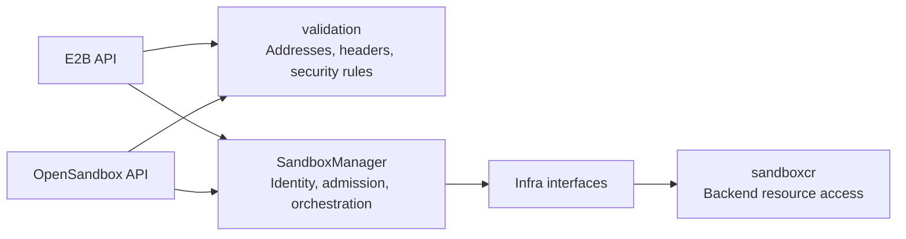
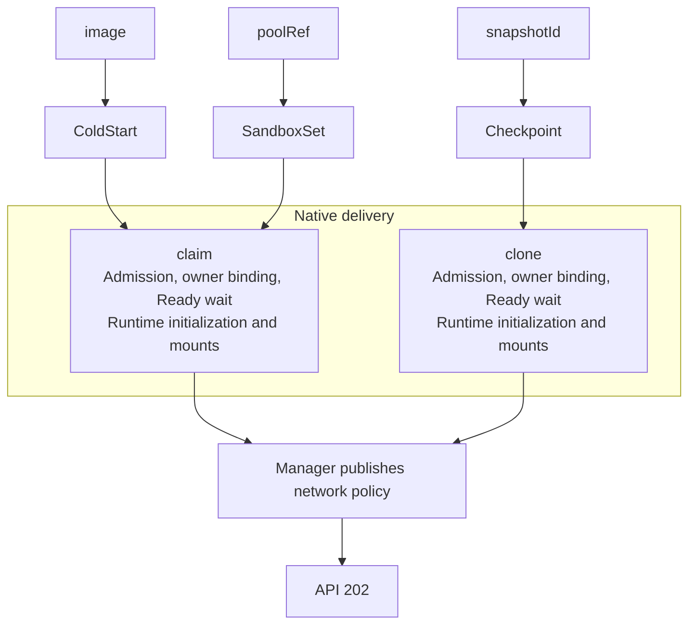
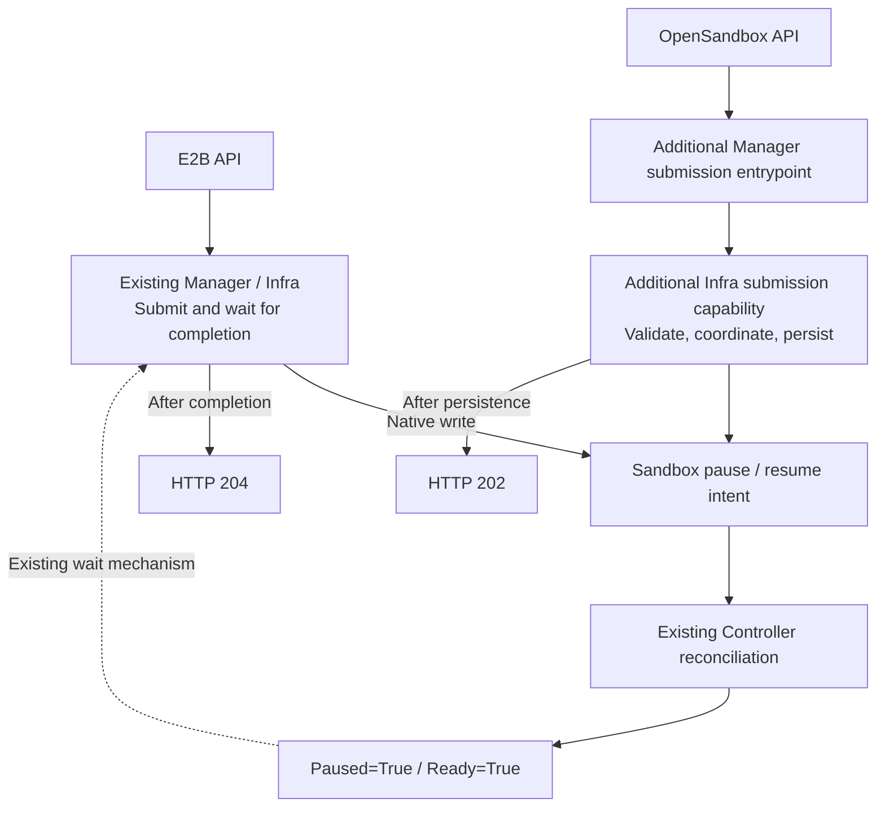
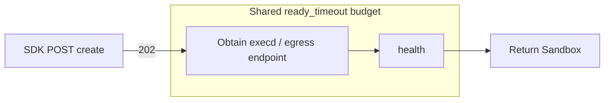
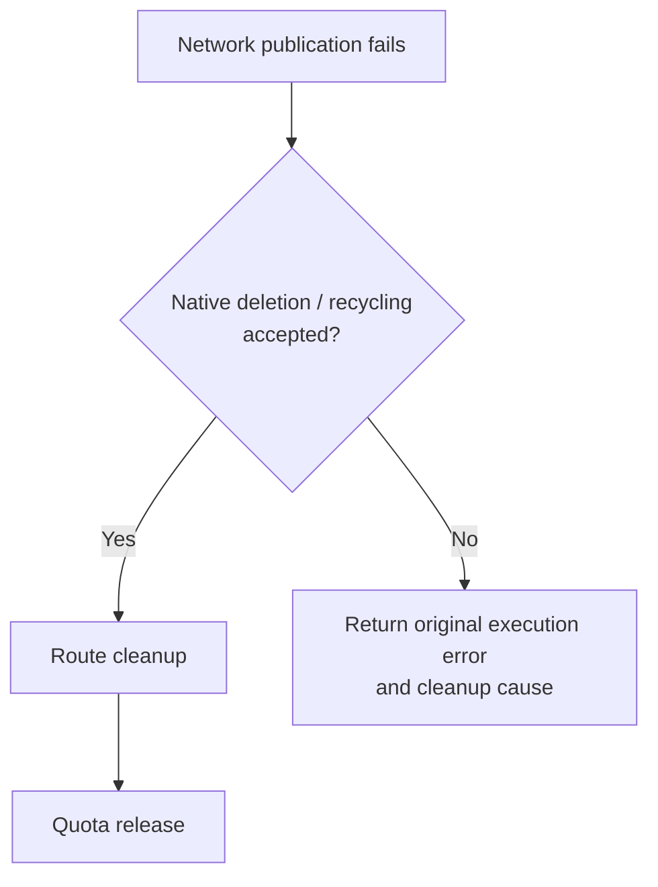

# OpenSandbox-Compatible API Adapter

## Table of Contents

- [Glossary](#glossary)
- [Summary](#summary)
  - [Create delivery](#create-delivery)
- [Motivation](#motivation)
  - [Goals](#goals)
  - [Non-Goals/Future Work](#non-goalsfuture-work)
- [Proposal](#proposal)
  - [User Stories](#user-stories)
    - [Story 1: Create from a source](#story-1-create-from-a-source)
    - [Story 2: Manage an instance](#story-2-manage-an-instance)
  - [Requirements (Optional)](#requirements-optional)
    - [Functional Requirements](#functional-requirements)
    - [Non-Functional Requirements](#non-functional-requirements)
  - [Implementation Details/Notes/Constraints](#implementation-detailsnotesconstraints)
    - [Architecture and responsibilities](#architecture-and-responsibilities)
    - [Baseline and validation](#baseline-and-validation)
    - [Control-plane authentication and authorization](#control-plane-authentication-and-authorization)
    - [Responses and errors](#responses-and-errors)
    - [Creation sources and execution order](#creation-sources-and-execution-order)
    - [Create field contract](#create-field-contract)
    - [Control-plane lifecycle](#control-plane-lifecycle)
    - [Data plane and SDK](#data-plane-and-sdk)
  - [Risks and Mitigations](#risks-and-mitigations)
    - [Failure cleanup and compatibility](#failure-cleanup-and-compatibility)
- [Alternatives](#alternatives)
- [Upgrade Strategy](#upgrade-strategy)
- [Additional Details](#additional-details)
  - [Test Plan [optional]](#test-plan-optional)
- [Implementation History](#implementation-history)

## Glossary

| Term | Meaning |
| --- | --- |
| API adapter | Translates the OpenSandbox protocol and calls shared Manager operations |
| Cold creation / Pool / snapshot | Construct a new Sandbox, claim SandboxSet inventory, or clone a Checkpoint |
| Best-effort update | Apply updates under native conditions; missing, zero-valued or ineligible resize fields may be skipped |
| Runtime initialization | Install or restore daemon configuration, separately from workload entrypoint startup |
| Endpoint / health | Subsequent SDK steps for obtaining data-plane addresses and checking availability |

## Summary

Add an OpenSandbox control-plane adapter to sandbox-manager for creation,
queries, listing, pause, resume, renewal and deletion. It shares the listener,
SandboxManager and KeyStorage with E2B. Protocol models and error formatting
stay in the API layer; execution follows native E2B behavior. Enable the adapter
with `--enable-opensandbox-compat`, which defaults to false.

This proposal describes the target control-plane design. PR989 implements only
`POST /v1/sandboxes`; queries, listing, pause, resume, renewal and deletion belong
to subsequent lifecycle delivery. Endpoint and runtime protocols have a separate
data-plane delivery boundary.

### Create delivery

| Creation mode | Delivered capability |
| --- | --- |
| Image cold creation | Construct a workload from an image; apply argv, env, CPU/memory, platform selection and existing-PVC mounts |
| Named Pool claim | Claim SandboxSet inventory; apply native image and CPU/memory updates, runtime initialization and CSI mounts |
| Snapshot recovery | Clone a Checkpoint, inherit recovery configuration and initialization credentials, and handle mounts under native conditions |

All three modes share API-key identity, quota/admission, instance ownership,
network-policy translation and failure cleanup.

## Motivation

[Adapter proposal #690](https://github.com/openkruise/agents/issues/690) calls for
an API adapter in the same process that reuses Agents orchestration, accepts the
OpenSandbox wire shape and documents behavioral differences between the systems.

### Goals

- Provide three creation sources using native allocation, initialization,
  mounting and networking.
- Provide instance queries, listing, pause, resume, renewal and deletion with
  explicit acceptance and completion boundaries.
- Preserve E2B defaults, validation and inheritance, and describe the actual
  execution result of each field.
- Separate protocol adaptation, business orchestration and backend
  implementation while preserving identity and ownership constraints.

### Non-Goals/Future Work

Input handling is defined in the field contract. The following capabilities are
outside this delivery for the stated reasons:

| Capability | Reason |
| --- | --- |
| A separate Lifecycle Server, reference provider topology and complete reference-schema validation | Reuse native checks and orchestration in the Agents process |
| image.auth, Pool platform and extended-resource overrides | No equivalent native request input; use platform image credentials and source preconfiguration |
| Snapshot startup-configuration and resource overrides | Clone restores recorded configuration and initialization credentials; it does not rewrite arbitrary workloads |
| secureAccess and credentialProxy | Endpoint-token delivery and credential-proxy lifecycle differ from native runtime tokens, header transforms and preconfigured platform security |
| preStart/periodic hooks | Native create has no equivalent request-level hook executor or scheduler |
| PVC provisioning/deletion, host and inline OSSFS | Mounting consumes identified existing storage; it does not add provisioning, shared-resource deletion ownership or inline credential management |
| Access-triggered renewal, execd isolation and other execution extensions | Storing strings does not provide the integration or runtime execution mechanism |
| A first-traffic barrier for request policies and strict resize confirmation | Preserve native policy publication order and best-effort updates without adding convergence waits or per-field confirmation |

**Future consideration or separate delivery:**

- Standalone `templateId` and `templateId + poolRef`: evaluate public template
  artifacts, version matching and an independent capacity model.
- Pool request entrypoint overrides: evaluate a process-start mechanism for each
  allocation.
- Automatic image prewarming, virtual templates and automatic pool selection:
  evaluate inventory, matching and recycling policy.
- Metadata updates, log/event diagnostics and snapshot management: define each
  contract separately before delivery.
- Public template creation, queries, listing and deletion: follow the artifact
  and build model rather than mapping directly to native SandboxTemplate.
- Endpoints, signed access, health, runtime network-policy management and execd
  command/file protocols: integrate runtime and credentials through a separate
  data-plane proposal.

Future evaluation does not commit this delivery to implementation.

## Proposal

### User Stories

#### Story 1: Create from a source

A caller supplies an image for a new workload, `extensions.poolRef` for existing
inventory, or a Checkpoint in the authenticated key's namespace for cloning.
The delivered instance belongs to the current key ID. Updates and recovery
contents follow the contract for the selected source.

#### Story 2: Manage an instance

A caller queries or lists their instances, submits pause/resume and polls actual
state. Ready marks restored availability. Renewal extends the instance deadline.
When finished, the caller requests deletion; shared Manager operations recycle
or delete the instance under native policy.

### Requirements (Optional)

#### Functional Requirements

**FR1: Creation sources and field mapping**

Allocate through the three sources. Apply, inherit, ignore overrides or store
inputs according to the field contract. Reject source conflicts and explicitly
unsupported execution inputs before allocation.

**FR2: Identity and lifecycle contracts**

Reuse KeyStorage identity and Manager authorization. Queries and operations use
the same namespace/owner constraints. The OpenSandbox API owns response projection
and error bodies. Pause/resume acceptance requires persisted intent, while the
Controller advances actual state. Explicit renewal returns its result after
successfully updating the deadline.

#### Non-Functional Requirements

**NFR1: Isolation and compatibility**

Preserve native E2B behavior and protect its existing lifecycle paths. User input
cannot overwrite system owner, token or route state, modify shared sources, or
acquire deletion ownership of existing volumes.

**NFR2: Layering, failure handling and verification**

Maintain `API -> Manager -> Infra` and the independent Controller boundary.
Bound cleanup work. Verify orchestration, real backend behavior and SDK flows
separately.

### Implementation Details/Notes/Constraints

#### Architecture and responsibilities

| Layer | Responsibility |
| --- | --- |
| `pkg/servers/opensandbox` | Routes, wire models, protocol authentication, source selection, responses and HTTP error mapping |
| `pkg/servers/validation` | Shared address/header validation and native security-rule normalization |
| Manager | Protocol-neutral identity, admission, allocation and lifecycle orchestration |
| Infra / `infra/sandboxcr` | Neutral Sandbox capabilities, concrete clients/caches and backend operations |
| Runtime / independent Controller | Daemon initialization and mounting / reconciliation from Sandbox CR to Pod |
| `cmd/sandbox-manager` | Assemble dependencies and register routes before the listener starts |

The API passes neutral Manager arguments. KeyStorage and metadata extension
parsing reuse existing components. OpenSandbox does not depend on the E2B root
package or handlers. Shared validation has no dependency on protocol packages,
Manager or Infra. The Controller's dependency closure remains independent of
API, Manager and Infra.

#### Baseline and validation

The reference release is [OpenSandbox 1.1.0](https://github.com/opensandbox-group/OpenSandbox/releases/tag/release-1.1.0),
with Python SDK `opensandbox==1.1.0`. Public fields are checked against its
[Lifecycle OpenAPI](https://github.com/opensandbox-group/OpenSandbox/blob/release-1.1.0/specs/sandbox-lifecycle.yml).
Server behavior explains provider conditions; the SDK explains client defaults
and serialization. Agents execution, defaults and validation follow native E2B.
The reference release resolves to commit
`b1a29cf93a823a95913f7943010febb3f29de05c`. The native Agents baseline for this
implementation is `7dc85e9491d8ca6203abd24b0a24b9612ea9d00b`.

- Retain a single Go JSON Decode: ignore unknown fields, handle null according
  to the destination type, and reject incompatible types during decoding.
- Retain authentication, source selection, quota/admission, metadata protection
  and actual network, mount and update constraints. Reference required fields,
  reserved env names and blanket field-combination bans are not automatically
  adopted.
- Omitted/null/zero timeout becomes 300 seconds, checked against the native
  30-second minimum and configured maximum. Ordinary metadata uses annotation
  semantics.

#### Control-plane authentication and authorization

This section covers control-plane API-key identity and resource authorization.
Endpoint/runtime credentials belong to the data plane.

**OpenSandbox behavior**

- The client supplies `OPEN-SANDBOX-API-KEY`.
- In single-tenant mode, the server compares it with `server.api_key` and uses
  the configured Kubernetes namespace. Authentication is skipped when no key
  is configured and multi-tenancy is disabled.
- In multi-tenant mode, a file or HTTP tenant provider resolves the key to a
  tenant and namespace. Creation, queries, listing and deletion are scoped to
  that namespace. A tenant can have multiple keys.

See the [OpenSandbox 1.1.0 multi-tenancy guide](https://github.com/opensandbox-group/OpenSandbox/blob/release-1.1.0/docs/guides/multi-tenancy.md#how-it-works).
A tenant's display name and namespace can differ.

**Agents behavior**

The E2B API supplies `X-API-Key` to existing KeyStorage. The stored key ID differs
from the credential string sent by the client. The key and its Team determine:

| Identity | Responsibility |
| --- | --- |
| Ordinary Team's name (`Team.Name`) | Kubernetes namespace for resolving SandboxSet, Checkpoint and other creation sources |
| Key ID | Caller identity, owner of the delivered Sandbox, native quota identity and subsequent instance authorization |

Keys in one Team can use the same source scope, but each delivered instance
belongs to its creating key. Queries check owner; listing filters by both
namespace and key ID. Admin Team keeps cross-namespace lookup scope and still
checks instance ownership. Legacy keys without a Team and the canonical admin
identity used when authentication is disabled follow native rules.

**Compatibility and differences**

The adapter accepts the OpenSandbox header and reuses Agents KeyStorage.
Clients put a valid Agents key in `OPEN-SANDBOX-API-KEY`; authorization still
uses Agents Team and key ID. Keys or tenants.toml from a separate OpenSandbox
server are not automatically imported.

For example, keys A and B belong to Team `alpha`. When A creates an instance,
its owner is A's key ID. B can resolve creation sources in `alpha`, but cannot
access A's instance. OpenSandbox keys in one tenant share namespace access;
Agents preserves per-key instance ownership. Replacing a key with a new key ID
does not automatically transfer instance access.

| Concern | Compatibility behavior or difference |
| --- | --- |
| Missing or invalid key | OpenSandbox distinguishes 401/MISSING_API_KEY and INVALID_API_KEY; Agents returns 401/UNAUTHORIZED/Invalid API Key for both, before allocation |
| Tenant-provider failure | OpenSandbox can return 503/TENANT_PROVIDER_UNAVAILABLE; Agents uses existing KeyStorage lookup results without adding this error category |
| Authentication disabled | Both protocols use native configuration; delivered instances bind to the canonical admin key ID and remain accessible through the corresponding admin key after authentication is enabled |

See the [reference authentication middleware](https://github.com/opensandbox-group/OpenSandbox/blob/release-1.1.0/server/opensandbox_server/middleware/auth.py).
Create binds source namespace and instance owner; object queries, lists and
operations enforce those ownership rules.

#### Responses and errors

**Responses and readiness**

Create returns HTTP 202. The reference response requires id, status, createdAt
and entrypoint, with optional metadata, extensions, platform and expiresAt.
Status requires state and optionally carries reason, message and lastTransitionAt.

The id is opaque. createdAt/expiresAt describe the delivered instance's lifetime;
absent entrypoint is emitted as an empty array. Metadata echoes user data,
labels and allowed diagnostic fields while filtering internal annotations.
The server writes `opensandbox.kruise.io/sandbox-resource` last, using the actual
namespace/name. Consumed native extensions are not echoed as ordinary metadata.
Pool/clone request entrypoint is protocol echo only.

The current create response omits the reference platform and
status.lastTransitionAt fields. It returns 202 after source orchestration and
network publication; SDK availability is established separately by endpoint/health.

**Errors**

The API maps domain errors to `{"code":"...","message":"..."}`, without adding
header or request-ID fields to the body.

| Scenario | Mapping |
| --- | --- |
| Invalid JSON, conflicting sources, unsupported execution input or native parameter rejection | 400 / INVALID_REQUEST |
| Missing/invalid key | 401 / UNAUTHORIZED |
| Native quota exceeded | 403 / FORBIDDEN |
| Create-source lookup failure | Preserve the native operation's error classification: domain ErrorNotFound maps to 400; unclassified errors map to 500 |
| Definitively missing instance or owner denial in subsequent lifecycle delivery | 404 / NOT_FOUND with identical bodies |
| Native conflict | 409 / CONFLICT |
| Internal execution, readiness or network-publication failure | Preserve native classification; generic failure is 500 / INTERNAL_ERROR |

Domain ErrorBadRequest and ErrorNotFound map to 400, ErrorQuotaExceeded to 403,
and ErrorConflict to 409, matching native E2B create. Internal and unclassified
errors, including cancellation errors without a domain classification, map to
500. Lookup timing and retries remain with the native operation; the adapter
does not replace clone failures with a boolean existence check.

#### Creation sources and execution order

**Supported source combinations**

This delivery adapts three entrypoints. OpenSandbox selects its backend through
deployment configuration. Ordinary Pool below means BatchSandbox Pool; snapshot
behavior first describes the container backend.

| Creation input | OpenSandbox 1.1.0 implementation | Agents adaptation |
| --- | --- | --- |
| `image.uri` | Docker pulls an image and creates a container; Kubernetes creates BatchSandbox or agent-sandbox resources whose Controllers create Pods. Request env/entrypoint configure the new workload | Translate to `ColdStartOptions`; Manager/Infra constructs a Sandbox and reuses claim admission, persistence, Ready waiting and initialization |
| Named `extensions.poolRef` | Create a BatchSandbox allocation referencing an existing Pool; taskTemplate executes env/entrypoint for that allocation. Workload image and resources come from the Pool | Select a SandboxSet and `ClaimSandbox` inventory. Apply native image/CPU/memory updates and runtime-init env. Retain the Pod entrypoint; request entrypoint is only echoed |
| `snapshotId` | Resolve a Ready snapshot for the current tenant, use `restore_config.image` as the restore image, and create a workload with current request configuration | Select a Checkpoint and `CloneSandbox`; inherit image, startup configuration and initialization credentials. Handle overrides according to the field contract |

Agents preserves the request entrypoints and applies native update/inheritance
rules. Image plus a named poolRef means a Pool image update; an ordinary
OpenSandbox Pool uses its pool-defined image/resources. FastSandbox snapshots
dispatch separately using the recorded backend identity; actual restored
contents depend on that backend.

See [BatchSandbox creation and Pool dispatch](https://github.com/opensandbox-group/OpenSandbox/blob/release-1.1.0/server/opensandbox_server/services/k8s/batchsandbox_provider.py)
and [snapshot restore resolution](https://github.com/opensandbox-group/OpenSandbox/blob/release-1.1.0/server/opensandbox_server/services/snapshot_restore.py).

Agents execution order:

Configuration overrides, requests/limits defaults, metadata precedence and mount
inheritance are defined below. Named Pools retain native revision and inventory
selection, with no-stock creation from the selected Set enabled by default.
Claim/clone returns after applicable initialization and mounts, then Manager
publishes network policy.

#### Create field contract

**The two matrices below describe Agents server behavior when receiving an
OpenSandbox create request.** Source selectors choose the execution branch;
configuration fields configure that source. Each row identifies a request field
or subfield, the three source columns describe Agents input handling, and the
last column states rejection conditions and unsupported capabilities. “Native”
means existing Agents E2B, Manager and Infra capabilities.

**Apply** means the value enters execution inputs; **inherit** retains source
configuration; **ignore override** accepts input without replacing execution
configuration; **store/echo only** preserves protocol data; **deferred/unsupported**
marks the current delivery boundary. Each cell assumes a resolved source and
successful applicable validation.

The matrices define source behavior. Field notes add defaults, material
differences and reasons for exclusions; verification is collected in the test plan.

**Source selectors**

`extensions.poolRef` is a subfield of the extensions string map. Other extensions
are configuration fields. Image with a named poolRef selects Pool claim and
requests an image update. An effective snapshotId conflicts with other effective
sources. templateId retains its field contract, but template creation is unsupported.
Effective selectors use nonblank values. Reject competing image/snapshot/template
selectors, snapshot plus poolRef, and requests without a supported source before
backend allocation. Image plus poolRef selects Pool rather than cold creation.

| OpenSandbox request field / Agents creation source | Image cold creation | Named Pool claim | Snapshot recovery | Agents rejection / unsupported capability |
| --- | --- | --- | --- | --- |
| image | Apply | Native update | Inherit | Non-null auth; nonempty clone image update |
| snapshotId | Not selected | Not selected | Native clone | Competing source combinations |
| templateId | Unsupported in this create delivery | Unsupported in this create delivery | Unsupported in this create delivery | Effective nonblank value, including template plus Pool: 400 |
| extensions.poolRef | Not selected | Select SandboxSet | Not selected | Effective snapshotId combination, automatic selection `*`, template plus Pool |

**image**

- **Wire/defaults:** Optional object with uri and optional auth.username/password.
  Reference image mode requires URI, entrypoint and resourceLimits; Agents selects
  the source using an effective URI without copying those required-field checks.
- **Mapping:** Apply URI in cold creation. Image plus poolRef requests a native
  named-Pool image update; native metadata image extensions take precedence.
  Snapshot rejects nonempty image updates.
- **Rejection and difference:** Non-null `image.auth` returns 400; no request-level
  pull secret is created or managed, and auth.username/password do not enter
  execution. Image pulling uses existing platform credentials. Automatic
  prewarming is deferred.

**snapshotId**

- **Wire/defaults:** Optional string; omitted/null/blank values select no source.
  An effective value conflicts with image/templateId/ordinary poolRef. Reference
  container recovery uses an image artifact and current request configuration;
  Agents preserves checkpoint configuration and recovery-content semantics.
- **Mapping:** Explicit snapshotId directly calls Manager → Infra CloneSandbox.
  Native clone owns Checkpoint lookup, cache retries and cancellation. The API
  performs no preliminary HasCheckpoint query, and no Manager existence-query
  wrapper is added. There is no same-name Set fallback. Reference provider
  restrictions are not all reproduced.
- **Inheritance and rejection:** Inherit image, command/env, scheduling and runtime
  credentials. Ignore request env/entrypoint/platform overrides; reject nonempty
  image/resource updates.

**templateId**

An OpenSandbox public template selects a built artifact and independent capacity.
An Agents Set selects work inventory, while Checkpoint selects a recovery source.
Those native selectors cannot directly provide equivalent artifact, version and
capacity guarantees; this delivery adds neither alias dispatch nor a new catalog.

- **Wire/defaults:** Optional string. The reference resolves a tenant's Succeeded
  artifact and can select capacity with poolRef. Agents documents the field but
  does not execute template creation.
- **Boundary:** Standalone templateId and templateId + poolRef are unsupported.
  An effective nonblank value returns 400, with no Set/Checkpoint alias dispatch,
  public-catalog lookup or allocation. Empty/null/blank values select no template;
  other effective selectors still determine the operation.
- **Difference:** Source-conflict checks remain. Reference-valid template requests
  are incompatible with this delivery. Native E2B template behavior is preserved;
  template lookup and claim/clone call counts remain zero for rejected requests.

**extensions.poolRef**

- **Wire/defaults:** extensions is a string map; poolRef is a pool name. An
  omitted/null/empty map or blank poolRef selects no pool. An effective named value
  selects ordinary Pool; `*` requests reference automatic selection.
- **Mapping:** Select a SandboxSet and claim native inventory. Its inline
  template/templateRef defines the workload; replicas represents unclaimed
  inventory, and rolling updates can retain old and new revisions. Support native
  image and CPU/memory updates and no-stock creation.
- **Boundary:** Automatic selection `*` and templateId + poolRef return 400. No
  reference capacity queue or 429/Retry-After contract is added.

**Configuration fields**

| OpenSandbox request field / Agents creation source | Image cold creation | Named Pool claim | Snapshot recovery | Agents rejection / unsupported capability |
| --- | --- | --- | --- | --- |
| platform | Apply nodeSelector | Inherit | Inherit; ignore override | Nonempty Pool override |
| timeout | Native lifetime | Native lifetime | Native lifetime | Outside native bounds |
| resourceLimits | Apply | Best-effort update | Inherit | Extended-resource keys; nonempty clone update |
| resourceRequests | Apply with cold-creation fallback | Independent best-effort update | Inherit | Extended-resource keys; nonempty clone update |
| env | Workload and initialization | Runtime initialization; no Pod-process override | Inherit; ignore override | No new startup-override mechanism |
| metadata | Native parsing and protection | Native parsing and recycling | Native parsing; preserve restore order | Native invalid/protected-key rejection |
| entrypoint | Execute argv or use image default | Inherit; request echo only | Inherit; request echo only | Pool request override deferred |
| networkPolicy | Native publication order | Native publication order | Native publication order | Unsupported addresses or limits exceeded |
| secureAccess | Disabled | Disabled | Disabled | true unsupported: 400 |
| credentialProxy | Disabled | Disabled | Disabled | enabled=true unsupported: 400 |
| lifecycle | No hook execution | No hook execution | No hook execution | Actual preStart/periodic requests: 400 |
| volumes | Existing-PVC Pod mounts | Native CSI conditions | Native CSI conditions / inheritance | host/inline OSSFS, missing PVC, etc.; provisioning hints ignored |
| extensions other than poolRef | Supported storage extensions | Supported storage extensions | Supported storage extensions | Execution extensions without an implemented mapping |

**platform**

- Optional os/arch object. Reference support depends on provider/runtime.
  Agents maps supplied image os/arch to nodeSelector. Omission does not guarantee
  a fixed architecture, and a selector alone does not establish Windows runtime
  compatibility.
- Snapshot accepts but ignores overrides. Pool returns 400 for effective os/arch;
  an empty object requests no override. Template mode is unsupported in this
  create delivery.

**timeout**

- **Reference:** Optional integer seconds for instance lifetime, with a minimum
  of 60 and a deployment-configured maximum. Ordinary image/snapshot/Pool
  omission or null can mean no deadline; 0 and 30–59 are invalid, and template
  requires non-null timeout. Docker stores an expiry for cleanup, BatchSandbox
  writes expireTime and agent-sandbox writes shutdownTime. The checked Kubernetes
  branches support no deadline. HTTP, allocation-wait and SDK ready_timeout
  budgets are separate.
- **Agents:** Omitted/null/zero becomes 300 seconds for every source, followed by
  the native 30-second minimum and configured maximum. Ordinary creation writes
  ShutdownTime; native never-timeout metadata can clear deadlines. OpenSandbox
  create has no execution mapping for autoPause, autoResume or autoPauseMemory;
  metadata and lifecycle hooks do not substitute for those native E2B fields.
- **Difference:** Reference template required-field and 60-second minimum checks
  are not adopted. Omission of top-level timeout alone does not mean unlimited
  lifetime.

**resourceLimits**

- **Reference:** Optional string map for cpu, memory, gpu and runtime-supported
  resource names. Image/snapshot require non-null input but accept an empty map;
  cpu/memory are not individually mandatory.
- **Agents:** Image parses CPU/memory quantities into the workload. Pool uses
  native InplaceUpdate, with metadata precedence per key. Omitted/empty maps keep
  unspecified values. Snapshot nonempty updates and request keys other than
  cpu/memory return 400. Source templates may preconfigure other resources;
  request-level overrides are unsupported.
- **Difference:** Pool retains native best-effort updates of already configured,
  nonzero resource fields. Memory cannot decrease, merged requests cannot exceed
  limits, and QoS cannot change. Ready does not confirm that every accepted
  resize has taken effect.

For both resource maps, keys other than cpu/memory return 400 across all three
creation sources. They are not silently discarded. This preserves the supported
resource boundary of native E2B in-place updates without changing the resources
already configured on a source template.

**resourceRequests**

- **Reference:** Optional string map. OpenAPI describes fallback from limits when
  omitted; reference Kubernetes also falls back for an empty map. A nonempty map
  replaces requests as a whole without per-key fallback.
- **Agents:** Pool requests and limits update independently. Omitted/null/empty
  requests retain source requests; partial maps update only supplied keys, with
  metadata precedence per key. Image cold creation retains its empty-requests
  fallback from limits.
- **Rejection:** Nonempty clone updates and extended-resource keys return 400;
  reference fallback does not rewrite checkpoint resources.

**env**

- **Reference:** Optional string map; omitted/null/empty input supplies no request
  variables. OPENSANDBOX_LIFECYCLE is reserved for hook transport. Templates
  reject any non-null env, including an empty map.
- **Agents:** Image writes workload env and uses native initialization settings.
  Pool passes variables to `/init`, subject to native skip-init; this does not
  rewrite already running Pod processes. Snapshot reinitializes from checkpoint
  information; native ReInit 401 means already initialized.
- **Difference:** Snapshot request env is accepted without overriding recovery
  configuration. No checkpoint-runtime override mechanism or reference reserved
  env-name check is added.

**metadata**

- **Reference:** Optional string map; omitted/null/empty input supplies no user
  metadata. Public examples can include names with spaces. Container providers
  store/filter labels and check keys/values, 63-character values and the
  opensandbox.io/ reserved prefix.
- **Agents:** ParseExtensions runs first and consumes native options. Ordinary
  metadata becomes annotations; `label:` keys become labels tracked for recycling.
  Protect system keys and retain native naming/generated-name, timeout, runtime,
  mount and network extension inputs.
- **Security rules:** `pkg/servers/validation.NormalizeSecurityRules` validates
  parsed native SecurityRule values, defaults actions and serializes them.
  E2B-specific `network.rules` translation stays in E2B. Public metadata cannot
  write system owner, token or internal route state.
- **Difference:** Ordinary values follow annotation semantics without label-value
  length limits. The display key `name` does not automatically rename Sandbox.
  Clone retains native modifier/restore order and inheritance precedence.

**entrypoint**

- **Reference:** Optional argv array, requiring at least one string when supplied.
  Explicit `[]` fails reference validation; image requires entrypoint.
  Snapshot/Pool omission uses `["tail", "-f", "/dev/null"]`. Templates reject
  non-null overrides and use the recorded entrypoint.
- **Agents:** Image preserves argv boundaries as workload command; omitted/empty
  arrays use the image default. Callers must explicitly select a shell for shell
  expansion.
- **Boundary:** Pool retains its source entrypoint, and snapshot retains restored
  command/args. Both accept request entrypoint without executing the override;
  the response may echo it. Pool request entrypoint execution is deferred.

**networkPolicy**

networkPolicy controls sandbox-to-external outbound traffic. secureAccess and
credentialProxy are sibling create fields: they protect client endpoint access
and enable outbound credential proxying, respectively.

| Subfield | OpenSandbox 1.1.0 contract and reference behavior | Agents compatibility behavior |
| --- | --- | --- |
| `defaultAction` | Contract lists allow/deny and defaults omission to deny; the reference model also accepts null/empty string, normalized to deny by the egress parser | Omitted/null/empty string uses native internet access=true; allow=true, deny=false; other actions return 400 |
| `egress` | Ordered rules; domain rules use first match, while IP behavior also depends on dns/dns+nft mode. Explicit null fails reference-model validation | Omitted/null/empty array means no local rules. Split nonempty rules into allow/deny groups, allow first, at most 100 entries per group; interleaved order is not preserved |
| `egress[].action` | Required allow/deny in the contract; omission/null fails reference-model validation. The egress parser normalizes empty string to deny | Trim and lowercase actions; omitted/null/empty string means deny, other actions return 400. target must still be valid |
| `egress[].target` | Required nonempty string; the contract describes domains/wildcards, while the checked egress parser also recognizes IP/CIDR | allow accepts concrete FQDN and IP/CIDR; deny accepts only IP/CIDR. Wildcard, missing/null/empty target returns 400 |

| Request input | OpenSandbox 1.1.0 | Agents compatibility behavior |
| --- | --- | --- |
| networkPolicy omitted or null | The checked Kubernetes container path creates no request-level egress sidecar | No local request rules; internet-access label=true. Existing platform network settings still apply |
| `networkPolicy: {}` | OpenAPI describes startup allow-all; the checked Kubernetes creation chain and egress parser actually normalize to deny | Internet-access label=true, no local TrafficPolicy; this input does not request an additional proxy |
| `networkPolicy: {"egress":[]}` | Empty rules normalize to deny on the checked path when defaultAction is omitted, subject to the contract discrepancy below | Same as empty object; no local TrafficPolicy |
| `networkPolicy: {"egress":null}` | Violates the array contract and fails reference-model validation | Accepted as no rules; defaultAction is still handled independently. If omitted too, same as empty object |
| Only `defaultAction: allow` | Explicit default allow; Kubernetes still configures an egress sidecar | Internet-access label=true, no local TrafficPolicy |
| Only `defaultAction: deny` | Explicit default deny | Internet-access label=false; retain the traffic-proxy requirement. No local TrafficPolicy; native platform policy handles the default |
| Valid nonempty rules, defaultAction omitted | Unmatched traffic defaults to deny | Internet-access label=true; unmatched local rules fall through to native platform policy, differing from the reference deny default |
| Rule item `{}` or null | Missing required action/target; fails reference-model validation | Empty target causes 400 before allocation |

The OpenAPI startup allow-all description for empty objects/rules differs from
the checked [Kubernetes creation configuration](https://github.com/opensandbox-group/OpenSandbox/blob/release-1.1.0/server/opensandbox_server/services/k8s/create_helpers.py#L103-L118)
and [egress parser](https://github.com/opensandbox-group/OpenSandbox/blob/release-1.1.0/components/egress/pkg/policy/policy.go#L60-L74).
The tables distinguish the contract from that execution path. Kubernetes also
requires configured egress; other providers need separate support checks.
Ordinary Pool rejects networkPolicy, while template plus Pool uses a dedicated
mapping. Agents publishes policies through native paths for all three sources.

**Native policy scope and publication**

Agents supports cluster, tenant and per-instance network settings. This request
only translates instance inputs: TrafficPolicy rules select the actual Pod,
and defaultAction sets the internet-access label. Native data-plane configuration
handles cluster/tenant policy, priority and fallback. Explicit deny does not add
a terminal deny-all rule or an empty policy object.

Manager publishes after native allocation and applicable Ready waiting, runtime
initialization and mounts. Publication failure deletes/recycles the instance,
cleans routes and releases quota. Canceled requests use a separate 30-second
cleanup context. Selectors use Controller-managed Pod UID labels with legacy
Pod-name fallback. Enforcement requires configured traffic-proxy.

**First-traffic gap:** Sandbox precedes Pod creation, providing an orchestration
point, but the current Controller does not wait for this request's policy.
Workloads may start before publication or proxy synchronization. HTTP 202 does
not confirm per-policy data-plane convergence. This delivery retains native
ordering without scheduling gates, fixed startupProbe checks or policy ACKs.
Preconfigured platform policies continue to apply under native conditions.

**secureAccess / credentialProxy**

| Top-level field / subfield | Reference purpose and dependencies | Agents behavior and gap |
| --- | --- | --- |
| `secureAccess` | Inbound endpoint protection, default=false. Supported Kubernetes ingress gateways generate a token delivered through endpoint-response headers; separate from control-plane API keys, daemon authentication and signed URLs | true returns 400; omitted/null/false is accepted. The public endpoint-credential contract is not connected; native API-key and runtime authentication remain |
| `credentialProxy.enabled` | Transparent outbound proxy and credential injection, default=false. Enabling requires networkPolicy and dns+nft; network rules alone do not enable the proxy. Secrets/injection rules use subsequent APIs | true returns 400; omitted/null/empty object/false is accepted. The credential proxy and secret-configuration lifecycle are not connected |

Native SecurityProfile/Secret token injection and plaintext header transforms
retain their platform roles. Inline security rules still reject
tokenTransformation. These differ from endpoint credential delivery, transparent
HTTPS interception and credential-management request contracts; this delivery
adds no corresponding execution mechanism.

**lifecycle**

| Subfield | Reference definition | Delivery behavior |
| --- | --- | --- |
| `preStart.command` | argv in a hook object, before entrypoint startup | Non-null preStart returns 400; no execution |
| `preStart.timeoutSeconds` | 1–10800 seconds; execution default=60 | Not consumed; no new timeout executor |
| `periodic[].name` | Unique nonempty name | Nonempty periodic array returns 400 |
| `periodic[].schedule` | cron/supported descriptors with reference constraints | Not consumed; no scheduler |
| `periodic[].command` | argv | No execution |
| `periodic[].timeoutSeconds` | 1–300 seconds; execution default=60 | Not consumed |

Native create has no equivalent request-level hook executor. Auto-pause/resume
and Controller template hooks have different executors and timing.
Omitted/null/empty lifecycle or an empty periodic array is accepted; non-null
preStart or nonempty periodic returns 400. No executor or scheduler is added.

**volumes**

| Subfield | Behavior and scope |
| --- | --- |
| `name` | Request-local volume name; validate syntax and uniqueness before using it in mount inputs |
| `mountPath` | Absolute container path, applied to the mount |
| `subPath` | Relative path, applied where supported; reject parent traversal |
| `readOnly` | Default=false, subject to native source and driver constraints |
| `pvc.claimName` | Reference only an existing, non-terminating PVC in the workload namespace |
| `pvc.createIfNotExists` | Reference default=true; ignored here, with no provisioning of missing PVCs |
| `pvc.deleteOnSandboxTermination` | Reference default=false; ignored here, with no PVC deletion ownership |
| `pvc.storageClass/storage/accessModes` | Ignored; not inputs for modifying or provisioning an existing PVC |
| `host.path` | Unsupported; host source returns 400 |
| `ossfs.bucket/endpoint/version/options/accessKeyId/accessKeySecret` | Inline OSSFS unsupported; ossfs source returns 400 and credentials do not enter execution |

- **Wire/defaults:** Optional array; omitted/null/empty input means no requested
  mounts. Each item has a request-unique name, absolute mountPath, optional
  relative subPath/readOnly and one source. Only existing PVCs are consumed.
- **Mapping:** Image uses existing-PVC Pod volumes. Pool/clone resolves a Bound PVC
  to a matching PV and native CSI provider, requiring binding identity and driver
  availability. Runtime mounts follow initialization; inherited workloads may
  already be running.
- **Native CSI input:** Simple volumeMounts name/path becomes CSI PV source and
  mount path. Full configuration includes mountID/pvName/mountPath/subPath/
  readOnly/attributes; readOnly also depends on PV access modes. Metadata CSI
  directly selects PV/provider without requiring OpenSandbox PVC resolution.
- **Ignored/rejected:** Provisioning, recycling and storage hints are ignored for
  existing PVCs. Missing PVC returns 400 even with createIfNotExists=true.
  Combining OpenSandbox volumes and native metadata CSI sources returns 400;
  native initialization constraints remain. Snapshot omission retains native
  mount records; a supplied list follows native clone mapping.

Official on-demand mounting documentation currently excludes checkpoint
restoration, while native clone parses and executes mount records. Unit tests
establish control-plane orchestration; driver-specific checkpoint restoration
still requires deployment evidence.

**extensions other than poolRef**

| Extension | Reference purpose | Delivery behavior |
| --- | --- | --- |
| `access.renew.extend.seconds` | Integer string in 300–86400, saved for access-triggered renewal integration | Automatic access renewal unsupported; this execution extension returns 400 |
| `bootstrap.execd.isolation` | enable changes bwrap startup, permissions and mount requirements | No isolation execution; direct execution extension without an implemented mapping returns 400 |
| `opensandbox.extensions.*` | Extension encoding and retrieval | Store/echo valid annotation keys without renewal, isolation or other execution semantics |
| Other nonempty extensions | Provider-specific or transient meaning | Return 400 without a documented mapping; do not silently discard |

Omitted/null/empty maps perform no extension operation. Native metadata
extensions still use the separate metadata input. Native autoResume means
wake-on-access only.

Stored extensions use the opensandbox.io/extensions.* annotation codec, preserve
empty values and track recycling with user metadata. Extensions win collisions
with metadata. Invalid annotation names fail before allocation. Storing a string
does not implement execution. Verify storage encoding, echo and recycling;
execution capabilities require evidence of their actual effects.

#### Control-plane lifecycle

Only create is implemented in PR989. The lifecycle mappings and submission
behavior below specify subsequent delivery, sharing this proposal's identity,
layering and error design; they are not additional routes enabled by PR989.

**Interfaces and native mapping**

The mapping covers public methods of Python SDK 1.1.0 `Sandbox` and
`SandboxManager`. Their [synchronous equivalents](https://github.com/opensandbox-group/OpenSandbox/tree/b1a29cf93a823a95913f7943010febb3f29de05c/sdks/sandbox/python/src/opensandbox/sync),
SandboxSync and SandboxManagerSync, have the same method names and scope.
The fixed-version [Sandbox](https://github.com/opensandbox-group/OpenSandbox/blob/b1a29cf93a823a95913f7943010febb3f29de05c/sdks/sandbox/python/src/opensandbox/sandbox.py),
[SandboxManager](https://github.com/opensandbox-group/OpenSandbox/blob/b1a29cf93a823a95913f7943010febb3f29de05c/sdks/sandbox/python/src/opensandbox/manager.py)
and [Sandboxes service protocol](https://github.com/opensandbox-group/OpenSandbox/blob/b1a29cf93a823a95913f7943010febb3f29de05c/sdks/sandbox/python/src/opensandbox/services/sandbox.py)
distinguish core routes, deferred routes and SDK-local methods below.

**Instance management**

| SDK entrypoint | HTTP interface | Agents mapping and delivery boundary |
| --- | --- | --- |
| `Sandbox.create` | `POST /v1/sandboxes` | Allocate through the three sources and return 202; subsequent SDK endpoint/health steps are separate delivery. Pool-only uses direct HTTP |
| `Sandbox.create_from_template` | Same route, with templateId | Unsupported in this create delivery; standalone templateId and templateId + poolRef return 400 before allocation, for the reasons in the source/field contract |
| `SandboxManager.list_sandbox_infos` | `GET /v1/sandboxes` | Manager lists currently visible instances filtered by namespace and owner |
| `Sandbox.get_info` / `SandboxManager.get_sandbox_info` | `GET /v1/sandboxes/{id}` | Manager loads and authorizes; API projects observed state and reasons, which may lag operation acceptance |
| `Sandbox.pause` / `SandboxManager.pause_sandbox` | `POST /v1/sandboxes/{id}/pause` | Manager → Infra submits pause intent; return 202 after persistence or confirmation of an existing same-direction intent. Controller completes actual suspension |
| `Sandbox.resume` / `SandboxManager.resume_sandbox` | `POST /v1/sandboxes/{id}/resume` | Same acceptance boundary; Ready marks restored availability. The high-level Sandbox method also performs the connection steps below |
| `Sandbox.renew` / `SandboxManager.renew_sandbox` | `POST /v1/sandboxes/{id}/renew-expiration` | Absolute expiresAt → ShutdownTime, preserving PauseTime; return 200 with expiresAt after persistence, or an error on failure |
| `Sandbox.kill` / `SandboxManager.kill_sandbox` | `DELETE /v1/sandboxes/{id}` | Native recycling/deletion; after acceptance, clean routes, release quota and return 204. Backend reclamation continues afterward |
| `Sandbox.patch_metadata` / `SandboxManager.patch_sandbox_metadata` | `PATCH /v1/sandboxes/{id}/metadata` | Deferred, not connected. String add/replace and null deletion require a separate patch design; create annotation storage does not implement this route |
| `Sandbox.get_endpoint` / `Sandbox.get_signed_endpoint` | `GET /v1/sandboxes/{id}/endpoints/{port}` | Separate data-plane delivery, not connected. Signed access passes expires (Unix seconds) on this route; address, proxy, credentials and expiry need coordinated adaptation |

**Snapshots, templates and diagnostics**

The following routes are deferred and not connected. Snapshot recovery consumes
existing Checkpoints; snapshot creation, listing, queries and deletion need
separate artifact, state, authorization and cleanup contracts. Public template
management includes asynchronous builds and artifacts, unlike native
SandboxTemplate configuration references. No build service or catalog is added.
Diagnostics need separate scope, content-delivery and permission design; routes
follow the [Diagnostics OpenAPI](https://github.com/opensandbox-group/OpenSandbox/blob/b1a29cf93a823a95913f7943010febb3f29de05c/specs/diagnostic-api.yml).

| SDK entrypoint | HTTP interface | Scope |
| --- | --- | --- |
| `Sandbox.create_snapshot` / `SandboxManager.create_snapshot` | `POST /v1/sandboxes/{id}/snapshots` | Snapshot management, separate from create(snapshot_id=...) recovery |
| `SandboxManager.get_snapshot` | `GET /v1/snapshots/{snapshotId}` | Snapshot details and state |
| `SandboxManager.list_snapshots` | `GET /v1/snapshots` | Snapshot filtering and pagination |
| `SandboxManager.delete_snapshot` | `DELETE /v1/snapshots/{snapshotId}` | Snapshot deletion and artifact ownership |
| `SandboxManager.create_template` | `POST /v1/templates` | Public template creation and asynchronous build |
| `SandboxManager.get_template` | `GET /v1/templates/{templateId}` | Template details and build state |
| `SandboxManager.list_templates` | `GET /v1/templates` | Template filtering and pagination |
| `SandboxManager.delete_template` | `DELETE /v1/templates/{templateId}` | Template deletion and artifact cleanup |
| `Sandbox.get_diagnostic_logs` / `SandboxManager.get_diagnostic_logs` | `GET /v1/sandboxes/{id}/diagnostics/logs` | Scoped log-content descriptions; distinct from execd command output |
| `Sandbox.get_diagnostic_events` / `SandboxManager.get_diagnostic_events` | `GET /v1/sandboxes/{id}/diagnostics/events` | Scoped event-content descriptions |

**SDK composition and local resources**

| SDK entrypoint | Actual behavior and compatibility boundary |
| --- | --- |
| `Sandbox.connect` | Obtain endpoints, rebuild service adapters and optionally check health. No separate connect route; does not implicitly create, resume or renew. The full flow belongs to data-plane delivery |
| `Sandbox.resume` | After submitting resume, reacquire endpoints, rebuild adapters, optionally check health and return Sandbox. SandboxManager.resume_sandbox only submits the request. Verify 202 acceptance and full SDK restoration separately |
| `Sandbox.destroy` | kill followed by close in finally; local cleanup also runs after deletion failure, then the deletion error propagates. No separate destroy route |
| `Sandbox.close` / `SandboxManager.close` | Close SDK-owned local HTTP transport. Context-manager exit calls close; the remote instance remains |
| `SandboxManager.create` | Construct a management client and service adapters without a remote Sandbox creation request |

**Related network and runtime entrypoints**

| SDK entrypoint | Call surface and delivery boundary |
| --- | --- |
| `Sandbox.get_egress_policy` / `Sandbox.patch_egress_rules` / `Sandbox.delete_egress_rules` | Ordinary sources call the egress sidecar; origin=template calls control-plane GET/PATCH/DELETE /v1/sandboxes/{id}/networkpolicy, respectively. Runtime policy management is separate and not connected; create networkPolicy only handles creation inputs |
| `Sandbox.is_healthy` / `Sandbox.check_ready` | Runtime health or custom checks, separately delivered; no control-plane state-transition route |
| `Sandbox.get_metrics` / `Sandbox.metrics` | Runtime metrics through the execd endpoint; separate data-plane scope |
| `Sandbox.files` / `Sandbox.commands` / `Sandbox.isolation` / `Sandbox.credential_vault` | File, process, isolation-session and credential-service handles. File/command protocols are separate delivery; isolation and credentials are unsupported here. Service submethods belong to their respective proposals |
| `Sandbox.diagnostics` | Diagnostics handle for the log/event routes above; origin and connection_config are client properties |

Lifecycle OpenAPI also defines full replacement through
`PUT /v1/sandboxes/{id}/networkpolicy`, without a convenience method on the
high-level Python Sandbox class; this route is also deferred.
`POST /v1/metrics/events` reports SDK creation telemetry and is a separate
observability interface. The service protocol's invalidate_endpoint_cache is
local cache maintenance. Neither performs Sandbox lifecycle transitions.

**Asynchronous acceptance, concurrency and completion**

E2B retains the native path in which HTTP waits for completion while the
Controller executes asynchronously. OpenSandbox adds Manager and Infra submission
entrypoints, returning 202 after persisting intent, and shares the existing
Sandbox model and Controller state machine.

- **Protect existing paths:** Preserve E2B handlers, Manager PauseSandbox/
  ResumeSandbox and Infra Sandbox.Pause/Sandbox.Resume signatures and bodies.
  PauseOptions/ResumeOptions remain unchanged. Add no submission-mode switch to
  old flows and do not extract or redirect their submit/wait logic for deduplication.
  Native state validation, deadline updates, errors, waiting and post-completion
  route synchronization stay on their original paths.
- **Additional entrypoints:** Add Manager pause/resume intent submission using
  object authorization and native business rules, backed by additional
  protocol-neutral Infra capabilities. Only OpenSandbox calls them. API code
  does not directly operate CRDs, concrete Infra or cache wait tasks. Submission
  failure, cancellation and state conflicts retain native error classifications.
- **Reuse boundary:** Call existing native state checks, informer caches and
  pause/resume coordination primitives. Establish coordination before writing and
  release it when submission exits, without waiting for completion. Existing wait
  tasks, coordination implementations and Controller remain unchanged. New
  submission orchestration stays in the additional path; refactoring old paths
  into shared logic is outside this integration.
- Infra uses informer observations and partial patches with resourceVersion
  preconditions. Confirm the version before accepting existing same-direction
  intent too. Bound conflict retries, check cancellation and return 409 when
  retries are exhausted. Add no APIReader reads.
- Same-direction repeated submissions that pass native state guards are
  idempotently accepted. Resume during incomplete pause, or pause during
  incomplete resume, returns 409, including the window where resume intent is
  written but phase is still Paused. Infra owns state decisions.
- OpenSandbox pause/resume retains existing instance deadlines. Only an
  intent-changing request may write accompanying deadline or pause annotations.
  If a neutral resume call also supplies a deadline, commit it atomically with
  clearing pause.
- Reuse Controller reconciliation, restored runtime initialization and CSI
  mounting. Ready marks restored availability; adaptation does not change
  Controller state, conditions or initialization order. Queries project
  observations without preemptively changing state after 202.
- Accepted intent survives caller disconnect or Manager restart. Submission does
  not run native post-wait route synchronization. Existing informer subscriptions
  follow state/address changes and rebuild routes from initial lists at startup;
  E2B retains post-completion synchronization.

**Deletion and resource ownership**

Deletion follows native recyclable-instance policy, including deletion fallback
after recycling failure. Success means deletion or recycling was accepted.
Shared SandboxSets, Checkpoints and existing PVCs/PVs keep their ownership;
instance cleanup acquires no deletion rights over those sources.

**Renewal versus deadline reset**

Explicit renewal extends instance lifetime and is separate from
access-triggered `access.renew.extend.seconds`, which is unsupported.
Request expiresAt uses RFC3339, must be later than now and the existing deadline,
and must respect configured maximum lifetime. Invalid, non-extending or
out-of-range input returns 400.

| Comparison | Behavior and compatibility boundary |
| --- | --- |
| OpenSandbox 1.1.0 | SDK renew(timeout) sends expiresAt as now plus duration; the public renewal contract requires it to exceed now and the current deadline |
| Native Agents E2B | For a running instance whose deadline can be set, reset it from now plus request seconds; this can shorten or extend it under native timeout policy and limits |
| Compatibility surface | Only extend deadlines. Shortening is unsupported; add no private parameter or SDK modification for it |

The SDK can serialize an earlier expiresAt, but it violates the public renewal
contract. The gap is deadline-reset versus renewal semantics. Other boundaries,
including renewal-state constraints, still need separate verification.
See [SDK renewal](https://github.com/opensandbox-group/OpenSandbox/blob/b1a29cf93a823a95913f7943010febb3f29de05c/sdks/sandbox/python/src/opensandbox/sandbox.py#L342)
and RenewSandboxExpirationRequest in the Lifecycle OpenAPI above.

#### Data plane and SDK

**Initialization and separate runtime delivery**

Initialization and inheritance follow the three-source field contract. execd
adaptation belongs to agent runtime under [Sidecar runtime proposal #669](https://github.com/openkruise/agents/pull/669).
Manager uses neutral operations; transport and credential handling stay in runtime,
preserving the E2B/envd path.

**SDK and server completion boundaries**

SDK 1.1.0 ordinary create defaults to timeout=600 seconds, CPU=1, memory=2Gi,
a keep-alive entrypoint and secureAccess=false. timeout=None sends null.
The ordinary high-level method requires image or snapshot_id; Pool-only can use
direct HTTP. The converter may omit empty maps. create_from_template is separate.

ready_timeout defaults to 30 seconds and health polling to 200ms. Skipping health
still acquires endpoints. Template mode uses the execd endpoint and control-plane
policy path; ordinary mode uses execd/egress endpoints and returned origin.
Connection and health options belong to the client. Failure cleanup depends on
the delete route; verify the full SDK flow separately across lifecycle and
data-plane delivery scopes.

### Risks and Mitigations

| Risk | Constraint and verification |
| --- | --- |
| Inheritance, ignored overrides or echo mistaken for execution | Check actual configuration/results against the field contract |
| Workload traffic precedes request-policy publication or synchronization | Document the first-traffic gap; use existing platform policies when earlier protection is needed |
| Cold creation repeats after persistence | Preserve current error classification; review retry boundaries separately |
| Native behavior or identity isolation regresses | Default the adapter off; cover E2B regression, ownership and cross-key scenarios |
| Control-plane results differ from actual backend behavior | Separate orchestration, driver execution and SDK acceptance evidence |
| A transition remains incomplete or fails after 202 | Query observed state/reasons; use Ready for restored availability |

#### Failure cleanup and compatibility

Authentication and input rejection precede allocation. After persistence,
Manager/Infra applies native retention policy. Network-publication failure after
request cancellation uses a separate 30-second cleanup context. Owner references
reclaim TrafficPolicy. Shared Sets/Checkpoints and existing PVCs/PVs retain their
ownership.

Cold creation reuses claim's outer retry loop. Ready, initialization or some
credential failures after persistence may be classified as retryable; a workload
may already have started before another creation attempt. There is currently no
one-business-instance-per-request guarantee. Correcting that retry boundary needs
separate review.

## Alternatives

| Alternative | Tradeoff and chosen approach |
| --- | --- |
| Separate Lifecycle Server | Adds a service/orchestration boundary; use an adapter in the same process |
| Convert to E2B DTOs or call handlers | Couples protocols and HTTP; use neutral Manager arguments |
| Automatic per-image SandboxSet | Requires inventory matching and recycling policy; use cold creation and explicit named Pools |
| Strict resize confirmation | Extends native contracts and waiting; retain best-effort behavior |

## Upgrade Strategy

Upgrades leave compatibility routes unregistered by default and preserve E2B
requests. When enabled, callers use OpenSandbox routes/headers and existing
sources, runtime, volume and network configuration. Migrate inputs according to
the field contract and enable SDK-required interfaces within their separate
delivery scopes.

Disabling the adapter leaves existing instances managed by native Manager,
Controller and recycling policy. Access continues through enabled interfaces
with the same permissions.

## Additional Details

### Test Plan [optional]

**Create delivery (PR989)**

PR989 uses focused HTTP/Manager/Infra unit tests and existing E2B regression
coverage. These tests verify orchestration and protocol behavior. Adding an
OpenSandbox E2E runner, workflow or deployment matrix is separate follow-up work,
outside this PR's implementation scope.

| Scope | Required evidence |
| --- | --- |
| Three creation sources | Actual images, settings, updates and checkpoint inheritance match the contract; shared sources remain unchanged |
| Defaults and boundaries | Single Decode, timeout 300/30/configured maximum; distinguish empty input, storage, ignored overrides and pre-allocation rejection |
| Resources, entrypoint and volumes | Independent requests/limits, metadata precedence and best-effort updates; inherited Pod entrypoint; correct cached PVC/PV identity, readOnly/subPath and CSI conditions |
| Network inputs and differences | Omitted/null/empty object/empty array, explicit allow/deny, missing-action deny mapping and empty-target rejection; compare reference empty-policy contract and execution discrepancy |
| Network and failure | Allow precedence, 100/101 entries, address support, selectors and consistent publication order across all sources; route cleanup/quota release after accepted deletion and bounded canceled-request cleanup |
| Shared validation and layering | Consistent addresses, security rules, error wording, default actions and serialization across protocols; no annotation for empty rules, reject excessive rules; no reverse dependencies from shared packages or Controller |
| Snapshot dispatch and errors | Call clone directly with the authenticated namespace and snapshotId; no preliminary Checkpoint or SandboxSet lookup; preserve domain errors and cancellation classification |
| Resource rejection | Both resource maps reject non-CPU/memory keys for image, Pool and snapshot before allocation; preserve metadata precedence and native validation |
| Create identity and upgrades | Authenticated key ID binds the owner and Team determines source scope; missing/invalid keys return 401 with no allocation; only the create route is added when enabled, and E2B behavior remains unchanged |

**Subsequent lifecycle delivery**

The following criteria apply when the corresponding lifecycle routes are
implemented. They are target acceptance criteria rather than completed PR989
checks.

| Scope | Required evidence |
| --- | --- |
| Lifecycle queries and deletion | Namespace/owner isolation, uniform 404 and internal-error 500; native recycling/deletion, route cleanup and quota release |
| SDK interface coverage | Fixed-version Sandbox, SandboxManager and sync-method inventory; explicit ownership of core routes, deferred interfaces, composed methods and local-resource operations; full SDK acceptance within separate scopes |
| Explicit renewal | RFC3339, future time, strict extension and configured maximum; return the corresponding expiresAt only after persistence; writes that fail cannot return success |
| Pause/resume acceptance | Persist or confirm same-direction intent before 202; return errors for write failure, cancellation and conflict |
| E2B path protection | Statically check unchanged handler and Manager/Infra pause/resume signatures/bodies, Options, wait tasks and Controller; E2B waits before 204 with the adapter enabled or disabled, preserving deadlines, errors and route synchronization |
| Lifecycle concurrency | OpenSandbox same-direction idempotency, opposite incomplete-operation 409, stale observations and version retries; same/opposite-direction concurrency with E2B, atomic deadlines and coordination release |
| Progress after acceptance | Intent survives disconnect; Controller completes initialization/mounts and Ready marks availability; Manager rebuilds route subscriptions after restart |
| Identity and isolation | owner=key ID, namespace=Team.Name; preserve native scope/owner for Admin, legacy keys and authentication toggles; different keys in the same Team, other Teams or Admin cannot access another owner's instances |
| Protocols and identifiers | Separate header/context/error handling; shared short/legacy-ID resolution followed by identical authorization; missing/invalid keys return 401 with zero allocation |
| Upgrades and native regression | Routes match delivery scope with the flag enabled/disabled; preserve existing E2B waiting, instances and recycling policy |

**Backend and full SDK verification**

Real resize, checkpoint, CSI, pause/resume, process-restart and traffic-proxy
effects require deployment evidence. Fake-client/cache/runtime tests verify
orchestration. Create-specific behavior and the complete SDK flow are accepted
separately. Later E2E coverage should reuse existing E2B environment preparation
and test assets where applicable, with actual OpenSandbox requests. Simulated
Checkpoint fixtures remain control-plane tests; real recovery needs a supported
backend and restored-content assertions. Endpoint discovery, health and execd
flows belong to data-plane integration rather than this create-only delivery.

## Implementation History

- [x] 2026-09-18: Drafted the API compatibility proposal around an adapter in the
  same process and a shared Manager.
- [x] 2026-10-12: Narrowed creation to image cold creation, named Pool claims and
  snapshot recovery. Chose persisted acceptance for asynchronous pause/resume and
  a separate data-plane proposal.
- [x] 2026-10-17: Consolidated shared validation into `pkg/servers/validation`,
  retained native best-effort Pool updates and grouped create fields into source
  selectors and configuration.
- [x] 2026-10-17: Added the [control-plane lifecycle design](#control-plane-lifecycle)
  for queries, listing, pause, resume, renewal and deletion. Defined
  namespace/owner authorization, persisted-intent 202 acceptance,
  same-direction idempotency, opposite-direction conflicts, Ready availability
  and deletion/recycling with route cleanup and quota release. Creation and
  lifecycle are separate implementations sharing this proposal.
- [x] 2026-10-17: Documented renewal versus deadline reset. OpenSandbox only
  extends; native E2B can shorten or extend. Compatibility adds no shortening
  capability; other boundaries, including renewal-state constraints, still need
  separate verification.
- [x] 2026-10-17: Mapped Python SDK 1.1.0 async/sync entrypoints; identified deferred
  metadata, snapshot, public-template, diagnostics, endpoint and runtime-network
  interfaces. Distinguished composed SDK methods and local cleanup from
  server-side lifecycle operations.
- [x] 2026-10-17: Designed additional lifecycle submission entrypoints while
  protecting the existing E2B call chain and Options. Reused native state
  machines, caches, coordination and Controller, and specified static-diff and
  cross-protocol concurrency verification.
- [x] 2026-10-18: Finalized the create delivery boundary and documented direct
  snapshot dispatch through native clone without a preliminary existence query.
  Retained uniform 400 rejection for unsupported resource keys and separated
  create unit/regression validation from subsequent lifecycle, E2E and data-plane
  acceptance criteria.
