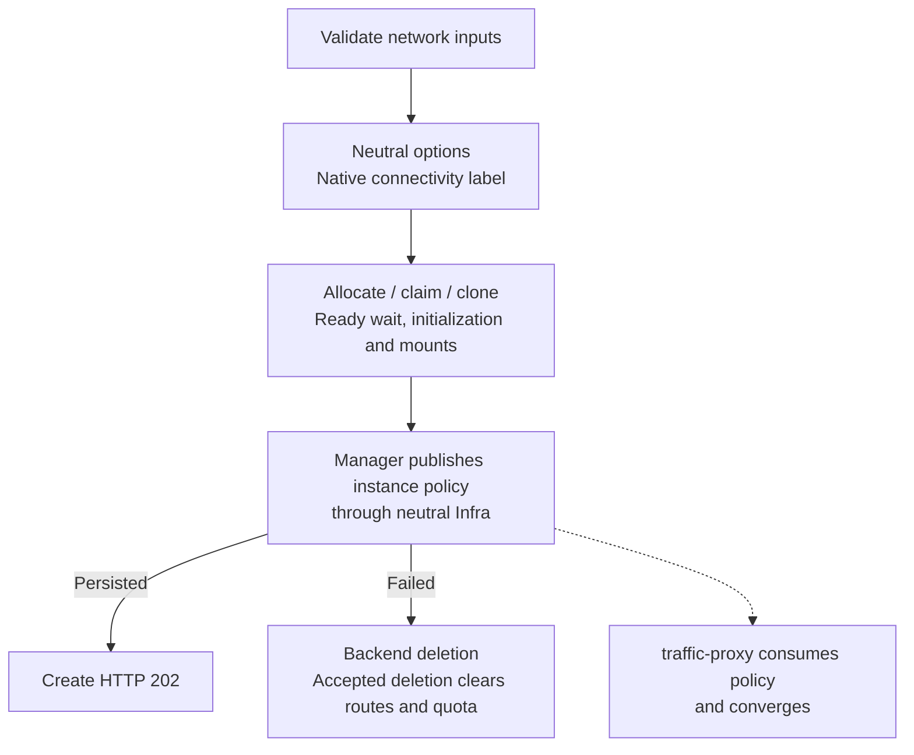
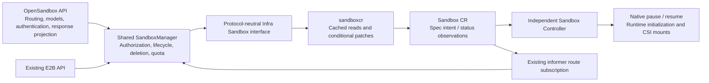
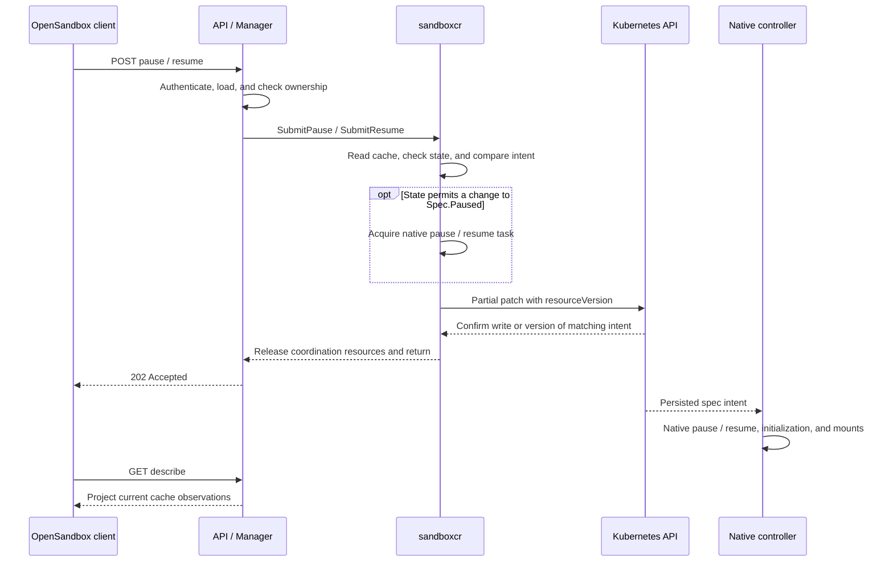
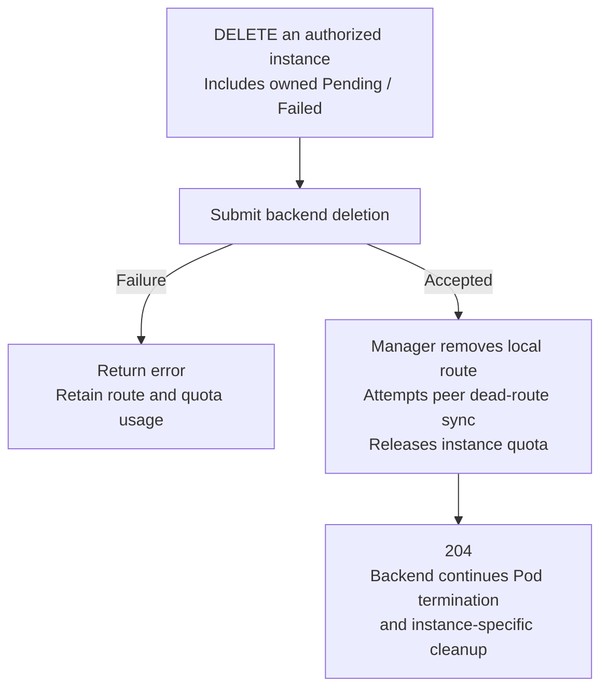

# OpenSandbox Control-Plane API Compatibility

## Table of Contents

- [Glossary](#glossary)
- [Summary](#summary)
- [Motivation](#motivation)
  - [Goals](#goals)
  - [Non-Goals/Future Work](#non-goalsfuture-work)
- [Proposal](#proposal)
  - [User Stories](#user-stories)
  - [Requirements](#requirements-optional)
  - [Implementation Details/Notes/Constraints](#implementation-detailsnotesconstraints)
    - [Architecture and baseline](#architecture-and-baseline)
    - [Create API](#create-api)
    - [Control-plane lifecycle](#control-plane-lifecycle)
    - [Snapshot management](#snapshot-management)
    - [Endpoint discovery and runtime initialization](#endpoint-discovery-and-runtime-initialization)
  - [Risks and Mitigations](#risks-and-mitigations)
- [Alternatives](#alternatives)
- [Upgrade Strategy](#upgrade-strategy)
- [Additional Details](#additional-details)
  - [Test Plan](#test-plan-optional)
  - [Full API coverage and deferred capabilities](#full-api-coverage-and-deferred-capabilities)
- [Design History](#design-history)

## Glossary

| Term | Meaning |
| --- | --- |
| API adapter | Translates the OpenSandbox protocol and calls the shared Manager |
| Cold create / Pool / snapshot | Create a Sandbox from an image, claim SandboxSet inventory, or clone a Checkpoint |
| Best-effort update | Applies native update rules, which may skip absent or zero values and fields that fail resize constraints |
| Runtime initialization | Installs or restores daemon configuration independently of the workload entrypoint |
| Endpoint discovery | Returns a service address and execution credential headers from the control plane |

## Summary

Add an OpenSandbox control-plane adapter to sandbox-manager for creation, six instance lifecycle operations, endpoint discovery, snapshot creation/listing/deletion, and four runtime network policy operations. The adapter shares the listener, SandboxManager, and KeyStorage with E2B. The API layer owns wire models and error formatting, and execution follows native E2B behavior. The `--enable-opensandbox-compat` flag defaults to off. See [API coverage](#full-api-coverage-and-deferred-capabilities) for contract and implementation status.

### Creation modes

Create from an image, claim from a named Pool, or restore from a snapshot. See [Create API](#create-api) for source behavior.

## Motivation

[Adapter proposal #690](https://github.com/openkruise/agents/issues/690) calls for an in-process API adapter that reuses agents orchestration, serves OpenSandbox clients, and documents observable differences.

### Goals

Reuse native allocation, authorization, and lifecycle orchestration. Expose the OpenSandbox protocol, ingress and direct endpoint discovery, and compatible runtime initialization. Document differences in behavior and deployment requirements.

### Non-Goals/Future Work

The adapter uses the existing listener, validation, and orchestration. A separate Lifecycle Server or provider topology, a second validation stack, a lifecycle task service, CRD or Controller state machines, a global async switch, and additional Prometheus metrics are outside scope. Automatic image prewarming, virtual templates, and automatic Pool selection are deferred.

See the [create field contract](#create-api) and [network contract](#traffic-policy-compatibility) for unsupported inputs and their handling. [API coverage](#full-api-coverage-and-deferred-capabilities) lists deferred management operations and their rationale.

## Proposal

### User Stories

#### Story 1: Create from a source

A caller obtains a sandbox from an image, existing SandboxSet inventory, or a Checkpoint. The current Key ID owns the resulting instance.

#### Story 2: Manage an instance

A caller inspects their own sandboxes, submits pause, resume, or expiration updates, observes actual state, and deletes resources when finished.

### Requirements (Optional)

#### Functional Requirements

Creation, lifecycle operations, snapshots, runtime network policy, and endpoint discovery follow the contracts below. Each contract identifies the acceptance point, completion criteria, and any SDK readiness conditions.

#### Non-Functional Requirements

Preserve E2B behavior, namespace and owner isolation, and the `API → Manager → Infra/runtime` dependency direction. Protect shared sources and system identity from request overrides, bound cleanup, and verify orchestration and real backend behavior separately.

### Implementation Details/Notes/Constraints

#### Architecture and baseline

**Architecture and responsibilities**

| Layer | Responsibilities |
| --- | --- |
| `pkg/servers/opensandbox` | Routes, wire models, protocol authentication, source and runtime selection, endpoint addresses and credentials, responses, and HTTP errors |
| `pkg/servers/validation` | Address and header validation and native security rule normalization shared by both APIs |
| Manager | Protocol-neutral identity, admission, allocation, and lifecycle orchestration. The snapshot wrapper loads the source, creates the checkpoint, and retrieves the completed record. `GetSandboxConnection` returns route observations after native ownership checks |
| Infra / `infra/sandboxcr` | Neutral Sandbox capabilities, cached reads, state guards, and partial patches with resourceVersion conditions. Lifecycle submission and renewal use no APIReader and carry no HTTP or deletion policy |
| `pkg/utils/runtime` | Native daemon initialization and optional additional initialization ports. Native initialization records retain configuration |
| Independent Controller | Reconciles Sandbox CRs into Pods |
| `cmd/sandbox-manager` | Wires dependencies and registers routes before starting the listener |

The API passes neutral Manager parameters and reuses KeyStorage and metadata extension parsing. OpenSandbox has no dependency on the E2B root package or handlers. Shared validation is independent of protocols, Manager, and Infra. The Controller's dependency closure remains independent of all three layers.

**Reference baseline and validation**

[OpenSandbox 1.1.0](https://github.com/opensandbox-group/OpenSandbox/releases/tag/release-1.1.0) provides `opensandbox==1.1.0` and the reference [Lifecycle OpenAPI][os-lifecycle-spec]. Server code determines provider conditions, and the SDK determines client defaults and serialization. Agents `v0.6.0` supplies historical comparisons for native lifecycle APIs. Execution, defaults, and validation use shared E2B behavior subject to the deployment conditions below.

- Create decodes JSON once using Go semantics. Unknown fields are ignored, `null` follows the target type, and incompatible types fail decoding.
- Preserve native authentication, source selection, quota and admission, metadata protection, and network, mount, and update constraints. Reference required fields, reserved environment variables, and generic field restrictions do not apply automatically.
- An omitted, `null`, or zero timeout defaults to 300 seconds. Validate the 30-second minimum and configured maximum. Ordinary metadata uses annotation semantics.

#### Create API

**Creation identity and quota**

Create uses the KeyStorage, Team and key ID mapping defined under [Lifecycle authentication and authorization](#lifecycle-authentication-and-authorization). The authenticated Team determines the source namespace. The key ID binds the delivered Sandbox's owner and quota identity. Subsequent queries and operations enforce the same ownership rules.

Agents uses its native per-key quota for admission, accounting and release. Exceeding it returns `403 / FORBIDDEN`. OpenSandbox 1.1.0 Kubernetes quotas use namespace ResourceQuota, which multiple keys can share. The `agent-sandbox` provider returns `403 / KUBERNETES::QUOTA_EXCEEDED`, while the default `batchsandbox` provider can wait until creation times out. The adapter retains the Agents quota scope. See [Quota scope and provider behavior](https://github.com/opensandbox-group/OpenSandbox/blob/release-1.1.0/docs/guides/multi-tenancy.md#quota-exhaustion-behavior).

**Responses and errors**

Create returns HTTP 202 after source orchestration and network publication. The reference response requires `id`, `status`, `createdAt` and `entrypoint` and optionally carries `metadata`, `extensions`, `platform` and `expiresAt`. Status requires `state` and optionally carries `reason`, `message` and `lastTransitionAt`. The adapter omits `platform` and `status.lastTransitionAt`. Endpoint discovery returns the service address and access headers.

The ID is opaque. `createdAt` and `expiresAt` describe the delivered instance's lifetime. An absent entrypoint becomes an empty array. Metadata returns user data, labels and allowed diagnostics, filters internal annotations and sets `opensandbox.kruise.io/sandbox-resource` to the actual namespace/name last. It omits consumed native extensions. For Pool and clone, the requested entrypoint is echoed without applying it to the workload.

The API maps domain errors to `{"code":"...","message":"..."}`. The body has only those two fields.

| Scenario | Mapping |
| --- | --- |
| Invalid JSON, conflicting sources, unsupported execution input, native validation failure or `ErrorBadRequest` | 400 / INVALID_REQUEST |
| Missing or invalid key | 401 / UNAUTHORIZED |
| Native quota exceeded (`ErrorQuotaExceeded`) | 403 / FORBIDDEN |
| Create-source lookup fails | Preserve the native operation's classification. `ErrorNotFound` maps to 400 / INVALID_REQUEST and unclassified errors to 500 / INTERNAL_ERROR |
| Native conflict (`ErrorConflict`) | 409 / CONFLICT |
| Execution, readiness or network publication fails, or cancellation has no domain classification | Preserve native classification. Unclassified errors return 500 / INTERNAL_ERROR |

These mappings follow native E2B create. Native operations own lookup timing and retries, including clone failures. Instance lookup and other lifecycle errors follow [Lifecycle errors and recovery](#lifecycle-errors-and-recovery).

**Creation sources and execution order**

OpenSandbox selects a backend through deployment configuration. In the table, ordinary Pool means BatchSandbox Pool and snapshot refers to the container backend.

| Creation input | OpenSandbox 1.1.0 implementation | Agents adaptation |
| --- | --- | --- |
| `image.uri` | Docker pulls the image and creates a container. On Kubernetes, the BatchSandbox or agent-sandbox controller creates the Pod. The request supplies env and entrypoint | Translate to `ColdStartOptions`. Manager/Infra constructs a Sandbox and reuses claim admission, persistence, Ready waiting and initialization |
| Named `extensions.poolRef` | A BatchSandbox allocation references an existing Pool. Its taskTemplate applies env and entrypoint. The Pool supplies image and resources | Map poolRef to a SandboxSet name and allocate inventory with `ClaimSandbox`. Support native image, CPU and memory updates. Env feeds runtime initialization. Retain the Pod entrypoint and echo the requested entrypoint |
| `snapshotId` | Resolve a Ready snapshot for the current tenant, take `restore_config.image` and create a workload using the current request configuration | Restore a Checkpoint through `CloneSandbox`. Inherit the image, startup configuration and initialization credentials. Handle overrides according to the field contract |

Image with a named poolRef requests a Pool image update in Agents. An ordinary OpenSandbox Pool uses its own image and resources. FastSandbox dispatches snapshots by recorded backend identity, and the backend determines what is restored. See [BatchSandbox creation and Pool dispatch](https://github.com/opensandbox-group/OpenSandbox/blob/release-1.1.0/server/opensandbox_server/services/k8s/batchsandbox_provider.py) and [Snapshot restore resolution](https://github.com/opensandbox-group/OpenSandbox/blob/release-1.1.0/server/opensandbox_server/services/snapshot_restore.py).

Named Pools preserve native revision and inventory selection. An empty inventory defaults to creating from the selected SandboxSet. Claim and clone return after applicable initialization and mounts. Manager then publishes the network policy.

**Create field contract**

Inheritance keeps source configuration. An ignored override is accepted without changing that configuration. Storage or echo does not apply a value to execution. Validation and rejection apply to the selected source.

SDK `1.1.0` high-level `Sandbox.create` sends defaults of 600 seconds, 1 CPU, 2Gi of memory, a keep-alive entrypoint and `secureAccess=false`. `timeout=None` sends null, and a serializer may omit empty maps. The high-level method requires exactly one of image or snapshot_id. The API also accepts named Pool-only requests. Use the generated Lifecycle client for these requests. `create_from_template` uses a separate SDK entry point. The server applies its own defaults to omitted inputs.

**Source selectors**

Selectors use nonblank values. Image with a named poolRef requests a Pool claim and image update. An effective snapshotId conflicts with image, templateId or poolRef. Competing image and templateId selectors and requests without a supported source fail before allocation.

| Field | Input, mapping and boundary |
| --- | --- |
| `image` | Optional object with uri and auth.username/password. Cold creation uses the URI. Native metadata image extensions take precedence during Pool updates. Clone rejects nonempty image updates. Non-null auth returns 400. Image pulls use platform credentials and create no pull secret. The reference image path requires URI, entrypoint and resourceLimits, while the adapter selects the source by effective URI. Automatic prewarming is deferred |
| `snapshotId` | Optional string. Omitted, null and blank values select no source. Manager calls native Infra clone for Checkpoint lookup, cache retries and cancellation, without a preliminary existence query or same-name Set fallback. The reference container backend combines the restore image and current request settings. Clone inherits image, command/env, scheduling, runtime credentials and restored content. Request env, entrypoint and platform overrides are ignored |
| `extensions.poolRef` | Pool name in the extensions string map. Omitted, null, empty map and blank values select no Pool. Claim from the named SandboxSet. Its inline template or templateRef defines the workload, replicas express unclaimed stock, and rolling updates can contain both revisions. Keep native creation on an empty inventory and the field-specific image/CPU/memory updates. Automatic selection (`*`) returns 400, with no new capacity queue or 429/Retry-After contract |

**templateId**

OpenSandbox FastSandbox resolves a tenant-scoped `Succeeded` template to its own golden-image artifact. Missing or unsuccessful templates return `404`. Native E2B `templateID` looks for a same-name SandboxSet first and checks for a Checkpoint only when no Set matches. A failed claim does not fall back. Template-only and template-plus-Pool remain deferred because public identity, artifacts, and independent capacity have no equivalent contract. See [reference artifact resolution][template-os-build] and [native source selection](https://github.com/openkruise/agents/blob/master/pkg/servers/e2b/create.go#L103-L119).

In OpenSandbox 1.1.0, Kubernetes dispatches an effective templateId to FastSandbox microVMs. Its restrictions apply to that path. See the [OpenAPI template contract][template-os-spec], [runtime dispatch][template-os-routing], [build and artifact resolution][template-os-build], [request validation][template-os-validation], [FastPath mapping][template-os-mapping], [capacity pools][template-os-pools] and [SDK template creation][template-os-sdk].

- **Input and rejection.** Optional string. Omitted, null, empty or blank input leaves source selection to the other selectors. The reference minLength rejects an explicit empty string and treats whitespace-only values as no selection. The adapter accepts the empty string as no selection. An effective value alone, with a named Pool or with `*` returns 400 before allocation. An effective image or snapshotId with templateId returns a source conflict. Rejection performs no template, Set or Checkpoint lookup, claim, clone, quota charge or instance allocation. Template existence does not change the response to 404.
- **Adoption conditions.** Instance Consumption in [Sandbox Template Build and E2B Compatibility](https://github.com/openkruise/agents/blob/master/docs/proposals/20260916-sandbox-template-build-and-e2b-compatibility.md) resolves a Ready template and prefers artifact restoration. It claims or creates from an associated SandboxSet only when no artifact exists. The first phase defers associated Sets, build-command execution and Kubernetes artifact capture. Pool consumption of build artifacts remains undefined. Template-only can be evaluated once identity, readiness, artifact/inventory selection and a neutral consumption entry point are defined. The evaluation can start before all build features are complete. Template-plus-Pool requires a separate design for capacity matching.
- **Supported sources and verification.** Use poolRef for a known Set or snapshotId for a known Checkpoint. Neither resolves a public template ID. Test an effective ID alone, with a named Pool or `*`, conflicts and ineffective selectors. Assert zero directory, Set/Checkpoint, claim/clone and quota calls when an effective template is rejected. See [Full API coverage and deferred capabilities](#full-api-coverage-and-deferred-capabilities).

**platform**

Optional os/arch object. Reference support depends on provider and runtime. Cold creation writes supplied values into nodeSelector and inherits the platform default for omissions. Architecture and Windows runtime availability depend on the deployment. Pool rejects effective overrides with 400 and treats an empty object as no override. Snapshot accepts and ignores the override.

**timeout**

- The reference accepts an optional integer in seconds, with a minimum of 60 and a deployment-specific maximum. Omitted or null input can be unlimited for ordinary image, snapshot and Pool creation. Zero and 30–59 are invalid. Template creation requires a non-null value. Docker keeps a cleanup deadline, BatchSandbox uses expireTime and agent-sandbox uses shutdownTime. Both inspected Kubernetes branches support unlimited lifetime. HTTP, allocation wait and SDK ready_timeout have separate budgets.
- The adapter maps omitted, null and zero to 300 seconds for all sources, checks the native 30-second minimum and configured maximum, then writes ShutdownTime. The never-timeout metadata extension can clear the deadline. Create has no execution mapping for native autoPause, autoResume or autoPauseMemory. Metadata and lifecycle hooks do not replace those fields.

**resourceLimits / resourceRequests**

Both are optional string maps. All three sources reject keys other than cpu and memory before allocation. Snapshot rejects nonempty updates with 400. Native templates can preconfigure other resources. Native metadata wins per key.

| Field | Reference default and Agents mapping |
| --- | --- |
| `resourceLimits` | The reference permits cpu, memory, gpu and runtime-specific names. Image and snapshot require a non-null map and accept an empty map or missing individual keys. Cold creation parses quantities for the new workload. Native Pool InplaceUpdate applies configured, nonzero keys and retains unspecified values |
| `resourceRequests` | The reference falls back to limits when omitted and on Kubernetes also when empty. A nonempty map replaces the whole map without filling individual keys. Cold creation retains the empty-map fallback. Pool updates requests independently of limits. Omitted, null and empty retain source values. A partial map changes only supplied keys. Snapshot preserves its Checkpoint configuration |

Pool resize is best effort. Memory cannot shrink, merged requests cannot exceed limits and QoS must be preserved. Ready does not confirm that every accepted update has taken effect.

**env**

Optional string map. Omitted, null and empty inputs add no request variables. Cold creation writes env into the workload and uses it for native initialization. Pool passes it to native envd `/init`, honors skip-init and leaves running Pod processes unchanged. Snapshot uses Checkpoint initialization data and treats native ReInit 401 as already initialized. The reference reserves OPENSANDBOX_LIFECYCLE for hooks and rejects every non-null template env, including an empty map. The adapter does not copy that reserved-name validation or add Checkpoint runtime overrides.

**metadata**

Optional string map. Omitted, null and empty inputs add no user data. Reference container providers store and filter labels, validate keys and values, cap values at 63 characters and reserve the opensandbox.io/ prefix. Public names can contain spaces.

The adapter runs `ParseExtensions` first. Consumed native extensions become neutral options. Ordinary keys enter annotations, and `label:` keys enter labels. Both track fields from the current delivery. Native naming, timeout, runtime, mount and network extensions retain their roles. System owner, token and routing state remain protected. Ordinary values are exempt from label value-length limits, and the display `name` leaves the Sandbox name intact. Clone preserves native modifier/restore order and inheritance precedence. See [Network access control](#traffic-policy-compatibility) for SecurityRule validation.

**entrypoint**

Optional argv array. The reference requires it for image and rejects explicit `[]` there. Snapshot and Pool default to `["tail", "-f", "/dev/null"]`. Template creation rejects non-null overrides and uses the recorded entrypoint. Cold creation preserves argv boundaries and uses the image default for an omitted or empty array. Clients supply an explicit shell for shell expansion. Pool retains its source entrypoint, and snapshot retains command/args. The requested values are echoed for both. Applying Pool entrypoint overrides is deferred.

**Network access control compatibility**

OpenSandbox networkPolicy is a request-level egress contract. Agents TrafficPolicy is the native Kubernetes resource consumed by traffic-proxy. The adapter translates supported inputs through neutral Manager/Infra capabilities. Cluster and tenant policy and SecurityProfile configuration remain platform responsibilities. See [TrafficPolicy and SecurityProfile design](https://github.com/openkruise/agents/blob/master/docs/proposals/20260521-traffic-policy-and-security-profile.md).

**Network inputs and observable differences**

`networkPolicy` controls outbound traffic. The top-level create fields `secureAccess` and `credentialProxy` govern endpoint access and outbound credential proxying, respectively. See [Endpoint and credential protection](#endpoint-and-credential-protection).

| Subfield | OpenSandbox 1.1.0 contract and reference behavior | Agents behavior |
| --- | --- | --- |
| `defaultAction` | allow/deny, default deny. The reference also accepts null and empty string, and egress parses them as deny | Omitted, null and empty string use the native connectivity label true. allow maps to true and deny to false. Other actions return 400 |
| `egress` | Ordered rules. Domain rules use first match. IP behavior depends on dns/dns+nft mode. The reference model rejects explicit null | Omitted, null and empty arrays mean no local rules. Separate nonempty rules into allow and deny groups, evaluate allow first, and cap each group at 100. Interleaved order is lost |
| `egress[].action` | Requires allow/deny. The reference model rejects omitted and null values. Egress parses empty string as deny | Trim and lowercase. Omitted, null and empty string mean deny. Other actions return 400. A valid target is still required |
| `egress[].target` | Requires a nonempty string. The contract describes domains and wildcards. The inspected egress parser also recognizes IP/CIDR | allow accepts concrete domains and IP/CIDR. deny accepts only IP/CIDR. Wildcards and absent, null or empty targets return 400 |

| Request input | OpenSandbox 1.1.0 | Agents behavior |
| --- | --- | --- |
| Omitted or null `networkPolicy` | The inspected Kubernetes container path creates no request-level egress sidecar | No local rules. Connectivity label true. Existing platform policy still applies |
| `networkPolicy: {}` | OpenAPI describes allow-all at startup. The inspected Kubernetes path and egress parser use deny | Connectivity label true, no local TrafficPolicy and no additional proxy requirement |
| `networkPolicy: {"egress":[]}` | No rules. The inspected implementation applies deny when defaultAction is omitted | Same as an empty object |
| `networkPolicy: {"egress":null}` | The reference model rejects null in place of an array | Accept as no rules and process defaultAction independently. With no action, treat as an empty object |
| Only `defaultAction: allow` | Explicit default allow. Kubernetes still sets up an egress sidecar | Connectivity label true, no local TrafficPolicy |
| Only `defaultAction: deny` | Explicit default deny | Connectivity label false and native traffic-proxy required. No local TrafficPolicy. Native platform fallback supplies the default behavior |
| Valid nonempty rules without defaultAction | Default deny when no rule matches | Connectivity label true. Unmatched traffic follows native platform policy |
| Rule object `{}` or null | Reject for missing required action/target | Target is empty and returns 400 before allocation |

The reference OpenAPI description of allow-all for an empty object or empty rules differs from the [Kubernetes creation path](https://github.com/opensandbox-group/OpenSandbox/blob/release-1.1.0/server/opensandbox_server/services/k8s/create_helpers.py#L106-L131) and [egress parser](https://github.com/opensandbox-group/OpenSandbox/blob/release-1.1.0/components/egress/pkg/policy/policy.go#L64-L79). Kubernetes requires configured egress, and other providers have their own conditions. Ordinary OpenSandbox Pool rejects networkPolicy. Template-plus-Pool uses its own mapping. All three Agents sources use native policy publication.

**Native TrafficPolicy mapping**

| Input or topic | Mapping and boundary |
| --- | --- |
| Allow IP/CIDR | Neutral AllowOut becomes CIDR peers in the first egress allow rule. Normalize bare IPs to CIDR |
| Allow concrete domains | Use FQDN peers in the same allow rule. Reject wildcard domains |
| Deny IP/CIDR | Neutral DenyOut becomes CIDR peers in the following reject rule. Reject domain deny rules |
| Ordering | Group allow peers before reject peers. Preserve neither interleaved input order nor domain first-match order |
| Priority | Instance policy priority is 100. Evaluate in ascending numeric order. Native global fallback must exceed 100 |
| Selector | Infra reads the Pod through the cache, preferring the controller-managed Sandbox UID label and falling back to Sandbox name on older Pods. Long names use the UID selector |
| Ownership | Create TrafficPolicy in the instance namespace with Sandbox as owner. Deletion and expiry follow owner-based garbage collection |
| Unmapped native fields | Ingress, Service/Workload peers, protocol/port restrictions, arbitrary selectors and custom priorities are unavailable |

The API caps each allow/deny group at 100 entries. The TrafficPolicy CRD limits each rule's To list to 20 peers, and the native builder leaves the rule intact. A request can therefore pass API validation and fail on write. See publication failure handling below and [Runtime network policy interfaces](#runtime-network-policy-interfaces).

`resolveEgressPolicy` in `opensandbox/network.go` parses the input. The builder and selector use `buildTrafficPolicy` and `trafficPolicySelectorForPod`. See [Native network implementation](https://github.com/openkruise/agents/blob/master/pkg/sandbox-manager/infra/sandboxcr/network.go) and [TrafficPolicy schema](https://github.com/openkruise/agents/blob/master/api/v1alpha1/trafficpolicy_types.go).

**Policy scope, publication and cleanup**

Create maps instance rules to a TrafficPolicy selecting the actual Pod and defaultAction to the connectivity label. The native proxy handles cluster and tenant configuration, priorities and fallback. Empty rules create no TrafficPolicy. Explicit default deny retains the traffic-proxy requirement and relies on platform fallback without adding an instance deny-all rule.

Manager publishes policy after native allocation and applicable readiness waiting, runtime initialization and mounts. On publication failure, Manager requests backend deletion, then removes routes and releases quota after deletion is accepted. Cancellation uses an independent 30-second cleanup context. If cleanup fails too, the HTTP 500 `message` includes both the publication and cleanup errors. Shared sources and existing storage retain ownership.

**First traffic window.** Sandbox is created before the Pod, but the Controller does not wait for request-specific policy. The workload can start before policy publication or proxy synchronization. HTTP 202 reports publication. The adapter retains native ordering without introducing a scheduling gate, a fixed startupProbe or a policy acknowledgment. Platform policies still apply according to their native conditions.

Cold creation requests a proxy runtime when needed. Pool and snapshot retain source or platform runtime conditions. The API does not wait for TrafficPolicy Accepted/Programmed conditions or a proxy policy ACK.

**Endpoint and credential protection**

| Field | Reference purpose and dependencies | Agents behavior |
| --- | --- | --- |
| `secureAccess` | Inbound endpoint protection, default false. Supported Kubernetes ingress gateways issue a token through response headers, separate from control-plane keys, daemon authentication and signed URLs | Accept omitted, null or false. true returns 400. Endpoint discovery supplies native runtime and applicable gateway credentials |
| `credentialProxy.enabled` | Transparent outbound proxy and credential injection, default false. Requires networkPolicy and dns+nft when enabled. Network rules alone leave it disabled. Secrets and injection rules use subsequent APIs | `credentialProxy` is an object. Omission, null, `{}` and `{"enabled":false}` are accepted. A bare boolean returns 400 for an invalid type. `{"enabled":true}` returns 400 because the proxy is unsupported. Secret configuration APIs are unavailable |

Native SecurityProfile/Secret token injection and plaintext header transforms retain their platform roles. Inline security rules reject tokenTransformation. Endpoint credentials do not add the reference secureAccess token, transparent HTTPS interception or credential management.

Management requests use the control-plane API key. Outbound allow/deny, endpoint access credentials and outbound credential injection have separate contracts. Native inline SecurityRule validation, defaulting and serialization use `pkg/servers/validation.NormalizeSecurityRules`.
E2B stores `network.rules` header transforms in `security-rules` by default and in `e2b-network` when annotation mode is enabled. [E2B network annotation](20261121-e2b-inline-security-profile.md#e2b-network-annotation)

**Runtime network policy interfaces**

The four operations reuse native `SelectNetworkPolicy/UpdateNetworkPolicy` through shared Manager authorization and neutral delegation. Rules follow the field and address contract above. Create defaults do not apply to runtime updates. Success returns HTTP 200 with `PolicyStatusResponse` and the resulting policy. The optional enforcementMode and reason are omitted without a native source.

| Method and path | Target behavior |
| --- | --- |
| `GET /v1/sandboxes/{id}/networkpolicy` | Project native rules and the loaded Sandbox's connectivity label as configured policy, without reporting enforcement |
| `PUT /v1/sandboxes/{id}/networkpolicy` | Replace all allow/deny rules and retain the existing connectivity label and default action |
| `PATCH /v1/sandboxes/{id}/networkpolicy` | Accept a top-level `NetworkRule[]`. Read the policy, add rules or replace actions by normalized target, then submit a full replacement. The first occurrence of a target wins within the batch. Retain other targets and defaultAction |
| `DELETE /v1/sandboxes/{id}/networkpolicy` | Accept a top-level array of target strings. Read the policy, remove matching rules and replace the remaining rules. Unknown targets are idempotent. Retain the default action and policy |

**Default action and empty inputs**

| Input or state | Result |
| --- | --- |
| PUT defaultAction omitted, null or empty | Preserve the existing default action. The reference defaults to deny |
| Explicit allow/deny equals the existing valid label | Accept as a precondition and update the rules |
| Request changes the default action | 400 `INVALID_REQUEST` without writes. Native runtime updates cannot change it |
| Loaded object has a missing or invalid connectivity label | All four operations return 501 `NOT_IMPLEMENTED`. No inferred default, component probe or additional Pod lookup |
| PUT `{}`, JSON null or empty egress | Clear local rules and keep the default action |
| PATCH/DELETE empty array or JSON null | Return current configuration without a rule change |
| Empty body, malformed JSON or incompatible type for PUT/PATCH/DELETE | 400. JSON null has its defined semantics. GET has no request body |

Normalize IP targets to CIDR before matching, so a bare IP matches its equivalent CIDR. OpenSandbox uses exact string matching. Readback preserves native allow/deny grouping. See [Native TrafficPolicy mapping](#native-trafficpolicy-mapping) for count and backend limits.

**Native results, failures and conditions**

- State and owner admission follow native network updates without auto-resume. Authentication, lookup and native read/write errors follow [Lifecycle errors and recovery](#lifecycle-errors-and-recovery). Unclassified read/write or readback errors return 500. Native Update defines write acceptance and Select supplies the response, with possible cache lag. Failed readback returns an error. Cancellation follows the native error and write result. Both retain completed writes and the running instance, with no background resubmission or blind rollback.
- Select reads the first TrafficPolicy. Update has no version precondition and can log rather than return failures when deleting cleared or redundant policies. PATCH and DELETE read then replace, with possible lost updates under concurrent writes. They provide neither atomic partial updates nor guarantees of consistent readback, complete cleanup or proxy enforcement.
- Enforcement requires an existing traffic-proxy and platform fallback. Flow verification uses a deployment meeting those conditions. Runtime updates leave proxy installation, instance recreation and default component provisioning outside their scope.
- Ordinary SDK origins use the endpoint egress adapter. Template origins use the control-plane networkPolicy adapter. Verify the control-plane routes and high-level SDK methods with their respective origins.

See native [SelectNetworkPolicy and UpdateNetworkPolicy][ag-network-runtime], [OpenSandbox operation specifications][os-network-operations] and [SDK origin selection][os-network-sdk].

**Network access-control acceptance criteria**

| Scope | Criteria |
| --- | --- |
| Fields | Omission, null and empty input, explicit default action, action normalization, missing target, and address coverage. Verify API validation accepts 100 rules and rejects 101 per action group with 400. Check the CRD peer limit separately |
| Mapping | Allow first, CIDR/FQDN peers, priority, Pod UID/name selectivity, ownership and preservation of existing platform policy |
| Publication | Applicable post-allocation sequence for all three sources, no policy for empty rules, native proxy and fallback for explicit deny |
| Failure | Preserve write and cleanup errors, bound cancellation cleanup, and clear quota/routes only after backend deletion is accepted |
| Enforcement | Use real traffic-proxy to verify matching, fallback and the first traffic window. CR persistence and HTTP 202 cover publication |
| Runtime | Verify all four operations, an unchanged default action, 501 for missing/invalid labels, empty inputs, normalized target matching and no-op readback |
| Readback and concurrency | Exercise cache lag, failed readback after a write, partial deletion failure and concurrent reads followed by replacement. Preserve the instance on error |
| Boundaries | Verify endpoint credentials, credential proxying, native security rules and SDK origins against their respective contracts |

**lifecycle**

Native create has no equivalent request-level hook executor. Auto-pause/resume and Controller template hooks use different executors and timing. Omitted, null, empty-object and empty-periodic-array values are accepted. A non-null preStart or nonempty periodic returns 400 before execution or scheduling.

| Subfield | Reference definition |
| --- | --- |
| `preStart.command` | Hook argv, run before entrypoint |
| `preStart.timeoutSeconds` | 1–10800 seconds, default 60 |
| `periodic[].name` | Unique nonempty name |
| `periodic[].schedule` | Cron or a supported schedule descriptor and constraints |
| `periodic[].command` | argv |
| `periodic[].timeoutSeconds` | 1–300 seconds, default 60 |

**volumes**

Optional array. Omitted, null and empty arrays add no mounts. Each item consumes exactly one existing PVC source.

| Subfield | Mapping, default and rejection |
| --- | --- |
| `name` | Valid volume name, unique within the request |
| `mountPath` | Absolute path in the container |
| `subPath` | Optional relative path. Reject parent traversal |
| `readOnly` | Defaults to false. Enforcement depends on native source and driver |
| `pvc.claimName` | Existing non-terminating PVC in the workload namespace. Missing claim returns 400 |
| `pvc.createIfNotExists` | Reference default true. Ignored. A missing PVC is not provisioned |
| `pvc.deleteOnSandboxTermination` | Reference default false. Ignored. The PVC retains its ownership |
| `pvc.storageClass/storage/accessModes` | Ignored. Existing PVC settings are retained |
| `host.path` | Host source returns 400 |
| `ossfs.bucket/endpoint/version/options/accessKeyId/accessKeySecret` | Inline OSSFS source returns 400 before credentials are used |

Cold creation uses PVC Pod volumes. Pool and clone resolve a Bound PVC to its PV and native CSI provider and require a valid binding and an available driver. Mounting follows runtime initialization, and an inherited workload may already have started. Simple native volumeMounts maps name/path to CSI PV/path. Full configuration includes mountID/pvName/mountPath/subPath/readOnly/attributes. PV access modes also affect readOnly. Native metadata CSI resolves a PV/provider directly. Combining it with request volume sources returns 400.

Snapshot keeps recorded mounts without overrides. A supplied list uses native clone mapping. The on-demand mount documentation excludes checkpoint restoration, and the current clone path processes the recorded mounts. Verify actual restoration with the specific driver in a real environment. Unit tests cover control-plane orchestration.

**extensions other than poolRef**

Omitted, null and empty maps have no effect. Native extensions still come from the separate metadata input. Native autoResume describes wake on access.

| Extension | Reference use and adapter behavior |
| --- | --- |
| `access.renew.extend.seconds` | Integer string from 300 to 86400 for renewal on access. Returns 400 because that mechanism is unsupported |
| `bootstrap.execd.isolation` | enable changes bwrap startup, permissions and mounts. Returns 400 because isolated execution is unsupported |
| `opensandbox.extensions.*` | Store and echo through the opensandbox.io/extensions.* annotation codec, preserving empty values and tracking the user fields. Extension values take precedence over same-named metadata. Storage has no execution effect |
| Other nonempty extensions | Return 400 without a defined mapping |

Invalid annotation names fail before allocation. Verify codec, echo and field cleanup separately from execution behavior such as renewal and isolation.

#### Control-plane lifecycle

The six instance management operations reuse native ownership, state, controller reconciliation, and termination cleanup. Creation and endpoint discovery have separate contracts.

**Lifecycle Method Coverage**

The protocol follows OpenSandbox 1.1.0 [Sandbox](https://github.com/opensandbox-group/OpenSandbox/blob/release-1.1.0/sdks/sandbox/python/src/opensandbox/sandbox.py), [SandboxManager](https://github.com/opensandbox-group/OpenSandbox/blob/release-1.1.0/sdks/sandbox/python/src/opensandbox/manager.py), and the [Sandboxes service protocol](https://github.com/opensandbox-group/OpenSandbox/blob/release-1.1.0/sdks/sandbox/python/src/opensandbox/services/sandbox.py). The [synchronous SDK](https://github.com/opensandbox-group/OpenSandbox/tree/release-1.1.0/sdks/sandbox/python/src/opensandbox/sync) uses the same server contract. The following mappings define the six supported operations.

| Operation | SDK entry point | HTTP endpoint | Request and success response |
| --- | --- | --- | --- |
| List | `SandboxManager.list_sandbox_infos` | `GET /v1/sandboxes` | state, metadata, page, pageSize. 200 with `{items,pagination}` |
| Describe | `Sandbox.get_info` / `SandboxManager.get_sandbox_info` | `GET /v1/sandboxes/{id}` | No request body. 200 with a Sandbox |
| Pause | `Sandbox.pause` / `SandboxManager.pause_sandbox` | `POST /v1/sandboxes/{id}/pause` | No operation arguments. 202 with `{}` |
| Resume | `Sandbox.resume` / `SandboxManager.resume_sandbox` | `POST /v1/sandboxes/{id}/resume` | No operation arguments. 202 with `{}` |
| Renew | `Sandbox.renew` / `SandboxManager.renew_sandbox` | `POST /v1/sandboxes/{id}/renew-expiration` | `{"expiresAt":"RFC3339 timestamp"}`. 200 with `{expiresAt}` |
| Delete | `Sandbox.kill` / `SandboxManager.kill_sandbox` | `DELETE /v1/sandboxes/{id}` | No operation arguments. 204 with no response body |

Pause and resume acknowledge acceptance before conditions converge. Delete acknowledges acceptance before the Pod and instance-specific resources finish cleanup. GET reflects observed backend state.

**Protocol Differences and Native Mappings**

The wire contract uses OpenSandbox `release-1.1.0`. The current [Sandbox Expiration documentation](https://github.com/opensandbox-group/OpenSandbox/blob/main/docs/getting-started/configuration.md#sandbox-expiration) also informs renewal semantics. See [Full API coverage](#full-api-coverage-and-deferred-capabilities) for the remaining operations.

| Operation | Difference from native E2B |
| --- | --- |
| Describe | OpenSandbox returns status, metadata, and createdAt/expiresAt. E2B returns state, templateID, startedAt/endAt, domain, and execution credentials. See [response projection](#description-and-state-compatibility). |
| List | The adapter uses page/pageSize, `{items,pagination}`, and accepts the eight projected filter states. Native E2B `v0.6.0` uses limit/nextToken, an array, and x-next-token on `/v2/sandboxes`. It accepts only `running` and `paused` and defaults to both. See [list pagination](#list-compatibility). |
| Pause / resume | OpenSandbox accepts asynchronously with 202. E2B PauseSandbox and legacy resume wait for completion and return 204. Connect can also update the timeout. See [pause and resume](#pause-and-resume-compatibility). |
| Renew | OpenSandbox accepts a future absolute expiresAt. E2B timeout accepts relative seconds and distinguishes automatic pause from shutdown. See [expiration and renewal](#expiration-renewal-compatibility). |
| Delete | E2B can return 204 for a missing sandbox. This API returns 404. See [deletion and ownership](#deletion-compatibility-and-resource-ownership). |

The request and response models follow the [Lifecycle OpenAPI](https://github.com/opensandbox-group/OpenSandbox/blob/release-1.1.0/specs/sandbox-lifecycle.yml), including `RenewSandboxExpirationRequest`, and the corresponding [lifecycle handlers](https://github.com/opensandbox-group/OpenSandbox/blob/release-1.1.0/server/opensandbox_server/api/lifecycle.py).

The historical native API baseline is Agents `v0.6.0`: [describe and delete](https://github.com/openkruise/agents/blob/v0.6.0/pkg/servers/e2b/services.go), [list](https://github.com/openkruise/agents/blob/v0.6.0/pkg/servers/e2b/list.go), [pause, resume, and connect](https://github.com/openkruise/agents/blob/v0.6.0/pkg/servers/e2b/pause_resume.go), and [set timeout](https://github.com/openkruise/agents/blob/v0.6.0/pkg/servers/e2b/timeout.go).

**Lifecycle Execution Layers**

OpenSandbox uses `SubmitSandboxPause → Sandbox.SubmitPause`, `SubmitSandboxResume → Sandbox.SubmitResume`, and `UpdateSandboxExpiration → Sandbox.UpdateShutdownTime`. Native `PauseSandbox/ResumeSandbox → Sandbox.Pause/Sandbox.Resume` continues to wait for completion.

`UpdateSandboxExpiration` and `UpdateShutdownTime` are protocol-neutral operations for setting an absolute expiration. The OpenSandbox renewal route uses them. Native E2B keeps `SaveTimeoutWithPolicy` and its existing timeout update policy.

The existing `PauseOptions` and `ResumeOptions` are shared as-is. Separate entry points express submission and waiting without a `SubmitOnly` option or a package, process, or controller feature gate.

**Lifecycle Authentication, Authorization, and State Checks**

The API key authenticates control-plane requests and authorizes resource access. Runtime services validate execution credentials at the target returned by [endpoint discovery](#endpoint-discovery-and-runtime-initialization).

OpenSandbox authenticates with `OPEN-SANDBOX-API-KEY`. Single-tenant mode compares `server.api_key` and uses the configured namespace. Authentication is skipped when neither a key nor multi-tenancy is configured. Multi-tenant mode resolves the key to a tenant and namespace through a file or HTTP provider. A tenant can have multiple keys and a display name distinct from its namespace. Kubernetes create, list, describe, and delete use the tenant namespace as their scope. See the [multi-tenancy guide](https://github.com/opensandbox-group/OpenSandbox/blob/release-1.1.0/docs/guides/multi-tenancy.md#how-it-works).

Clients send a valid Agents key in that header. The adapter reuses the KeyStorage behind E2B `X-API-Key` without importing OpenSandbox keys or tenants.toml. A regular `Team.Name` determines the source namespace. The resolved server-side Key ID identifies the instance owner and quota account independently of the submitted key string. Describe checks ownership, and list selects by namespace and key ID. Keys on the same team can use the same sources but manage separate instances. Changing the key ID does not transfer ownership. Admin Team can look up instances across namespaces subject to the same owner check. Legacy teams resolve through `TeamForKey`. Disabling KeyStorage uses the anonymous `AdminKeyID` identity.

| Condition | Compatibility behavior |
| --- | --- |
| Missing or invalid key | OpenSandbox distinguishes 401 / MISSING_API_KEY and INVALID_API_KEY. Agents returns 401 / UNAUTHORIZED / Invalid API Key before the operation handler runs. |
| Tenant lookup unavailable | OpenSandbox can return 503 / TENANT_PROVIDER_UNAVAILABLE. Agents uses the existing KeyStorage result. |
| Authentication disabled | Both protocols use the native setting. Delivered instances are owned by the designated admin key ID and remain accessible with that key when authentication is re-enabled. |

See the [OpenSandbox authentication middleware](https://github.com/opensandbox-group/OpenSandbox/blob/release-1.1.0/server/opensandbox_server/middleware/auth.py).

Lifecycle routes using `loadOwnedSandbox` authenticate, perform a bounded lookup, and check owner and eligible state before running the handler. `Manager.GetSandbox` receives the authenticated key ID and namespace and reads through informer-backed Infra with a two-second lookup limit. The Manager submission methods recheck ownership before pause or resume.

**State Eligibility by Route**

The native `GetState()` result gates route access. API state projection is independent.

| Route | Eligible native state | Further checks |
| --- | --- | --- |
| Describe | running, paused, dead | API visibility rules |
| Pause / resume | running, paused, dead | Infra checks spec, phase, and conditions. A repeated resume during initialization can be accepted. |
| Renew expiration | running, paused | API validates the timestamp. Infra rechecks expiration rules on conflict retries. |
| Delete | Any owned state | Can clean up Pending, Failed, and instances hidden by read APIs. |
| List | Namespace and owner selection | Visibility, filters, and pagination apply. |

Missing, foreign-owned, out-of-namespace, and ineligible instances share `404 / NOT_FOUND` with the message `sandbox not found` at load time. Internal read failures that prevent an existence check return 500. A state conflict in Infra after loading returns 409.

**Describe Response and State Projection**

**Response Fields**

Describe and list items share `SandboxResponse` and `projectSandbox`. Both project backend observations, so accepting a write does not change a read response before the backend reports the new state.

| Field | Source and behavior |
| --- | --- |
| `id` | Current delivery's Sandbox ID, resolved through the native path. |
| `status.state` | API projection of native state, reason, and phase. |
| `status.reason` | Native state reason. No additional message is populated. |
| `createdAt` | Claim-time annotation, then object creation time, then the current UTC time. |
| `expiresAt` | PauseTime when set, otherwise ShutdownTime. Omitted when both are zero. |
| `entrypoint` | Required. Reads return `[]` without reconstructing the command from the create response. |
| `metadata` | Merge labels and annotations, with annotations winning. Hide reserved prefixes, project the current Pod IP when enabled, and inject the protected `opensandbox.kruise.io/sandbox-resource=namespace/name` last. |

`id`, `status`, `createdAt`, and `entrypoint` are always present. Read responses omit source fields such as image, snapshotId, platform, extensions, and allocation, as well as full Kubernetes conditions and `status.lastTransitionAt`.

When the persisted create opt-in `e2b.agents.kruise.io/return-sandbox-ip=true` is effective and `GetIP()` is nonempty, describe and list set `e2b.agents.kruise.io/sandbox-ip` from the current authorized observation. They ignore user metadata under that key and omit it when the opt-in is off or no IP is available. The opt-in and other internal metadata stay hidden. The IP remains a string metadata value and requires no additional Kubernetes read.

**State Mapping**

| Native observation | OpenSandbox state | Meaning or visibility |
| --- | --- | --- |
| creating / available | Pending | The projection supports these states. Route and selection rules restrict in-progress creation and unclaimed inventory. |
| running | Running | The ordinary running path satisfies the native Ready check. |
| paused + `RunningResourceClaimedAndPaused` | Pausing | The spec requests pause and phase is still Running. |
| paused + `NotRunningResourceClaimed`, phase=Resuming | Resuming | The controller is resuming the instance. |
| Same reason, phase=Upgrading | Running | Native projection during an upgrade. Runtime health requires separate evidence. |
| Same reason, other recognized phases | Paused | Includes the phase=Paused window. |
| dead + `RunningResourceClaimedButNotReady` | Pending | Native phase is Running, but the instance is not yet Ready. |
| dead + `ResourceTerminating` | Stopping | Termination observed. Reads hide the instance. |
| dead + `ResourceFailed` | Failed | Failure observed. Reads hide the instance. |
| dead + `ResourceDeleted/ResourceSucceeded/ShutdownTimeReached` | Terminated | Reads hide Deleted and Succeeded. Expired instances remain visible while queryable. |
| Unmapped combination | Projection error | Describe returns 500, as does list if the item reaches response projection. |

Describe and list independently hide creating, reserved-failed, and dead instances with Succeeded, Failed, Terminating, or Deleted reasons. Read APIs expose no retained terminal history.

Native `phase=Paused` can precede `Paused=True`. The API may display Paused in that window or after resume intent is accepted while phase is still Paused. `Paused=True` determines pause completion, and Infra condition guards control reverse operations.

The native `Ready=True` condition marks the sandbox available after resume. On the ordinary resume path, a Running phase with unfinished initialization projects as Pending. The API exposes readiness through state rather than a separate field.

**List Filtering, Ordering, and Pagination**

| Parameter | Behavior |
| --- | --- |
| `state` | Repeated or comma-separated values use OR. The eight API states are case-sensitive. Empty entries are skipped and unknown values return 400. |
| `metadata` | URL-encoded `key=value&key=value`, with AND across pairs. Invalid syntax and reserved keys return 400. |
| `page` | Integer ≥1, default 1. |
| `pageSize` | Default 20, allowed range 1–100. |

Manager uses the native paginator with `Limit=0` to collect the full filtered set. It excludes instances without claim-time and sorts by ascending claim-time, then ascending Sandbox ID. The API then applies offset pagination. See the [native sort](https://github.com/openkruise/agents/blob/master/pkg/utils/pagination/pagination.go#L58-L68).

`pagination={page,pageSize,totalItems,totalPages,hasNextPage}` reports totals for the entire filtered set. An empty set or out-of-range page returns `items: []`. An empty set has `totalPages=0`, and the response keeps the requested page. The API checks the page range before calculating the offset to avoid integer overflow.

Each request reflects current cache observations. Concurrent creation, deletion, and state changes can shift later pages. Materialization cost grows with the number of authorized instances.

Metadata filtering matches annotations only. A legacy value stored only as a label can appear in the response. A state filter drops objects whose state cannot be projected. Without a state filter, a projection failure on a selected page returns 500.

**Pause and Resume: Acceptance, Execution, and Completion**

The handlers call `SubmitSandboxPause` or `SubmitSandboxResume` with the current key ID, the authorized instance, and empty native options. Infra evaluates eligibility against the current version so a stale API load cannot reject a concurrent duplicate.

Acceptance occurs when the Kubernetes API server confirms the write or observed version, including a duplicate request with no changes. Write failure, cancellation, state conflicts, and exhausted retries return the corresponding error.

**Pause execution.** Submission changes `Spec.Paused` from false to true. The current controller selects `commonControl`. Its `Stop` strategy deletes the Pod through `ensureStopPaused` and sets `Paused=True` after the Pod is gone. This path creates no checkpoint. Existing storage retains persistent PVC data. The container root filesystem and in-memory process state are lost. See [controller selection](https://github.com/openkruise/agents/blob/master/pkg/controller/sandbox/sandbox_control.go), [pause execution](https://github.com/openkruise/agents/blob/master/pkg/controller/sandbox/core/common_control.go), and [Stop handling](https://github.com/openkruise/agents/blob/master/pkg/controller/sandbox/core/util.go).

**Resume execution.** Submission changes `Spec.Paused` from true to false. The controller resumes only after pause reaches its completion condition. The `Stop` path recreates the Pod from retained configuration, initializes the runtime, remounts CSI volumes, and reports readiness. Tests check Pod recreation, initialization, mounts, and applicable PVC data. Manager schedules no follow-up initialization job after responding to HTTP.

The [PauseStrategy type](https://github.com/openkruise/agents/blob/master/api/v1alpha1/sandbox_types.go) also defines `Hibernate`. The current `commonControl` does not execute it. Validate preserved content against `persistentContents` and backend capabilities only where the deployment supplies a supporting controller and checkpoint backend.

**Coexistence with E2B**

| API | Manager / Infra path | Response and follow-up |
| --- | --- | --- |
| OpenSandbox | Submit methods | 202 after persistence or version confirmation. Completion proceeds without waiting or calling completion-stage `syncRoute`. |
| E2B | Existing Pause/Resume methods | 204 after native completion. Existing refresh, errors, timeout handling, and completion-stage route sync apply. |

The original E2B handlers, Manager and Infra methods, options, wait tasks, and controller logic remain in the native path. Submission methods reuse native state checks and coordination.

**Concurrency, Idempotency, and Version Checks**

**State Guards**

These rules apply after authorization and route admission.

| Backend state | Pause | Resume |
| --- | --- | --- |
| Running, Ready=True, no pause requested | Submit pause | Confirm the existing running intent and return 202 |
| Running, pause requested | Confirm matching intent if native pause checks pass | 409 while pause is incomplete |
| Paused, spec.paused=true, Paused condition incomplete | Confirm matching pause intent | 409 while pause is incomplete |
| Paused, Paused=True, spec.paused=true | Accept a repeated pause | Submit resume |
| Paused, spec.paused=false | 409 while the accepted resume has yet to change the phase | Accept a repeated resume if native resume checks pass |
| Resuming | 409 | Accept a repeated resume |
| Running, Ready=False, spec.paused=false | 409 while pause is ineligible | Accept a repeated resume during initialization |
| Deleting, past ShutdownTime, or ineligible native phase | 409 | 409 |

An idempotent request must still pass the native state guards. Matching `Spec.Paused` alone is insufficient.

**Atomic Submission**

1. Check the context and read the latest Sandbox observation with the cached client on each attempt. Prefer a confirmed write version already held by the wrapper when it is newer than the cache.
2. Evaluate native pause/resume eligibility and the additional guards for operations in the opposite direction.
3. Acquire the native pause/resume task only when the guards pass and `Spec.Paused` must change. It coordinates with synchronous waiters in the opposite direction. Call Release on every exit without calling Wait. A same-direction no-op acquires no task and still checks the version.
4. Deep-copy the observation. Apply accompanying Timeout, pause annotations, and tracing context only when the request changes `Spec.Paused`.
5. Use a partial patch with `MergeFromWithOptimisticLock`. Include the resourceVersion precondition even when no fields change. Confirm the observed version with a no-change patch before returning a rejection.
6. Re-read and re-evaluate on server-side version conflicts within a bounded retry budget. Return a domain Conflict when retries are exhausted. On success, update the wrapper and record a resource-version expectation for actual changes.

No-change patches guard against both stale confirmations and stale rejections. If a neutral resume includes Timeout, write it atomically with `Spec.Paused=false`. Repeated requests preserve the first writer's settings. The task coordinates with E2B waiters in the same process and is released when submission returns. Across Managers, persisted spec, phase, conditions, and resourceVersion protect unfinished intent.

**Expiration and Explicit Renewal**

**Pause and resume deadlines.** OpenSandbox pause and resume preserve ShutdownTime and PauseTime. The clock continues during pause, resume does not restart it, and expiration can trigger native cleanup during either transition. On native E2B `/v2/connect`, SDK 2.51.0 omits timeout by default. The server applies the 300-second default, the finite-deadline Paused recovery branch, and the configured floor. Running connections and never-timeout instances use their respective native branches. OpenSandbox resume has no connect-time override.

**Renewal Request and Semantics**

| Aspect | Contract |
| --- | --- |
| Input | Required `expiresAt`, an absolute RFC3339 timestamp in the future. |
| Shutdown deadline only | With zero PauseTime and finite ShutdownTime, accept earlier, equal, or later future deadlines. Equal normalized values succeed without a write. |
| Existing PauseTime | Require a strict extension beyond PauseTime and any nonzero ShutdownTime. Preserve PauseTime. |
| No deadline | When both deadlines are zero, set ShutdownTime to the request value. Native E2B set_timeout leaves never-timeout instances unchanged. |
| Maximum | If the shared `--e2b-max-timeout` limit is set, reject values later than `now + maxTimeout` at validation time. Instance age does not enter this calculation. |
| Precision | Convert to UTC and truncate to seconds. Recheck that the time is in the future and still meets the applicable deadline rules before persistence. |
| Write | Patch ShutdownTime with a resourceVersion precondition. Preserve PauseTime, Paused, other spec fields, and annotations. |
| Response | 200 with normalized expiresAt after a successful update or equal-value confirmation. |

The API validates input and the configured limit. Manager calls `UpdateSandboxExpiration → Sandbox.UpdateShutdownTime`. On each version conflict, Infra reads the latest cache observation, re-evaluates the deadline branch, and retries the partial patch with resourceVersion. A shutdown-only request can shorten a concurrently written deadline after observing the new version. If another writer adds PauseTime, the retry requires strict extension and returns 400 unless the request is later than both deadlines. Deletion in progress and exhausted conflicts return 409. A failed write does not return 200. The native E2B timeout handler keeps its existing update policy.

Earlier deadlines reclaim instances sooner. Successful concurrent writes determine the effective deadline, so clients should send the target absolute time. The route, RFC3339 type, and success response shape remain stable.

| Entry point | Behavior |
| --- | --- |
| OpenSandbox SDK `renew(timeout)` | Sends expiresAt as the current time plus the duration. No SDK change or private shortening parameter is needed. |
| Native E2B timeout reset | Updates finite deadlines for eligible Running instances, including earlier or equal values. An effective deadline of zero is a no-op. |
| OpenSandbox adapter | Admits Running and Paused and follows the deadline rules above. |

OpenSandbox creation leaves PauseTime unset by default. The new ShutdownTime then matches expiresAt in subsequent reads. If another protocol using the same key has set PauseTime, native automatic pause remains configured. GET gives PauseTime precedence, and renew returns the new ShutdownTime.

Renew rejects unknown JSON fields. Create retains its single Decode and ignores unknown fields. Explicit renewal does not implement access-triggered `access.renew.extend.seconds`.

Current [Sandbox Expiration documentation](https://github.com/opensandbox-group/OpenSandbox/blob/main/docs/getting-started/configuration.md#sandbox-expiration) permits earlier, equal, and later future deadlines without applying the create-time limit to renewal. The adapter retains the shared native maximum. The pinned [SDK renew implementation](https://github.com/opensandbox-group/OpenSandbox/blob/release-1.1.0/sdks/sandbox/python/src/opensandbox/sandbox.py#L342) and Lifecycle OpenAPI `RenewSandboxExpirationRequest` define the request serialization and response model. Native deadline behavior is in [setSandboxTimeout](https://github.com/openkruise/agents/blob/master/pkg/servers/e2b/timeout.go) and [ConnectSandboxV2](https://github.com/openkruise/agents/blob/master/pkg/servers/e2b/pause_resume.go).

**Deletion and Resource Ownership**

Manager submits deletion through neutral Infra. After backend acceptance, Manager removes the local route, attempts to notify peers of the dead route, and releases quota under the native conditions. If deletion fails, route and quota usage are retained and the API maps the underlying error.

Native post-processing logs peer fanout and quota release failures without rolling back accepted deletion. Quota release uses a separate bounded context. The Controller, informer, and existing repair mechanisms converge the remaining state.

Missing and unauthorized IDs return 404 from the middleware, whereas native E2B can return 204 for a missing instance. DELETE can clean up owned Pending, Failed, and retained debug instances even when describe hides them.

Deletion does not acquire ownership of the shared SandboxSet, source Checkpoint, or existing PVC/PV. A deleted Sandbox cannot return to inventory or be delivered again under the same ID. Read visibility rules govern terminal observations.

**Errors, Cancellation, and Recovery**

The API formats errors as `{"code":"...","message":"..."}`.

| Condition | HTTP / code |
| --- | --- |
| Missing or invalid API key | 401 / UNAUTHORIZED |
| Missing instance, owner mismatch, or ineligible state at load | 404 / NOT_FOUND, with a uniform lookup message |
| Internal lookup failure | 500 / INTERNAL_ERROR |
| Invalid list input or expiresAt, including failure to strictly extend an existing PauseTime | 400 / INVALID_REQUEST |
| Unfinished operation in the opposite direction, native state conflict, wait-task conflict, or exhausted version retries | 409 / CONFLICT |
| Instance disappears during backend operation, Kubernetes NotFound, or domain NotFound | 404 / NOT_FOUND |
| Domain quota exceeded | 403 / FORBIDDEN |
| Unclassified write failure, context cancellation, or internal execution error | 500 / INTERNAL_ERROR |

Lifecycle NotFound refers to a missing instance and returns 404. A missing creation source is an input error under the create contract. The lifecycle routes add no rate limiter and do not originate 429.

**Failures Before and After Acceptance**

| Timing or failure | Handling and observable evidence |
| --- | --- |
| Cancellation before write or write failure | Return the error without submitting intent from a background goroutine. |
| Server may have committed before the client lost the response | The client can GET or retry in the same direction. The server applies version and idempotency rules. |
| Client disconnects after acceptance | Persisted spec intent remains and the Controller proceeds independently. |
| Manager restarts after acceptance | The Controller proceeds. The new Manager rebuilds routes from the informer's initial list. |
| Pod recreation, initialization, CSI, or applicable checkpoint backend fails | Native reconciliation, conditions, and logs reflect the result. The 202 response carries no completion callback. |
| Continued version conflicts or lagging cache | Return 409 after bounded retries. The next request observes current state without bypassing the cache. |
| Deletion or expiration while paused | Native termination and cleanup apply. Subsequent requests follow admission and state guards. |

The submission path skips completion-stage `InplaceRefresh`, `syncRoute`, and fanout. Each Manager's existing Sandbox route source forwards neutral Add/Update/Delete observations to `handleSandboxRouteEvent` to update or remove its local route. State and Pod IP changes converge through that subscription, and the initial list supports recovery. Existing route projection and versioning replace the need for a new completion task. E2B retains its native route refresh after synchronous operations.

**Deferred Operations and Capability Boundaries**

Snapshot creation, listing, and deletion follow the design below. The four [runtime network operations](#runtime-network-policy-interfaces) are defined above. See [Full API coverage](#full-api-coverage-and-deferred-capabilities) for implementation status and deferred or unsupported operations. The adapter adds no operation service or completion callback.

**SDK Composition and Local Resources**

The OpenSandbox 1.1.0 Python SDK offers corresponding async and sync operations. Synchronous calls block the client and share the same server acceptance point.

| SDK entry point | Composition or resource behavior |
| --- | --- |
| `SandboxManager.resume_sandbox` | Submits resume only. |
| `Sandbox.resume` | Rediscovers the endpoint after submission, so the client call completes after the server accepts with 202. |
| `Sandbox.destroy` | Calls kill and closes in finally. A failed delete still closes the local connection and propagates the error. |
| `Sandbox.close` / `SandboxManager.close` | Close local transports and retain the remote instance. |
| `SandboxManager.create` | Constructs a management client without creating a remote Sandbox. |
| `Sandbox.connect` | Discovers endpoints and rebuilds client adapters. It has no separate route and performs no implicit creation, resume, or renewal. |
| `Sandbox.get_signed_endpoint` | Sends expires in Unix seconds to endpoint discovery, which returns 501. |
| `invalidate_endpoint_cache` | Clears the local endpoint cache without changing remote instance state. |

**Lifecycle Acceptance Criteria**

**Control Plane and Concurrency**

| Scope | Observable evidence |
| --- | --- |
| Protocol and reads | All six routes follow authentication, namespace/owner checks, uniform lookup errors, state admission, response and eight-state projection, metadata protection, and list boundaries. Cover different keys in one team, cross-team, Admin and legacy identities, and very large page numbers. |
| Pod IP | Create, describe, and list honor the opt-in. Compare each read after pause or resume against the current CR IP, omit absent IP, and hide control fields. Recheck when Ready without requiring the IP to stay fixed or change. |
| Early acceptance | The API returns 202 before Controller progress. The API server already holds spec intent and the API has not written status. |
| Duplicate and reverse requests | Same-direction confirmation preserves first-writer settings. Incomplete pause, accepted resume with phase still Paused, Resuming, and initialization follow the guard table. |
| No-op and opposite intent | Resume of a Running instance and repeated pause of a Paused instance acquire no task. Block both no-ops at version confirmation and verify that an actual opposite intent can submit. Retried requests preserve the unfinished winning intent and native reverse waiters still protect real transitions. |
| Stale observations | Verify no decision directly from stale cache for a same-direction no-op, stale rejection, or a winning opposite intent. |
| Mixed SDK operations | Follow native E2B order by submitting two pauses, then two resumes. Await results after submitting all four, without an extra barrier. A Paused start ends Running and a Running start ends Paused without falling back to the initial state or sequential repairs. Only a resume from a Paused start retries explicit SandboxIsPausing conflicts within a bound. A resume from a Running start sends one request. |
| Patches and cancellation | Write failure, sustained conflicts, disappearance, and cancellation before or during a write return errors with underlying context. |
| Accompanying fields and task release | Resume and Timeout submit atomically. Repeats preserve deadlines and annotations. No wait hook leaks or APIReader calls occur. |
| Renewal | Check RFC3339, missing and unknown fields, past values, configured maximum, and UTC whole seconds. Earlier, equal, and later future shutdown-only deadlines agree in the response, CR, and describe. Shortening reclaims the instance ahead of its original deadline while a control instance remains alive. |
| Concurrent renewal | Patch ShutdownTime only with a resourceVersion precondition. Preserve concurrent Paused, annotations, and PauseTime, re-evaluate the latest version, and switch to strict extension if PauseTime appears. Equal normalized shutdown-only values cause no write. |
| Routes | With a client disconnect after acceptance, verify route recovery from a real shared informer's initial list, state/IP events, and a new Manager's subscription. |
| Deletion | Backend acceptance precedes quota release and route cleanup. Deletion failure retains usage. Shared-source and PVC ownership remain intact. |
| Concurrent quota | Before each round, ensure enough Ready, unclaimed, unlocked Pool inventory. When demand exceeds quota, the number of successes equals the available quota and the set of successful instance IDs matches the owned CRs. All other requests return quota 403. Allow one strict retest after recovery only when existing metrics explain every first-round fail-open excess success. Other anomalies or second-round oversell fail. |
| E2B regression | Preserve existing handlers, Manager/Infra wait paths, and options. Native completion, deadlines, and synchronous route updates apply with the adapter enabled or disabled. |

Evidence of quota recovery comes from Manager Pods with stable identities and restart counts and counters that never decrease. Metric read or parse failure fails the check. Within the bounded recovery window, verify that each affected Pod rejects excess creations again, clean up test and probe instances, and confirm zero quota usage before the one strict retest. Verification reads existing quota state without modifying storage or adding metrics, fault-injection profiles, or SDK plugins.

Repeat focused race tests for concurrency and version contention. Keep SDK operation direction, response status, and 409 bodies to correlate final states with submissions and rejection causes.

**Cluster and SDK**

| Scenario | Acceptance evidence |
| --- | --- |
| Stop pause and resume | Pod deletion and recreation from retained settings, Paused/Ready conditions, initialization, and applicable PVC contents. Restoration of the container root filesystem or in-memory process state is outside this strategy. |
| Hibernate restore | Verify preservation and restoration against persistentContents and backend capabilities only where the deployment provides a supporting controller and checkpoint backend. |
| Resume initialization and mounts | Credentials, runtime initialization, and CSI remounts. Check conditions and recovery after initialization failure. |
| Disconnect and restart | Cancellation before write, disconnect after write, and Controller progress and route recovery across a real Manager restart. |
| Multiple Managers and E2B coexistence | Same-direction, reverse, and deadline write contention, including sustained conflicts and cache delay. |
| Deletion and expiration | Cleanup during pause and resume, no redelivery of the deleted Sandbox, separate inventory replenishment objects, quota convergence, and preservation of shared resources. |
| SDK management calls | Pinned 1.1.0 async and sync methods, endpoint discovery after resume, and remote versus local resource handling for destroy and close. |

Focused HTTP/Manager/Infra tests cover protocol and orchestration. Real backend, process restart, and full SDK checks supply separate evidence. Simulated Checkpoints and fake clients cover protocol and orchestration; restoration content requires a real backend.

#### Snapshot management

Snapshot creation, listing, and deletion reuse native Checkpoint operations. Creating a sandbox with `snapshotId` continues to use the existing clone flow. The standalone detail endpoint remains deferred pending a decision on access and visible states. The following tables specify the target contract. See [Full API coverage](#full-api-coverage-and-deferred-capabilities) for implementation status.

| Method and path | Execution and success response |
| --- | --- |
| `POST /v1/sandboxes/{id}/snapshots` | Authorize by Key, namespace, and owner. Wait for the native snapshot of a Running source and read the persisted record. Return `202` with a `Ready` Snapshot and omit `Location`. |
| `GET /v1/snapshots` | Find Succeeded artifacts by namespace and Key owner, project them as `Ready`, and return `200` with `{items,pagination}`. |
| `DELETE /v1/snapshots/{snapshotId}` | Call native `DeleteCheckpoint` directly. Success, a missing artifact, a repeat request, and an artifact owned by another Key all return `204`. Artifacts owned by another Key are preserved. |

**Layering and response projection**

The API owns the wire models, filtering, pagination, and error format. A protocol-neutral `Manager.CreateSandboxCheckpoint` loads the authorized source, invokes `Sandbox.CreateCheckpoint`, and retrieves the completed record. Listing and deletion reuse `ListCheckpoints` and `DeleteCheckpoint`. Infra and runtime capabilities stay the same. The API uses Manager interfaces for data access and execution.

Populate `id`, `sandboxId`, and `createdAt` from the actual `CheckpointInfo.CheckpointID`, `SandboxID`, and `CreationTimestamp`, respectively. At creation, verify the canonical source ID and format the timestamp as RFC3339. Map Succeeded to `Ready`. Omit `name` and fields with no native source (`reason`, `message`, and `lastTransitionAt`). Required fields come from the persisted record.

**Creation input, waiting, and failure**

- An empty body, `{}`, or `null` is a zero-value request. Accept string or null `name` values, including empty and whitespace-only strings, without storing or returning them. Use standard decoding for unknown fields and return `400` for malformed input or incompatible types. Native E2B snapshot extension headers remain E2B-only.
- Use zero-value `CreateCheckpointOptions` with nil `KeepRunning` (the CR default is true) and nil `TTL`. Inherit the source's filesystem and memory configuration and use the native 60-second wait. Return `401` for a missing or invalid Key, `404` for a missing or unauthorized source, and `400` for a loaded Paused source. Use existing error categories and map unclassified errors to `500`.
- After native creation succeeds, use owner-scoped `ListCheckpoints` to retrieve the full record by artifact ID and the source's canonical ID. Reread with the request context and a total retry budget of one second for cache delays.
- Creation or wait failures and cancellation use native bounded cleanup. Native ownership manages reclamation of the associated SandboxTemplate. Retrieval or projection failure after successful creation returns `500` and preserves the artifact and its ID for diagnosis, listing, and deletion. The design requires no new background job, async status store, or idempotency index.
- The reference service returns `202 Creating` with `Location`, and its detail operation can be polled until `Ready` or `Failed`. SDK 1.1.0 decodes the `202` creation response as a Snapshot without polling. Its default `request_timeout` of 30 seconds is shorter than the native 60-second wait. For acceptance tests, allow 120 seconds for the request, covering up to 30 seconds of failure cleanup and transport overhead, and check proxy timeouts. After a timeout, consult the list for completed artifacts. The server retains the native wait.

**List filters and pagination**

A regular Key is scoped to its namespace and owner. An admin with an empty namespace can query beyond one namespace with the same Key owner restriction. With authentication disabled, the native anonymous identity applies. Listing and deletion work after the source sandbox is removed.

| Parameter | Target behavior |
| --- | --- |
| `sandboxId` | Omission or an empty string disables the filter. A nonempty string must match the native `SandboxID` exactly. |
| `name` | Omission disables the filter. Any explicit value matches nothing. CR names do not count as user-supplied names. |
| `state` | Omission disables the filter. Repeated parameters are ORed. The candidate set contains only `Ready` snapshots. An exact `Ready` value matches and unknown states yield no match without error. |
| `page` / `pageSize` | Defaults are 1 and 20. Require `page >= 1` and `1 <= pageSize <= 100`. Empty, invalid, or overflowing values return `400`. |

Combine different filters with AND and match strings as supplied without trimming, case folding, or splitting on commas. A URL value of `null` is a literal string. The SDK omits None and empty `states`. Use the native Paginator with `Limit=0`, sorting by ascending `CreationTimestamp` with namespace/name as the tie-breaker, then apply an overflow-safe offset. `pagination` contains `page`, `pageSize`, `totalItems`, `totalPages`, and `hasNextPage`. Totals cover the filtered set. Zero matches or an out-of-range page return `200` with `items: []` and preserve the requested page and actual totals. With zero matches, `totalItems=0`, `totalPages=0`, and `hasNextPage=false`.

The reference service sorts by descending creation time and allows a page size up to 200. This adapter uses native ascending order and a limit of 100. Each request materializes and sorts the Key's successful artifacts in about O(N log N), without an additional index or artifact catalog. The sandbox quota does not cap snapshot count. Native NotFound maps to `404` and projection errors to `500`.

**Deletion and resource ownership**

Deletion goes directly to Manager with the Key identity and works without loading the source sandbox. Authentication failure returns `401`, and read or delete errors return `500`. The associated SandboxTemplate follows native deletion and garbage collection, including the existing cleanup for legacy forms. If a SandboxSet and an authorized Checkpoint share an ID, the snapshot route deletes the Checkpoint and cleans up its associated template while retaining the SandboxSet. The E2B template route uses its existing `HasTemplate` check and returns `401` in this case.

The reference service returns `404` for a missing snapshot or cross-tenant access and `409` for `Creating`. The adapter uses the native result mapping above and applies no additional Creating-state guard. `204` acknowledges the delete request. Physical reclamation depends on the deployed Checkpoint backend and TTL/finalizer behavior. Native E2B retains its `201` creation response and options, listing, template deletion, and clone behavior. See the [reference deletion implementation](https://github.com/opensandbox-group/OpenSandbox/blob/release-1.1.0/server/opensandbox_server/services/snapshot_service.py#L242-L261).

See the [snapshot operations and models][os-snapshot-operations], [SDK adapter][os-snapshot-sdk], and [request timeout configuration][os-connection]. Native references are [CreateSnapshot][ag-snapshot-create], [ListSnapshots][ag-snapshot-list], [DeleteTemplate][ag-snapshot-delete], and [CreateCheckpoint/AsCheckpointInfo][ag-checkpoints].

#### Endpoint discovery and runtime initialization

**Endpoint discovery and access paths**

`GET /v1/sandboxes/{id}/endpoints/{port}` returns `200` and `Endpoint{endpoint, headers}` on success. The handler passes the current Key ID and the namespace derived from `Team.Name` to Manager's `GetSandboxConnection`. Manager loads the instance and checks the owner. The Admin Team retains native cross-namespace lookup. The handler checks for Paused or Dead using the returned route observation. See the [Lifecycle OpenAPI][os-lifecycle-spec] and [native Manager lookup][ag-manager].

| Mode | execd/egress address | Response headers |
| --- | --- | --- |
| Ingress (default) | `host[:port]` from `--opensandbox-gateway-url` | `e2b-sandbox-id`, `e2b-sandbox-port=44772`, `X-Access-Token`, and `X-EXECD-ACCESS-TOKEN`. When traffic authorization is required, obtain `e2b-traffic-access-token` through native token refresh. |
| Direct | `PodIP:44772` | `X-EXECD-ACCESS-TOKEN` |

Select the mode with `--opensandbox-access-mode=ingress|direct`. An invalid mode prevents route registration. The gateway URL must be an HTTP(S) origin with an empty path or `/` and without a query, fragment, or credentials. Ingress discovery returns `503` if the origin is missing. The query parameter `use_server_proxy` selects the Lifecycle Server proxy and is independent of the deployment's access mode.

The adapter reuses native Gateway and direct access paths. It returns `501` for `use_server_proxy=true` because it has no Lifecycle Server byte relay or target authorization contract at the management address. A client can connect to the execution service only if it can reach the Gateway or Pod address returned by discovery.

SDK 1.1.0 builds execution URLs with `ConnectionConfig.protocol` and an endpoint string without a scheme. In ingress mode, the SDK protocol must match the configured entry point. Direct mode uses an internal HTTP control-plane connection. Logical execd port 44772 and egress port 18080 both resolve to the compatibility listener on 44772. Other valid ports retain the requested port under the same address selection rules. See the [connection configuration][os-connection] and [command URL construction][os-command-adapter].

A missing or invalid Key (`401`) and internal load failure (`500`) follow the [common error rules](#lifecycle-errors-and-recovery).

| Query condition | Response |
| --- | --- |
| Invalid port, port outside 1–65535, or invalid boolean `use_server_proxy` | 400 / INVALID_REQUEST |
| Instance missing or owned by another caller | Same 404 / NOT_FOUND |
| Pod IP not yet assigned | 404 / KUBERNETES::POD_IP_NOT_AVAILABLE, matching SDK endpoint readiness retries |
| Paused or Dead | 409 / CONFLICT |
| Missing execd/egress token, missing ingress origin, or required Gateway token refresh fails | 503 / SERVICE_UNAVAILABLE |
| `use_server_proxy=true` or any `expires` parameter, including an empty value | 501 / NOT_IMPLEMENTED |

The control plane accepts `OPEN-SANDBOX-API-KEY`. Discovery passes the native runtime token to execd/egress as `X-EXECD-ACCESS-TOKEN`. Ingress also adds native Gateway routing and access headers. The control-plane Key is scoped to the management API. The runtime service verifies execution credentials at the target. Native SecurityProfile and traffic-token policies retain their roles. Discovery does not implement the reference service's `secureAccess` or `credentialProxy` behavior. See [SDK header merging][os-headers] and [native token handling][ag-token].

Discovery reads the current route observation. It neither waits for execution health nor deletes an instance after a lookup failure.

**Runtime selection and initialization**

The API selects existing generic runtime injection configurations. Cold image creation requests native `agent-runtime` and `opensandbox-runtime`. A Pool claim preserves the source workload and requires it to already include the compatibility container. When initialization runs, the claim records `InitRuntimeOptions.AdditionalInitPorts=[44772]` with the native environment and runtime token. Native skip-init behavior still applies. A Checkpoint clone inherits the recorded workload and initialization settings and runs additional initialization only when the inherited settings specify it. Existing Pool and Checkpoint sources retain their configuration until explicitly updated.

`pkg/utils/runtime` validates the additional ports before initialization. It initializes envd first and then uses the same native transport to initialize the configured ports. A native initialization failure stops the additional handshake. Native ReInit still treats `401` as already initialized, and additional service failures propagate. An empty additional port configuration uses the native E2B path. The initialization record preserves the additional ports for later native lifecycle operations. See [native initialization][ag-init].

Native envd initialization continues to handle `envVars`. Initialization on the additional port consumes only `accessToken` and uses the same runtime credentials accepted by the native runtime. This wiring preserves the native initialization options and record. Full OpenSandbox `/internal/init` binding is outside the supported scope.

The additional-port bridge requires HTTP on the native runtime. With the bridge enabled, a TLS-only runtime fails before initialization without a transport downgrade. With no additional ports, existing TLS/mTLS calls retain native behavior. In ingress mode, the existing entry point terminates HTTPS and routes to the HTTP runtime through the native Gateway. Direct mode uses HTTP and the deployment's Pod network access policy. See [Agents transport][ag-transport] and the [reference execd HTTP server][os-http-server].

The deployment must provide the compatibility image, injection configuration, native envd, and network access. The compatibility container uses TCP readiness to make initialization requests reachable. Initialization for Pool, Checkpoint, and resumed instances follows the applicable source and lifecycle contracts.

### Risks and Mitigations

See the contracts for [field handling and inheritance](#create-api), [first traffic and cleanup](#policy-scope-publication-and-cleanup), [state visibility](#description-and-state-compatibility), [cross-protocol concurrency](#concurrency-idempotency-and-version-checks), [expiration](#expiration-renewal-compatibility), and [pagination](#list-compatibility). The [test plan](#test-plan-optional) separates orchestration checks from real backend verification.

#### Failure cleanup and compatibility

Authenticate and reject invalid inputs before allocation. After persistence, cleanup follows native Manager and Infra ownership rules. A [network publication failure during create](#policy-scope-publication-and-cleanup) triggers bounded cleanup. Runtime network update errors retain the instance and any completed mutations. A [snapshot projection failure](#snapshot-management) retains a successfully created artifact. Shared SandboxSets, source Checkpoints, and existing PVCs and PVs retain their ownership.

Cold creation reuses the outer claim retry. After persistence, readiness, initialization, or partial credential failures may be retryable. A workload can already have started before another allocation attempt. A request therefore has no single-instance guarantee. Changes to this retry boundary require separate review.

## Alternatives

A separate Lifecycle Server adds another service and orchestration boundary. Translating into E2B DTOs or calling E2B handlers couples the protocols. The in-process adapter instead passes neutral Manager inputs. Automatic per-image SandboxSets require inventory matching and idle cleanup policies, so this design uses cold creation and named Pools. Resize follows native best-effort behavior. Strict confirmation would require additional waiting.

Dedicated Submit entry points provide asynchronous acceptance. Waiting on native Pause or Resume before returning 202 still blocks. A handler goroutine cannot reliably report pre-acceptance write failures and can be interrupted by process exit. A SubmitOnly option would add branches to existing entry points. Patching a CR or querying APIReader from the API would cross layering and read-consistency boundaries.

## Upgrade Strategy

The compatibility routes are disabled by default after upgrade. Enabling them makes the OpenSandbox routes and header available while reusing configured sources, runtimes, volumes, and networking. Migrate inputs by the field contract and enable SDK operations according to their requirements.

After disabling the adapter, the native Manager, Controller, and termination cleanup continue to manage existing instances and persisted intents. Access continues through enabled interfaces with equivalent authorization. All implementations of the neutral Sandbox interface must satisfy new methods in the same code delivery.

Configure `--opensandbox-access-mode` and the ingress origin as applicable. See [runtime selection and inheritance](#endpoint-discovery-and-runtime-initialization). After changing the access mode, discover the endpoint again and open new connections. Active streams do not migrate.

## Additional Details

### Test Plan [optional]

**Create contract**

Use targeted HTTP, Manager, and Infra unit tests and existing E2B regressions for protocol conversion and orchestration. Verify real backend and complete SDK behavior in the deployment tests below.

Use the official generated Lifecycle client and models for creation, lifecycle, snapshot management, runtime network policy, authentication, quota, and endpoint discovery. Compare outcomes with actual Sandbox and Pod state. Authentication cases use the client's HTTP transport. Keep all 11 existing quota cases and assertions for native quota propagation across image, Pool, and clone, quota error mapping, and release on DELETE or failed creation. Create a real Checkpoint for the snapshot workflow and restore it on a supported backend. Verify OpenSandbox DELETE for cleanup. Native fallback may reclaim resources and must preserve the original deletion error as a test failure.

Run SDK `1.1.0` and `latest` through separate existing entry points. Reuse the current profiles for new operations and cover ingress, direct access, authentication on or off, and Redis quota where the deployment supports them. Record the SDK version used.

Orchestration tests use existing E2B workloads and probes with the required compatible runtime. Check management routes and Kubernetes observations. A successful run requires no Manager or Gateway restarts.

| Scope | Acceptance criteria |
| --- | --- |
| Three creation sources | Actual image, configuration, updates, and Checkpoint inheritance follow the contract. Verify named Pool fallback with zero stock. Shared sources retain their configuration |
| Defaults and boundaries | Verify a single decode, the 300-second default, 30-second minimum, and configured maximum. Verify never-timeout leaves the shutdown deadline unset. Distinguish empty inputs, stored inputs, ignored values, and rejections before allocation |
| Resources, entrypoint, and volumes | Independent requests and limits, metadata precedence, and best-effort updates. Verify persisted metadata and labels, inherited Pod entrypoint, cached PVC/PV identity, readOnly and subPath, and CSI conditions |
| Network | Verify input handling, mapping, publication, cleanup on failure, enforcement, and capability limits against the [network criteria](#network-access-control-acceptance-criteria) |
| Shared validation and layering | Both protocols agree on addresses, security rules, error text, action defaults, and serialization. Empty rules omit the annotation and limits reject excess rules. Shared validation and the Controller have no reverse dependencies |
| Snapshot source and errors | Pass the authenticated namespace and snapshotId directly to clone, with no Checkpoint or SandboxSet prelookup. Preserve domain error and cancellation mapping |
| Resource validation | Reject non-CPU and non-memory keys in both resource maps before allocation for every source. Preserve metadata precedence and native validation |
| Create identity and upgrade | Key ID determines ownership and Team determines source scope. A missing or invalid Key returns 401 before allocation. Enabled routes follow the compatibility contract and E2B behavior is preserved |

**Lifecycle contract**

Use the [lifecycle acceptance criteria](#lifecycle-acceptance-criteria) for authorization, read and list projection, submission, renewal, deletion, E2B regression, and recovery independently of create tests.

**Snapshot management contract**

| Scope | Acceptance criteria |
| --- | --- |
| Create and projection | Exercise empty, null, and omitted bodies, acceptance of `name` without persistence, invalid types, Key, owner, Running, and native defaults. `202 Ready` contains required values from a real record and omits Location. Verify bounded lookup under cache delay, cleanup on failure or cancellation, and artifact retention on projection failure |
| List | Verify namespace and Key ownership, admin and anonymous scope, source/name/state filters, OR and AND, case and empty values, invalid and extreme page values, the 100/101 boundary, stable ties, and [empty and out-of-range pages](#snapshot-management) |
| Delete | Verify 204 on success, repeat, and foreign ownership with foreign resources preserved, plus 401 and 500. A removed source does not prevent cleanup. Preserve a same-ID SandboxSet and clean up the associated Template through the native path |
| Real workflow and regression | Create, list, restore via snapshotId, and delete. Check identifiable file contents after restore, source state, ownership, inherited configuration, and cleanup boundaries. Regress E2B snapshot creation, listing, template deletion, clone, and the eight existing compatibility routes |

Use the [network acceptance criteria](#network-access-control-acceptance-criteria) for configuration round trips, unchanged default action, native failures, concurrent writes, and actual traffic conditions. Verify high-level SDK routing by origin.

**Endpoint and runtime initialization contract**

| Scope | Acceptance criteria |
| --- | --- |
| Discovery and identity | Check current Key and namespace scope, identical 404 for missing and foreign instances, the SDK-retryable missing-IP code, and Paused/Dead rejection |
| Access and credentials | Verify ingress origin and routing headers, direct Pod IP and port, 44772/18080 mapping, runtime token, and traffic-token refresh where required |
| Unsupported discovery requests | Invalid port or Boolean returns 400, expires or server proxy requests return 501, and unavailable required credentials or configuration return 503 |
| Runtime and inheritance | Check cold-create runtime selection, Pool workload inheritance, Checkpoint initialization inheritance, and native skip-init |
| Initialization order | Native init runs before additional init. Native failure skips the additional step. Authorization failure on the extra step after native ReInit propagates. Empty additional ports preserve native E2B behavior. A TLS-only runtime with additional ports fails before initialization |

**Real backends and control-plane SDK**

Verify actual resize, Checkpoint creation and restore, CSI mounts, pause and resume, process restarts, and traffic-proxy enforcement in a deployment. Unit tests with fake clients, caches, or runtimes cover orchestration. Validate create-specific checks and SDK management flows separately, reusing the E2B setup and Pool fixtures. Snapshot management requires real creation. If the required backend is absent, record a conditional skip. Endpoint discovery verifies address and credential projection.

### Full API coverage and deferred capabilities

The OpenSandbox `release-1.1.0` [Lifecycle OpenAPI][os-lifecycle-spec] has **22 operations**: 9 for core instance management, 4 for runtime network policy, 4 for snapshots, 4 for templates, and 1 for SDK telemetry. The implementation branch wires create, six lifecycle operations, and endpoint discovery, for 8 in total. Seven more have defined contracts and await implementation. Five are deferred. Metadata PATCH and SDK telemetry have separate scope decisions below.

| Group | Method and path (under `/v1`) | Count | Scope and native behavior |
| --- | --- | --- | --- |
| Lifecycle | List, describe, delete, pause, resume, and renew-expiration | 6 | Follow the six-method mapping for state, acceptance, concurrency, and expiration |
| Create | `POST /sandboxes` | 1 | Three sources share admission, initialization, and failure cleanup |
| Endpoint | `GET /sandboxes/{id}/endpoints/{port}` | 1 | Returns addresses and credentials for ingress or direct access. expires and server proxy requests return 501 |
| Metadata update | `PATCH /sandboxes/{id}/metadata` | 1 | Unregistered. OpenSandbox can add, replace, or remove individual user metadata keys after creation. Native E2B sets metadata at creation and reads it on queries. A separate operation to save changes on an existing instance would add a new native write capability, outside the compatibility scope. See [native E2B routes](https://github.com/openkruise/agents/blob/master/pkg/servers/e2b/routes.go#L48-L70) |
| Snapshot creation, listing, and deletion | `POST /sandboxes/{id}/snapshots`, `GET /snapshots`, `DELETE /snapshots/{snapshotId}` | 3 | Defined contract, implementation pending. Reuses native creation, listing of successful artifacts, and deletion. See [snapshot management](#snapshot-management) |
| Snapshot details | `GET /snapshots/{snapshotId}` | 1 | Deferred. Access and state visibility are open. E2B has no standalone HTTP detail route and GET templates only queries SandboxSets. Internal Checkpoint reads and an owner-scoped list of Succeeded Checkpoints already exist |
| Template management | `POST /templates`, `GET /templates`, `GET /templates/{templateId}`, `DELETE /templates/{templateId}` | 4 | Deferred. OpenSandbox manages asynchronous golden-image builds and artifacts. Native SandboxTemplate references and E2B SandboxSet-based queries use different artifact and capacity models. A public build service or artifact catalog is outside scope |
| Runtime network policy | `GET/PUT/PATCH/DELETE /sandboxes/{id}/networkpolicy` | 4 | Defined contract, implementation pending. Reuses native read and replace, preserves defaultAction, and applies PATCH and target DELETE through non-atomic read and replace. See [runtime network policy](#runtime-network-policy-interfaces) |
| SDK telemetry | `POST /metrics/events` | 1 | Not integrated. Best-effort reporting failures do not block sandbox use. This receiver is separate from the existing Agents Prometheus `/metrics` endpoint |

Native behavior is based on the [E2B routes][ag-control-routes], [Checkpoint orchestration][ag-checkpoints], [network policy reads and writes][ag-network-runtime], and [Sandbox write operations][ag-sandbox-writes]. Unregistered OpenSandbox routes receive the mux's standard 404.

| Related entry point | Boundary |
| --- | --- |
| `GET /sandboxes/{id}/diagnostics/logs` and `GET /sandboxes/{id}/diagnostics/events` | The [Diagnostics OpenAPI](https://github.com/opensandbox-group/OpenSandbox/blob/release-1.1.0/specs/diagnostic-api.yml) defines these two additional operations. Both are unregistered. Native E2B has no equivalent read for container logs or Kubernetes Events. Command output comes from the runtime. The adapter adds no diagnostics read capability or RBAC |
| Lifecycle Server proxy | Transports execution bytes. Endpoint discovery returns 501 for `use_server_proxy=true`. Execution uses the configured ingress or direct path |
| SDK composition and local operations | See the [SDK methods table](#sdk-composition-and-local-resources). These operations add no lifecycle routes |

## Design History

- 2026-09-18: Proposed the in-process API adapter and shared Manager.
- 2026-10-12: Limited creation to cold image creation, named Pool claims, and snapshot restore. Selected persisted acceptance for asynchronous pause and resume.
- 2026-10-17: Selected shared `pkg/servers/validation`, native best-effort Pool updates, and separate lifecycle Submit entry points. Retained E2B waiting behavior and Options, and reused the native state machine, cache, coordination, and Controller.
- 2026-10-18: Routed snapshotId directly to native clone without a prelookup and rejected unsupported resource keys across all sources.
- 2026-10-27: Added endpoint address and credential discovery and compatible runtime selection and initialization. Defined ingress and direct modes, source inheritance, additional HTTP initialization, and signing and proxy boundaries.
- 2026-11-02: Allowed shorter, equal, and longer future shutdown-only deadlines. Retained separate rules for nonzero PauseTime, never-timeout, and resume.
- 2026-11-02: Defined opt-in Pod IP projection, strict mixed-operation final states, and a single metrics-supported quota recovery retest.
- 2026-11-02: Allocated native tasks only for actual intent changes and retained state and version checks on no-op requests. Preserved E2B submission order for mixed SDK operations.
- 2026-11-08: Defined snapshot creation, listing, and deletion and four runtime network policy operations. Snapshots wait for native completion, and network operations preserve default action and reuse read and replace. Excluded metadata PATCH and Diagnostics and deferred snapshot details and template management.

[template-os-spec]: https://github.com/opensandbox-group/OpenSandbox/blob/release-1.1.0/specs/sandbox-lifecycle.yml#L1746-L1761
[template-os-routing]: https://github.com/opensandbox-group/OpenSandbox/blob/release-1.1.0/server/opensandbox_server/services/composite_service.py#L57-L68
[template-os-build]: https://github.com/opensandbox-group/OpenSandbox/blob/release-1.1.0/server/opensandbox_server/services/templates/template_service.py
[template-os-validation]: https://github.com/opensandbox-group/OpenSandbox/blob/release-1.1.0/server/opensandbox_server/api/schema.py#L563-L610
[template-os-mapping]: https://github.com/opensandbox-group/OpenSandbox/blob/release-1.1.0/server/opensandbox_server/services/fast_sandbox/create_mapping.py#L155-L207
[template-os-pools]: https://github.com/opensandbox-group/OpenSandbox/blob/release-1.1.0/docs/architecture/fast-sandbox/scheduling.md#pools
[template-os-sdk]: https://github.com/opensandbox-group/OpenSandbox/blob/release-1.1.0/sdks/sandbox/python/src/opensandbox/sandbox.py#L638-L711
[os-lifecycle-spec]: https://github.com/opensandbox-group/OpenSandbox/blob/release-1.1.0/specs/sandbox-lifecycle.yml
[os-connection]: https://github.com/opensandbox-group/OpenSandbox/blob/release-1.1.0/sdks/sandbox/python/src/opensandbox/config/connection.py
[os-command-adapter]: https://github.com/opensandbox-group/OpenSandbox/blob/release-1.1.0/sdks/sandbox/python/src/opensandbox/adapters/command_adapter.py
[os-headers]: https://github.com/opensandbox-group/OpenSandbox/blob/release-1.1.0/sdks/sandbox/python/src/opensandbox/models/sandboxes.py
[ag-manager]: https://github.com/openkruise/agents/blob/v0.6.0/pkg/sandbox-manager/api.go#L216-L260
[ag-init]: https://github.com/openkruise/agents/blob/v0.6.0/pkg/utils/runtime/init.go
[ag-token]: https://github.com/openkruise/agents/blob/v0.6.0/pkg/utils/utils.go#L302-L314
[ag-transport]: https://github.com/openkruise/agents/blob/v0.6.0/pkg/utils/runtime/transport.go
[os-http-server]: https://github.com/opensandbox-group/OpenSandbox/blob/release-1.1.0/components/execd/main.go#L392-L436
[ag-control-routes]: https://github.com/openkruise/agents/blob/master/pkg/servers/e2b/routes.go#L65-L69
[ag-snapshot-create]: https://github.com/openkruise/agents/blob/master/pkg/servers/e2b/snapshot.go
[ag-snapshot-list]: https://github.com/openkruise/agents/blob/master/pkg/servers/e2b/list.go#L219
[ag-snapshot-delete]: https://github.com/openkruise/agents/blob/master/pkg/servers/e2b/templates.go#L122
[ag-checkpoints]: https://github.com/openkruise/agents/blob/master/pkg/sandbox-manager/infra/sandboxcr/clone.go
[ag-network-runtime]: https://github.com/openkruise/agents/blob/master/pkg/sandbox-manager/infra/sandboxcr/network.go
[ag-sandbox-writes]: https://github.com/openkruise/agents/blob/master/pkg/sandbox-manager/infra/sandboxcr/sandbox.go
[os-snapshot-operations]: https://github.com/opensandbox-group/OpenSandbox/blob/release-1.1.0/specs/sandbox-lifecycle.yml#L501-L816
[os-snapshot-sdk]: https://github.com/opensandbox-group/OpenSandbox/blob/release-1.1.0/sdks/sandbox/python/src/opensandbox/adapters/sandboxes_adapter.py#L351-L439
[os-network-operations]: https://github.com/opensandbox-group/OpenSandbox/blob/release-1.1.0/specs/sandbox-lifecycle.yml#L50-L227
[os-network-sdk]: https://github.com/opensandbox-group/OpenSandbox/blob/release-1.1.0/sdks/sandbox/python/src/opensandbox/sandbox.py#L737-L773
