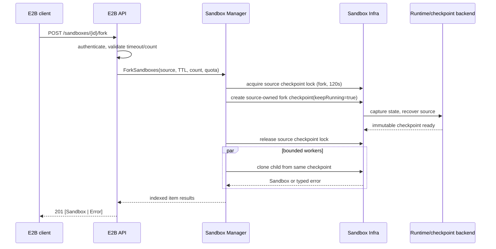

# E2B-Compatible Running Sandbox Fork

## API Changes

This proposal adds E2B-compatible endpoints:

```http
POST /sandboxes/{sandboxID}/fork
POST /kruise/api/sandboxes/{sandboxID}/fork
```

The first is the native E2B path and the second is the customized path. They
MUST be behaviorally identical.

### Request

The request body is optional:

```json
{
  "timeout": 60,
  "count": 2
}
```

| Field | Type | Default | Validation | Meaning |
|---|---:|---:|---|---|
| `timeout` | integer | 15 | `1 <= timeout <= maxTimeout` | Lifetime of each new Sandbox, in seconds. |
| `count` | integer | 1 | `1 <= count <= 100` | Number of forks to attempt from one checkpoint. |

The Go request model MUST use pointers to distinguish omitted fields from
explicit zero values:

```go
type ForkSandboxRequest struct {
    Timeout *int `json:"timeout,omitempty"`
    Count   *int `json:"count,omitempty"`
}
```

`timeout: 0` and `count: 0` are invalid. Fork timeout validation is independent
from the existing create API and MUST NOT silently inherit its 30-second
minimum timeout. The [upstream OpenAPI schema](https://github.com/e2b-dev/E2B/blob/a1ad3266d7088eb0dcaf720adf6665ab59be12c4/spec/openapi.yml#L1198-L1206)
declares a minimum timeout of zero, but the [E2B Runtime validator](https://github.com/e2b-dev/runtime/blob/e46b165d8d7e9e8dc28587a3c90ce9e5f20327cb/packages/api/internal/handlers/timeout_helper.go#L18-L42)
rejects explicitly supplied values less than or equal to zero. This endpoint
follows Runtime behavior; zero does not mean an unlimited lifetime.

### Success response

The endpoint returns `201 Created` only after the source checkpoint succeeds
and every fork has completed its creation attempt. The result array MUST have
exactly `count` entries in request-slot order and permits partial success:

```json
[
  { "sandbox": { "sandboxID": "sbx-new-a" } },
  { "error": { "code": 429, "message": "sandbox concurrency quota exceeded" } }
]
```

Each result MUST contain exactly one of `sandbox` or `error`:

```go
type ForkSandboxResult struct {
    Sandbox *Sandbox       `json:"sandbox,omitempty"`
    Error   *ForkItemError `json:"error,omitempty"`
}

type ForkItemError struct {
    Code    int    `json:"code"`
    Message string `json:"message"`
}
```

A successful item returns the complete E2B `Sandbox` representation, including
new credentials issued by the existing create/clone contract, not only the
`sandboxID`.

### Request-level errors

| HTTP status | Meaning |
|---:|---|
| 400 | Malformed request body or invalid timeout/count. |
| 401 | Authentication failed. |
| 404 | The source Sandbox is absent, terminal, or belongs to another tenant. Ownership mismatch MUST remain indistinguishable from absence. |
| 409 | The source cannot be forked in its current state, including Paused, or another checkpoint of the same Sandbox is in progress. |
| 429 | Request-level rate limiting. |
| 500 | An unexpected control-plane or checkpoint error occurred. |
| 503 | The Runtime checkpoint admission queue or a required backend is unavailable. |

After checkpoint success, individual clone failures are written into the `201`
result array. Quota exhaustion maps to `429`, capacity exhaustion or retry
exhaustion maps to `503`, conflicts map to `409`, and other failures map to
`500`. Fork quota exhaustion MUST NOT reuse the existing create API's `403`
mapping.

### Sandbox annotation

This proposal adds one internal Sandbox annotation:

| Key | Writer | Meaning |
|---|---|---|
| `agents.kruise.io/checkpoint-lock` | sandbox-manager sets it before creating a checkpoint and releases it afterwards; recycle clears it | Holder of the checkpoint in progress on this Sandbox. Absent means unlocked. |

```json
{
  "holder": "4f1c2b9e-8d3a-4c51-9f0e-2a7b6c5d4e3f",
  "operation": "fork",
  "expireTime": "2026-10-20T08:02:00Z"
}
```

`holder` is unique per acquisition, `operation` names the operation that
requested the checkpoint (`fork` or `snapshot`) and is reported in conflict
errors, and `expireTime` is the RFC 3339 UTC time after which the lock is free.
The key and its JSON value type are defined in `api/v1alpha1`, like
`UpdatedMetadataInClaim`, rather than in a sandbox-manager package; Infra
returns and accepts this type directly:

```go
type CheckpointLock struct {
    Holder     string      `json:"holder"`
    Operation  string      `json:"operation"`
    ExpireTime metav1.Time `json:"expireTime"`
}
```

The key is distinct from `agents.kruise.io/lock`, which identifies a claim
delivery. Users and other components MUST NOT write it.

### Snapshot conflict

| Endpoint | Change |
|---|---|
| `POST /sandboxes/{sandboxID}/snapshots` | Returns `409` when another checkpoint of the same Sandbox, from a fork or another Snapshot, is in progress. Concurrent Snapshots previously each created their own Checkpoint CR. |

The Snapshot handler adds the mapping from Manager conflicts to `409` and
passes the operation name `snapshot` to the Manager. Upstream E2B waits for an
observed concurrent `Snapshotting` transition before returning `409`; this
endpoint returns `409` as soon as it observes an active checkpoint lock.

### Fork source lookup failures

Both fork source lookups are bounded by two seconds. A lookup deadline or a
transient backend error maps to `503` for fork only, while absent or foreign
Sandboxes remain indistinguishable `404` responses. Other E2B endpoints retain
their existing lookup mappings, and Snapshot checkpoint-lock retry exhaustion
continues to return `500`.

Using an internal fork checkpoint ID with the ordinary Sandbox create endpoint
is an invalid request and returns `400`, not a control-plane failure.

## Summary

E2B `Sandbox.fork` is a running-state microVM clone, not an ordinary template
create or a filesystem-only checkpoint restore. It captures one logical point
in time from a running source Sandbox and restores one or more independent
Sandboxes from that point. The source remains available after a brief
checkpoint pause; every fork receives a new Sandbox identity, lifecycle,
credentials, TTL, and quota reservation.

OpenKruise Agents already provides the checkpoint/restore capability required
by this proposal and can create a Sandbox from a Checkpoint. Fork reuses that
capability while adding E2B-specific orchestration: one checkpoint supports a
whole batch, and source-owned fork checkpoints are never exposed as user
Snapshots.

This proposal adds a dedicated Manager-layer fork use case, a source-owned
checkpoint lifecycle, and bounded concurrent clone orchestration. It forbids
implementing fork by composing the existing snapshot and create HTTP handlers.

## Background and Motivation

E2B SDKs expose `fork` through both instance and static entry points. Callers
need to branch an initialized execution environment without repeating expensive
initialization, for example to explore model outputs from an already loaded
workspace. Compatibility is more than accepting a route: all children of one
batch MUST start from the same running-state point.

The current E2B API already provides related capabilities:

- `POST /sandboxes/{sandboxID}/snapshots` calls `Sandbox.CreateCheckpoint` for
  a running Sandbox.
- `POST /sandboxes` accepts a Checkpoint ID and uses the existing Manager clone
  flow.
- `SandboxManager.CloneSandbox` already centralizes short-ID assignment, quota
  admission, create limiting, and route publication.

Directly composing these HTTP paths is unacceptable. It exposes internal fork
artifacts, cannot guarantee a single checkpoint for a batch, leaves cancellation
and source-lifecycle cleanup ownership unclear, and duplicates Manager-owned
quota and lifecycle orchestration in the API layer.

### Goals

- Implement the E2B fork HTTP contract, including defaults, batch results,
  request-level errors, and native/customized path equivalence.
- Ensure all successful children of one request use one immutable checkpoint.
- Preserve source identity, quota reservation, and lifecycle deadline after a
  successful fork.
- Give each child a new Sandbox ID, route identity, credentials, lifecycle,
  quota reservation, and independent writable root filesystem layer.
- Serialize every checkpoint that sandbox-manager creates on one Sandbox,
  including fork, Snapshot, and future checkpoint features, through a checkpoint
  lock stored on that Sandbox, without changing the concurrency semantics of
  pause, resume, or delete.
- Keep fork checkpoints private to their source Sandbox and reclaim successful
  batches immediately while retaining incomplete batches only until their TTL.
- Preserve the `API -> Manager -> Infra` layering.
- Reuse the project's established running-state checkpoint/restore capability
  without changing its backend contract.

### Non-Goals

- Implementing Linux `fork(2)` semantics.
- Guaranteeing that existing TCP, HTTP/2, WebSocket, or other long-lived source
  connections survive checkpointing.
- Duplicating external persistent-volume data.
- Adding an idempotency key not defined by upstream E2B.
- Changing public Snapshot retention or listing, general Checkpoint retention,
  or existing create API semantics. The only Snapshot change is the concurrent
  checkpoint conflict.
- Applying the checkpoint lock to controller-side checkpoints for pause or
  upgrade.
- Adding Prometheus metrics.

## Current Implementation Assessment

`CheckpointSpec` declares `keepRunning`, `memory`, and `filesystem`. The
Sandbox controller coordinates Checkpoint CRs for pause and checkpoint-restore
flows; Checkpoint status carries a backend checkpoint ID and Pod template
delta. Fork treats the existing checkpoint/restore implementation as its
established running-state foundation. It adds neither a second checkpoint
backend nor a separate checkpoint-capability validation phase.

The current snapshot implementation creates a Checkpoint and its owned
SandboxTemplate, waits for `CheckpointSucceeded`, and uses
`status.checkpointId` for later clone. A fork checkpoint remains owned by its
source Sandbox, but it is a per-batch artifact: successful batches delete it
after every child reaches Ready. A failed, cancelled, or interrupted batch
leaves its checkpoint to the one-hour `ttlAfterFinished` fallback; source
deletion cascades through the ownership relationship, and recycle cleanup is
deferred until recycle itself is complete.

The current clone path retries creation. A Kubernetes create timeout may occur
after the Sandbox CR has already persisted, so a retry may leave an orphan.
Fork multiplies this exposure by `count`; it therefore requires a bounded worker
pool and child-orphan recovery through the existing clone lifecycle.

## Proposal

### Checkpoint Reuse and Inheritance

Fork uses the existing checkpoint/restore implementation with
`KeepRunning=true`. Each request creates or refreshes an internal fork
checkpoint owned by the source Sandbox. Every child in that request restores
from the same immutable checkpoint, while the source is restored through the
existing checkpoint lifecycle. A later fork creates a new checkpoint from the
source's current state rather than reusing stale running state.

A fork checkpoint is private and never exposed as a public Snapshot. After all
children in a batch successfully reach Ready, the Manager deletes that batch's
checkpoint by its exact checkpoint ID. A batch with a failed child, cancellation,
or manager crash remains until its one-hour checkpoint TTL expires; source
Sandbox deletion cascades to remaining fork checkpoints through owner
references. Generic
checkpoint cleanup and resume selection MUST ignore fork checkpoints.

Each child receives a new Sandbox identity, lifecycle deadline, quota
reservation, runtime credentials, traffic token, and writable root filesystem
layer. A preparation deadline protects the child while it starts; after Ready,
runtime initialization, token issuance, and CSI mounts complete, the Manager
atomically writes the requested lifecycle deadline and restores its inherited
auto-pause policy. Auto-pause children inherit the source's resolved
paused-retention annotation. Source credentials MUST NOT be copied through
Checkpoint annotations, template metadata, or response models.

Fork reads the source TrafficPolicy and the normalized L7 rules in
`agents.kruise.io/security-rules` inside the checkpoint lock, and restores both
on each child before it is created. L7 rules such as domain blocking and header
injection may exist without a TrafficPolicy and MUST NOT be lost. This does not
add L7 rules to the general checkpoint annotation allow-list or change ordinary
Snapshot/clone inheritance.

Auto-pause/auto-resume, runtime configuration, CSI mount configuration, resource
shape, and workload-identity inputs follow the existing checkpoint inheritance
behavior. Fork does not redefine the checkpoint backend persistence contract.

External-volume data is excluded from the isolation guarantee. Fork inherits
mount configuration, while whether children access the same external data is
defined by the volume's own semantics.

### Sandbox Checkpoint Lock

Checkpoints of one Sandbox run one at a time. Every sandbox-manager operation
that creates a checkpoint MUST first acquire that Sandbox's checkpoint lock.
Fork and E2B Snapshot are its current users; future checkpoint features go
through the same Manager entry point and get mutual exclusion without separate
integration. The lock covers checkpoints only: pause, resume, and delete do not
acquire it and are never blocked by a held lock.

The lock is stored on the checkpointed Sandbox as the
`agents.kruise.io/checkpoint-lock` annotation defined in API Changes, not on a
Checkpoint CR. Each Checkpoint CR is newly created with a generated name that
also becomes its SandboxTemplate name and Snapshot ID, so no fixed Checkpoint
object exists to lock atomically. The lock lives and dies with its Sandbox, so
it needs no separate object or garbage collection, and it is visible wherever
the Sandbox is inspected.

| Step | Behavior |
|---|---|
| Acquire | Read the Sandbox from the informer cache. An unexpired lock held by another holder fails with a conflict naming its operation. Otherwise, write a new value with a merge patch carrying the observed `resourceVersion` as a precondition. A write conflict re-reads the informer view with bounded backoff and re-evaluates. An absent, expired, or unparsable value is replaced. |
| Use | The successful patch response is the latest Sandbox on the API server. The caller runs its in-lock checks on that object without a separate read. |
| Release | A JSON patch tests that the annotation still equals the holder's value and removes it. When the patch fails, the informer view decides the outcome: a value that is no longer the holder's means the lock expired and was taken over, so release completes as a no-op. Any other failure leaves the lock to expire. |
| Expire | `expireTime` is fixed at acquisition and is never renewed. After a holder crashes, the next checkpoint of that Sandbox waits until then. |

Each acquisition derives its TTL from the checkpoint's own wait bound and is
never renewed:

```text
TTL = checkpoint wait timeout
    + 30s abandoned-checkpoint cleanup
    + 30s for release latency and clock skew between sandbox-manager replicas
```

| Caller | Checkpoint wait timeout | Lock TTL |
|---|---|---|
| Fork | 60 seconds, fixed | 120 seconds |
| Snapshot | `snapshot-wait-success-seconds` header, default 60 seconds, unbounded | 120 seconds by default; 360 seconds for a 300-second wait |

Every holder MUST finish its protected work, including detached cleanup, within
the TTL. A crashed sandbox-manager blocks the next checkpoint of the same
Sandbox for at most one TTL. In normal operation the lock is released as soon
as the checkpoint completes or fails.

Lock state never reaches children or the next tenant. Checkpoints copy only
allow-listed Sandbox annotations and SandboxTemplates copy only spec fields, so
Sandboxes created from a checkpoint never inherit the source's lock, and recycle
clears the key together with the other per-delivery annotations. Acquisition
and a failed release read only the informer cache, so neither reads the API
server directly. Each acquisition and release is one Sandbox write: the
Sandbox controller reconciles once, and Sandbox informer consumers observe an
update that leaves route and quota content unchanged.

Each replica judges the lock from its own informer view, preferring an object it
wrote itself when that object is newer. A request served by another replica just
after a release can still observe the released lock and receive `409`; callers
retry it like any other conflict.

Controller-side checkpoints for pause and upgrade do not take part. They follow
a different path that creates the Checkpoint CR and polls its status across
reconciles without a timeout, and the controller must not depend on
sandbox-manager packages. Defining the annotation key and value type in
`api/v1alpha1` keeps the lock directly readable and writable by the controller.

### Layered Architecture

```text
E2B API
  parse and validate E2B requests; authenticate; map responses
       |
       v
Sandbox Manager
  run every checkpoint through one entry point that holds the Sandbox
  checkpoint lock; create a source-owned running checkpoint; run bounded
  concurrent clones; collect item results
       |
       v
Sandbox Infra
  maintain the Sandbox checkpoint lock annotation; create source-owned
  checkpoints without locking; precisely clean completed fork batches and clean
  remaining artifacts on source deletion; execute Runtime operations; implement
  clone; operate Kubernetes resources
```

#### API layer

Add `fork.go`, request/result models, and route registration under
`pkg/servers/e2b`. The handler MUST:

1. Parse the optional JSON body and reject unknown fields.
2. Apply E2B defaults and validate timeout/count.
3. Resolve the authenticated user and namespace.
4. Call one Manager method.
5. Convert successful neutral Sandboxes through `convertToE2BSandbox`.
6. Map Manager request and item results to the public E2B contract.

The handler MUST NOT read or write Checkpoint CRs, call an Infra implementation
directly, or internally call the `CreateSnapshot` or `CreateSandbox` handlers.

The API-key middleware continues to establish ownership without exposing a
foreign Sandbox. The fork handler must query a sufficiently broad state set to
distinguish Paused from absent, mapping Paused to `409` rather than allowing a
live-only lookup to collapse it to `404`.

#### Manager layer

`SandboxManager.CreateCheckpoint` is the only sandbox-manager entry point that
creates a checkpoint; E2B Snapshot already calls it. Other Manager code MUST NOT
call the Infra `CreateCheckpoint` directly.

```go
type CreateCheckpointOptions struct {
    // Operation names the requester; it is written into the lock and reported
    // in conflict errors.
    Operation string
    Infra     infra.CreateCheckpointOptions
    // BeforeCheckpoint optionally runs inside the lock on the Sandbox returned
    // by acquisition; an error aborts before any checkpoint is created.
    BeforeCheckpoint func(ctx context.Context, sbx infra.Sandbox) error
}

func (m *SandboxManager) CreateCheckpoint(
    ctx context.Context,
    sbx infra.Sandbox,
    opts CreateCheckpointOptions,
) (string, error)
```

The entry point:

1. Derives the TTL from `Infra.WaitSuccessTimeout`, or 60 seconds when unset,
   and acquires the checkpoint lock with `Operation`.
2. Runs `BeforeCheckpoint`, when set, on the Sandbox returned by acquisition.
3. Calls the Infra `CreateCheckpoint` and waits for completion. Steps 2 and 3
   run under a deadline equal to the wait timeout, which leaves the cleanup
   allowance and the margin of the TTL for detached cleanup and release.
4. Releases the lock on a detached bounded context, whether the checkpoint
   succeeded or failed.

Snapshot calls it with operation `snapshot` and no `BeforeCheckpoint`; apart
from the concurrent-checkpoint `409`, its behavior is unchanged.

Add a protocol-neutral Manager use case for fork:

```go
type ForkSandboxOptions struct {
    Namespace string
    User      string
    SandboxID string
    Timeout   time.Duration
    Count     int
    Quota     *quotaspec.QuotaSpec
}

type ForkSandboxItemResult struct {
    Sandbox infra.Sandbox
    Err     error
}

func (m *SandboxManager) ForkSandboxes(
    ctx context.Context,
    opts ForkSandboxOptions,
) ([]ForkSandboxItemResult, error)
```

The Manager is responsible for:

1. Looking up the source in tenant scope and evaluating its lifecycle state. A
   source that the informer view already shows as not Running is rejected
   before any lock write.
2. Creating the checkpoint through the Manager entry point with operation
   `fork` and the 60-second wait, which yields a 120-second lock.
   `BeforeCheckpoint` re-validates source identity, recycle state, and Running
   state on the Sandbox returned by the acquisition, then reads the source
   network policy. Only another checkpoint of the same Sandbox causes the lock
   conflict. The implementation MUST NOT use an API-process-local mutex or add a
   recoverable batch task for fork.
3. Creating or refreshing a source-owned running-state fork checkpoint with
   `KeepRunning=true`.
4. Fanning out child clones through a bounded worker pool. The public batch
   limit is 100; worker count is an internal Manager option protecting Runtime
   and Kubernetes create capacity. E2B Runtime currently launches up to 100
   children with unbounded `errgroup.Go`; bounded scheduling changes only
   internal start concurrency, not the request, response ordering, or partial
   success semantics.
5. Sending every child through the existing clone admission path so it receives
   an independent quota reservation, Sandbox ID, create-limit admission, route,
   and credentials.
6. Preserving result order through stable input indexes.
7. Waiting for all started workers and collecting item results.
8. Starting child clones only after the entry point returns, by which time the
   checkpoint lock is released. Source Sandbox delete/expiry cleans up its fork
   checkpoint.

A request canceled before its checkpoint starts takes no lock and creates no
checkpoint. Once the checkpoint starts, the system stops unstarted work when
safe, while source recovery continues in a detached bounded context.
Cancellation after checkpoint success does not prove that no child was created.
The request is not idempotent; callers that receive an uncertain result MUST
inspect existing resources before retrying.

The API layer owns E2B defaults and HTTP mapping. The Manager accepts only
validated neutral duration/count values and returns typed domain errors; it MUST
NOT import E2B request, response, or HTTP types.

#### Infra layer

Add a source-owned fork checkpoint contract on top of the existing checkpoint
and clone capabilities:

```go
type ForkCheckpointOptions struct {
    KeepRunning        bool
    PersistentContents []string
}

type ForkCheckpoint struct {
    ID        string
    Namespace string
    Name      string
}
```

Infra MUST:

- Implement the Sandbox checkpoint lock on the neutral Sandbox interface:

  ```go
  type CheckpointLockOptions struct {
      Operation string
      TTL       time.Duration
  }

  // Added to infra.Sandbox. A successful acquisition refreshes the Sandbox to
  // the object returned by the API server.
  AcquireCheckpointLock(ctx context.Context, opts CheckpointLockOptions) (v1alpha1.CheckpointLock, error)
  ReleaseCheckpointLock(ctx context.Context, lock v1alpha1.CheckpointLock) error
  ```

  A lock held by another holder returns a typed conflict error naming its
  operation; exhausted write-conflict retries return a typed unavailable error.
  The Infra `CreateCheckpoint` itself does not lock. Fork validates the source
  on the Sandbox returned by acquisition instead of a separate API-server read.
- Create and wait for a fork checkpoint for the source Sandbox using the
  existing running-state checkpoint implementation.
- Create children from that checkpoint through the existing neutral clone path.
- Delete a source's fork checkpoint when the source Sandbox is deleted or
  expires.

The implementation may reuse `Checkpoint` CRs and `SandboxTemplate`, but a
fork checkpoint MUST have an internal purpose label and an explicit ownership
relationship to its source Sandbox. It MUST NOT appear in E2B `GET /snapshots`,
be accepted as a user template, or be selected by unrelated pause or upgrade
flows. The label is an implementation selector, not an authorization boundary;
namespace and owner checks remain mandatory.

After every child in a batch succeeds, the Manager MUST delete only that
batch's fork checkpoint, matched by both source UID and checkpoint ID. Infra
finds it through the informer-backed checkpoint index and deletes it with UID
and resourceVersion preconditions; it does not read the SandboxTemplate or fall
back to the APIReader. The template is controlled by its checkpoint and is
reclaimed by garbage collection. A cache miss or failed deletion leaves the
artifact to its TTL.

A failed, cancelled, or interrupted batch MUST retain its checkpoint for the
one-hour `ttlAfterFinished` fallback. Source deletion or expiry MUST also delete
fork checkpoints and cascade deletion of their owned SandboxTemplates.

Recycle does not clean fork checkpoints in this proposal. The recycle
lifecycle's content reset is not yet complete (the recycler is currently a
no-op), and recycle is not enabled by the E2B create path, so the one-hour TTL
already bounds any checkpoint left behind by a recycled source. When recycle is
completed, it MUST batch-delete fork checkpoints for the source UID before the
Sandbox returns to the pool; until then the TTL fallback covers the gap.

### Operation Flow



### State and Failure Semantics

The source checkpoint lock has these conceptual states:

```text
Unlocked -> Held by one checkpoint (fork or Snapshot) -> Unlocked
                          \-> Expired after manager crash -> replaced by the next acquisition
```

On one Sandbox, fork and fork, fork and Snapshot, and Snapshot and Snapshot are
mutually exclusive; the later request returns `409`. Pause, resume, and delete
retain their existing semantics and can race with a checkpoint. The lock is
released when an in-lock check or the checkpoint fails. Fork releases it before
child clones begin, so child clones do not hold a source lock. The lock's
`resourceVersion` precondition gives atomic coordination across Manager
replicas without an API-process-local mutex. A manager crash leaves the lock to
expire; it does not create a recoverable or replayable `ForkOperation`.

| Phase | Failure outcome |
|---|---|
| Before checkpoint | Return a non-201 request error; do not start children. |
| Checkpoint / source recovery | Return a request error. Restore a healthy source; otherwise use existing terminal lifecycle cleanup. |
| Individual clone | Record a typed item error and continue other workers. |
| Source Sandbox deletion or expiry | Delete the source-owned fork checkpoint and its SandboxTemplate. |
| Request cancellation | Stop unstarted children; never abandon source recovery only because the HTTP client disconnected. |
| sandbox-manager restart | Do not resume or replay the old batch. Successfully created children remain; unfinished child results may be unknown. |

#### Client Disconnect and sandbox-manager Restart

On client disconnect, only completion of source checkpointing and source
recovery use a detached bounded context. Child clones continue to use the
request context. Consequently, unstarted children do not begin, while
children whose creation was already submitted may succeed, fail, or have an
unknown result. The server does not turn the whole clone batch into a background
task or deliver a delayed response to a disconnected client.

A sandbox-manager restart has the same request semantics. The old batch is not
resumed or replayed, and the design adds no persistent `ForkOperation`, operation
ID, or idempotency key. The source checkpoint lock expires at its `expireTime`
after restart; the source-owned checkpoint remains, and a later fork
checkpoints the source's current state again. Created children remain running
and are not
rolled back because other children in their batch were unfinished.

A caller that does not receive the complete `201` response MUST treat the
outcome as unknown and MUST NOT blindly retry. A retry creates a new checkpoint
and a new child set; the caller must first inventory or clean up already-created
Sandboxes.

After checkpoint success, the fork route MUST NOT convert a partially successful
batch into an overall error. This matches E2B semantics and prevents callers
from losing identities of children they need to delete.

### Security and Inheritance Rules

- Tenant lookup, checkpoint creation, clone, and source-deletion cleanup MUST
  all be scoped by namespace and owner.
- A cross-tenant request MUST return `404`, like an absent source Sandbox.
- Each child receives new runtime access credentials and traffic tokens; source
  credentials MUST NOT leak or be copied.
- Identity configuration may be inherited as input configuration, but workload
  identity MUST be derived again for the new Sandbox identity.
- Network, auto-pause, auto-resume, resource shape, and mount configuration
  follow existing checkpoint inheritance rules. Unsupported or unsafe
  configuration MUST fail before checkpoint creation.
- Fork does not make external volumes copy-on-write. This limitation MUST be
  documented in public E2B compatibility documentation.

## Compatibility and Upgrade Strategy

The endpoint is additive. Existing E2B paths, public Snapshots, and create
behavior remain unchanged, except that a Snapshot concurrent with another
checkpoint of the same Sandbox returns `409`, matching upstream E2B.

The endpoint directly reuses the project's supported checkpoint/restore path.
Rollback is safe: disabling the fork route stops new requests without changing
existing Sandbox or Checkpoint data.

If fork-checkpoint labels or annotations are added, older controllers may ignore
them. Before rollout, all active controller/backend versions MUST understand the
source-owned checkpoint cleanup and isolation contract.

The checkpoint lock annotation is additive and is ignored by components that do
not acquire it. During a sandbox-manager rolling upgrade, old replicas create
checkpoints without the lock, so mutual exclusion takes full effect once every
replica is upgraded. A controller that predates recycle clearing of the key may
return a Sandbox to its pool with a stale lock; the lock expires, and the next
acquisition replaces it.

## Test Plan

### Unit tests

- API defaults and rejection of zero, negative, and out-of-range timeout/count.
- Native and customized route equivalence.
- Request-level mapping for malformed input, absent sources, cross-tenant
  access, Paused sources, and conflicts.
- Result model construction always emits exactly one of `sandbox` or `error`.
- Fork item error mapping, especially quota `429` rather than create `403`.
- Result order remains stable when workers complete out of order.
- A multi-child batch creates exactly one source-owned fork checkpoint.
- L7 rules are restored on every child even without a TrafficPolicy, using the
  locked source view rather than the pre-lock view.
- Both fork source lookups map deadlines and temporary backend errors to `503`
  without changing other endpoints or exposing foreign Sandbox existence.
- Ordinary create rejects an internal fork checkpoint with `400`.
- Fork cleanup uses only the checkpoint informer index and guarded deletion,
  without template reads or an APIReader fallback.
- Client cancellation restores the source through a detached bounded context
  and does not start unstarted children.
- A request canceled before its checkpoint starts takes no lock and creates no
  checkpoint.
- A sandbox-manager restart does not resume or replay an old batch, and its
  checkpoint lock expires to allow a later request.
- Checkpoint lock acquisition succeeds on an unlocked, expired, or unparsable
  value; fails with a conflict naming the active foreign holder's operation;
  and retries a `resourceVersion` conflict from the informer view.
- Checkpoint lock release removes only the holder's own value and is a no-op
  after expiry and takeover.
- Fork and Snapshot both create checkpoints through the Manager entry point,
  whose lock TTL follows the wait timeout: 120 seconds by default and longer
  for a longer Snapshot wait.
- A failed `BeforeCheckpoint` creates no checkpoint, and the lock is released
  after a failed `BeforeCheckpoint` and after a failed checkpoint.
- Recycle clears the checkpoint lock, and checkpoints and clones never carry it
  to children.
- Source deletion or expiry submits deletion of its fork checkpoint.

### Integration and End-to-End Tests

The established checkpoint capability is a prerequisite and is not separately
revalidated by this proposal. Fork coverage validates the new orchestration:

- All successful children use the same checkpoint identifier.
- The source retains its Sandbox ID, deadline, route, and quota reservation.
- Every child has a new ID, independent quota reservation, and new credentials.
- Batch quota contention produces a partial-success `201` response.
- Concurrent fork requests have one winner; the competing fork returns `409`.
- A Snapshot during a fork returns `409`, and a fork during a Snapshot returns
  `409`.
- Pause, resume, and delete retain their existing concurrency semantics while a
  fork is in progress.
- E2B Snapshot listing and template lookup never expose source-owned fork
  checkpoints.
- Source deletion or expiry cleans up fork checkpoints without deleting public
  snapshots.
- `count: 100` respects the worker-pool limit.
- Source and child root filesystem writes do not cross over, and the source is
  usable after fork.
- Child access tokens, traffic tokens, identities, IDs, and TTL start times all
  differ from the source.
- External mounted-volume behavior is documented and matches underlying volume
  semantics.

## Implementation Plan

1. **Infra lifecycle**: add source-owned fork checkpoint creation, internal
   artifact filtering, and cascading cleanup on source Sandbox delete/expiry to
   the existing checkpoint path.
2. **Checkpoint lock**: add the annotation key and value type in
   `api/v1alpha1`, Infra acquisition and release, recycle clearing, and the
   Manager checkpoint entry point; E2B Snapshot passes its operation name.
3. **Manager use case**: implement fork on the Manager checkpoint entry point,
   bounded indexed worker-pool execution, typed item results, and integration
   with existing clone admission.
4. **API surface**: add models, handler, route, status mapping, and
   native/customized compatibility tests.
5. **Rollout**: enable the additive route after the fork orchestration test
   suite passes.

## Implementation History

- 2026-09-28: Initial proposal drafted from E2B fork-contract analysis and the
  current OpenKruise Agents snapshot/clone implementation review.
- 2026-10-20: Replaced the per-source Kubernetes Lease with a Sandbox checkpoint
  lock that serializes every sandbox-manager checkpoint, including Snapshot.
