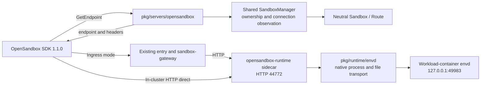
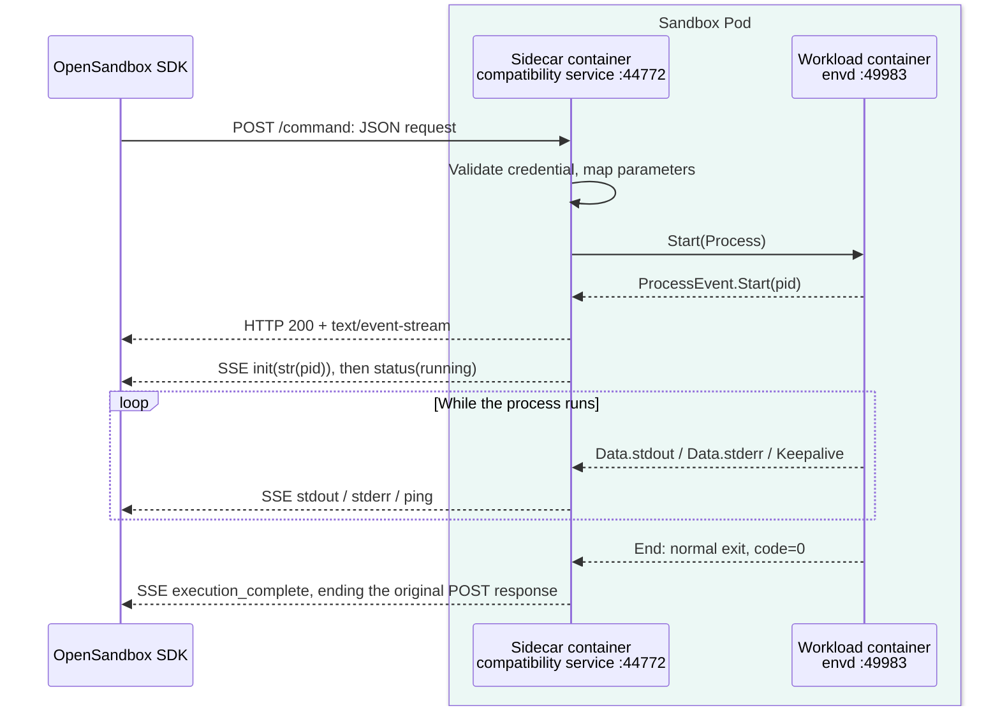
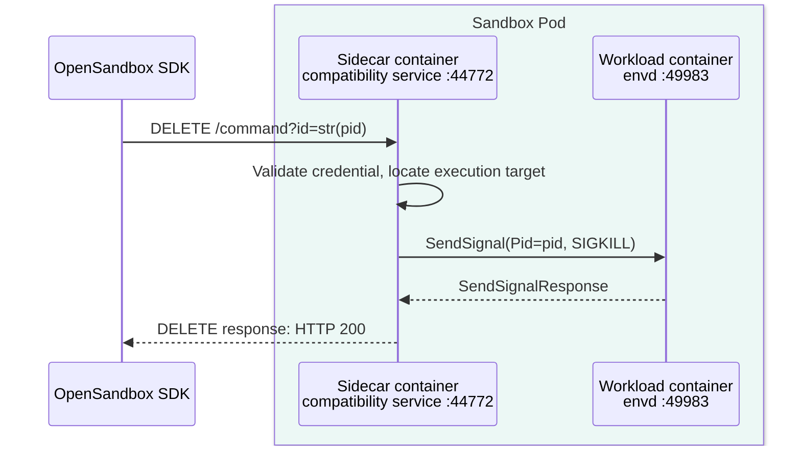
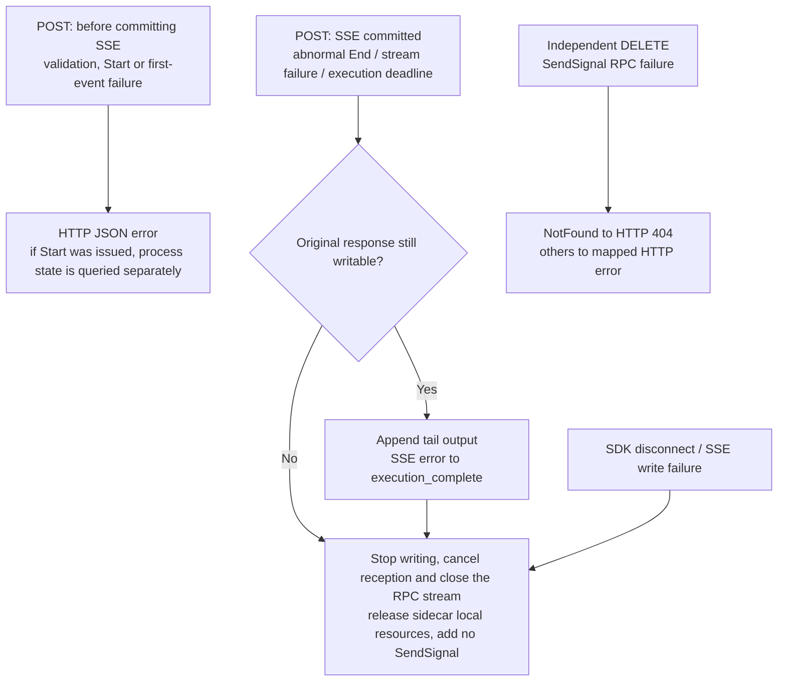
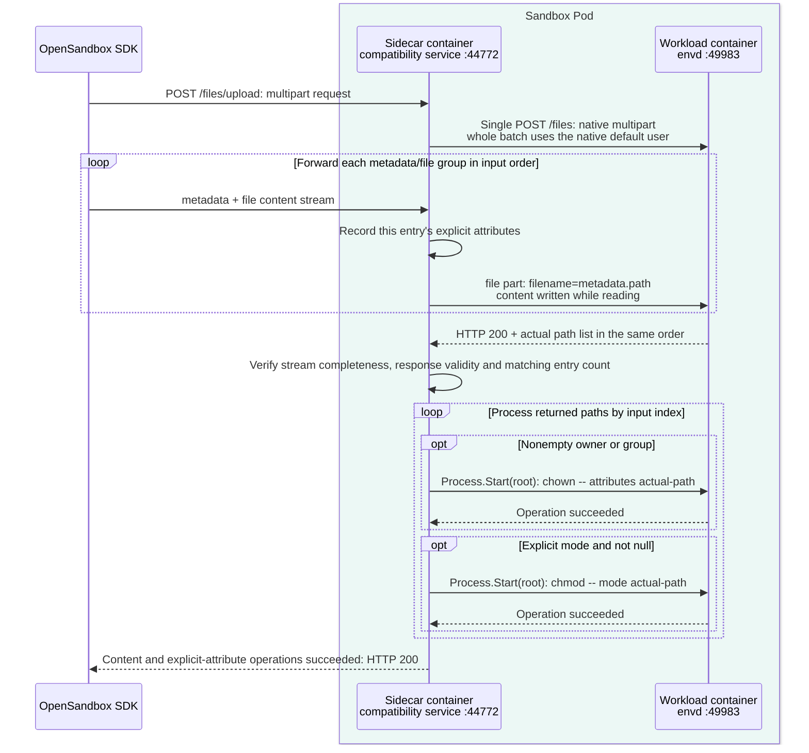
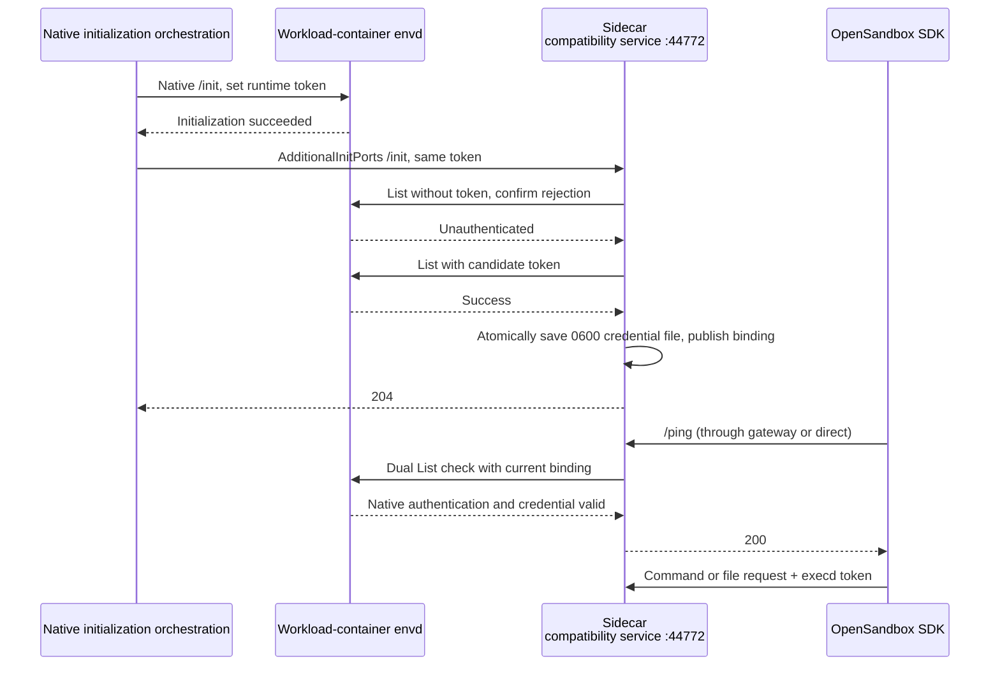

# OpenSandbox-Compatible Data Plane

## Table of Contents

- [Glossary](#glossary)
- [Summary](#summary)
  - [Delivery boundary](#delivery-boundary)
- [Motivation](#motivation)
  - [Goals](#goals)
  - [Non-Goals/Future Work](#non-goalsfuture-work)
- [Proposal](#proposal)
  - [User Stories](#user-stories)
    - [Story 1: Run commands and read/write files through the gateway](#story-1-run-commands-and-readwrite-files-through-the-gateway)
    - [Story 2: Access the same execution capabilities from inside the cluster](#story-2-access-the-same-execution-capabilities-from-inside-the-cluster)
  - [Requirements (Optional)](#requirements-optional)
    - [Functional Requirements](#functional-requirements)
    - [Non-Functional Requirements](#non-functional-requirements)
  - [Implementation Details/Notes/Constraints](#implementation-detailsnotesconstraints)
    - [Architecture and shared responsibilities](#architecture-and-shared-responsibilities)
    - [Reference baseline and native capabilities](#reference-baseline-and-native-capabilities)
    - [Endpoint and dual-path addressing](#endpoint-and-dual-path-addressing)
    - [Credentials and transport boundaries](#credentials-and-transport-boundaries)
    - [Initial command and file delivery](#initial-command-and-file-delivery)
    - [Command invocation and SSE translation](#command-invocation-and-sse-translation)
    - [Native execution semantics](#native-execution-semantics)
    - [Execution identity and stream-close boundary](#execution-identity-and-stream-close-boundary)
    - [File batch and metadata handling](#file-batch-and-metadata-handling)
    - [Initialization and deployment prerequisites](#initialization-and-deployment-prerequisites)
    - [Failure cleanup and compatibility](#failure-cleanup-and-compatibility)
  - [Risks and Mitigations](#risks-and-mitigations)
- [Alternatives](#alternatives)
- [Upgrade Strategy](#upgrade-strategy)
- [Additional Details](#additional-details)
  - [Test Plan \[optional\]](#test-plan-optional)
  - [Implementation and verification status (2026-10-19)](#implementation-and-verification-status-2026-10-19)
- [Implementation History](#implementation-history)

## Glossary

| Term | Meaning |
| --- | --- |
| Data plane | The path carrying sandbox execution and file requests; this delivery covers foreground commands and file upload/download, with execution behavior aligned to the pinned E2B SDK call chain |
| Endpoint | The service address and request headers returned by the control plane, used by the SDK to connect to the data plane |
| Execd compatibility entry | The sandbox-side service implementing this delivery's OpenSandbox HTTP/SSE contracts; it does not run the OpenSandbox execd binary |
| envd | The native Agents execution component providing process, file and other runtime capabilities |
| Ingress / in-cluster direct access | Respectively forwarded through sandbox-gateway, or connecting directly to the sandbox Pod IP and service port |
| Sidecar / workload container | The compatibility service runs in a separate sidecar; envd completes operations within the workload container's user and filesystem view |

## Summary

This proposal delivers OpenSandbox **foreground command and file data-plane
compatibility**: a sandbox-side HTTP compatibility service on port 44772
translates execd requests into native envd calls inside the workload container,
obtaining address and credentials through the control-plane endpoint contract.
**Both ingress and in-cluster Pod IP direct access are in scope for this
delivery**; the two deployment modes share protocol translation, target-side
authentication and native execution semantics.

### Delivery boundary

| Scope | This delivery |
| --- | --- |
| Address discovery | Connect the `GET /v1/sandboxes/{id}/endpoints/{port}` defined by the control-plane proposal, returning address and execution credentials under the existing API Key, namespace and owner rules |
| Access paths | This delivery supports both ingress and direct; ingress is the default, reusing the gateway and existing external HTTPS termination; direct uses in-cluster HTTP Pod IP, selected by deployment configuration |
| Commands | Foreground shell/argv execution, cwd/env, real-time stdout/stderr SSE, nonzero exits, timeout and interrupt; shell, deadline and interrupt behavior map to the pinned E2B SDK |
| Files | Single-/multi-file upload and download reusing the native filesystem; default permissions follow envd, and explicit owner/group/mode and download byte Range adapt per request |
| Connection prerequisites | `/ping`, `/ready`, runtime-token initialization, and the execd 44772 and egress 18080 endpoint discovery that the SDK must query |
| Compatibility boundary | Code interpreter, independent file management, background state/logs and egress management are listed as non-goals; implementation and verification status is in [current status](#implementation-and-verification-status-2026-10-19) |

The endpoint HTTP contract and shared initialization contract are defined by the
control-plane proposal; their implementation and supporting wiring may be
delivered ahead with the data-plane branch to satisfy complete SDK connection.
Implementation batches follow the `API → Manager → Infra/runtime` layering,
keeping the same contract consistent.

## Motivation

After the OpenSandbox SDK creates a sandbox, it also resolves the execution
endpoint, checks health and calls the command and file services. With only a
creation API, the SDK's actual execution path remains unconnected. See the
[official architecture: Server Proxy and Endpoint Resolution][os-architecture]
and the [SDK `Sandbox` implementation][os-sandbox].

Agents already provides sandbox-gateway, in-cluster Pod IP direct access and
envd process/file capabilities. The data-plane adaptation mainly handles the
request, event and credential differences between execd and envd; the two access
paths can share the sandbox-side service. See [Return Sandbox IP][ag-doc-ip],
the [native process client][ag-process] and [filesystem capabilities][ag-files].

Adaptation proposal #690 gives the direction of control-plane protocol
adaptation and runtime capability layering. This delivery reuses the shared
SandboxManager and a neutral execution transport, preserving the native E2B
path.

### Goals

- Connect the SDK's post-creation endpoint, health check, foreground command and
  file read/write path.
- Let ingress and in-cluster direct access use the same set of SDK business
  calls and reach the same compatibility service.
- Reuse existing authorization, runtime token, workload-container execution
  capabilities and initialization orchestration.
- Keep output delivered in real time; execution deadline and explicit interrupt
  follow envd, and client disconnection only ends forwarding and releases local
  resources.
- Align the first batch's execution behavior with the pinned E2B SDK's actual
  calls and observable results, preserving existing E2B APIs; envd provides the
  underlying execution capability, and comparable E2E scenarios serve as the
  reference.

### Non-Goals/Future Work

| Capability | Current handling |
| --- | --- |
| Code interpreter, code contexts and sessions | `/code`, session run and isolated session APIs are not in this batch; no Jupyter protocol or session file view integration |
| Background command state, logs and PTY | `background=true`, background queries and PTY APIs return unsupported; after disconnection the native process may continue running and be interrupted by execution ID; this batch adds no completed-state or cross-connection log storage |
| Independent file management | list, stat, remove, directory management and similar APIs are excluded; file scope is limited to upload and download |
| Other command/file parameters | Numeric command UID/GID overrides and line-based offset/limit downloads return unsupported |
| Metrics and egress management | `/metrics`, `/policy`, `/credential-vault` and similar APIs return HTTP 501; 18080 only provides a genuinely reachable unsupported-response entry |
| Signed endpoints and generic Lifecycle Server Proxy | `expires` or `use_server_proxy=true` in endpoint queries returns HTTP 501 |
| Automatic routing, failure fallback and external direct access | The mode is fixed at API deployment; execution requests are not replayed, and no public address or external route is provisioned |
| Compatibility-service TLS/mTLS | Direct access provides HTTP only; HTTPS reuses the existing external entry; TLS-only native envd is not in this batch's wiring scope |
| Lifecycle APIs and recovery scenarios | No new describe/list/delete/pause/resume control-plane APIs; Pool, Checkpoint and post-recovery execution are verified separately |
| New credential proxies and request-level hooks | No new outbound Credential Proxy, preStart executor or periodic scheduler |

## Proposal

### User Stories

#### Story 1: Run commands and read/write files through the gateway

A caller creates a sandbox with the OpenSandbox SDK and obtains the gateway
endpoint and routing/execution-credential headers. The SDK reaches the
compatibility service through the existing gateway, runs foreground commands,
receives output in real time, and uploads or downloads files. The external entry
may terminate HTTPS using the existing deployment.

#### Story 2: Access the same execution capabilities from inside the cluster

An in-cluster caller connects to the direct-mode HTTP control-plane address.
After the SDK obtains `PodIP:44772` and the target-side execution credentials, it
accesses the same compatibility service directly, using the same command and
file APIs.

### Requirements (Optional)

#### Functional Requirements

**FR1: Dual-path endpoint discovery**

Return the gateway or Pod IP address per deployment configuration, sharing
identity, ownership and service-mapping rules; both 44772 and 18080 point to the
deployed compatibility service.

**FR2: Foreground commands and real-time output**

Support shell string or argv, cwd, env, timeout and execution-ID interrupt;
deliver initialization, stdout, stderr, error and execution-complete events over
SSE.

**FR3: Single-/multi-file upload and download**

Accept ordered metadata/file multipart, streaming content to native `/files`;
downloads stream back content from the workload container, without a multi-file
transaction.

**FR4: Initialization and target-side authentication**

The compatibility service binds the same sandbox runtime token after native
envd initialization. Business requests validate `X-EXECD-ACCESS-TOKEN`; health
checks pass after initialization and native-service availability.

#### Non-Functional Requirements

**NFR1: Authorization and layering**

Endpoint queries reuse control-plane authorization; execution credentials are
validated at the actual target. Maintain `API → Manager → Infra`; the
sandbox-side protocol service is independent of Manager, Infra implementations
and Controller, and the control-plane API Key is not an execution token.

**NFR2: Streaming, cancellation and native compatibility**

Avoid aggregating complete command output or file content; stream exit releases
the connection and local resources, and explicit signal calls use an
independent, bounded context. Existing E2B buffered calls and native routes
remain unchanged.

### Implementation Details/Notes/Constraints

#### Architecture and shared responsibilities

| Location | Responsibility and delivery relationship |
| --- | --- |
| `pkg/servers/opensandbox` | Implements endpoint, identity context, address and credential projection, and error mapping per the control-plane contract; selects the compatibility runtime at creation and passes initialization options; the related wiring may be delivered ahead with the data plane |
| `pkg/sandbox-manager/connection.go` | `GetSandboxConnection` reuses the `GetSandbox` ownership check and returns a neutral route observation as the shared dependency of endpoint |
| Infra | Provides state, IP and route data along existing Sandbox capabilities, with no new API protocol or resource type |
| sandbox-gateway | Reuses existing routing headers, forwarding and ingress authentication, with no execd protocol translation |
| `pkg/agent-runtime/opensandbox` | execd request/event adaptation, runtime-token validation, PID execution ID, readiness checks and file stream handling |
| `pkg/runtime/envd` | Concrete native transport client: process Start/Signal/List, file HTTP and probes, independent of the control plane |
| `pkg/utils/runtime` | Supports optional additional ports per the shared initialization contract and preserves the native initialization record; the related wiring may be delivered ahead with the data plane |
| `cmd/opensandbox-runtime` | Assembles the compatibility service, HTTP listener and shutdown flow; the binary is packaged in the agent-runtime image |

Current consumers use a concrete envd client; this batch adds no generic
`RuntimeProvider` interface and does not modify the existing buffered process
API. execd models and HTTP/SSE rules remain at the compatibility-service
boundary.

#### Reference baseline and native capabilities

| Object | Stable baseline | Purpose |
| --- | --- | --- |
| OpenSandbox | `release-1.1.0`, Python SDK `opensandbox==1.1.0` | Lifecycle/execd contracts, SDK calls and default behavior |
| OpenKruise Agents | `v0.6.0` | Reference for released gateway, runtime, protocol and test capabilities |
| E2B Python SDK | [`e2b@2.51.0`][e2b-commands] | SDK calls, parameter defaults, disconnection, timeout and explicit-interrupt behavior baseline for the first batch's command and file capabilities |
| envd dependency | E2B infra `2025.33` | Reuses the existing native component; this batch does not modify, backport, upgrade or replace envd |

The protocol reference is the [execd OpenAPI][os-execd-spec]; execution semantics
use the pinned E2B SDK's complete call chain as the baseline, and envd is used to
verify the underlying mechanism. Commands reuse envd `Process.Start`; files
reuse HTTP `/files`; OpenSandbox fields, units, SSE and HTTP responses map at the
API layer, with default differences in
[native execution semantics](#native-execution-semantics). See
[E2B command calls][e2b-commands], [file calls][e2b-files],
[native processes][ag-process], [filesystem capabilities][ag-files] and
[initialization][ag-init]. The current implementation and the images used in
local runs are recorded separately from these capability references in
[implementation and verification status](#implementation-and-verification-status-2026-10-19).

#### Endpoint and dual-path addressing

`GET /v1/sandboxes/{id}/endpoints/{port}` returns `Endpoint{endpoint, headers}`.
The API uses the existing KeyStorage identity, scoping namespace by Team.Name;
the Admin team follows existing cross-namespace query rules, and Manager still
checks whether the instance owner is the current Key ID. See
[Lifecycle OpenAPI][os-lifecycle-spec] and [Manager `GetSandbox`][ag-manager].

| Mode | Address | Headers required by execd/egress |
| --- | --- | --- |
| Ingress (default) | host[:port] of `--opensandbox-gateway-url` | `e2b-sandbox-id`, `e2b-sandbox-port=44772`, `X-Access-Token`, `X-EXECD-ACCESS-TOKEN`; obtains the native traffic token when traffic auth is enabled |
| direct | `PodIP:44772` | `X-EXECD-ACCESS-TOKEN` |

The mode is selected by `--opensandbox-access-mode=ingress|direct`; ingress
requires an HTTP(S) origin configured without path, query or credentials. The
SDK's `use_server_proxy` denotes the lifecycle proxy and cannot switch between
these two access modes.

SDK 1.1.0 uses `ConnectionConfig.protocol` to assemble the execution URL; the
endpoint string itself carries no scheme. Therefore the ingress SDK protocol
must match the configured entry; direct uses an internal HTTP control-plane
connection. See [SDK connection configuration][os-connection] and
[command URL construction][os-command-adapter].

Logical execd 44772 and egress 18080 both map to the compatibility listener
44772; egress policy and Vault use points return `501 NOT_SUPPORTED`. Other
valid ports return along existing address rules; this batch's command and file
services are handled only by the compatibility entry.

| Query condition | Response |
| --- | --- |
| Invalid port | HTTP 400 |
| Nonexistent sandbox or another owner | The same HTTP 404 response |
| No Pod IP yet | HTTP 404, code `KUBERNETES::POD_IP_NOT_AVAILABLE`, satisfying the pinned SDK's endpoint-readiness retry |
| Paused / Dead state | HTTP 409 |
| Missing execution token or unconfigured ingress origin | HTTP 503 |
| `use_server_proxy=true` or specified `expires` | HTTP 501, code `NOT_IMPLEMENTED` |

Address discovery only reads existing observations; whether the service is
initialized and executable is confirmed by the subsequent `/ping` and actual
operations. See the [SDK readiness budget][os-readiness].

#### Credentials and transport boundaries

The control plane uses `OPEN-SANDBOX-API-KEY`. The compatibility service and
envd share the current sandbox runtime token: external execution APIs validate
`X-EXECD-ACCESS-TOKEN`, and internal envd calls use `X-Access-Token` and the
required native execution-user identity. See [SDK header merging][os-headers],
[reference execd authentication][os-router] and [native token handling][ag-token].

| Hop | This batch's transport and protection |
| --- | --- |
| SDK → Ingress → gateway | HTTPS and native gateway authentication along the existing entry |
| gateway → compatibility service | HTTP; preserves routing and native access credentials, and the compatibility service validates the execd token |
| In-cluster SDK → compatibility service | HTTP and execd token; the deployment network must allow access to the target Pod |
| Compatibility service → envd in the same Pod | HTTP `127.0.0.1:49983` and the native runtime token |

Agents native already has optional runtime TLS/mTLS; OpenSandbox `release-1.1.0`
execd itself serves HTTP. This batch connects an HTTP native runtime; TLS-only
envd initialization fails explicitly, with no transport downgrade. See
[Agents transport][ag-transport] and the [execd HTTP server][os-http-server].

Gateway JWT validation and traffic wakeup apply only to requests passing
through the gateway; direct's deployment network and access policy must be
configured separately, and target-side token validation covers this batch's
direct authentication.

#### Initial command and file delivery

| Route | Target behavior |
| --- | --- |
| `POST /command` | Shell strings execute via `/bin/bash -l -c` per the E2B SDK; argv preserves literal argument boundaries. Supports cwd/env; the execution user follows the SDK and envd version rules; timeout uses milliseconds, omitted means 60000, explicit 0/null means no deadline |
| Command SSE | After the first Start returns, sends `init(str(pid))`, status, stdout/stderr, ping, error and execution_complete; startup errors before the stream begins use an HTTP JSON response; a stream failure lacking End uses error termination |
| `DELETE /command?id=...` | Parses the ID as a nonzero `uint32` PID and calls the native PID selector and SIGKILL within the authenticated target; invalid ID returns 400, RPC success returns 200, native NotFound returns 404 |
| `POST /files/upload` | One external batch converts to a single native multipart POST, resolving paths for the whole batch with the SDK default file user; after all content succeeds, associates returned paths by index, then applies explicit owner/group/mode; omitted/null mode adds no chmod |
| `GET /files/download?path=...` | Reads with the default user of the SDK and selected envd version, forwarding content, byte Range and the corresponding response headers/status |
| `GET /ping`, `GET /ready` | Does not require an external execd token; uses the bound credential to check that native authentication is enabled and the token is valid. No binding, uninitialized, credential mismatch or probe failure returns 503 |

File content is operated by the workload-container envd; the compatibility
container only forwards bytes and protocol metadata. owner/group are post-hoc
file attributes and do not change the whole-batch path-resolution user; parent
directories follow native creation rules. Partial failures of content and
attributes are handled separately per the
[file batch contract](#file-batch-and-metadata-handling). The table above
describes target behavior; historical implementation and verification scope are
listed separately in [current status](#implementation-and-verification-status-2026-10-19).

Normal nonzero exits preserve the numeric exit code for SDK inference; abnormal
processes and transport failures use execution errors. Known but unsupported
execd/egress operations return HTTP 501 (`NOT_SUPPORTED`); unknown routes return
404.

#### Command invocation and SSE translation

The sidecar and workload container are in the same Sandbox Pod, with internal
fixed access to `127.0.0.1:49983`. The SDK-to-sidecar arrows below include the
selected ingress or direct path; the gateway only forwards and does not
translate the execd protocol.

**Normal execution and output**

**Independent interrupt**

After obtaining `init(str(pid))`, DELETE can run in parallel with the original
POST's SSE. HTTP 200 only confirms the signal RPC succeeded; while the
connection remains, the original SSE receives End independently, with no fixed
ordering between the two.

| Native event | Compatibility SSE |
| --- | --- |
| First Start(pid) | init(str(pid)), then status(running) |
| Data.stdout / Data.stderr | Corresponding stdout/stderr, ordered per channel, incremental UTF-8 decoding and JSON escaping |
| Keepalive | ping |
| Valid normal End, code=0 | execution_complete |
| Nonzero exit or abnormal End | error then execution_complete; a valid nonzero exit preserves the numeric exit code |
| RPC failure or EOF without End | When the connection is writable, sends error and execution_complete, without inferring exit code 0 |

The first Start is consumed only once; each channel retains only the incomplete
UTF-8 tail, without aggregating all output. After an SSE write, Flush or
per-write deadline failure, writing stops. The execution deadline and the
original HTTP request context are managed separately; after the deadline
triggers, `CommandTimeout` and the termination event can still be sent over the
writable original connection. Start does not auto-replay.

**Abnormal return and connection cleanup**

Abnormal End is handled by actual state; a stream failure without End leaves the
remote state unknown. A DELETE error only ends this interrupt request; the
original POST continues or ends by its own state. Before the 200 commit, return
an HTTP JSON error; after commit, write SSE only; after the connection fails,
stop writing and release sidecar local resources.

#### Native execution semantics

The first batch's command and file capabilities align with the actual calls and
observable results of E2B Python SDK `2.51.0`; envd `2025.33` is the underlying
execution basis. OpenSandbox requests, units, SSE and HTTP status adapt at the
compatibility entry. Behaviors with synonymous capability are reused directly;
differences that cannot align or require larger changes are listed with
behavior, change scope and cost for review.

| Condition | Target behavior | SDK call, underlying basis and observable difference |
| --- | --- | --- |
| String command, cwd/env | Strings go through `/bin/bash -l -c`; cwd/env pass per request, with defaults implemented by the native execution chain; argv preserves independent argument form | E2B `Commands._start` uses a login shell; the prototype `-c` profile/PATH behavior must be synchronized. [SDK commands][e2b-commands] |
| Client disconnect, SSE write failure or request cancellation | Stop this event reception and forwarding, release the connection and local resources; send no additional termination signal | SDK `disconnect()` only closes the event stream; `wait()` does not automatically call kill on a stream error; the envd process continues under its own deadline, explicit signals and sandbox lifecycle. [SDK handle][e2b-command-handle], [native Start][envd-process] |
| Execution timeout | When the OpenSandbox millisecond field is omitted, adopt the SDK default 60 seconds; explicit 0/null corresponds to SDK 0/None, adding no execution deadline; positive values convert to the SDK synonymous deadline | SDK `run()` defaults to 60 seconds; positive values constrain both the client stream and the pinned envd process deadline via Connect's `connect-timeout-ms`; timeout adds no SendSignal. [SDK commands][e2b-commands], [timeout conversion][e2b-utils], [Connect encoding][connect-timeout], [native deadline][envd-process] |
| Explicit interrupt and request deadline | The execution ID corresponds to the native process; call `SendSignal(SIGKILL)` and return by RPC result; the interrupt RPC's request deadline follows SDK configuration, default 60 seconds, handled separately from the execution deadline | SDK `kill(pid)` returns True on success and False on NotFound, without waiting for remote exit; the compatibility API maps results to 200/404. `request_timeout` applies to such unary requests, not to SDK run/connect streams. [SDK commands][e2b-commands], [SDK handle][e2b-command-handle], [execd OpenAPI][os-execd-spec] |
| Execution locating and identity | The execution ID directly uses the PID's decimal string; after disconnection, interrupt by native PID; user identity passes per SDK and envd version rules, preserving existing gateway protection | No Tag is set and no execution map is maintained. The default user supplements `user` when envd <0.4.0; this batch keeps that old-version identity behavior. PID reuse follows the native boundary. [SDK commands][e2b-commands], [identity conversion][e2b-utils], [native process selection][envd-service] |
| Upload mode omitted/null | Add no chmod; new-file permissions are determined by the envd creation method and umask; overwriting an existing file preserves its mode | The E2B SDK file write does not fill mode or add chmod; envd `processFile` uses `os.Create`, `os.Chown` and writes content. [SDK files][e2b-files], [native upload][envd-upload] |
| Upload carrying mode | Execute native chmod with the explicit value, preserving error and partial-write semantics | SDK 1.1.0's `WriteEntry.mode` defaults to 755, and the adapter writes it into multipart metadata; this is a request-carried value, so 755 still applies. [SDK model][os-file-model], [upload adapter][os-file-adapter] |

OpenSandbox SDK 1.1.0's `RunCommandOpts.timeout=None` omits the wire field, and
the reference implementation describes no server deadline; this compatibility
entry maps the omitted value to the E2B SDK default 60 seconds, and a
no-deadline call must explicitly pass 0. This difference is limited to the
default deadline; connection termination, explicit interrupt and deadline
triggering each follow the rules above. See [OpenSandbox parameters][os-command-model]
and [serialization][os-command-converter].

Verification uses comparable calls of the pinned E2B SDK as the reference,
covering login shell, timeout omitted/0/null/positive, post-disconnect survival
and subsequent interrupt, duplicate and ended executions, mode omitted/null on
new creation and overwrite, and OpenSandbox SDK carrying 755 and explicit mode.
The published prototype's Bash `-c`, disconnect SIGKILL, default chmod 755 and
returning 204 after waiting for the local active request are adjusted per the
targets above and re-verified.

#### Execution identity and stream-close boundary

The E2B SDK creates a CommandHandle from the PID returned by Start; kill/connect
use the same PID; the compatibility call uses `ProcessSelector.pid`. The
OpenSandbox ordinary command ID is a string with no UUID format constraint, so
this batch directly projects the PID, adding no persistent map, completed-state
store or UID fingerprint. The ID is limited to the native process namespace of
the authenticated sandbox; native PIDs can be reused, providing no historical
uniqueness or guarantee that an old ID always returns 404 after restart. See
[SDK commands][e2b-commands], [command ID model][os-command-model] and
[execd interrupt][os-execd-spec].

The sidecar propagates backpressure along synchronous segment-by-segment
forwarding; after client disconnection, write failure or request cancellation,
it stops forwarding, cancels reception and closes the client RPC stream, adding
no SendSignal. The cleanup scope is sidecar local resources, adding no infinite
background drain.

The pinned envd `2025.33` has synchronization risks in the subscription-cancel
and backpressure paths; the native handler, sender and output resource cleanup
are not yet closed. See [native Start][envd-process] and the
[native multiplexer][envd-multiplex]. This issue and the first batch's
commitable scope must be discussed with the maintainer; modifying or replacing
envd is not in this proposal's confirmed implementation scope.

#### File batch and metadata handling

E2B `write_files`'s multipart branch uses one POST and one user for a batch; the
optional octet-stream branch sends per file. This batch adopts the multipart
branch supported by the pinned envd, adding no octet-stream/gzip. See
[SDK files][e2b-files].

- External metadata/file converts in order to a single native multipart. The
  whole-batch username follows the pinned SDK default; metadata.owner does not
  switch the native path-resolution user. Relative paths and `~` follow that
  user's HOME; no `$VAR` expansion is added, and parent directories are not
  rewritten per file owner/group.
- The native file part's filename comes from JSON `metadata.path`, constructed
  with standard MIME parameter encoding, omitting the whole-batch query.path.
  The external file-part filename may already be truncated to basename by the
  SDK and cannot be used to recover the path; nor is `Part.FileName()`, which
  truncates basename, used. See [SDK upload][os-file-adapter] and
  [native full-path resolution][envd-multipart].
- Content is forwarded streaming, saving only metadata that grows with entry
  count. After the upstream production stream ends normally, native HTTP 200,
  the success response parses and the entry count matches, returned `entry.path`
  is associated by index; same-name files in different directories do not use a
  basename/name map. See [PostFiles][envd-upload].
- After all content succeeds, attributes apply in input order, executed as root
  native Process argv with `Cwd=/` and the returned path. owner/group apply only
  when the value is a nonempty string; omitted/null/empty string skips the
  corresponding attribute, without trimming whitespace or filling defaults.
  owner-only, group-only and both construct `chown -- owner path`,
  `chown -- :group path`, `chown -- owner:group path` respectively; both empty
  means no chown. After chown, chmod executes only for an explicit non-null mode.
- When the native content phase fails, the attribute phase does not execute,
  preserving native partial writes. When the attribute phase fails, subsequent
  attributes stop and an error returns, without rollback; subsequent file
  content may already be on disk, and later attributes remain native results.
  Upstream, downstream and the multipart writer cancel and clean up together,
  without replaying the POST.
- Duplicate-target determination is left to the same native request, not copied
  or strengthened at the adaptation layer. The pinned `2025.33` judges by the
  resolved path string; the newer runtime's inode alias check is not
  retroactively counted as an old-version capability. See
  [pinned resolvePath][envd-upload]. Content and attributes do not form an atomic
  transaction.

The OpenSandbox reference execd uses process HOME/cwd to resolve relative paths
and `~`, with owner participating in post-hoc attributes; this batch adopts the
E2B file user's HOME, preserving this observable difference. See
[reference upload handling][os-upload-target].

#### Initialization and deployment prerequisites

The compatibility binary ships with the existing runtime image, configuring the
`opensandbox-runtime` sidecar through the existing generic runtime injection
mechanism; native envd follows existing components and deployment configuration.
Ordinary image cold creation selects native and compatibility components;
Pool/Checkpoint inherits from the source and must already contain the sidecar
and initialization configuration, without automatically rewriting existing
templates or snapshots.

**Container bootstrap and execution readiness are separate.** Pod readiness
keeps the TCP 44772 check so Claim/Controller can perform native initialization
after the Pod is Ready; the token-dependent `/ready` is not wired as Pod
readiness, avoiding the "wait for Ready to init, wait for init to be Ready"
cycle. The SDK still checks `/ping`, and the default test configuration sets
`disable_metrics=True`.

Each `/ping`, `/ready` and protected business request uses an immutable
`{token, generation}` snapshot; the whole dual probe shares a 1-second
deadline: the native `Process.List` without token must get Unauthenticated /
HTTP 401, and the List with the current token must succeed; other errors and
timeouts are treated as not ready, and the response body is discarded directly;
after probing, generation is rechecked, and a late probe from an old binding
must not pass. Business calls follow the same token snapshot. An incorrect
external execd token returns 401; no binding, uninitialized, credential
mismatch, probe failure or timeout returns 503. See
[native authentication][envd-auth] and [List][envd-list].

`initMu` serializes candidate-token validation, temporary 0600 file write and
rename, and in-memory binding publication. Failure preserves the old binding;
same-token initialization is idempotent. Only a valid rebinding increments
generation and cancels forwarding contexts derived from the old binding,
sending no signal; sidecar local stream cleanup completes outside the
publication lock, without waiting for the native sender to exit. The sidecar
does not call envd `/init` and does not repair native initialization based on
the client business token.

| Scenario | Target behavior |
| --- | --- |
| Sidecar restart alone | The file only restores the candidate credential; business requests are accepted only after passing the current native authentication check |
| envd/workload container restart alone | Returns 503 after detecting uninitialized or mismatch, waiting for shared native re-init or rebuild; this batch adds no automatic initialization controller for ordinary container restarts |
| Pool claim | Follows existing Claim initialization and component source, native first then AdditionalInitPorts |
| Checkpoint, clone/resume/recreate | Follows the native initialization record, token and additional-port inheritance and re-handshake, adding no independent token rotation |

The dual List is a per-request observation, providing no atomic transaction
across envd restarts; a restart between or after probes follows the native
in-flight call result. SDK health/connect also does not replace server-side
initialization. See [SDK health][e2b-health] and [shared initialization][ag-init].
This batch adds no runtime epoch or pre-init gate.

#### Failure cleanup and compatibility

The execution ID is a string projection of the native PID; after the active
stream closes, the PID selector directly locates the surviving process,
maintaining no active map or completed-state record. Disconnection, execution
deadline and explicit signal each follow the
[SDK alignment contract](#native-execution-semantics); the signal call uses an
independent, bounded request context, with the deadline per the SDK's unary
request configuration, and remote process exit and process-tree handling follow
native capability boundaries.

envd signals act on the natively selected process; this batch adds no
process-tree supervision, completed-state storage or cross-connection log model.
See the [envd signal implementation][envd-signal]. An endpoint query failure does
not delete the sandbox; failure cleanup after SDK creation is handled by the
control-plane caller, and the data-plane service acquires no sandbox or storage
deletion authority. E2E creation, failure-evidence collection and instance
deletion are handled by the fixture; control-plane lifecycle deletion calls the
corresponding contract.

### Risks and Mitigations

| Risk | Measure or remaining condition |
| --- | --- |
| Endpoint discoverable but credential not yet bound | The SDK keeps the `/ping` prerequisite; the business entry also checks native authentication and binding; failure 503, Pod bootstrap uses TCP separately |
| Gateway buffers output or truncates the execution stream | Both paths reuse the real-time callback case, asserting the first output segment arrives before execution completes |
| Direct access uses gateway-only policy | direct separately checks network and access policy; JWT/traffic-wakeup scenarios remain for later verification |
| File view or metadata inconsistency | A single native multipart preserves batch semantics; attributes act only on returned paths; on attribute failure already-uploaded content is preserved; permissions and Range are verified separately |
| Stream exit confused with process termination | Verify sidecar local closure, adding no signal; process deadline and explicit interrupt follow native behavior. The pinned envd's subscription-cancel and sender cleanup risks await maintainer discussion |
| Incomplete component deployment or credential inconsistency after recovery | The source contains the sidecar and additional initialization record; after restoring the candidate credential, recheck; on envd restart mismatch return 503, following native re-initialization or rebuild |
| PID reused or registration changes after envd restart | Handle per native PID semantics, promising no historical unique ID; test concurrency, ended and reuse boundaries, adding no UID fingerprint |
| Shared initialization affects native E2B | The additional initialization port is a per-call option; extend existing initialization tests, without changing the native default path |

## Alternatives

| Alternative | Tradeoff |
| --- | --- |
| Ingress only | Both paths share the main execution adaptation; use the existing gateway and Pod IP dual path |
| Unified proxy through the lifecycle service | Adds general HTTP/SSE/WebSocket forwarding responsibility; this batch keeps execution traffic on the existing gateway or Pod direct |
| Translate execd protocol in the gateway | Couples with routing and cannot reuse for direct; use a sandbox-side shared compatibility service |
| Run the OpenSandbox execd binary directly | Involves another execution component and initialization/deployment chain; this batch reuses Agents envd |

## Upgrade Strategy

Build a runtime image containing the compatibility binary, configure the
existing native and compatibility sidecar injection templates, then enable
`--enable-opensandbox-compat` and the corresponding endpoint strategy. Native
envd, the default E2B image and existing injection capabilities keep their
current scope; enabling only the API flag without the compatibility binary or
template does not satisfy deployment conditions. Existing Pool or Checkpoint is
configured and verified separately by its source.

SDK connection configuration matches protocol and network to the selected mode.
After switching access mode, rediscover the endpoint and establish the execution
connection; running streams are not migrated. After disabling the compatibility
entry, instances continue under native Manager, Controller and release policy.

## Additional Details

### Test Plan [optional]

Formal E2E pins `opensandbox==1.1.0`, reusing the existing cluster,
component-image builds and JUnit approach; ingress and direct run the same set
of business scenarios. The existing SDK business scenarios are **6 cases**, with
the optional existing UUID authentication profile adding **1 case**;
native-aligned behavior assertions and scenario-specific verification are
supplemented below.

| Area | Cases | Existing E2B reference and behavior assertions |
| --- | --- | --- |
| Foreground commands | 4 | [`test_commands_run.py`][ag-e2e-commands]: basic execution, errors, real-time callbacks, live-process interrupt; the last migrates from the original kill scenario, without verifying completed background state/logs |
| Files | 2 | [`test_filesystem.py`][ag-e2e-files]: single-file and multi-file write/read, checking actual SDK content |
| UUID authentication profile | 1, optional | [Existing gateway authentication][ag-e2e-auth]: missing/incorrect execd token rejected; ingress additionally checks the native gateway token, then a valid command succeeds |

Creation, health and 44772/18080 endpoint discovery are fixture prerequisites;
the fixture checks the SDK's actual request targets, headers and actual
component versions. On test failure, collect status and logs first, then delete
the instances it recorded; the cluster runner uses endpoint and authentication
configuration consistent with the selected deployment mode.

The compatibility-layer contract and native-risk verification scope is as
follows:

| Contract | Acceptance condition |
| --- | --- |
| PID execution locating | init ID matches the real PID; same-sandbox concurrency, post-disconnect interrupt, duplicate/ended ID, invalid ID and native reuse boundary |
| Compatibility-layer closure and native risk | Sustained output, slow client, cancellation before first Start and client stream closure; verify sidecar local cleanup and record native current state, not treating unapproved native fixes as a pass prerequisite |
| Single-batch files | Relative/`~`/absolute paths, same basename, native duplicate and alias determination; content failure does not execute attributes, attribute failure preserves all written content; owner-only/group-only/both, mode omitted/null/explicit and SDK 755; disconnection and writer cleanup |
| Restart readiness | TCP bootstrap without circular dependency, sidecar/envd restart separately, uninitialized, wrong token, same-token idempotence, valid new binding and late probe; Pool/Checkpoint inheritance verified independently |

Necessary targeted Go tests cover cross-owner isolation, the SDK-retryable
missing-IP response, native and additional initialization order, authentication
and stream/process lifecycle boundaries; the concurrency portion runs race
checks. Native-aligned behavior assertions are supplemented per
[native execution semantics](#native-execution-semantics); file Range, external
HTTPS, recovery and JWT/wakeup policy record scenario-specific results by actual
deployment combination.

### Implementation and verification status (2026-10-19)

The prototype published on 2026-10-19 was a single signed commit
`79dc707c942d9153feb219686a4a5bba5ca7edbb`, corresponding to upstream data-plane
Draft PR #1081, then targeting `master` and including the historical creation
dependency of #989. The table below preserves that day's local verification
snapshot, with verification base
`61041681ada0f748a91902ac060cbe794ad9b698`. That version's disconnect SIGKILL,
default chmod 755 and DELETE returning 204 after waiting for the local request
are all historical implementation; the current target is in
[native execution semantics](#native-execution-semantics), and the corresponding
implementation adjustment and acceptance are pending.

| Status | Scope and evidence |
| --- | --- |
| Implemented and passed local SDK E2E | Ingress and direct, 7 cases each, 0 failures, 0 skips; covering the command/file cases above and the optional UUID authentication profile. Ingress log, direct log, ingress JUnit, direct JUnit |
| Passed targeted Go checks | OpenSandbox API package, extended initialization cases, compatibility-service initialization/authentication and stream boundaries; race repeated 10 times. After E2E only the Vault unsupported path was corrected, supplementary cases passed, see verification record |
| Wired, pending scenario-specific verification | Upload owner/group/mode, download byte Range |
| Pending later scenario verification | Pool/Checkpoint, credential/address binding after recovery and reallocation, existing gateway JWT/wakeup policy; the initialization record already preserves the additional port |
| Deployment capability reused, pending real measurement | Existing entry HTTPS termination; the local ingress profile uses HTTP |
| Written at local snapshot; started after publication | OpenSandbox CI workflow: reuses existing Kind configuration, using Kubernetes 1.32.0 / AMD64 nodes and the code-interpreter:v1.6 workload image |

The local run used Kubernetes 1.36.1 / ARM64, an ordinary `python:3.11-slim`
workload image, Manager/Controller/compatibility service built from the current
workspace, and the existing `v0.6.0-alpha2` gateway. The envd binary was
`2025.33` corresponding to commit
`370fa866a5e61f1e23413e0805e6ec7875f47733`. The formal capability reference
remains pinned to the stable tags above; the local environment's result scope is
this batch's command and file path.

## Implementation History

- [x] 2026-10-18: Defined ingress and in-cluster direct access sharing the
  compatibility entry, with the access path selected by deployment.
- [x] 2026-10-19: Completed the local implementation of this batch's endpoint,
  HTTP compatibility service, runtime-token initialization, foreground commands
  and file read/write.
- [x] 2026-10-19: Completed 7 SDK E2E cases per path and the necessary targeted
  Go checks, saving logs and JUnit.
- [x] 2026-10-19: Signed and pushed the commit, creating a Draft PR depending on
  #989 and targeting upstream master; CI started.
- [ ] External HTTPS, permissions, Range and lifecycle-related scenarios proceed
  per the current status table; CI results are on the remote PR.

[os-architecture]: https://github.com/opensandbox-group/OpenSandbox/blob/release-1.1.0/docs/architecture/index.md
[os-sandbox]: https://github.com/opensandbox-group/OpenSandbox/blob/release-1.1.0/sdks/sandbox/python/src/opensandbox/sandbox.py
[os-execd-spec]: https://github.com/opensandbox-group/OpenSandbox/blob/release-1.1.0/specs/execd-api.yaml
[os-lifecycle-spec]: https://github.com/opensandbox-group/OpenSandbox/blob/release-1.1.0/specs/sandbox-lifecycle.yml
[os-connection]: https://github.com/opensandbox-group/OpenSandbox/blob/release-1.1.0/sdks/sandbox/python/src/opensandbox/config/connection.py
[os-command-adapter]: https://github.com/opensandbox-group/OpenSandbox/blob/release-1.1.0/sdks/sandbox/python/src/opensandbox/adapters/command_adapter.py
[os-headers]: https://github.com/opensandbox-group/OpenSandbox/blob/release-1.1.0/sdks/sandbox/python/src/opensandbox/models/sandboxes.py
[os-router]: https://github.com/opensandbox-group/OpenSandbox/blob/release-1.1.0/components/execd/pkg/web/router.go
[os-readiness]: https://github.com/opensandbox-group/OpenSandbox/blob/release-1.1.0/sdks/sandbox/python/src/opensandbox/internal/readiness.py
[ag-doc-ip]: https://openkruise.io/kruiseagents/user-manuals/sandbox-claim#return-sandbox-ip-v030
[ag-manager]: https://github.com/openkruise/agents/blob/v0.6.0/pkg/sandbox-manager/api.go#L216-L260
[ag-process]: https://github.com/openkruise/agents/blob/v0.6.0/pkg/utils/runtime/process.go
[ag-files]: https://github.com/openkruise/agents/blob/v0.6.0/pkg/utils/runtime/filesystem.go
[ag-init]: https://github.com/openkruise/agents/blob/v0.6.0/pkg/utils/runtime/init.go
[ag-token]: https://github.com/openkruise/agents/blob/v0.6.0/pkg/utils/utils.go#L302-L314
[ag-transport]: https://github.com/openkruise/agents/blob/v0.6.0/pkg/utils/runtime/transport.go
[envd-process]: https://github.com/e2b-dev/runtime/blob/2025.33/packages/envd/internal/services/process/start.go
[envd-signal]: https://github.com/e2b-dev/runtime/blob/2025.33/packages/envd/internal/services/process/signal.go
[envd-service]: https://github.com/e2b-dev/runtime/blob/2025.33/packages/envd/internal/services/process/service.go
[envd-upload]: https://github.com/e2b-dev/runtime/blob/2025.33/packages/envd/internal/api/upload.go
[os-file-model]: https://github.com/opensandbox-group/OpenSandbox/blob/release-1.1.0/sdks/sandbox/python/src/opensandbox/models/filesystem.py
[os-file-adapter]: https://github.com/opensandbox-group/OpenSandbox/blob/release-1.1.0/sdks/sandbox/python/src/opensandbox/adapters/filesystem_adapter.py
[os-command-model]: https://github.com/opensandbox-group/OpenSandbox/blob/release-1.1.0/sdks/sandbox/python/src/opensandbox/models/execd.py
[os-command-converter]: https://github.com/opensandbox-group/OpenSandbox/blob/release-1.1.0/sdks/sandbox/python/src/opensandbox/adapters/converter/execution_converter.py
[e2b-commands]: https://github.com/e2b-dev/E2B/blob/e2b@2.51.0/packages/python-sdk/e2b/sandbox_sync/commands/command.py
[e2b-command-handle]: https://github.com/e2b-dev/E2B/blob/e2b@2.51.0/packages/python-sdk/e2b/sandbox_sync/commands/command_handle.py
[e2b-utils]: https://github.com/e2b-dev/E2B/blob/e2b@2.51.0/packages/python-sdk/e2b/envd/utils.py
[e2b-files]: https://github.com/e2b-dev/E2B/blob/e2b@2.51.0/packages/python-sdk/e2b/sandbox_sync/filesystem/filesystem.py
[connect-timeout]: https://github.com/connectrpc/connect-py/blob/v0.11.1/src/connectrpc/_protocol_connect.py
[ag-e2e-commands]: https://github.com/openkruise/agents/blob/v0.6.0/test/e2b/test_commands_run.py
[ag-e2e-files]: https://github.com/openkruise/agents/blob/v0.6.0/test/e2b/test_filesystem.py
[ag-e2e-auth]: https://github.com/openkruise/agents/blob/v0.6.0/test/e2b/test_gateway_auth.py
[os-http-server]: https://github.com/opensandbox-group/OpenSandbox/blob/release-1.1.0/components/execd/main.go#L392-L436
[envd-multipart]: https://github.com/e2b-dev/runtime/blob/2025.33/packages/envd/internal/utils/multipart.go
[envd-auth]: https://github.com/e2b-dev/runtime/blob/2025.33/packages/envd/internal/api/auth.go
[envd-list]: https://github.com/e2b-dev/runtime/blob/2025.33/packages/envd/internal/services/process/list.go
[e2b-health]: https://github.com/e2b-dev/E2B/blob/e2b@2.51.0/packages/python-sdk/e2b/envd/api.py
[os-upload-target]: https://github.com/opensandbox-group/OpenSandbox/blob/release-1.1.0/components/execd/pkg/web/controller/filesystem_upload.go
[envd-multiplex]: https://github.com/e2b-dev/runtime/blob/2025.33/packages/envd/internal/services/process/handler/multiplex.go