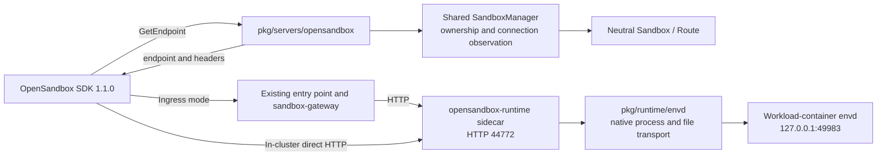
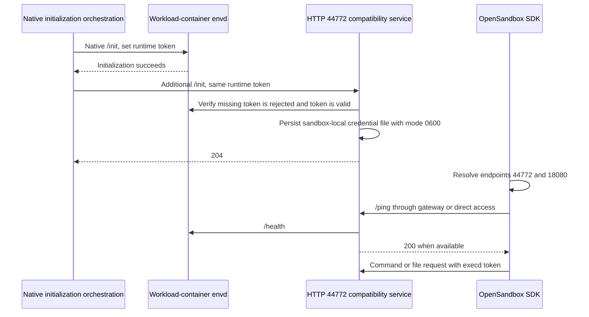

# OpenSandbox-Compatible Data Plane

## Table of Contents

- [Glossary](#glossary)
- [Summary](#summary)
  - [Delivery boundary](#delivery-boundary)
- [Motivation](#motivation)
  - [Goals](#goals)
  - [Non-Goals/Future Work](#non-goalsfuture-work)
- [Proposal](#proposal)
  - [User Stories](#user-stories)
    - [Story 1: Run commands and read/write files through the gateway](#story-1-run-commands-and-readwrite-files-through-the-gateway)
    - [Story 2: Access the same execution capabilities from inside the cluster](#story-2-access-the-same-execution-capabilities-from-inside-the-cluster)
  - [Requirements (Optional)](#requirements-optional)
    - [Functional Requirements](#functional-requirements)
    - [Non-Functional Requirements](#non-functional-requirements)
  - [Implementation Details/Notes/Constraints](#implementation-detailsnotesconstraints)
    - [Architecture and responsibilities](#architecture-and-responsibilities)
    - [Release baseline and native capabilities](#release-baseline-and-native-capabilities)
    - [Endpoint discovery and access paths](#endpoint-discovery-and-access-paths)
    - [Credentials and transport boundaries](#credentials-and-transport-boundaries)
    - [Initial command and file delivery](#initial-command-and-file-delivery)
    - [Initialization and deployment prerequisites](#initialization-and-deployment-prerequisites)
    - [Failure cleanup and compatibility](#failure-cleanup-and-compatibility)
  - [Risks and Mitigations](#risks-and-mitigations)
- [Alternatives](#alternatives)
- [Upgrade Strategy](#upgrade-strategy)
- [Additional Details](#additional-details)
  - [Test Plan \[optional\]](#test-plan-optional)
  - [Implementation and verification status (2026-10-19)](#implementation-and-verification-status-2026-10-19)
- [Implementation History](#implementation-history)

## Glossary

| Term | Meaning |
| --- | --- |
| Data plane | The path for sandbox execution and file requests; this delivery covers foreground commands and file upload/download |
| Endpoint | A service address and request headers returned by the control plane for the SDK to use |
| Execd compatibility service | A sandbox-side service implementing this delivery's OpenSandbox HTTP/SSE contracts; it does not run the OpenSandbox execd binary |
| envd | The native Agents execution component providing process, file and other runtime capabilities |
| Ingress / in-cluster direct access | Access through sandbox-gateway, or directly through the sandbox Pod IP and service port |
| Sidecar / workload container | The compatibility service runs in a separate sidecar; envd performs operations with the workload container's user and filesystem view |

## Summary

This proposal delivers OpenSandbox **foreground command and file data-plane
compatibility**. It adds endpoint discovery to the control plane and an HTTP
compatibility service on sandbox port 44772, adapting execd requests to native
envd calls in the workload container. **Ingress and in-cluster direct Pod IP
access** share execution, authentication and cancellation cleanup.

### Delivery boundary

| Scope | This delivery |
| --- | --- |
| Discovery | `GET /v1/sandboxes/{id}/endpoints/{port}` returns addresses and execution credentials under existing API-key, namespace and owner rules |
| Access modes | Default ingress reuses the gateway and existing external HTTPS termination; direct access uses in-cluster HTTP Pod IP connectivity; deployment configuration selects the mode |
| Commands | Foreground shell/argv execution, cwd/env, live stdout/stderr SSE, nonzero exits, timeout and interrupt |
| Files | Single-file and multi-file upload/download using the native filesystem; upload owner/group/mode and byte Range downloads are wired |
| Connection setup | `/ping`, `/ready`, runtime-token initialization, and the SDK's required execd 44772 and egress 18080 endpoint discovery |
| Compatibility boundary | Code interpreter, independent file management, background state/logs and egress management are non-goals; implementation and verification are recorded in [current status](#implementation-status-20261019) |

## Motivation

After creating a sandbox, the OpenSandbox SDK resolves execution endpoints,
checks health and calls command and file services. A creation API alone leaves
that execution path incomplete. See [Server Proxy and Endpoint Resolution in
the architecture][os-architecture] and the [SDK `Sandbox` implementation][os-sandbox].

Agents already provides sandbox-gateway, in-cluster Pod IP access and native
envd process/file capabilities. The adaptation handles differences in requests,
events and credentials between execd and envd. Both access paths can share the
sandbox-side service. See [Return Sandbox IP][ag-doc-ip], the [native process
client][ag-process] and [filesystem capabilities][ag-files].

[Issue #690](https://github.com/openkruise/agents/issues/690) outlines control-plane
protocol adaptation and runtime capability layering. This delivery reuses the
shared SandboxManager and neutral execution transport while preserving native
E2B paths.

### Goals

- Connect SDK creation to endpoint discovery, health checks, foreground commands
  and file reads/writes.
- Use the same SDK business calls and compatibility service for ingress and
  in-cluster direct access.
- Reuse existing authorization, runtime tokens, workload execution capabilities
  and initialization orchestration.
- Stream output as it arrives and perform bounded remote cleanup after timeout,
  interruption or disconnection.
- Preserve existing E2B APIs and envd calls, keeping E2E scope within comparable
  scenarios already covered by E2B.

### Non-Goals/Future Work

| Capability | Current handling |
| --- | --- |
| Code interpreter and code contexts | `/code` and related APIs return unsupported errors; this remains a high-priority follow-up, without Jupyter protocol integration in this delivery |
| Background command state/logs and PTY | `background=true`, background queries and PTY APIs return unsupported errors; only active foreground requests are tracked |
| Independent file management | List, stat, remove and directory-management APIs are excluded; the file scope is upload/download |
| Other command/file parameters | Numeric command UID/GID overrides and line-based offset/limit downloads return unsupported errors |
| Metrics and egress management | `/metrics`, `/policy`, `/credential-vault` and related APIs return HTTP 501; port 18080 resolves to a real reachable service that returns unsupported responses |
| Signed endpoints and general Lifecycle Server Proxy | Endpoint queries with `expires` or `use_server_proxy=true` return HTTP 501 |
| Automatic routing, access fallback and external direct access | The API deployment selects one mode; requests are not replayed, and no public addresses or external routes are provisioned |
| Compatibility-service TLS/mTLS | Direct access is HTTP; HTTPS reuses the existing external entry point; TLS-only native envd is outside this delivery's integration scope |
| Lifecycle APIs and recovery scenarios | No new describe/list/delete/pause/resume control-plane APIs; Pool, Checkpoint and execution after recovery require separate verification |
| New credential proxies and request-level hooks | No new outbound Credential Proxy, preStart executor or periodic scheduler |

## Proposal

### User Stories

#### Story 1: Run commands and read/write files through the gateway

A caller creates a sandbox with the OpenSandbox SDK and receives a gateway
endpoint with routing and execution-credential headers. The SDK reaches the
compatibility service through the existing gateway to run foreground commands,
receive live output, and upload or download files. The external entry point can
terminate HTTPS using the existing deployment configuration.

#### Story 2: Access the same execution capabilities from inside the cluster

An in-cluster caller connects to the HTTP control-plane address of a direct-mode
deployment. The SDK receives `PodIP:44772` and target execution credentials,
then reaches the same compatibility service directly using the same command
and file APIs.

### Requirements (Optional)

#### Functional Requirements

**FR1: Endpoint discovery for both access paths**

Return a gateway or Pod IP address according to deployment configuration, sharing
identity, ownership and service-mapping rules. Both 44772 and 18080 resolve to
the deployed compatibility service.

**FR2: Foreground commands and live output**

Support a shell string or argv, cwd, env, timeout and interruption by execution
ID. Send initialization, stdout, stderr, error and completion events over SSE.

**FR3: Single-file and multi-file upload/download**

Accept ordered metadata/file multipart pairs and stream content to native
`/files`. Stream downloads from the workload container without a multi-file
transaction guarantee.

**FR4: Initialization and target authentication**

Bind the compatibility service to the same sandbox runtime token after native
envd initialization. Validate `X-EXECD-ACCESS-TOKEN` on business requests; health
checks succeed after initialization and native-service availability.

#### Non-Functional Requirements

**NFR1: Authorization and layering**

Reuse control-plane authorization for discovery and validate execution
credentials at the actual target. Preserve `API -> Manager -> Infra`. The
sandbox-side protocol service is independent of Manager, concrete Infra
implementations and Controller. The control-plane API key is not an execution
token.

**NFR2: Streaming, cancellation and native compatibility**

Avoid buffering complete command output or file contents. Clean up remote
processes with an independent, bounded context. Existing E2B buffered callers
and native routes retain their behavior.

### Implementation Details/Notes/Constraints

#### Architecture and responsibilities

| Location | Responsibilities in this delivery |
| --- | --- |
| `pkg/servers/opensandbox` | Endpoint HTTP contracts, caller context, address/credential projection and error mapping; select the compatibility runtime and initialization options during creation |
| `pkg/sandbox-manager/connection.go` | `GetSandboxConnection` reuses `GetSandbox` ownership checks and returns neutral route observations |
| Infra | Existing Sandbox capabilities supply state, IP and route data; no new API protocol or resource type |
| sandbox-gateway | Existing routing headers, forwarding and ingress authentication; no execd protocol translation |
| `pkg/agent-runtime/opensandbox` | Execd requests/events, runtime-token validation, active foreground execution tracking and file streams |
| `pkg/runtime/envd` | A concrete native transport client for process Start/Signal, file HTTP and probes, independent of the control plane |
| `pkg/utils/runtime` | Optional additional ports in existing initialization calls, retained in native initialization records |
| `cmd/opensandbox-runtime` | Assemble the compatibility service, HTTP listener and shutdown flow; package the binary in the agent-runtime image |

Current consumers use a concrete envd client. This delivery adds no generic
`RuntimeProvider` interface and does not modify the existing buffered process
API. Execd models and HTTP/SSE rules remain at the compatibility-service boundary.

#### Release baseline and native capabilities

| Component | Stable baseline | Purpose |
| --- | --- | --- |
| OpenSandbox | `release-1.1.0`, Python SDK `opensandbox==1.1.0` | Lifecycle/execd contracts, SDK calls and defaults |
| OpenKruise Agents | `v0.6.0` | Reference for released gateway, runtime, protocol and test capabilities |
| Transitive envd dependency | E2B infra `2025.33` | Native execution component selected by the Agents `v0.6.0` Dockerfile |

The protocol reference is the [execd OpenAPI][os-execd-spec], with native Agents
E2B as the execution baseline. Commands reuse envd `Process.Start`; files reuse
HTTP `/files`; initialization extends existing runtime orchestration. See
[native processes][ag-process], [filesystem capabilities][ag-files],
[downloads][envd-download] and [initialization][ag-init]. The current
implementation and actual local test images are recorded separately from these
capability references in [implementation and verification status](#implementation-status-20261019).

#### Endpoint discovery and access paths

`GET /v1/sandboxes/{id}/endpoints/{port}` returns `Endpoint{endpoint, headers}`.
The API uses the existing KeyStorage identity and limits namespace scope by
Team.Name. The Admin team retains the existing cross-namespace lookup scope;
Manager still checks that the instance owner is the current key ID. See the
[Lifecycle OpenAPI][os-lifecycle-spec] and [Manager `GetSandbox`][ag-manager].

| Mode | Address | Headers for execd/egress |
| --- | --- | --- |
| Ingress (default) | host[:port] from `--opensandbox-gateway-url` | `e2b-sandbox-id`, `e2b-sandbox-port=44772`, `X-Access-Token`, `X-EXECD-ACCESS-TOKEN`; obtain the native traffic token when traffic auth is enabled |
| direct | `PodIP:44772` | `X-EXECD-ACCESS-TOKEN` |

Select the mode with `--opensandbox-access-mode=ingress|direct`. Ingress requires
an HTTP(S) origin without a path, query or credentials. The SDK's
`use_server_proxy` selects a lifecycle proxy, not either of these access modes.

SDK 1.1.0 builds execution URLs using `ConnectionConfig.protocol`; the endpoint
string contains no scheme. For ingress, the SDK protocol must match the
configured entry point. Direct mode uses an internal HTTP control-plane
connection. See [connection configuration][os-connection] and [command URL
construction][os-command-adapter].

Logical execd 44772 and egress 18080 both map to the compatibility listener on
44772. Egress policy and Vault operations return `501 NOT_SUPPORTED`. Other
valid ports retain the existing addressing rules; command and file services in
this delivery are provided only by the compatibility entry point.

| Lookup condition | Response |
| --- | --- |
| Invalid port | HTTP 400 |
| Missing sandbox or sandbox owned by another caller | Identical HTTP 404 responses |
| Pod IP not yet assigned | HTTP 404 with code `KUBERNETES::POD_IP_NOT_AVAILABLE`, matching the pinned SDK's endpoint-readiness retry |
| Paused / Dead state | HTTP 409 |
| Missing execution token or unconfigured ingress origin | HTTP 503 |
| `use_server_proxy=true` or an `expires` parameter | HTTP 501 with code `NOT_IMPLEMENTED` |

Discovery reads existing observations. Subsequent `/ping` and actual operations
establish service initialization and execution availability. See the [SDK
readiness budget][os-readiness].

#### Credentials and transport boundaries

The control plane accepts `OPEN-SANDBOX-API-KEY`. The compatibility service and
envd share the current sandbox runtime token: external execution APIs validate
`X-EXECD-ACCESS-TOKEN`; internal envd calls use `X-Access-Token` and the required
native execution-user identity. See [SDK header merging][os-headers],
[reference execd authentication][os-router] and [native token handling][ag-token].

| Hop | Transport and protection in this delivery |
| --- | --- |
| SDK -> ingress -> gateway | HTTPS termination and native gateway authentication through the existing entry point |
| Gateway -> compatibility service | HTTP with routing and native access credentials; the compatibility service also validates the execd token |
| In-cluster SDK -> compatibility service | HTTP and execd token; the deployment network must allow access to the target Pod |
| Compatibility service -> envd in the same Pod | HTTP `127.0.0.1:49983` and the native runtime token |

Agents has optional native runtime TLS/mTLS. OpenSandbox `release-1.1.0` execd
itself serves HTTP. This delivery integrates with an HTTP native runtime;
initialization against TLS-only envd fails explicitly without transport
downgrade. See [Agents transport][ag-transport] and the [execd HTTP server][os-http-server].

Gateway JWT validation and traffic wakeup apply only to requests passing through
the gateway. Direct-mode network and access policies require separate deployment
configuration; target-token validation covers this delivery's direct access.

#### Initial command and file delivery

| Route | Implemented behavior |
| --- | --- |
| `POST /command` | Shell strings execute through `/bin/bash -c`; argv uses literal executable arguments. Supports cwd/env, defaults to native `user`, and accepts timeout in milliseconds |
| Command SSE | Execution-ID init, status, stdout/stderr, ping, error and execution_complete after process exit; startup errors before streaming use synchronous HTTP responses |
| `DELETE /command?id=...` | Interrupt the active request and wait for bounded remote cleanup; completed state is not retained and an unknown active ID returns 404 |
| `POST /files/upload` | Ordered metadata/file pairs with streamed content. Owner defaults to `user`; mode defaults to 755 and is applied as octal text; group uses a native command |
| `GET /files/download?path=...` | Read through envd as default `user`, forwarding content, byte Range and associated response headers/status |
| `GET /ping`, `GET /ready` | Return 503 before initialization, then probe native health; these health routes do not require an execd token |

Upload ownership uses envd's native identity parameter. Group/mode use literal
`chown`/`chmod` arguments inside the workload container. File operations use the
workload filesystem; later failures retain native partial-write results. Upload
metadata and Range are wired, with their targeted verification status recorded
in [current status](#implementation-status-20261019).

Normal nonzero exits preserve a numeric exit code for SDK inference. Abnormal
process termination and transport failures use execution errors. Known
unsupported execd/egress operations return HTTP 501 (`NOT_SUPPORTED`); unknown
routes return 404.

#### Initialization and deployment prerequisites

The compatibility binary ships in the agent-runtime image. The existing generic
runtime injection mechanism configures an `opensandbox-runtime` container.
Ordinary image cold creation selects the native `agent-runtime` and compatibility
runtime. Pool/Checkpoint paths inherit their source workloads, which must
already contain the compatibility container and corresponding initialization
configuration; existing templates and checkpoints are not modified automatically.

Native `InitRuntimeOptions.AdditionalInitPorts` drives the additional handshake
after envd initialization succeeds, and initialization records retain the
option. The compatibility service stores its credential in a separate emptyDir
file that can be read after a container restart. Complete credential binding
after recovery or reallocation still requires lifecycle-specific verification.

Images, injection templates, native envd, network access and initialization must
all be configured. The E2E [injection template](../../test/opensandbox/assets/runtime-injection.yaml)
uses TCP readiness so native initialization orchestration can reach the service
first. SDK `/ping` checks execution readiness after initialization. Normal
creation retains endpoint and health discovery; tests set `disable_metrics=True`
to avoid calling the undelivered metrics API.

#### Failure cleanup and compatibility

Each foreground request has a unique native process tag. Timeout, interrupt,
caller disconnection or stream-write failure triggers native SIGKILL using an
independent three-second cleanup context. Cleanup does not rely on closing the
stream. Cleanup errors are retained server-side, and interrupt returns after
cleanup finishes.

envd signals the process selected by its native selector. This delivery adds no
process-tree supervisor, completed-state storage or cross-connection log model.
See the [envd process implementation][envd-process]. Endpoint lookup failure
does not delete a sandbox. The control-plane caller handles cleanup after SDK
creation failures; the data-plane service acquires no sandbox or storage deletion
authority. E2E uses Kubernetes to delete only its recorded created instances,
because this delivery does not add the OpenSandbox lifecycle delete API.

### Risks and Mitigations

| Risk | Measure or remaining condition |
| --- | --- |
| Discovery succeeds before service initialization | Keep SDK `/ping` setup; the target returns 503 before initialization |
| Gateway buffering or truncation of execution streams | Reuse live-output callbacks in both modes and assert first output arrives before completion |
| Direct access relies on gateway-only policy | Check direct-mode network and access policy separately; JWT/traffic-wakeup profiles remain for later verification |
| Filesystem or metadata mismatch | Native envd accesses the workload filesystem; single/multi-file round trips are included, while metadata and Range checks remain pending |
| Cancellation closes only the response stream | Explicitly signal the uniquely tagged native process; targeted tests cover timeout/disconnect/interrupt |
| Incomplete deployment or credential mismatch after recovery | Require injection and initialization; Pool, Checkpoint, recovery and reallocation scenarios remain pending |
| Shared initialization affects native E2B | Additional ports are optional per-call inputs; extend existing initialization tests while preserving the native default path |

## Alternatives

| Alternative | Tradeoff |
| --- | --- |
| Ingress only | Both paths share the main execution adaptation; use existing gateway and Pod IP access |
| Proxy execution through the lifecycle service | Adds general HTTP/SSE/WebSocket forwarding; retain execution traffic on the existing gateway or direct Pod path |
| Translate execd protocols inside the gateway | Couples execution to routing and cannot serve direct access; use one shared sandbox-side service |
| Run the OpenSandbox execd binary | Introduces another execution component and initialization/deployment path; this delivery reuses Agents envd |

## Upgrade Strategy

Build a runtime image containing the compatibility binary, configure native and
compatibility runtime injection templates, then enable
`--enable-opensandbox-compat` and select an endpoint strategy. The API flag alone
is insufficient without the image/templates. Upgrade existing Pool or Checkpoint
sources separately according to their configuration.

Match SDK protocol and network settings to the selected mode. After switching
modes, rediscover endpoints and open new execution connections; active streams
are not migrated. When the compatibility entry point is disabled, native
Manager, Controller and release policies continue to manage the instances.

## Additional Details

### Test Plan [optional]

Pin E2E to `opensandbox==1.1.0` and reuse the existing cluster, component-image
builds and JUnit reporting. Ingress and direct access run the same business
scenarios. The default is **six cases**, with **one optional case** under the
existing UUID authentication profile. No separate PoC or expanded independent
test matrix is introduced.

| Area | Cases | Existing E2B reference and assertions |
| --- | --- | --- |
| Foreground commands | 4 | [`test_commands_run.py`][ag-e2e-commands]: basic execution, errors, live callbacks and interruption of a live process; adapt the existing kill scenario without completed background-state/log coverage |
| Files | 2 | [`test_filesystem.py`][ag-e2e-files]: single-file and multi-file reads/writes with actual SDK content assertions |
| UUID authentication profile | 1, optional | [Existing gateway authentication][ag-e2e-auth]: reject missing/incorrect execd tokens, additionally check the native gateway token in ingress mode, then execute a valid command |

Creation, health and 44772/18080 discovery are fixture setup. Fixtures inspect
the SDK's actual request targets and headers. On failure, collect status and
logs before deleting recorded instances. See the [test instructions](../../test/opensandbox/README.md#opensandbox-data-plane-e2e)
and [in-cluster runner](../../hack/run-opensandbox-e2e-test.sh).

Necessary targeted Go tests cover cross-owner isolation, SDK-retryable missing
IP responses, native/additional initialization ordering, authentication and
timeout/disconnect cleanup. Concurrency-sensitive cleanup runs with race checks.
Upload metadata, Range, external HTTPS, recovery and JWT/wakeup profiles remain
verification items without adding business scenarios to this E2E delivery.

### Implementation and verification status (2026-10-19)

The local verification snapshot below was recorded on 2026-10-19, based on
`61041681ada0f748a91902ac060cbe794ad9b698`. Publication and current GitHub check
status are tracked in the implementation pull request. The new workflow had not
run at the time of this local snapshot; local logs and JUnit reports were retained
with the verification record.

| Status | Scope and evidence |
| --- | --- |
| Implemented and passed local SDK E2E | Seven cases per ingress/direct mode, zero failures and zero skips, covering the command/file cases and optional UUID profile; local logs and JUnit reports were retained |
| Passed targeted Go checks | OpenSandbox API package, extended initialization tests, compatibility-service initialization/authentication and stream boundaries; race checks repeated ten times. After E2E, only the unsupported Vault path was corrected and its additional tests passed |
| Wired; targeted verification pending | Upload owner/group/mode and byte Range downloads |
| Later scenario verification pending | Pool/Checkpoint, address/credential binding after recovery or reallocation, and existing gateway JWT/wakeup policy; initialization records already retain additional ports |
| Existing deployment capability reused; verification pending | External HTTPS termination; the local ingress profile used HTTP |
| Written; execution pending at the local snapshot | [OpenSandbox CI workflow](../../.github/workflows/e2e-opensandbox-1.1.0.yaml) using the existing Kind configuration, Kubernetes 1.32.0 / AMD64 nodes and code-interpreter:v1.6 workload image |

The local run used Kubernetes 1.36.1 / ARM64, a plain `python:3.11-slim` workload,
Manager/Controller/compatibility-service builds from the working tree, and an
existing `v0.6.0-alpha2` gateway. The envd binary corresponds to `2025.33` commit
`370fa866a5e61f1e23413e0805e6ec7875f47733`. Stable tags remain the capability
references above; local results cover this delivery's command and file paths.

## Implementation History

- [x] 2026-10-18: Select a shared compatibility service for ingress and in-cluster
  direct access, with deployment configuration selecting the path.
- [x] 2026-10-19: Complete the local endpoint API, HTTP compatibility service,
  runtime-token initialization, foreground commands and file reads/writes.
- [x] 2026-10-19: Complete seven SDK E2E cases per access mode and necessary
  targeted Go checks; retain logs and JUnit reports.
- [ ] Verify the external HTTPS entry point; metadata, Range and lifecycle-related
  checks remain as listed above. CI results are tracked in the implementation PR.

[os-architecture]: https://github.com/opensandbox-group/OpenSandbox/blob/b1a29cf93a823a95913f7943010febb3f29de05c/docs/architecture/index.md
[os-sandbox]: https://github.com/opensandbox-group/OpenSandbox/blob/b1a29cf93a823a95913f7943010febb3f29de05c/sdks/sandbox/python/src/opensandbox/sandbox.py
[os-execd-spec]: https://github.com/opensandbox-group/OpenSandbox/blob/b1a29cf93a823a95913f7943010febb3f29de05c/specs/execd-api.yaml
[os-lifecycle-spec]: https://github.com/opensandbox-group/OpenSandbox/blob/b1a29cf93a823a95913f7943010febb3f29de05c/specs/sandbox-lifecycle.yml
[os-connection]: https://github.com/opensandbox-group/OpenSandbox/blob/b1a29cf93a823a95913f7943010febb3f29de05c/sdks/sandbox/python/src/opensandbox/config/connection.py
[os-command-adapter]: https://github.com/opensandbox-group/OpenSandbox/blob/b1a29cf93a823a95913f7943010febb3f29de05c/sdks/sandbox/python/src/opensandbox/adapters/command_adapter.py
[os-headers]: https://github.com/opensandbox-group/OpenSandbox/blob/b1a29cf93a823a95913f7943010febb3f29de05c/sdks/sandbox/python/src/opensandbox/models/sandboxes.py
[os-router]: https://github.com/opensandbox-group/OpenSandbox/blob/b1a29cf93a823a95913f7943010febb3f29de05c/components/execd/pkg/web/router.go
[os-readiness]: https://github.com/opensandbox-group/OpenSandbox/blob/b1a29cf93a823a95913f7943010febb3f29de05c/sdks/sandbox/python/src/opensandbox/internal/readiness.py
[ag-doc-ip]: https://openkruise.io/kruiseagents/user-manuals/sandbox-claim#return-sandbox-ip-v030
[ag-manager]: https://github.com/openkruise/agents/blob/a1e0811323b71fd9a54efe26b0f4baf19106c84e/pkg/sandbox-manager/api.go#L216-L260
[ag-process]: https://github.com/openkruise/agents/blob/a1e0811323b71fd9a54efe26b0f4baf19106c84e/pkg/utils/runtime/process.go
[ag-files]: https://github.com/openkruise/agents/blob/a1e0811323b71fd9a54efe26b0f4baf19106c84e/pkg/utils/runtime/filesystem.go
[ag-init]: https://github.com/openkruise/agents/blob/a1e0811323b71fd9a54efe26b0f4baf19106c84e/pkg/utils/runtime/init.go
[ag-token]: https://github.com/openkruise/agents/blob/a1e0811323b71fd9a54efe26b0f4baf19106c84e/pkg/utils/utils.go#L302-L314
[ag-transport]: https://github.com/openkruise/agents/blob/a1e0811323b71fd9a54efe26b0f4baf19106c84e/pkg/utils/runtime/transport.go
[envd-download]: https://github.com/e2b-dev/infra/blob/370fa866a5e61f1e23413e0805e6ec7875f47733/packages/envd/internal/api/download.go
[envd-process]: https://github.com/e2b-dev/infra/blob/370fa866a5e61f1e23413e0805e6ec7875f47733/packages/envd/internal/services/process/start.go
[ag-e2e-commands]: https://github.com/openkruise/agents/blob/a1e0811323b71fd9a54efe26b0f4baf19106c84e/test/e2b/test_commands_run.py
[ag-e2e-files]: https://github.com/openkruise/agents/blob/a1e0811323b71fd9a54efe26b0f4baf19106c84e/test/e2b/test_filesystem.py
[ag-e2e-auth]: https://github.com/openkruise/agents/blob/a1e0811323b71fd9a54efe26b0f4baf19106c84e/test/e2b/test_gateway_auth.py

[os-http-server]: https://github.com/opensandbox-group/OpenSandbox/blob/b1a29cf93a823a95913f7943010febb3f29de05c/components/execd/main.go#L392-L436
