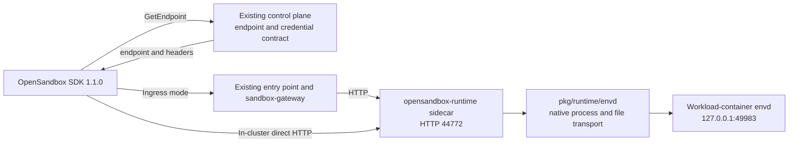
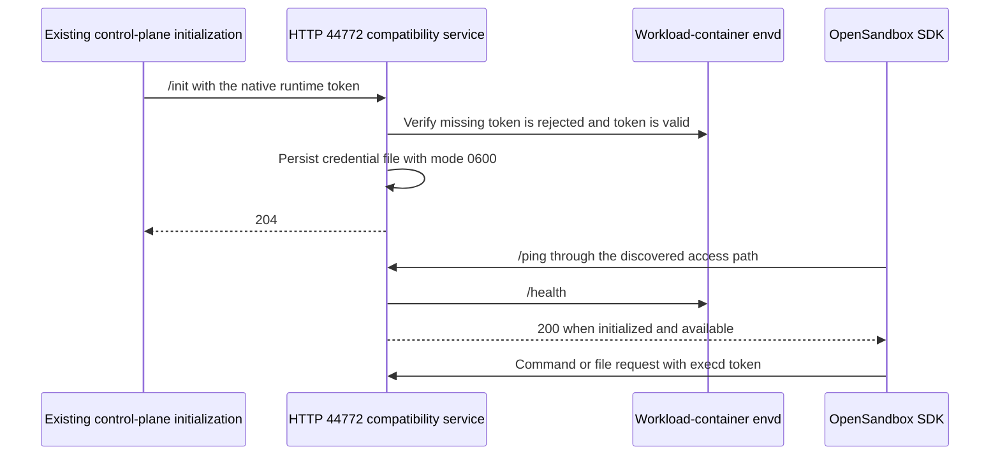

# OpenSandbox-Compatible Data Plane

## Table of Contents

- [Glossary](#glossary)
- [Summary](#summary)
  - [Delivery boundary](#delivery-boundary)
- [Motivation](#motivation)
  - [Goals](#goals)
  - [Non-Goals/Future Work](#non-goalsfuture-work)
- [Proposal](#proposal)
  - [User Stories](#user-stories)
    - [Story 1: Run commands and read/write files through the gateway](#story-1-run-commands-and-readwrite-files-through-the-gateway)
    - [Story 2: Access the same execution capabilities from inside the cluster](#story-2-access-the-same-execution-capabilities-from-inside-the-cluster)
  - [Requirements (Optional)](#requirements-optional)
    - [Functional Requirements](#functional-requirements)
    - [Non-Functional Requirements](#non-functional-requirements)
  - [Implementation Details/Notes/Constraints](#implementation-detailsnotesconstraints)
    - [Architecture and responsibilities](#architecture-and-responsibilities)
    - [Release baseline and native capabilities](#release-baseline-and-native-capabilities)
    - [Endpoint discovery and access paths](#endpoint-discovery-and-access-paths)
    - [Credentials and transport boundaries](#credentials-and-transport-boundaries)
    - [Initial command and file delivery](#initial-command-and-file-delivery)
    - [Initialization and deployment prerequisites](#initialization-and-deployment-prerequisites)
    - [Failure cleanup and compatibility](#failure-cleanup-and-compatibility)
  - [Risks and Mitigations](#risks-and-mitigations)
- [Alternatives](#alternatives)
- [Upgrade Strategy](#upgrade-strategy)
- [Additional Details](#additional-details)
  - [Test Plan \[optional\]](#test-plan-optional)
- [Design History](#design-history)

## Glossary

| Term | Meaning |
| --- | --- |
| Data plane | The path for sandbox execution and file requests; this delivery covers foreground commands and file upload/download |
| Endpoint | A service address and request headers returned by the control plane for the SDK to use |
| Execd compatibility service | A sandbox-side service implementing this delivery's OpenSandbox HTTP/SSE contracts; it does not run the OpenSandbox execd binary |
| envd | The native Agents execution component providing process, file and other runtime capabilities |
| Ingress / in-cluster direct access | Access through sandbox-gateway, or directly through the sandbox Pod IP and service port |
| Sidecar / workload container | The compatibility service runs in a separate sidecar; envd performs operations with the workload container's user and filesystem view |

## Summary

This proposal delivers OpenSandbox **foreground command and file data-plane
compatibility** through an HTTP compatibility service on sandbox port 44772,
adapting execd requests to native envd calls in the workload container. It consumes
the existing control-plane endpoint, credential and runtime-initialization
contract. **Ingress and in-cluster direct Pod IP access** share execution,
authentication and cancellation cleanup.

### Delivery boundary

| Scope | This delivery |
| --- | --- |
| Control-plane dependency | Consume endpoint addresses, execution credentials, runtime selection and initialization defined by the [control-plane contract](./20260918-opensandbox-compat.md#endpoint-discovery-and-runtime-initialization) |
| Access paths | Reach the compatibility service through the configured ingress/gateway or in-cluster direct HTTP endpoint; reuse existing external HTTPS termination |
| Commands | Foreground shell/argv execution, cwd/env, live stdout/stderr SSE, nonzero exits, timeout and interrupt |
| Files | Single-file and multi-file upload/download using the native filesystem; upload owner/group/mode and byte Range downloads are wired |
| Runtime setup | Implement the `/init` receiver, credential persistence, `/ping` and `/ready`; package the runtime image and deployment configuration consumed by native initialization |
| Compatibility boundary | Code interpreter, independent file management, background state/logs and egress management are non-goals; deployment and verification conditions are defined below |

## Motivation

After creating a sandbox, the OpenSandbox SDK resolves execution endpoints,
checks health and calls command and file services. A creation API alone leaves
that execution path incomplete. See [Server Proxy and Endpoint Resolution in
the architecture][os-architecture] and the [SDK `Sandbox` implementation][os-sandbox].

Agents already provides sandbox-gateway, in-cluster Pod IP access and native
envd process/file capabilities. The adaptation handles differences in requests,
events and credentials between execd and envd. Both access paths can share the
sandbox-side service. See [Return Sandbox IP][ag-doc-ip], the [native process
client][ag-process] and [filesystem capabilities][ag-files].

The [control-plane compatibility proposal](./20260918-opensandbox-compat.md#endpoint-discovery-and-runtime-initialization)
defines endpoint discovery, API deployment configuration, runtime selection and
initialization through shared SandboxManager operations. This data-plane design
provides the sandbox-side services, image and deployment environment consumed by
that contract, preserving native E2B paths.

### Goals

- Consume control-plane endpoint and credential discovery, then provide runtime
  health checks, foreground commands and file reads/writes for the SDK.
- Use the same SDK business calls and compatibility service for ingress and
  in-cluster direct access.
- Consume existing control-plane authorization and initialization orchestration;
  reuse runtime tokens and native workload execution capabilities.
- Stream output as it arrives and perform bounded remote cleanup after timeout,
  interruption or disconnection.
- Preserve existing E2B APIs and envd calls, keeping E2E scope within comparable
  scenarios already covered by E2B.

### Non-Goals/Future Work

| Capability | Current handling |
| --- | --- |
| Code interpreter, code contexts and sessions | Deferred; `/code` and related APIs return unsupported errors, without Jupyter protocol integration in this delivery |
| Background command state/logs and PTY | `background=true`, background queries and PTY APIs return unsupported errors; only active foreground requests are tracked |
| Independent file management | List, stat, remove and directory-management APIs are excluded; the file scope is upload/download |
| Other command/file parameters | Numeric command UID/GID overrides and line-based offset/limit downloads return unsupported errors |
| Metrics and egress management | `/metrics`, `/policy`, `/credential-vault` and related APIs return HTTP 501; port 18080 resolves to a real reachable service that returns unsupported responses |
| Endpoint API, signed endpoints and Lifecycle Server Proxy | Existing control-plane contracts apply; this delivery adds no discovery route, API configuration or management-service forwarding |
| Automatic routing, access fallback and external direct access | The API deployment selects one mode; requests are not replayed, and no public addresses or external routes are provisioned |
| Compatibility-service TLS/mTLS | Direct access is HTTP; HTTPS reuses the existing external entry point; TLS-only native envd is outside this delivery's integration scope |
| Instance management and recovery scenarios | Consume existing create/list/describe/delete/pause/resume/renew APIs; Pool, Checkpoint and execution after recovery require separate verification |
| New credential proxies and request-level hooks | No new outbound Credential Proxy, preStart executor or periodic scheduler |

## Proposal

### User Stories

#### Story 1: Run commands and read/write files through the gateway

A caller creates a sandbox with the OpenSandbox SDK and receives a gateway
endpoint with routing and execution-credential headers. The SDK reaches the
compatibility service through the existing gateway to run foreground commands,
receive live output, and upload or download files. The external entry point can
terminate HTTPS using the existing deployment configuration.

#### Story 2: Access the same execution capabilities from inside the cluster

An in-cluster caller connects to the HTTP control-plane address of a direct-mode
deployment. The SDK receives `PodIP:44772` and target execution credentials,
then reaches the same compatibility service directly using the same command
and file APIs.

### Requirements (Optional)

#### Functional Requirements

**FR1: Consume endpoints for both access paths**

Use the control-plane address and credential headers to reach the deployed
compatibility service through ingress or direct access. Service ports and API
configuration follow the [control-plane contract](./20260918-opensandbox-compat.md#endpoint-discovery-and-runtime-initialization).

**FR2: Foreground commands and live output**

Support a shell string or argv, cwd, env, timeout and interruption by execution
ID. Send initialization, stdout, stderr, error and completion events over SSE.

**FR3: Single-file and multi-file upload/download**

Accept ordered metadata/file multipart pairs and stream content to native
`/files`. Stream downloads from the workload container without a multi-file
transaction guarantee.

**FR4: Initialization and target authentication**

Bind the compatibility service to the same sandbox runtime token after native
envd initialization. Validate `X-EXECD-ACCESS-TOKEN` on business requests; health
checks succeed after initialization and native-service availability.

#### Non-Functional Requirements

**NFR1: Authorization and layering**

Consume control-plane discovery and validate execution credentials at the
actual target. Existing API authorization retains `API -> Manager -> Infra`.
The sandbox-side protocol service is independent of Manager, concrete Infra
implementations and Controller. The control-plane API key is not an execution
token.

**NFR2: Streaming, cancellation and native compatibility**

Avoid buffering complete command output or file contents. Clean up remote
processes with an independent, bounded context. Existing E2B buffered callers
and native routes retain their behavior.

### Implementation Details/Notes/Constraints

#### Architecture and responsibilities

| Location | Responsibility or existing dependency |
| --- | --- |
| `pkg/servers/opensandbox`, Manager and Infra | Existing control-plane dependency: discovery, identity/ownership, neutral route observations and runtime selection follow the [control-plane contract](./20260918-opensandbox-compat.md#endpoint-discovery-and-runtime-initialization) |
| sandbox-gateway | Existing routing headers, forwarding and ingress authentication; no execd protocol translation |
| `pkg/agent-runtime/opensandbox` | Execd requests/events, runtime-token validation, active foreground execution tracking and file streams |
| `pkg/runtime/envd` | A concrete native transport client for process Start/Signal, file HTTP and probes, independent of the control plane |
| `pkg/utils/runtime` | Existing control-plane initialization dependency; this delivery supplies the target service receiving its native runtime token |
| `cmd/opensandbox-runtime` | Assemble the compatibility service, HTTP listener and shutdown flow; package the binary in the agent-runtime image |

Current consumers use a concrete envd client. This delivery adds no generic
`RuntimeProvider` interface and does not modify the existing buffered process
API. Execd models and HTTP/SSE rules remain at the compatibility-service boundary.

#### Release baseline and native capabilities

| Component | Stable baseline | Purpose |
| --- | --- | --- |
| OpenSandbox | `release-1.1.0`, Python SDK `opensandbox==1.1.0` | Lifecycle/execd contracts, SDK calls and defaults |
| OpenKruise Agents | `v0.6.0` | Reference for released gateway, runtime, protocol and test capabilities |
| Transitive envd dependency | E2B infra `2025.33` | Native execution component selected by the Agents `v0.6.0` Dockerfile |

The protocol reference is the [execd OpenAPI][os-execd-spec], with native Agents
E2B as the execution baseline. Commands reuse envd `Process.Start`; files reuse
HTTP `/files`; service initialization consumes existing control-plane
orchestration. See [native processes][ag-process],
[filesystem capabilities][ag-files] and [downloads][envd-download]. Deployment and
acceptance checks use the component versions and runtime conditions defined
in this proposal.

#### Endpoint discovery and access paths

Endpoint HTTP models, API deployment flags, address/credential projection,
service-port mapping and errors follow the
[control-plane discovery contract](./20260918-opensandbox-compat.md#endpoint-discovery-and-runtime-initialization).
This delivery consumes those endpoints and headers; it adds no API or Manager
route-resolution implementation.

The compatibility service must be reachable through the selected gateway or Pod
network path. Match SDK `ConnectionConfig.protocol` to the configured ingress
origin; direct access uses in-cluster HTTP. The service listens on 44772 and
handles both execd requests and the egress endpoint's unsupported responses.
Egress policy and Vault operations return `501 NOT_SUPPORTED`. See
[connection configuration][os-connection] and
[command URL construction][os-command-adapter].

#### Credentials and transport boundaries

Control-plane API-key handling and credential delivery follow the
[discovery contract](./20260918-opensandbox-compat.md#endpoint-discovery-and-runtime-initialization).
The compatibility service and envd share the current sandbox runtime token:
external execution APIs validate
`X-EXECD-ACCESS-TOKEN`; internal envd calls use `X-Access-Token` and the required
native execution-user identity. See [SDK header merging][os-headers],
[reference execd authentication][os-router] and [native token handling][ag-token].

| Hop | Transport and protection in this delivery |
| --- | --- |
| SDK -> ingress -> gateway | HTTPS termination and native gateway authentication through the existing entry point |
| Gateway -> compatibility service | HTTP with routing and native access credentials; the compatibility service also validates the execd token |
| In-cluster SDK -> compatibility service | HTTP and execd token; the deployment network must allow access to the target Pod |
| Compatibility service -> envd in the same Pod | HTTP `127.0.0.1:49983` and the native runtime token |

The compatibility service and its native envd connection use HTTP. The
control-plane contract defines the additional-initialization HTTP/TLS boundary;
deploy this service with an HTTP native runtime. External HTTPS terminates at
the existing ingress. OpenSandbox `release-1.1.0` execd also serves HTTP; see the
[execd HTTP server][os-http-server].

Gateway JWT validation and traffic wakeup apply only to requests passing through
the gateway. Direct-mode network and access policies require separate deployment
configuration; target-token validation covers this delivery's direct access.

#### Initial command and file delivery

| Route | Implemented behavior |
| --- | --- |
| `POST /command` | Shell strings execute through `/bin/bash -c`; argv uses literal executable arguments. Supports cwd/env, defaults to native `user`, and accepts timeout in milliseconds |
| Command SSE | Execution-ID init, status, stdout/stderr, ping, error and execution_complete after process exit; startup errors before streaming use synchronous HTTP responses |
| `DELETE /command?id=...` | Interrupt the active request and wait for bounded remote cleanup; completed state is not retained and an unknown active ID returns 404 |
| `POST /files/upload` | Ordered metadata/file pairs with streamed content. Owner defaults to `user`; mode defaults to 755 and is applied as octal text; group uses a native command |
| `GET /files/download?path=...` | Read through envd as default `user`, forwarding content, byte Range and associated response headers/status |
| `GET /ping`, `GET /ready` | Return 503 before initialization, then probe native health; these health routes do not require an execd token |

Upload ownership uses envd's native identity parameter. Group/mode use literal
`chown`/`chmod` arguments inside the workload container. File operations use the
workload filesystem; later failures retain native partial-write results. Upload
owner/group/mode and Range behavior require the targeted acceptance checks
in the [test plan](#test-plan-optional).

Normal nonzero exits preserve a numeric exit code for SDK inference. Abnormal
process termination and transport failures use execution errors. Known
unsupported execd/egress operations return HTTP 501 (`NOT_SUPPORTED`); unknown
routes return 404.

#### Initialization and deployment prerequisites

The compatibility binary ships in the agent-runtime image. The deployment
provides an `opensandbox-runtime` container through the generic runtime injection
template and native envd in the workload container. API `RuntimeConfig`
selection and `InitRuntimeOptions.AdditionalInitPorts` orchestration are existing
[control-plane responsibilities](./20260918-opensandbox-compat.md#endpoint-discovery-and-runtime-initialization).
Pool and Checkpoint sources must already contain the applicable compatibility
container and initialization configuration; this delivery does not upgrade
existing source workloads automatically.

The compatibility service stores its credential in a separate emptyDir file
that can be read after a container restart. Complete credential binding after
recovery or reallocation still requires lifecycle-specific verification.

Images, injection templates, native envd, network access and initialization must
all be configured. The compatibility container uses TCP readiness so existing
initialization can reach the service first. SDK `/ping` checks execution
readiness afterward. Normal SDK creation consumes discovery and health checks;
tests set `disable_metrics=True` to avoid calling the undelivered metrics API.

#### Failure cleanup and compatibility

Each foreground request has a unique native process tag. Timeout, interrupt,
caller disconnection or stream-write failure triggers native SIGKILL using an
independent three-second cleanup context. Cleanup does not rely on closing the
stream. Cleanup errors are retained server-side, and interrupt returns after
cleanup finishes.

envd signals the process selected by its native selector. This delivery adds no
process-tree supervisor, completed-state storage or cross-connection log model.
See the [envd process implementation][envd-process]. The caller handles cleanup
after SDK creation failures; the data-plane service acquires no sandbox or
storage deletion authority. Its E2E fixture uses Kubernetes to delete only
recorded created instances, including failed high-level SDK setup. Instance
management and deletion remain existing control-plane capabilities.

### Risks and Mitigations

| Risk | Measure or remaining condition |
| --- | --- |
| Discovery succeeds before service initialization | Keep SDK `/ping` setup; the target returns 503 before initialization |
| Gateway buffering or truncation of execution streams | Reuse live-output callbacks in both modes and assert first output arrives before completion |
| Direct access relies on gateway-only policy | Check direct-mode network and access policy separately; JWT/traffic-wakeup profiles remain for later verification |
| Filesystem or metadata mismatch | Native envd accesses the workload filesystem; verify single/multi-file round trips and explicit owner/group/mode and Range behavior separately |
| Cancellation closes only the response stream | Explicitly signal the uniquely tagged native process; targeted tests cover timeout/disconnect/interrupt |
| Incomplete deployment or credential mismatch after recovery | Require injection and initialization; Pool, Checkpoint, recovery and reallocation scenarios remain pending |

## Alternatives

| Alternative | Tradeoff |
| --- | --- |
| Ingress only | Both paths share the main execution adaptation; use existing gateway and Pod IP access |
| Proxy execution through the lifecycle service | Adds general HTTP/SSE/WebSocket forwarding; retain execution traffic on the existing gateway or direct Pod path |
| Translate execd protocols inside the gateway | Couples execution to routing and cannot serve direct access; use one shared sandbox-side service |
| Run the OpenSandbox execd binary | Introduces another execution component and initialization/deployment path; this delivery reuses Agents envd |

## Upgrade Strategy

Build a runtime image containing the compatibility binary and provide native
and compatibility runtime injection templates. Deploy the existing control plane
with the [required access and initialization configuration](./20260918-opensandbox-compat.md#endpoint-discovery-and-runtime-initialization).
Upgrade existing Pool or Checkpoint sources separately according to their
configuration.

Match SDK protocol and network settings to the selected mode. After switching
modes, rediscover endpoints and open new execution connections; active streams
are not migrated. When the compatibility entry point is disabled, native
Manager, Controller and release policies continue to manage the instances.

## Additional Details

### Test Plan [optional]

Pin E2E to `opensandbox==1.1.0` and reuse the existing cluster, component-image
builds and JUnit reporting. Ingress and direct access run the same business
scenarios. The default is **six cases**, with **one optional case** under the
existing UUID authentication profile. No separate PoC or expanded independent
test matrix is introduced.

| Area | Cases | Existing E2B reference and assertions |
| --- | --- | --- |
| Foreground commands | 4 | [`test_commands_run.py`][ag-e2e-commands]: basic execution, errors, live callbacks and interruption of a live process; adapt the existing kill scenario without completed background-state/log coverage |
| Files | 2 | [`test_filesystem.py`][ag-e2e-files]: single-file and multi-file reads/writes with actual SDK content assertions |
| UUID authentication profile | 1, optional | [Existing gateway authentication][ag-e2e-auth]: reject missing/incorrect execd tokens, additionally check the native gateway token in ingress mode, then execute a valid command |

Creation, health and 44772/18080 discovery are fixture setup. Fixtures inspect
the SDK's actual request targets and headers. On failure, collect status and
logs before deleting recorded instances. The in-cluster runner uses the same
endpoint and authentication conditions as the selected deployment mode.

Control-plane discovery, ownership and additional-initialization tests remain
with that implementation. Data-plane Go tests cover the initialization receiver,
target authentication, command/file protocol translation and timeout/disconnect
cleanup. Concurrency-sensitive cleanup runs with race checks.
Targeted checks cover upload owner/group/mode, Range, external HTTPS, recovery
and JWT/wakeup profiles under the applicable deployment conditions, separately
from the six command/file business scenarios.

## Design History

- 2026-10-18: Defined one sandbox-side compatibility service for ingress and
  in-cluster direct access, selected by deployment configuration.
- 2026-10-19: Defined endpoint discovery, runtime-token initialization, foreground
  command/file contracts, bounded process cleanup and the shared SDK acceptance
  scope. External HTTPS, explicit file permissions, Range and lifecycle-related
  execution require their corresponding deployment checks.
- 2026-10-27: Retained command, file and health compatibility services, native envd
  transport, runtime packaging and deployment in the data plane. Endpoint APIs,
  API configuration, runtime selection and initialization orchestration consume
  the control-plane contract.

[os-architecture]: https://github.com/opensandbox-group/OpenSandbox/blob/release-1.1.0/docs/architecture/index.md
[os-sandbox]: https://github.com/opensandbox-group/OpenSandbox/blob/release-1.1.0/sdks/sandbox/python/src/opensandbox/sandbox.py
[os-execd-spec]: https://github.com/opensandbox-group/OpenSandbox/blob/release-1.1.0/specs/execd-api.yaml
[os-connection]: https://github.com/opensandbox-group/OpenSandbox/blob/release-1.1.0/sdks/sandbox/python/src/opensandbox/config/connection.py
[os-command-adapter]: https://github.com/opensandbox-group/OpenSandbox/blob/release-1.1.0/sdks/sandbox/python/src/opensandbox/adapters/command_adapter.py
[os-headers]: https://github.com/opensandbox-group/OpenSandbox/blob/release-1.1.0/sdks/sandbox/python/src/opensandbox/models/sandboxes.py
[os-router]: https://github.com/opensandbox-group/OpenSandbox/blob/release-1.1.0/components/execd/pkg/web/router.go
[ag-doc-ip]: https://openkruise.io/kruiseagents/user-manuals/sandbox-claim#return-sandbox-ip-v030
[ag-process]: https://github.com/openkruise/agents/blob/v0.6.0/pkg/utils/runtime/process.go
[ag-files]: https://github.com/openkruise/agents/blob/v0.6.0/pkg/utils/runtime/filesystem.go
[ag-token]: https://github.com/openkruise/agents/blob/v0.6.0/pkg/utils/utils.go#L302-L314
[envd-download]: https://github.com/e2b-dev/runtime/blob/2025.33/packages/envd/internal/api/download.go
[envd-process]: https://github.com/e2b-dev/runtime/blob/2025.33/packages/envd/internal/services/process/start.go
[ag-e2e-commands]: https://github.com/openkruise/agents/blob/v0.6.0/test/e2b/test_commands_run.py
[ag-e2e-files]: https://github.com/openkruise/agents/blob/v0.6.0/test/e2b/test_filesystem.py
[ag-e2e-auth]: https://github.com/openkruise/agents/blob/v0.6.0/test/e2b/test_gateway_auth.py
[os-http-server]: https://github.com/opensandbox-group/OpenSandbox/blob/release-1.1.0/components/execd/main.go#L392-L436
