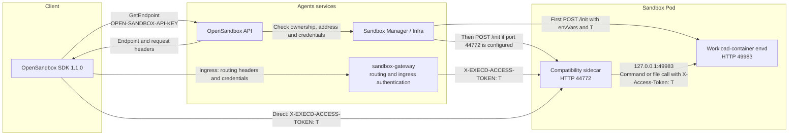
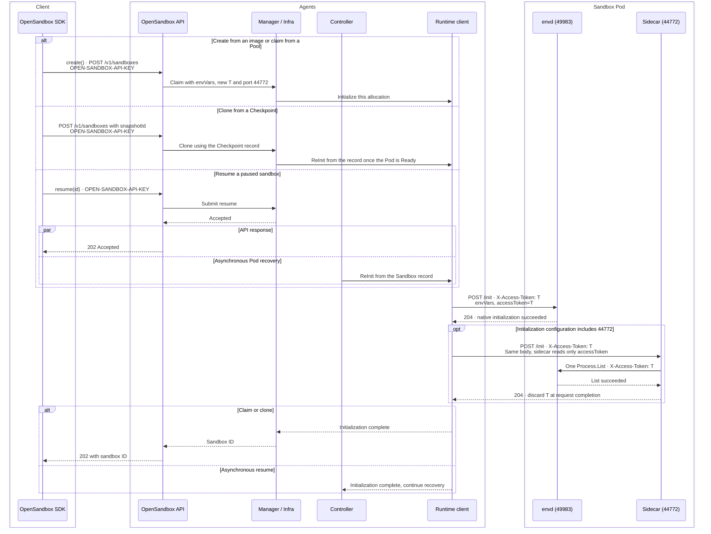
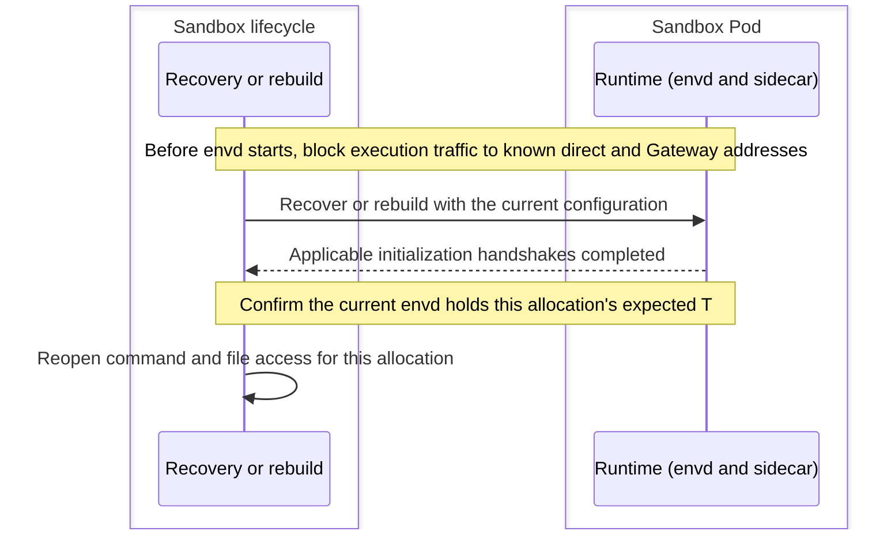
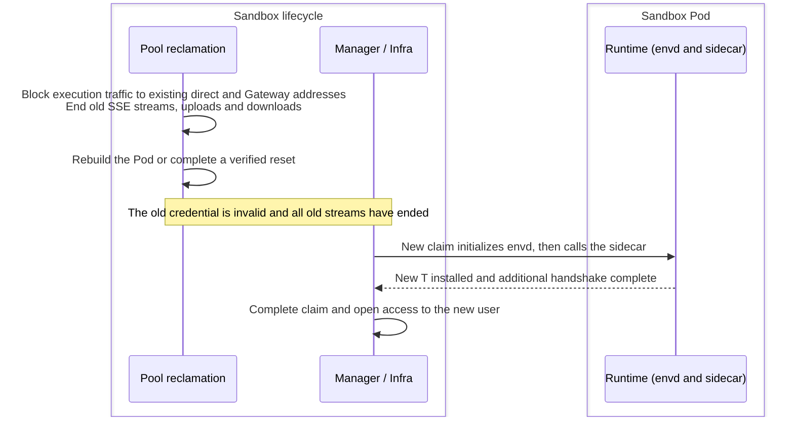
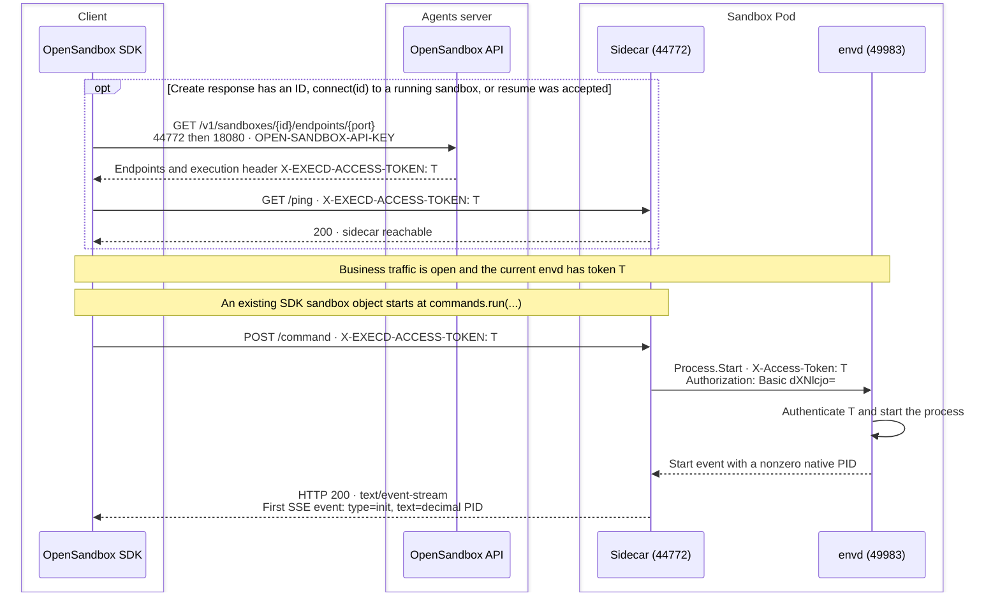
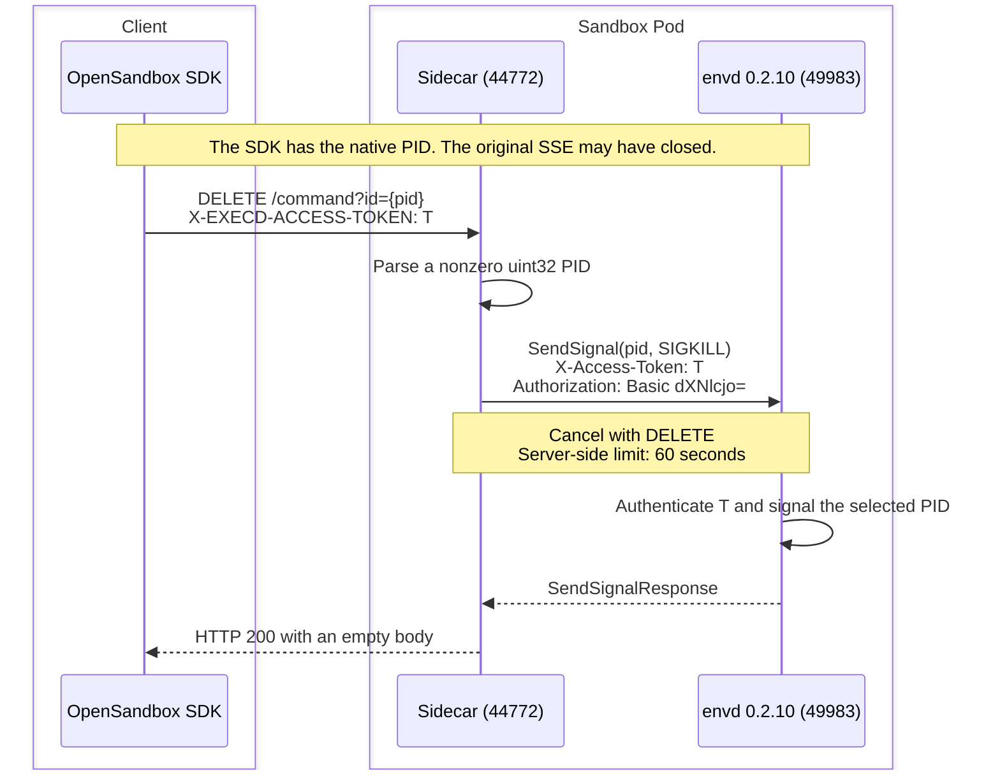
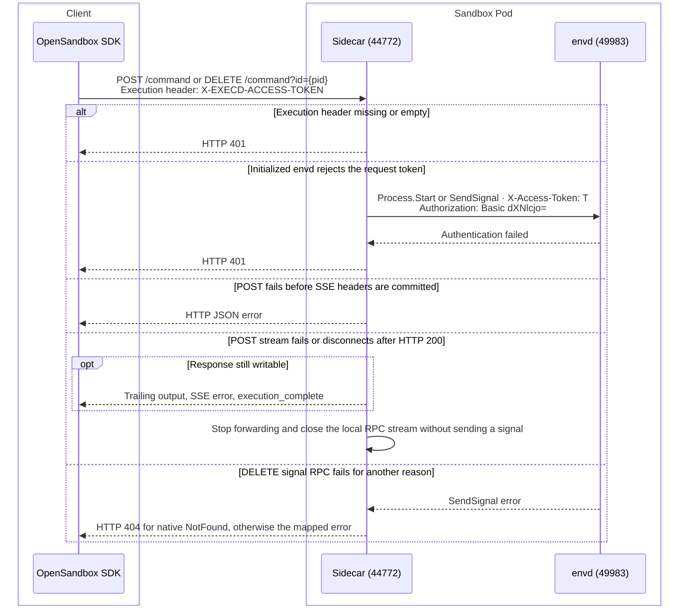
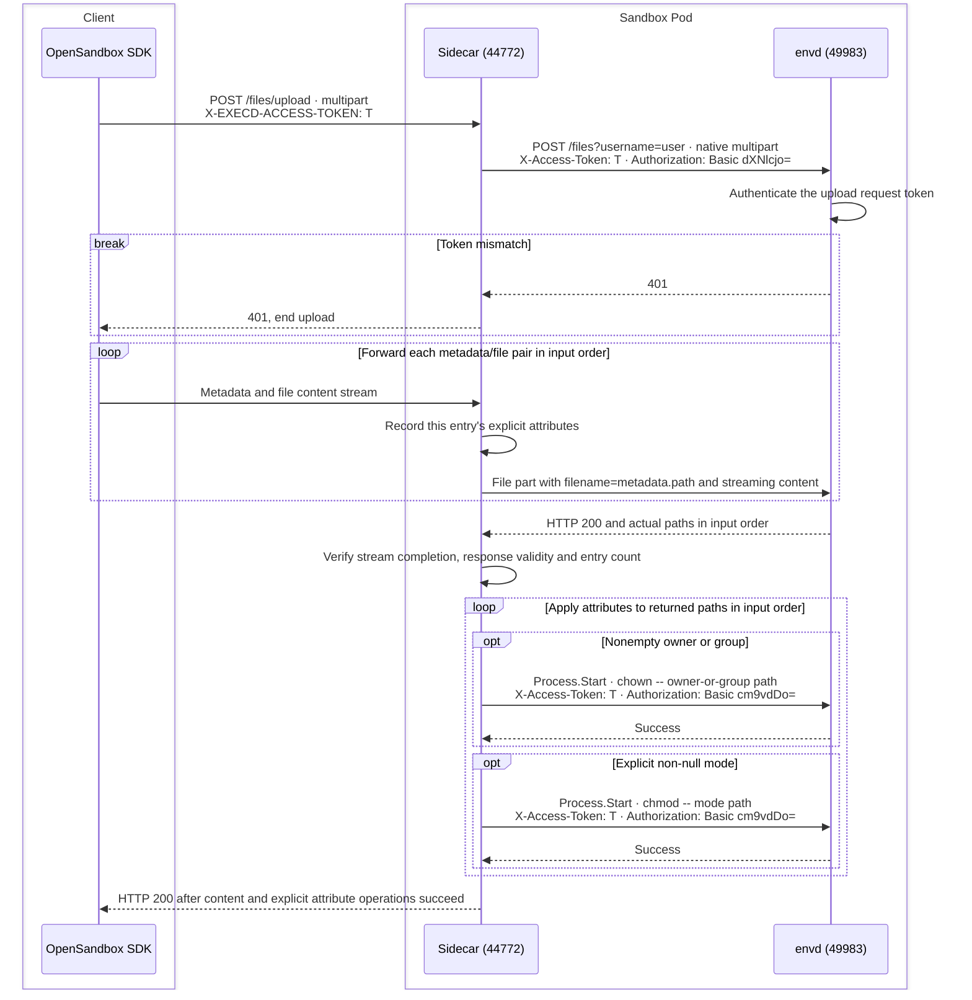
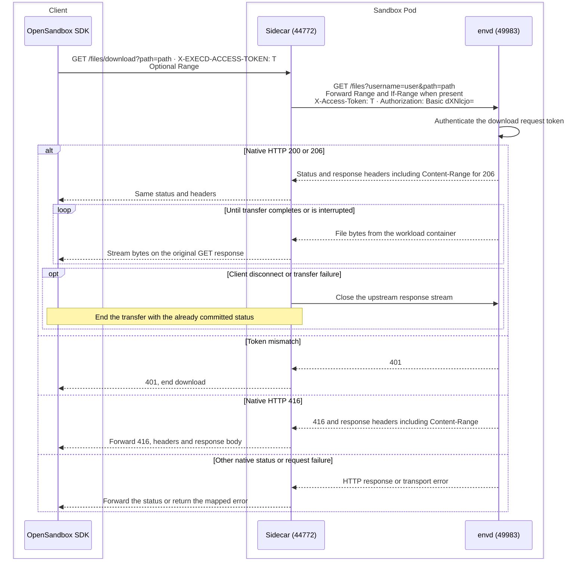

# OpenSandbox-Compatible Data Plane

## Table of Contents

- [Glossary](#glossary)
- [Summary](#summary)
  - [Delivery boundary](#delivery-boundary)
- [Motivation](#motivation)
  - [Goals](#goals)
  - [Non-Goals/Future Work](#non-goalsfuture-work)
- [Proposal](#proposal)
  - [User Stories](#user-stories)
    - [Story 1: Run commands and read/write files through the gateway](#story-1-run-commands-and-readwrite-files-through-the-gateway)
    - [Story 2: Access the same execution capabilities from inside the cluster](#story-2-access-the-same-execution-capabilities-from-inside-the-cluster)
  - [Requirements (Optional)](#requirements-optional)
    - [Functional Requirements](#functional-requirements)
    - [Non-Functional Requirements](#non-functional-requirements)
  - [Implementation Details/Notes/Constraints](#implementation-detailsnotesconstraints)
    - [Architecture and shared responsibilities](#architecture-and-shared-responsibilities)
    - [Reference baseline and native capabilities](#reference-baseline-and-native-capabilities)
    - [Endpoint and dual-path addressing](#endpoint-and-dual-path-addressing)
    - [Credentials and transport boundaries](#credentials-and-transport-boundaries)
    - [Initialization and deployment prerequisites](#initialization-and-deployment-prerequisites)
    - [Initial command and file delivery](#initial-command-and-file-delivery)
    - [Command invocation and SSE translation](#command-invocation-and-sse-translation)
    - [Native execution semantics](#native-execution-semantics)
    - [Execution identity and stream-close boundary](#execution-identity-and-stream-close-boundary)
    - [File batch and metadata handling](#file-batch-and-metadata-handling)
    - [Failure cleanup and compatibility](#failure-cleanup-and-compatibility)
  - [Risks and Mitigations](#risks-and-mitigations)
- [Alternatives](#alternatives)
- [Upgrade Strategy](#upgrade-strategy)
- [Additional Details](#additional-details)
  - [Test Plan \[optional\]](#test-plan-optional)
  - [Verification status](#verification-status)
    - [October 19 prototype](#implementation-and-verification-status-2026-10-19)
- [Implementation History](#implementation-history)

## Glossary

| Term | Meaning |
| --- | --- |
| Data plane | The path carrying sandbox execution and file requests; this delivery covers foreground commands and file upload/download, with execution behavior aligned to the pinned E2B SDK call chain |
| Endpoint | The service address and request headers returned by the control plane, used by the SDK to connect to the data plane |
| Execd compatibility entry | The sandbox-side service implementing this delivery's OpenSandbox HTTP/SSE contracts; it does not run the OpenSandbox execd binary |
| envd | The native Agents execution component providing process, file and other runtime capabilities |
| Ingress / in-cluster direct access | Respectively forwarded through sandbox-gateway, or connecting directly to the sandbox Pod IP and service port |
| Sidecar / workload container | The compatibility service runs in a separate sidecar; envd completes operations within the workload container's user and filesystem view |

## Summary

The OpenSandbox SDK obtains an execution endpoint and credentials from the
control plane. Both the ingress and in-cluster Pod IP paths reach the same
HTTP sidecar on port 44772. The sidecar translates foreground commands and
file requests into native calls and passes each request's token to envd in
the workload container for authentication.

### Delivery boundary

| Scope | This delivery |
| --- | --- |
| Address discovery | Connect the `GET /v1/sandboxes/{id}/endpoints/{port}` defined by the control-plane proposal, returning address and execution credentials under the existing API Key, namespace and owner rules |
| Access paths | This delivery supports both ingress and direct; ingress is the default, reusing the gateway and existing external HTTPS termination; direct uses in-cluster HTTP Pod IP, selected by deployment configuration |
| Commands | Foreground shell/argv execution, cwd/env, real-time stdout/stderr SSE, nonzero exits, timeout and interrupt; shell, deadline and interrupt behavior map to the pinned E2B SDK |
| Files | Single-/multi-file upload and download reusing the native filesystem; default permissions follow envd, and explicit owner/group/mode and download byte Range adapt per request |
| Initialization and connection | When initialization is enabled, a claim initializes envd and then calls the sidecar. For an ordinary sandbox, the SDK discovers endpoints after receiving the ID and uses `GET /ping` as its default sidecar liveness check. |
| Compatibility boundary | Code interpreter, independent file management, background state/logs and egress management are listed as non-goals; implementation and verification status is in [current status](#verification-status) |

Endpoint discovery and runtime initialization follow the control plane's
`API → Manager → Infra/runtime` path. Once the SDK has the endpoint, commands
and file requests reach envd through the sidecar. [Control-plane initialization contract][control-init]

## Motivation

After the OpenSandbox SDK creates a sandbox, it also resolves the execution
endpoint, checks health and calls the command and file services. With only a
creation API, the SDK's actual execution path remains unconnected. See the
[official architecture: Server Proxy and Endpoint Resolution][os-architecture]
and the [SDK `Sandbox` implementation][os-sandbox].

Agents already provides sandbox-gateway, in-cluster Pod IP direct access and
envd process/file capabilities. The data-plane adaptation mainly handles the
request, event and credential differences between execd and envd; the two access
paths can share the sandbox-side service. See [Return Sandbox IP][ag-doc-ip],
the [native process client][ag-process] and [filesystem capabilities][ag-files].

Adaptation proposal #690 gives the direction of control-plane protocol
adaptation and runtime capability layering. This delivery reuses the shared
SandboxManager and a neutral execution transport, preserving the native E2B
path.

### Goals

- Connect the SDK's post-creation endpoint, health check, foreground command and
  file read/write path.
- Let ingress and in-cluster direct access use the same set of SDK business
  calls and reach the same compatibility service.
- Reuse existing authorization, runtime token, workload-container execution
  capabilities and initialization orchestration.
- Keep output delivered in real time; execution deadline and explicit interrupt
  follow envd, and client disconnection only ends forwarding and releases local
  resources.
- Align the first batch's execution behavior with the pinned E2B SDK's actual
  calls and observable results, preserving existing E2B APIs; envd provides the
  underlying execution capability, and comparable E2E scenarios serve as the
  reference.

### Non-Goals/Future Work

| Capability | Current handling |
| --- | --- |
| Code interpreter, code contexts and sessions | `/code`, session run and isolated session APIs are not in this batch; no Jupyter protocol or session file view integration |
| Background command state, logs and PTY | `background=true`, background queries and PTY APIs return unsupported; after disconnection the native process may continue running and be interrupted by execution ID; this batch adds no completed-state or cross-connection log storage |
| Independent file management | list, stat, remove, directory management and similar APIs are excluded; file scope is limited to upload and download |
| Other command/file parameters | Numeric command UID/GID overrides and line-based offset/limit downloads return unsupported |
| Metrics and egress management | `/metrics`, `/policy`, `/credential-vault` and similar APIs return HTTP 501; 18080 only provides a genuinely reachable unsupported-response entry |
| Signed endpoints and generic Lifecycle Server Proxy | `expires` or `use_server_proxy=true` in endpoint queries returns HTTP 501 |
| Automatic routing, failure fallback and external direct access | The mode is fixed at API deployment; execution requests are not replayed, and no public address or external route is provisioned |
| Compatibility-service TLS/mTLS | Direct access provides HTTP only; HTTPS reuses the existing external entry; TLS-only native envd is not in this batch's wiring scope |
| Lifecycle APIs and recovery scenarios | No new describe/list/delete/pause/resume control-plane APIs; Pool, Checkpoint and post-recovery execution are verified separately |
| New credential proxies and request-level hooks | No new outbound Credential Proxy, preStart executor or periodic scheduler |

## Proposal

### User Stories

#### Story 1: Run commands and read/write files through the gateway

A caller creates a sandbox with the OpenSandbox SDK and obtains the gateway
endpoint and routing/execution-credential headers. The SDK reaches the
compatibility service through the existing gateway, runs foreground commands,
receives output in real time, and uploads or downloads files. The external entry
may terminate HTTPS using the existing deployment.

#### Story 2: Access the same execution capabilities from inside the cluster

An in-cluster caller connects to the direct-mode HTTP control-plane address.
After the SDK obtains `PodIP:44772` and the target-side execution credentials, it
accesses the same compatibility service directly, using the same command and
file APIs.

### Requirements (Optional)

#### Functional Requirements

**FR1: Dual-path endpoint discovery**

Return the gateway or Pod IP address per deployment configuration, sharing
identity, ownership and service-mapping rules; both 44772 and 18080 point to the
deployed compatibility service.

**FR2: Foreground commands and real-time output**

Support shell strings or argv, cwd, env, timeouts and explicit interrupts by
PID. The first SSE event carries the native PID. Subsequent events report
stdout, stderr, errors and completion.

**FR3: Single-/multi-file upload and download**

Accept ordered metadata/file multipart, streaming content to native `/files`;
downloads stream back content from the workload container, without a multi-file
transaction.

**FR4: Initialization and target-side authentication**

The runtime client configures envd with the allocation's token `T`. When port
44772 is configured, the sidecar checks `T` with one native read-only call
and discards it when the handshake ends. For commands, interrupts and file
requests, envd authenticates the token on the requested operation. The SDK's
default health check confirms only that the sidecar is reachable.

#### Non-Functional Requirements

**NFR1: Authorization and layering**

Endpoint discovery uses existing control-plane authorization. Command and
file requests authenticate at the target. The API key authorizes control-plane
operations, and the runtime token authorizes execution in the sandbox.

**NFR2: Streaming, cancellation and native compatibility**

Stream command output and file contents incrementally. Closing a stream releases
its local resources. An explicit interrupt uses the DELETE request's own
cancellable context with a server-side limit of 60 seconds. Existing E2B
buffered calls and native routes retain their behavior.

### Implementation Details/Notes/Constraints

#### Architecture and shared responsibilities

| Location | Responsibility |
| --- | --- |
| `pkg/servers/opensandbox` | Implements endpoint, identity context, address and credential projection, and error mapping under the control-plane contract. Selects the compatibility runtime at creation and passes the initialization options. |
| `pkg/sandbox-manager/connection.go` | `GetSandboxConnection` reuses the `GetSandbox` ownership check and returns a neutral route observation as the shared dependency of endpoint |
| Infra | Provides state, IP and route data along existing Sandbox capabilities, with no new API protocol or resource type |
| sandbox-gateway | Reuses existing routing headers, forwarding and ingress authentication, with no execd protocol translation |
| `pkg/agent-runtime/opensandbox` | Handles the additional handshake and `/ping`, forwards each command or file request with its execution token, and translates the native PID and process events into SSE. |
| `pkg/runtime/envd` | Sends native `Process.Start`, `SendSignal` and file HTTP requests with each request's token and execution-user identity. |
| `pkg/utils/runtime` | Initializes envd, then sends the same request body to the configured additional ports. Clone and resume replay the recorded options. |
| `cmd/opensandbox-runtime` | Assembles the compatibility service, HTTP listener and shutdown flow; the binary is packaged in the agent-runtime image |

Current consumers use a concrete envd client; this batch adds no generic
`RuntimeProvider` interface and does not modify the existing buffered process
API. execd models and HTTP/SSE rules remain at the compatibility-service
boundary.

#### Reference baseline and native capabilities

| Object | Stable baseline | Purpose |
| --- | --- | --- |
| OpenSandbox | `release-1.1.0`, Python SDK `opensandbox==1.1.0` | Lifecycle/execd contracts, SDK calls and default behavior |
| OpenKruise Agents | `v0.6.0` | Reference for released gateway, runtime, protocol and test capabilities |
| E2B Python SDK | [`e2b@2.51.0`][e2b-commands] | SDK calls, parameter defaults, disconnection, timeout and explicit-interrupt behavior baseline for the first batch's command and file capabilities |
| envd dependency | E2B infra `2025.33` | Reuses the existing native component; this batch does not modify, backport, upgrade or replace envd |

The protocol reference is the [execd OpenAPI][os-execd-spec]; execution semantics
use the pinned E2B SDK's complete call chain as the baseline, and envd is used to
verify the underlying mechanism. Commands reuse envd `Process.Start`; files
reuse HTTP `/files`; OpenSandbox fields, units, SSE and HTTP responses map at the
API layer, with default differences in
[native execution semantics](#native-execution-semantics). See
[E2B command calls][e2b-commands], [file calls][e2b-files],
[native processes][ag-process], [filesystem capabilities][ag-files] and
[initialization][ag-init]. The [verification status](#verification-status) identifies the versions and
deployment behind the SDK results.

#### Endpoint and dual-path addressing

`GET /v1/sandboxes/{id}/endpoints/{port}` returns `Endpoint{endpoint, headers}`.
The API uses the existing KeyStorage identity, scoping namespace by Team.Name;
the Admin team follows existing cross-namespace query rules, and Manager still
checks whether the instance owner is the current Key ID. See
[Lifecycle OpenAPI][os-lifecycle-spec] and [Manager `GetSandbox`][ag-manager].

| Mode | Address | Headers required by execd/egress |
| --- | --- | --- |
| Ingress (default) | host[:port] of `--opensandbox-gateway-url` | `e2b-sandbox-id`, `e2b-sandbox-port=44772`, `X-Access-Token`, `X-EXECD-ACCESS-TOKEN`; obtains the native traffic token when traffic auth is enabled |
| direct | `PodIP:44772` | `X-EXECD-ACCESS-TOKEN` |

The mode is selected by `--opensandbox-access-mode=ingress|direct`; ingress
requires an HTTP(S) origin configured without path, query or credentials. The
SDK's `use_server_proxy` denotes the lifecycle proxy and cannot switch between
these two access modes.

SDK 1.1.0 uses `ConnectionConfig.protocol` to assemble the execution URL; the
endpoint string itself carries no scheme. Therefore the ingress SDK protocol
must match the configured entry; direct uses an internal HTTP control-plane
connection. See [SDK connection configuration][os-connection] and
[command URL construction][os-command-adapter].

For an ordinary sandbox, SDK 1.1.0 queries the execd (44772) and egress (18080)
endpoints, in that order, after receiving the ID from `create()` or when
connecting to a running sandbox with `connect(id)`. Both ports map to the
sidecar on 44772. The default health check sends `GET /ping` to the execd
endpoint with the returned headers. A reachable sidecar responds with 200.
An existing SDK sandbox object can issue commands or file requests directly.
[SDK create][os-create-sync] · [SDK connect][os-connect-sync] · [Endpoint headers][os-headers]

| Query condition | Response |
| --- | --- |
| Invalid port | HTTP 400 |
| Nonexistent sandbox or another owner | The same HTTP 404 response |
| No Pod IP yet | HTTP 404, code `KUBERNETES::POD_IP_NOT_AVAILABLE`, satisfying the pinned SDK's endpoint-readiness retry |
| Paused / Dead state | HTTP 409 |
| Missing execution token or unconfigured ingress origin | HTTP 503 |
| `use_server_proxy=true` or specified `expires` | HTTP 501, code `NOT_IMPLEMENTED` |

Endpoint discovery reads the current route. Egress policy and Vault operations
return `501 NOT_SUPPORTED`. Other valid ports follow the existing addressing
rules. [SDK readiness budget][os-readiness]

#### Credentials and transport boundaries

The API authenticates sandbox creation and endpoint discovery with
`OPEN-SANDBOX-API-KEY`. For a command, interrupt or file operation, the
sidecar returns 401 if `X-EXECD-ACCESS-TOKEN` is missing or empty. Otherwise
it passes the value `T` in the native operation's `X-Access-Token` header
and supplies the required execution-user identity. The initialized envd
authenticates that call. The first and subsequent requests follow the same
path, with zero additional `Process.List` calls.
[SDK header merging][os-headers] · [Native token handling][ag-token] · [envd authentication][envd-auth]

| Hop | This batch's transport and protection |
| --- | --- |
| SDK → Ingress → gateway | HTTPS and native gateway authentication along the existing entry |
| Gateway → sidecar | HTTP to `PodIP:44772`, preserving the SDK's `X-EXECD-ACCESS-TOKEN` header. |
| In-cluster SDK → sidecar | HTTP to `PodIP:44772`. Command and file requests carry `X-EXECD-ACCESS-TOKEN`. |
| Sidecar → envd in the same Pod | HTTP to `127.0.0.1:49983` with `X-Access-Token: T` on the native call. |

The additional-port handshake requires HTTP on the native runtime. A TLS-only
runtime with additional ports configured fails before initialization. With an
empty additional-port list, native E2B keeps its configured TLS/mTLS transport.
[Control-plane transport contract][control-init] · [Agents transport][ag-transport] · [execd HTTP server][os-http-server]

Gateway JWT validation and traffic wakeup apply only to requests passing
through the gateway; direct's deployment network and access policy must be
configured separately, and target-side token validation covers this batch's
direct authentication.

#### Initialization and deployment prerequisites

The runtime image includes the `opensandbox-runtime` binary. Cold creation from
an image injects both native envd and the compatibility sidecar. Pool templates
and Checkpoints must already contain the required components and runtime
configuration. The following flows apply to HTTP sandboxes.

**Create, clone and resume.** When initialization is enabled for an image
creation or a Pool claim, Manager/Infra records `AdditionalInitPorts=[44772]`.
Cold creation waits for the Pod to be Ready. The sidecar's TCP readiness probe
checks that port 44772 is listening. For a clone, Manager/Infra replays the
Checkpoint's initialization record. For a resume, the Controller asynchronously
replays the Sandbox's record. The diagram shows a claim with initialization
enabled or a replay with a record. In this example the Sandbox already carries
the credential `T`. [Control-plane initialization contract][control-init] ·
[Claim initialization][ag-claim-init] · [Checkpoint replay][ag-clone-init] ·
[Controller replay][ag-resume-init] · [Runtime request headers][ag-init-headers]

**Failures and replay.** If initial envd setup fails, the runtime client skips
the additional handshake for that attempt. Only during replay (`ReInit`) does
the client treat a `401` from envd's `/init` as already initialized and proceed
to the recorded additional ports. A record with no additional ports initializes
envd alone. Without an initialization record, replay skips both steps.
[Native ReInit][ag-reinit-status] · [Control-plane acceptance criteria][control-init-tests]

The sidecar rejects a missing or empty `accessToken` in the request body before
contacting envd. For a nonempty token `T`, it issues one read-only
`Process.List` with `X-Access-Token: T`. On success the sidecar returns `204`
and discards `T` at the end of the request. If envd rejects the token, the
sidecar returns `401`. That response, or any other RPC failure, fails
initialization for the claim, clone or asynchronous resume, including during
replay. [envd List][envd-list] · [envd authentication][envd-auth]

**SDK entry points.** After a create returns an ID, the SDK looks up the
endpoint. Connecting to a running sandbox with `connect(id)` starts at the same
lookup. In the default configuration the SDK then calls `GET /ping`, the
sidecar's sole liveness endpoint. A reachable sidecar returns `200` with no envd
calls. Native execd's `/ready` is outside this interface. An existing SDK object
can issue command and file requests immediately. None of these operations
initializes envd. [Endpoint discovery](#endpoint-and-dual-path-addressing) ·
[SDK create][os-create-sync] · [SDK connect][os-connect-sync] ·
[OpenSandbox health routes][os-router]

On resume, the SDK starts endpoint discovery as soon as the API returns `202`.
If the sandbox still reports `Paused`, the lookup returns `409`. SDK 1.1.0
only retries the specific `404` for a missing Pod IP. The `resume(id)` call can
therefore fail before reaching `/ping` while the Controller continues the
accepted recovery. [Control-plane endpoint states][control-endpoint] ·
[SDK resume][os-resume-sync] · [SDK endpoint retries][os-readiness]

An explicit `skip-init-runtime` skips both ports during claim. Endpoint discovery
returns `503` if the execution credential is missing. During cold creation or
after skipped initialization, the deployment must block command, interrupt and
file requests until the current envd holds this allocation's `T`. This applies
to known Pod addresses and previously issued Gateway addresses.

**When envd restarts alone.** The token lives in envd's process memory. A fresh
envd without a configured token skips the token check on command and file
requests. A successful read-only call using `T` therefore cannot establish that
the token was installed. Restarting envd alone does not trigger a claim or
record replay. The deployment must isolate existing addresses before the new
envd can serve requests, then restore access after native recovery or rebuild
has installed and confirmed the expected token. If only the sidecar restarts,
envd retains the token for subsequent requests. [envd authentication][envd-auth] ·
[envd token initialization][envd-init-token]

**Pool handoff between users.** In a deployment that reuses a Pod across
allocations, retirement of the old allocation must block its existing addresses
and end its command SSE streams and file transfers. Once envd has a token it
rejects an attempt to replace it with a different token. Handoff therefore
requires a rebuilt Pod or a verified reset that clears old state. The default
no-op recycler can report success without performing a reset. Before serving a
new user, the old token must be invalid, all old streams must have ended, and
the current envd must hold the new allocation's token. Disable in-place reuse
between users if the deployment cannot meet these conditions.
[envd token initialization][envd-init-token] · [Default recycler][ag-pool-recycler]

#### Initial command and file delivery

| Route | Target behavior |
| --- | --- |
| `POST /command` | Shell strings execute via `/bin/bash -l -c` per the E2B SDK; argv preserves literal argument boundaries. Supports cwd/env; the execution user follows the SDK and envd version rules; timeout uses milliseconds, omitted means 60000, explicit 0/null means no deadline |
| Command SSE | After the first Start returns, sends `init(str(pid))`, status, stdout/stderr, ping, error and execution_complete; startup errors before the stream begins use an HTTP JSON response; a stream failure lacking End uses error termination |
| `DELETE /command?id=...` | Parse the ID as a nonzero `uint32` PID and send `SendSignal(pid, SIGKILL)` with this request's token. Return 400 for an invalid ID, 200 for a successful RPC and 404 for native NotFound. |
| `POST /files/upload` | One external batch converts to a single native multipart POST, resolving paths for the whole batch with the SDK default file user; after all content succeeds, associates returned paths by index, then applies explicit owner/group/mode; omitted/null mode adds no chmod |
| `GET /files/download?path=...` | Reads with the default user of the SDK and selected envd version, forwarding content, byte Range and the corresponding response headers/status |
| `GET /ping` | The SDK sends the endpoint headers by default. A reachable sidecar responds with HTTP 200 without calling envd. |

File content is operated by the workload-container envd; the compatibility
container only forwards bytes and protocol metadata. owner/group are post-hoc
file attributes and do not change the whole-batch path-resolution user; parent
directories follow native creation rules. Partial failures of content and
attributes are handled separately per the
[file batch contract](#file-batch-and-metadata-handling). The table above
describes target behavior; historical implementation and verification scope are
listed separately in [current status](#verification-status).

Normal nonzero exits preserve the numeric exit code for SDK inference; abnormal
processes and transport failures use execution errors. Known but unsupported
execd/egress operations return HTTP 501 (`NOT_SUPPORTED`); unknown routes return
404.

#### Command invocation and SSE translation

**Run a command in a sandbox**

For an ordinary HTTP sandbox using direct access, `create()` obtains the
sandbox ID and `connect(id)` starts with endpoint discovery for the running
sandbox. The diagram shows successful discovery with the default `/ping` check. A caller with an existing
SDK sandbox object can start at `sbx.commands.run(...)`. In ingress mode, the
gateway routes the same execution requests to the sidecar. See
[SDK creation][os-create-sync], [SDK connection][os-connect-sync] and
[initialization and deployment prerequisites](#initialization-and-deployment-prerequisites).

The first and subsequent commands each issue a single `Process.Start`. The
sidecar returns 401 for a missing or empty execution header. For a nonempty
value, it sends that request's `T` in `X-Access-Token`. The initialized envd
authenticates the native call. The Basic header selects `user` with an empty
password for the pinned envd version. The sidecar commits HTTP 200 only after
the first native Start event supplies a nonzero PID. The first SSE event has
`type=init` and carries the decimal PID in `text`. See
[credentials and transport boundaries](#credentials-and-transport-boundaries)
and [envd authentication][envd-auth].

**Independent interrupt**

Once the SDK receives the PID, it can send a separate DELETE even if the
original SSE connection has closed. HTTP 200 confirms that the signal RPC
succeeded. If the original POST is still connected, its End event can arrive
before or after the DELETE response.

| Native event | Compatibility SSE |
| --- | --- |
| First Start(pid) | init(str(pid)), then status(running) |
| Data.stdout / Data.stderr | Corresponding stdout/stderr, ordered per channel, incremental UTF-8 decoding and JSON escaping |
| Keepalive | ping |
| Valid normal End, code=0 | execution_complete |
| Nonzero exit or abnormal End | error then execution_complete; a valid nonzero exit preserves the numeric exit code |
| RPC failure or EOF without End | When the connection is writable, sends error and execution_complete, without inferring exit code 0 |

The first Start is consumed only once; each channel retains only the incomplete
UTF-8 tail, without aggregating all output. After an SSE write, Flush or
per-write deadline failure, writing stops. The execution deadline and the
original HTTP request context are managed separately; after the deadline
triggers, `CommandTimeout` and the termination event can still be sent over the
writable original connection. Start does not auto-replay.

**Abnormal return and connection cleanup**

Abnormal End is handled by actual state; a stream failure without End leaves the
remote state unknown. A DELETE error only ends this interrupt request; the
original POST continues or ends by its own state. Before the 200 commit, return
an HTTP JSON error; after commit, write SSE only; after the connection fails,
stop writing and release sidecar local resources.

#### Native execution semantics

The first batch's command and file capabilities align with the actual calls and
observable results of E2B Python SDK `2.51.0`; envd `2025.33` is the underlying
execution basis. OpenSandbox requests, units, SSE and HTTP status adapt at the
compatibility entry. Behaviors with synonymous capability are reused directly;
differences that cannot align or require larger changes are listed with
behavior, change scope and cost for review.

| Condition | Target behavior | SDK call, underlying basis and observable difference |
| --- | --- | --- |
| String command, cwd/env | Strings go through `/bin/bash -l -c`; cwd/env pass per request, with defaults implemented by the native execution chain; argv preserves independent argument form | E2B `Commands._start` uses a login shell, which supplies the shell profile and PATH. [SDK commands][e2b-commands] |
| Client disconnect, SSE write failure or request cancellation | Stop this event reception and forwarding, release the connection and local resources; send no additional termination signal | SDK `disconnect()` only closes the event stream; `wait()` does not automatically call kill on a stream error; the envd process continues under its own deadline, explicit signals and sandbox lifecycle. [SDK handle][e2b-command-handle], [native Start][envd-process] |
| Execution timeout | When the OpenSandbox millisecond field is omitted, adopt the SDK default 60 seconds; explicit 0/null corresponds to SDK 0/None, adding no execution deadline; positive values convert to the SDK synonymous deadline | SDK `run()` defaults to 60 seconds; positive values constrain both the client stream and the pinned envd process deadline via Connect's `connect-timeout-ms`; timeout adds no SendSignal. [SDK commands][e2b-commands], [timeout conversion][e2b-utils], [Connect encoding][connect-timeout], [native deadline][envd-process] |
| Explicit interrupt and request deadline | The sidecar calls `SendSignal(pid, SIGKILL)`. The signal RPC inherits the DELETE request context and has a fixed 60-second server-side limit. Canceling DELETE can end the RPC earlier. | The SDK supplies the execution ID and its HTTP timeout controls how long the client waits. The sidecar returns 400 for an invalid PID, 404 for native NotFound and an empty 200 response when the RPC succeeds. [SDK interrupt request][os-interrupt-request], [execd OpenAPI][os-execd-spec] |
| Execution locating and identity | The execution ID directly uses the PID's decimal string; after disconnection, interrupt by native PID; user identity passes per SDK and envd version rules, preserving existing gateway protection | No Tag is set and no execution map is maintained. The default user supplements `user` when envd <0.4.0; this batch keeps that old-version identity behavior. PID reuse follows the native boundary. [SDK commands][e2b-commands], [identity conversion][e2b-utils], [native process selection][envd-service] |
| Upload mode omitted/null | Add no chmod; new-file permissions are determined by the envd creation method and umask; overwriting an existing file preserves its mode | The E2B SDK file write does not fill mode or add chmod; envd `processFile` uses `os.Create`, `os.Chown` and writes content. [SDK files][e2b-files], [native upload][envd-upload] |
| Upload carrying mode | Execute native chmod with the explicit value, preserving error and partial-write semantics | SDK 1.1.0's `WriteEntry.mode` defaults to 755, and the adapter writes it into multipart metadata; this is a request-carried value, so 755 still applies. [SDK model][os-file-model], [upload adapter][os-file-adapter] |

OpenSandbox SDK 1.1.0's `RunCommandOpts.timeout=None` omits the wire field, and
the reference implementation describes no server deadline; this compatibility
entry maps the omitted value to the E2B SDK default 60 seconds, and a
no-deadline call must explicitly pass 0. This difference is limited to the
default deadline; connection termination, explicit interrupt and deadline
triggering each follow the rules above. See [OpenSandbox parameters][os-command-model]
and [serialization][os-command-converter].

Verification uses comparable calls of the pinned E2B SDK as the reference,
covering login shell, timeout omitted/0/null/positive, post-disconnect survival
and subsequent interrupt, duplicate and ended executions, mode omitted/null on
new creation and overwrite, and OpenSandbox SDK carrying 755 and explicit mode.

#### Execution identity and stream-close boundary

The E2B SDK creates a CommandHandle from the PID returned by Start; kill/connect
use the same PID; the compatibility call uses `ProcessSelector.pid`. The
OpenSandbox ordinary command ID is a string with no UUID format constraint, so
this batch directly projects the PID, adding no persistent map, completed-state
store or UID fingerprint. The ID is limited to the native process namespace of
the authenticated sandbox; native PIDs can be reused, providing no historical
uniqueness or guarantee that an old ID always returns 404 after restart. See
[SDK commands][e2b-commands], [command ID model][os-command-model] and
[execd interrupt][os-execd-spec].

The sidecar propagates backpressure along synchronous segment-by-segment
forwarding; after client disconnection, write failure or request cancellation,
it stops forwarding, cancels reception and closes the client RPC stream, adding
no SendSignal. The cleanup scope is sidecar local resources, adding no infinite
background drain.

The pinned envd `2025.33` has synchronization risks in the subscription-cancel
and backpressure paths; the native handler, sender and output resource cleanup
are not yet closed. See [native Start][envd-process] and the
[native multiplexer][envd-multiplex]. This issue and the first batch's
committable scope must be discussed with the maintainer; modifying or replacing
envd is not in this proposal's confirmed implementation scope.

#### File batch and metadata handling

For the first and every subsequent upload or download, the sidecar forwards
the nonempty `X-EXECD-ACCESS-TOKEN` as `X-Access-Token` on the native
`POST /files` or `GET /files`. The initialized envd checks the token in
`validateSigning` before reading or writing file contents. It returns 401 for
a mismatch. Subsequent `chown` and `chmod` calls use the same upload request's
`T`. See [envd authentication][envd-auth], [native upload][envd-upload] and
[native download](https://github.com/e2b-dev/runtime/blob/2025.33/packages/envd/internal/api/download.go#L25-L35).

**File upload**

E2B `write_files`'s multipart branch uses one POST and one user for a batch; the
optional octet-stream branch sends per file. This batch adopts the multipart
branch supported by the pinned envd, adding no octet-stream/gzip. See
[SDK files][e2b-files].

- External metadata/file converts in order to a single native multipart. The
  whole-batch username follows the pinned SDK default; metadata.owner does not
  switch the native path-resolution user. Relative paths and `~` follow that
  user's HOME; no `$VAR` expansion is added, and parent directories are not
  rewritten per file owner/group.
- The native file part's filename comes from JSON `metadata.path`, constructed
  with standard MIME parameter encoding, omitting the whole-batch query.path.
  The external file-part filename may already be truncated to basename by the
  SDK and cannot be used to recover the path; nor is `Part.FileName()`, which
  truncates basename, used. See [SDK upload][os-file-adapter] and
  [native full-path resolution][envd-multipart].
- Content is forwarded streaming, saving only metadata that grows with entry
  count. After the upstream production stream ends normally, native HTTP 200,
  the success response parses and the entry count matches, returned `entry.path`
  is associated by index; same-name files in different directories do not use a
  basename/name map. See [PostFiles][envd-upload].
- After all content succeeds, attributes apply in input order, executed as root
  native Process argv with `Cwd=/` and the returned path. owner/group apply only
  when the value is a nonempty string; omitted/null/empty string skips the
  corresponding attribute, without trimming whitespace or filling defaults.
  owner-only, group-only and both construct `chown -- owner path`,
  `chown -- :group path`, `chown -- owner:group path` respectively; both empty
  means no chown. After chown, chmod executes only for an explicit non-null mode.
- When the native content phase fails, the attribute phase does not execute,
  preserving native partial writes. When the attribute phase fails, subsequent
  attributes stop and an error returns, without rollback; subsequent file
  content may already be on disk, and later attributes remain native results.
  Upstream, downstream and the multipart writer cancel and clean up together,
  without replaying the POST.
- Duplicate-target determination is left to the same native request, not copied
  or strengthened at the adaptation layer. The pinned `2025.33` judges by the
  resolved path string; the newer runtime's inode alias check is not
  retroactively counted as an old-version capability. See
  [pinned resolvePath][envd-upload]. Content and attributes do not form an atomic
  transaction.

The OpenSandbox reference execd uses process HOME/cwd to resolve relative paths
and `~`, with owner participating in post-hoc attributes; this batch adopts the
E2B file user's HOME, preserving this observable difference. See
[reference upload handling][os-upload-target].

**File download**

The SDK's `range_header` parameter sets `Range` on the download request. The
sidecar forwards `Range` and `If-Range` when present on the incoming request.
It streams the native GET response with envd's status and headers, including
206 for partial content and 416 for an unsatisfiable range. A read or write
failure after the headers have been committed ends the transfer and releases
the forwarding resources. See [SDK download request][os-download-request].

#### Failure cleanup and compatibility

If the command POST disconnects or an SSE write fails, the sidecar stops
forwarding and closes its native RPC stream. An authenticated caller that has
the PID can still interrupt a surviving process with `DELETE /command?id=<pid>`.
Only an explicit DELETE sends `SIGKILL`. The sidecar may return HTTP 200 as soon
as envd acknowledges the signal RPC. The process may exit later. The DELETE
request has its own cancellation and timeout rules. See
[native execution semantics](#native-execution-semantics).

envd signals the process selected by its native PID. Process-tree supervision,
completed-state storage and cross-connection logs are outside this proposal.
The control-plane caller owns cleanup after SDK creation. An endpoint lookup
failure leaves the sandbox in place. The E2E fixture creates the instance,
collects failure evidence and deletes the instance through the lifecycle API.
See the [envd signal implementation][envd-signal].

### Risks and Mitigations

| Risk | Measure or remaining condition |
| --- | --- |
| envd can accept traffic before the current token is set | Block commands, interrupts and file access on known Direct and Gateway addresses during cold creation, after skipped initialization, or when envd restarts alone. Open access only after the current envd holds the expected `T`. See [initialization and deployment prerequisites](#initialization-and-deployment-prerequisites). |
| The gateway buffers output or truncates the execution stream | On both paths, assert that the real-time callback receives the first output before the command completes. |
| Direct access bypasses gateway policy | Verify network and access policy for Direct independently. Verify gateway JWT and traffic wakeup on deployments that enable them. |
| File content or attributes differ from the request | Send one native multipart batch, then apply attributes only to returned paths. Preserve uploaded content on attribute failure. Verify permissions and byte ranges separately. |
| A closed stream can leave a running process | Verify that the sidecar releases its local resources without sending a signal. Process deadlines and explicit interrupts follow envd behavior. Subscription cancellation and sender cleanup in the pinned envd remain open for maintainer review. |
| A previous Pool user retains access | For deployments that reuse a sandbox across users, the previous token must be invalid and active SSE streams, uploads and downloads must end before the new user's first access. Rebuild the Pod if the deployment cannot verify isolation during in-place reuse. See [initialization and deployment prerequisites](#initialization-and-deployment-prerequisites). |
| A PID can be reused | Treat the PID as an identifier in the current process namespace. Verify concurrent commands, exited processes and PID reuse. |
| The native transport is incompatible with an additional port | Reject a TLS-only runtime before initialization when additional ports are configured. Verify that native E2B initialization with an empty port list still uses its configured TLS transport. See [credentials and transport boundaries](#credentials-and-transport-boundaries). |

## Alternatives

| Alternative | Tradeoff |
| --- | --- |
| Ingress only | Both paths share the main execution adaptation; use the existing gateway and Pod IP dual path |
| Unified proxy through the lifecycle service | Adds general HTTP/SSE/WebSocket forwarding responsibility; this batch keeps execution traffic on the existing gateway or Pod direct |
| Translate execd protocol in the gateway | Couples with routing and cannot reuse for direct; use a sandbox-side shared compatibility service |
| Run the OpenSandbox execd binary directly | Involves another execution component and initialization/deployment chain; this batch reuses Agents envd |

## Upgrade Strategy

Build a runtime image that includes the compatibility binary, configure the
native and sidecar injection templates, then enable `--enable-opensandbox-compat`
and the selected endpoint strategy. New OpenSandbox claims with initialization
enabled record `AdditionalInitPorts=[44772]`. Existing Pool templates and
Checkpoints retain their configuration. Verify new claims and replay of
existing records separately. When a record contains port 44772, the deployed
sidecar must be able to complete the additional handshake. See the
[control-plane initialization contract][control-init] and
[initialization and deployment prerequisites](#initialization-and-deployment-prerequisites).

The SDK connection configuration must match the protocol and network for the
selected access mode. After a mode change, clients rediscover the endpoint and
establish a new connection. Running streams remain on their original
connections. Disabling the compatibility service leaves existing instances
under native lifecycle management.

## Additional Details

### Test Plan [optional]

The target default suite uses `opensandbox==1.1.0` and runs the same four
foreground command cases and two file cases on ingress and Pod IP direct
access. Deployments with UUID authentication may run one additional case.

| Area | Cases | Existing E2B reference and behavior assertions |
| --- | --- | --- |
| Foreground commands | 4 | Basic execution, errors, real-time callbacks and interrupting a live process. See [E2B command tests][ag-e2e-commands]. |
| Files | 2 | Single- and multi-file writes followed by SDK reads that check the content. See [E2B filesystem tests][ag-e2e-files]. |
| UUID authentication | 1, optional | Verify rejection of missing and incorrect execd credentials. On ingress also check the native gateway token, then run a command with valid credentials. See [gateway authentication tests][ag-e2e-auth]. |

For the ordinary sandbox fixture, creation, endpoint discovery on 44772 and
18080, and the default health check precede the business cases. Record the
SDK's actual targets, request headers and component versions for each access
mode. On failure, collect status and logs before deleting the instances the
fixture created.

| Contract | Acceptance condition |
| --- | --- |
| Native PID and explicit interrupt | Match the ID in the first SSE event to the native PID. Cover concurrency within a sandbox, interrupts after disconnect, repeated interrupts, invalid and exited PIDs, and PID reuse. Test early DELETE cancellation, the signal RPC's fixed 60-second server limit and the command's execution deadline separately. |
| Stream closure and native cleanup | Exercise sustained output, a slow client, cancellation before the first Start event and a disconnected client. Verify that sidecar resources are released and record how the pinned envd handles cancellation and backpressure. |
| Single-batch files | Cover relative, home-relative and absolute paths, identical basenames, and native handling of duplicate or aliased paths. Content failure skips attribute operations. Attribute failure preserves written content. Exercise owner only, group only, both, omitted/null/explicit mode, SDK mode 755 and writer cleanup after disconnect. |
| Initialization and replay | Verify that envd is initialized before port 44772 is called. Each additional handshake with a nonempty `T` issues exactly one `Process.List`. Failed initial envd initialization skips the additional handshake. An absent or empty token in the handshake body makes zero calls to envd. Test clone and resume with a record containing 44772, an empty additional-port list and no record. Native `ReInit` may continue after envd returns 401. A 401 or other RPC error from the additional handshake fails the initialization attempt. |
| Per-request authentication | With envd initialized, trace first and subsequent commands, interrupts, uploads and downloads. A missing or empty execution header returns 401 from the sidecar with zero native calls. The native operation rejects an incorrect token. Each concurrent request uses its own header. Every operation makes zero extra `Process.List` calls. The default `/ping` makes zero envd calls. |
| Lifecycle isolation | On known Direct and Gateway addresses, verify that commands, interrupts and file transfers are blocked before cold initialization, after an explicit skip while envd lacks `T`, and during an envd-only restart until the expected token is restored. Test a real Pool handoff only on deployments that permit sandbox reuse across users. Keep SSE streams, uploads and downloads active during the handoff. Before the new user's first access, the old streams must have ended and the old token must be invalid. Verify that only the new credentials work afterward. |

Targeted Go tests should cover owner isolation, the SDK-retryable missing-Pod-IP
response, HTTP runtime initialization, authentication and stream and process
lifetimes. Use the race detector for concurrent cases. Deployment tests also
cover a sidecar-only restart while envd retains the current token, and the
SDK response to a temporary endpoint 409 after resume is accepted. See
[native execution semantics](#native-execution-semantics) and
[verification status](#verification-status).

### Verification status

**November 14, 2026 — version with creation-time sidecar credential binding.**
OpenSandbox Python SDK 1.1.0 ran against Kind (Kubernetes 1.32) on both paths.
The test base was `3c14b7e`. The checkout `df9bb7e` had the same source tree
as the implementation at `b8319e9`. Both runs used `SandboxSync.create`, the
default health check and `use_server_proxy=False`. The fixture extended the
readiness budget from 30 to 120 seconds and disabled creation telemetry.

Ingress and Pod IP direct access **each passed 16 cases** (nine command and
seven file cases) and **each skipped one** optional UUID authentication case.
These runs covered all six scenarios in the target default suite.

| Area | Observed behavior |
| --- | --- |
| Commands and interrupts | Both paths returned the native PID and streamed live output. A process survived disconnection of its original SSE stream and could subsequently be interrupted by PID. |
| Files and byte ranges | Both paths covered single- and multi-file transfers, explicit owner/group/mode and the contents of two valid byte ranges. Targeted Go tests checked HTTP 206, HTTP 416 and `Content-Range`. |

**Pending for the proposed handshake and per-request authentication.** Record
the `Process.List` count for each additional handshake and the result of replay
failures. Run the four-command, two-file suite independently on each path and
verify zero extra `Process.List` calls on first and subsequent operations.
Deployment evidence is still needed for isolation before initialization and
during an envd-only restart, cross-user Pool handoff, partial writes and
resource cleanup under real envd backpressure. External HTTPS, Pool/Checkpoint
recovery, gateway JWT and traffic wakeup require verification in the deployment
configurations that use them.

#### Implementation and verification status (2026-10-19)

The October 19 prototype passed seven local SDK cases on each path, including
the optional UUID authentication profile. That prototype used `SIGKILL` on
disconnect, applied mode 755 by default and waited for local cleanup before
returning 204 to DELETE. Its JUnit results describe the behavior of that
version.

## Implementation History

- November 7, 2026: The standalone data-plane proposal entered review.

[os-architecture]: https://github.com/opensandbox-group/OpenSandbox/blob/release-1.1.0/docs/architecture/index.md
[os-sandbox]: https://github.com/opensandbox-group/OpenSandbox/blob/release-1.1.0/sdks/sandbox/python/src/opensandbox/sandbox.py
[os-execd-spec]: https://github.com/opensandbox-group/OpenSandbox/blob/release-1.1.0/specs/execd-api.yaml
[os-lifecycle-spec]: https://github.com/opensandbox-group/OpenSandbox/blob/release-1.1.0/specs/sandbox-lifecycle.yml
[os-connection]: https://github.com/opensandbox-group/OpenSandbox/blob/release-1.1.0/sdks/sandbox/python/src/opensandbox/config/connection.py
[os-command-adapter]: https://github.com/opensandbox-group/OpenSandbox/blob/release-1.1.0/sdks/sandbox/python/src/opensandbox/adapters/command_adapter.py
[os-headers]: https://github.com/opensandbox-group/OpenSandbox/blob/release-1.1.0/sdks/sandbox/python/src/opensandbox/models/sandboxes.py
[os-router]: https://github.com/opensandbox-group/OpenSandbox/blob/release-1.1.0/components/execd/pkg/web/router.go
[os-readiness]: https://github.com/opensandbox-group/OpenSandbox/blob/release-1.1.0/sdks/sandbox/python/src/opensandbox/internal/readiness.py
[ag-doc-ip]: https://openkruise.io/kruiseagents/user-manuals/sandbox-claim#return-sandbox-ip-v030
[ag-manager]: https://github.com/openkruise/agents/blob/v0.6.0/pkg/sandbox-manager/api.go#L216-L260
[ag-process]: https://github.com/openkruise/agents/blob/v0.6.0/pkg/utils/runtime/process.go
[ag-files]: https://github.com/openkruise/agents/blob/v0.6.0/pkg/utils/runtime/filesystem.go
[ag-init]: https://github.com/openkruise/agents/blob/v0.6.0/pkg/utils/runtime/init.go
[ag-token]: https://github.com/openkruise/agents/blob/v0.6.0/pkg/utils/utils.go#L302-L314
[ag-transport]: https://github.com/openkruise/agents/blob/v0.6.0/pkg/utils/runtime/transport.go
[envd-process]: https://github.com/e2b-dev/runtime/blob/2025.33/packages/envd/internal/services/process/start.go
[envd-signal]: https://github.com/e2b-dev/runtime/blob/2025.33/packages/envd/internal/services/process/signal.go
[envd-service]: https://github.com/e2b-dev/runtime/blob/2025.33/packages/envd/internal/services/process/service.go
[envd-upload]: https://github.com/e2b-dev/runtime/blob/2025.33/packages/envd/internal/api/upload.go
[os-file-model]: https://github.com/opensandbox-group/OpenSandbox/blob/release-1.1.0/sdks/sandbox/python/src/opensandbox/models/filesystem.py
[os-file-adapter]: https://github.com/opensandbox-group/OpenSandbox/blob/release-1.1.0/sdks/sandbox/python/src/opensandbox/adapters/filesystem_adapter.py
[os-command-model]: https://github.com/opensandbox-group/OpenSandbox/blob/release-1.1.0/sdks/sandbox/python/src/opensandbox/models/execd.py
[os-command-converter]: https://github.com/opensandbox-group/OpenSandbox/blob/release-1.1.0/sdks/sandbox/python/src/opensandbox/adapters/converter/execution_converter.py
[e2b-commands]: https://github.com/e2b-dev/E2B/blob/e2b@2.51.0/packages/python-sdk/e2b/sandbox_sync/commands/command.py
[e2b-command-handle]: https://github.com/e2b-dev/E2B/blob/e2b@2.51.0/packages/python-sdk/e2b/sandbox_sync/commands/command_handle.py
[e2b-utils]: https://github.com/e2b-dev/E2B/blob/e2b@2.51.0/packages/python-sdk/e2b/envd/utils.py
[e2b-files]: https://github.com/e2b-dev/E2B/blob/e2b@2.51.0/packages/python-sdk/e2b/sandbox_sync/filesystem/filesystem.py
[connect-timeout]: https://github.com/connectrpc/connect-py/blob/v0.11.1/src/connectrpc/_protocol_connect.py
[ag-e2e-commands]: https://github.com/openkruise/agents/blob/v0.6.0/test/e2b/test_commands_run.py
[ag-e2e-files]: https://github.com/openkruise/agents/blob/v0.6.0/test/e2b/test_filesystem.py
[ag-e2e-auth]: https://github.com/openkruise/agents/blob/v0.6.0/test/e2b/test_gateway_auth.py
[os-http-server]: https://github.com/opensandbox-group/OpenSandbox/blob/release-1.1.0/components/execd/main.go#L392-L436
[envd-multipart]: https://github.com/e2b-dev/runtime/blob/2025.33/packages/envd/internal/utils/multipart.go
[envd-auth]: https://github.com/e2b-dev/runtime/blob/2025.33/packages/envd/internal/api/auth.go
[envd-list]: https://github.com/e2b-dev/runtime/blob/2025.33/packages/envd/internal/services/process/list.go#L12-L27
[os-upload-target]: https://github.com/opensandbox-group/OpenSandbox/blob/release-1.1.0/components/execd/pkg/web/controller/filesystem_upload.go
[envd-multiplex]: https://github.com/e2b-dev/runtime/blob/2025.33/packages/envd/internal/services/process/handler/multiplex.go
[os-create-sync]: https://github.com/opensandbox-group/OpenSandbox/blob/release-1.1.0/sdks/sandbox/python/src/opensandbox/sync/sandbox.py#L699-L773
[os-connect-sync]: https://github.com/opensandbox-group/OpenSandbox/blob/release-1.1.0/sdks/sandbox/python/src/opensandbox/sync/sandbox.py#L798-L878
[os-interrupt-request]: https://github.com/opensandbox-group/OpenSandbox/blob/release-1.1.0/sdks/sandbox/python/src/opensandbox/api/execd/api/command/interrupt_command.py
[ag-claim-init]: https://github.com/openkruise/agents/blob/master/pkg/sandbox-manager/infra/sandboxcr/claim.go#L450-L464
[ag-clone-init]: https://github.com/openkruise/agents/blob/master/pkg/sandbox-manager/infra/sandboxcr/clone.go#L459-L474
[ag-resume-init]: https://github.com/openkruise/agents/blob/master/pkg/controller/sandbox/core/sandbox_initializer.go#L174-L190
[ag-reinit-status]: https://github.com/openkruise/agents/blob/master/pkg/utils/runtime/init.go#L76-L88
[control-init]: https://github.com/openkruise/agents/blob/master/docs/proposals/20260918-opensandbox-compat.md#L880-L888
[control-init-tests]: https://github.com/openkruise/agents/blob/master/docs/proposals/20260918-opensandbox-compat.md#L959-L964
[control-endpoint]: https://github.com/openkruise/agents/blob/master/docs/proposals/20260918-opensandbox-compat.md#L869-L878
[ag-init-headers]: https://github.com/openkruise/agents/blob/master/pkg/utils/runtime/client.go#L489-L497
[os-download-request]: https://github.com/opensandbox-group/OpenSandbox/blob/release-1.1.0/sdks/sandbox/python/src/opensandbox/sync/adapters/filesystem_adapter.py#L112-L129
[ag-pool-recycler]: https://github.com/openkruise/agents/blob/master/pkg/controller/sandbox/core/recycle.go#L58-L83
[envd-init-token]: https://github.com/e2b-dev/runtime/blob/2025.33/packages/envd/internal/api/init.go#L38-L47
[os-resume-sync]: https://github.com/opensandbox-group/OpenSandbox/blob/release-1.1.0/sdks/sandbox/python/src/opensandbox/sync/sandbox.py#L921-L968
