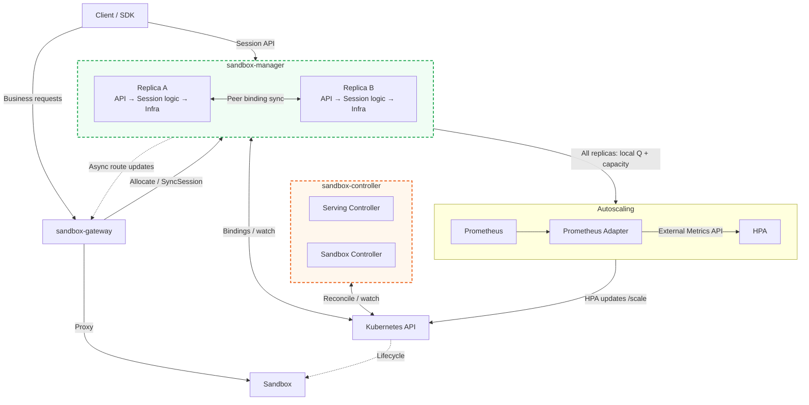
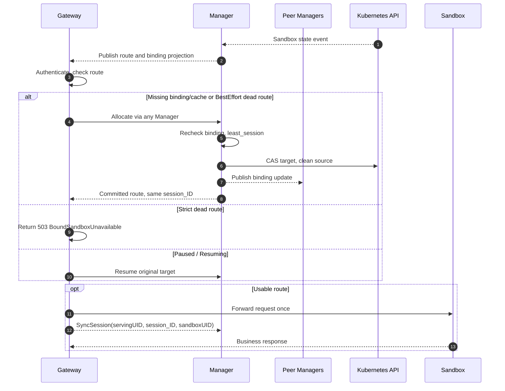
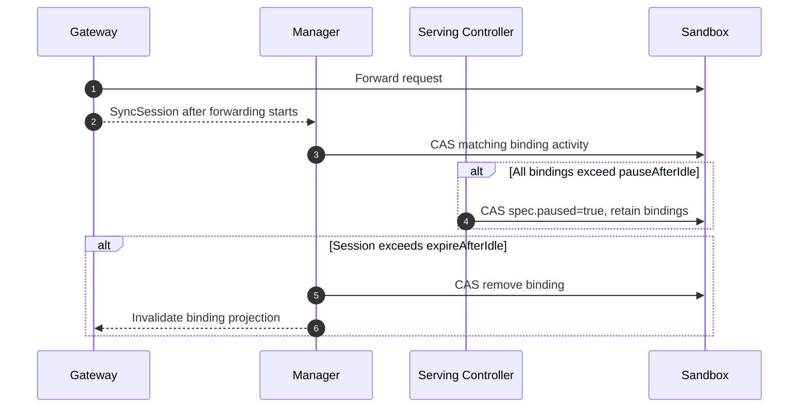
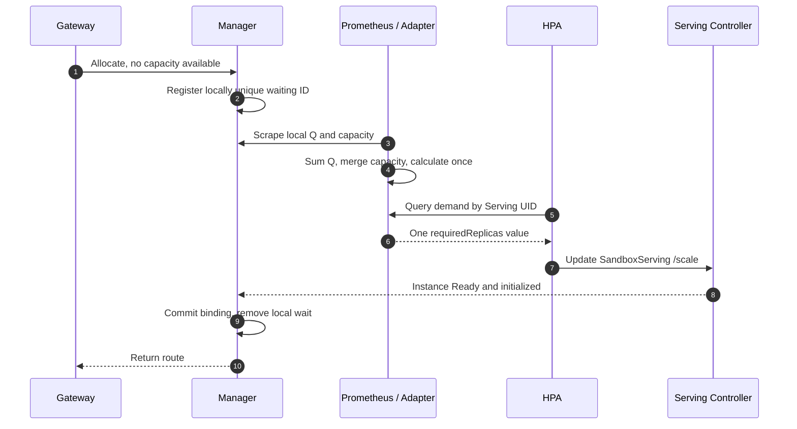
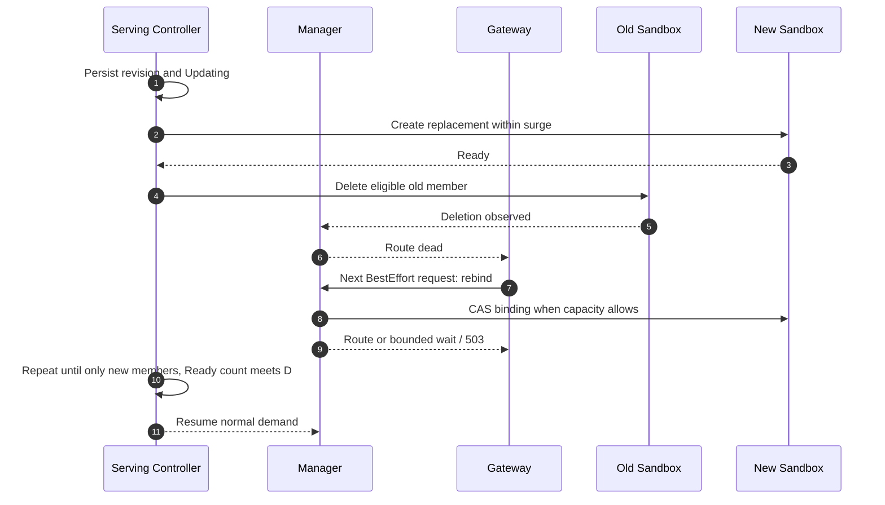
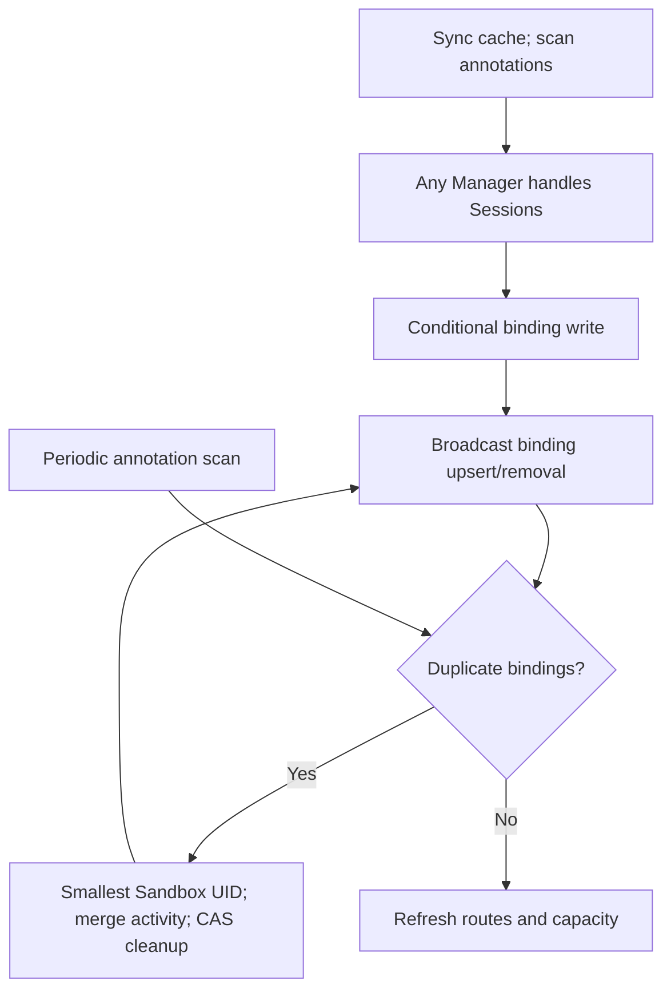

# SandboxServing: Replica Management and Session Affinity

## Table of Contents

- [Summary](#summary)
- [Motivation](#motivation)
  - [Goals](#goals)
  - [Non-Goals](#non-goals)
- [Proposal](#proposal)
- [Architecture](#architecture)
- [API and Data Model](#api-and-data-model)
- [Flow 1: Routing and Rebinding](#flow-1-routing-and-rebinding)
- [Flow 2: Activity, Pause, and Expiry](#flow-2-activity-pause-and-expiry)
- [Flow 3: Autoscaling](#flow-3-autoscaling)
- [Flow 4: Rolling Updates](#flow-4-rolling-updates)
- [Flow 5: Binding Synchronization](#flow-5-binding-synchronization)
- [Compatibility and Tests](#compatibility-and-tests)
- [Implementation History](#implementation-history)

## Summary

SandboxServing provides stable ingress and persistent Session bindings. `BestEffort` can rebind unavailable targets; `Strict` retains bindings and returns errors. Replicas are fixed or HPA-managed.

This document proposes new APIs and behavior; it does not describe an implemented feature. The test coverage below is planned validation for the implementation.

## Motivation

Session affinity must survive scaling and updates.

### Goals

- **Stable data-plane endpoint**: Keep the data-plane domain name stable for a Serving while backend Sandbox instances scale and update. The platform maintains mappings between SandboxServing, Sessions, and Sandboxes; applications only need to retain the association between their business sessions and platform Sessions.
- **Session affinity**: Route requests by the Session ID in the request header. Support `BestEffort` affinity, which prefers the bound Sandbox, and `Strict` affinity, which requires it. Setting `maxSessionsPerSandbox: 1` limits each Sandbox to one bound Session at a time.
- **Autoscaling**: When HPA is configured, use its `minReplicas` and `maxReplicas`, together with per-instance Session capacity `maxSessionsPerSandbox`, to adjust the replica target according to Session capacity demand. Normal scale-down preserves valid bindings and reclaims only instances without valid bindings.
- **Idle lifecycle management**: Expire Session bindings after a configured idle threshold and release instances without valid bindings during scale-down. Alternatively, pause instances to retain their state and resume them when subsequent requests arrive.

### Non-Goals

- **Isolation between Sessions**: Sessions sharing a Sandbox do not receive separate filesystems, processes, or networks. `maxSessionsPerSandbox: 1` only limits the number of concurrent bindings; it does not define an additional execution environment model within the Sandbox.
- **Environment continuity across rebinding**: Switching a Session ID to another Sandbox does not automatically migrate files, memory, processes, or background tasks. `BestEffort` permits selecting another instance but does not guarantee execution environment continuity. Applications are responsible for any required state migration and recovery.
- **Automatic Session environment cleanup**: The platform manages Session bindings and releases binding capacity; it does not automatically clean up all application-created state within a Sandbox. SandboxServing is not recommended for applications that require environment resets after Sessions end or strong isolation between Sessions.

## Proposal

### Architecture

Each Manager replica contains API, Session logic and Infra.



| Component | Responsibilities |
| --- | --- |
| `sandbox-gateway` | Check identity/port/Session header; proxy and report activity after forwarding. |
| `sandbox-manager` | API: HTTP/JWT, errors and Session endpoints; Session logic: allocation, lifecycle, peer sync, duplicate convergence and wait/capacity metrics; Infra: `BindingStore`, with annotation codecs, capacity checks and conditional writes in `infra/sandboxcr`. Any replica handles Sessions. |
| `sandbox-controller` | Serving Controller: replicas/Revisions/pause/updates; Sandbox Controller: instance lifecycle. Creates/deletes instances to match the target. |

Controller is independent; shared annotation codecs are neutral.

### API and Data Model

`SandboxServing` is namespaced. A binding is `(Serving UID, session_ID) → Sandbox UID`; one slot per Session, regardless of request count.

```yaml
apiVersion: agents.kruise.io/v1alpha1
kind: SandboxServing
metadata:
  name: code-agent
  namespace: demo
spec:
  replicas: 5
  provision:
    sandboxTemplate:
      spec:
        containers:
          - name: agent
            image: registry.example.com/code-agent:v2
            ports: [{containerPort: 8080}]
  ports: [8080]
  updateStrategy:
    maxSurge: 25%
  sessionPolicy:
    affinity: BestEffort
    maxSessionsPerSandbox: 4
    pauseAfterIdle: 30m
    expireAfterIdle: 6h
```

Use `provision.sandboxTemplate` or `provision.sandboxSetRef`; require completed Claim, initialization and Ready. Only template edits create a `ControllerRevision`; rollouts freeze capacity/affinity/provision type and queue later templates.

Fixed mode sets `spec.replicas`, returning `SessionCapacityExhausted` when full. Valid HPA owns `/scale`, enables capacity waits, and requires explicit `maxSessionsPerSandbox` in 1–512. Lowering it retains bindings; fixed mode may omit it but still obeys platform limits.

#### Session Protocol

| Item | Definition |
| --- | --- |
| Endpoint | `https://{port}-{servingShortID}.svc.{baseDomain}`, using the Short ID allocator. |
| Header | `X-Kruise-Agent-Session-ID`, exactly one nonempty value. |
| ID | ASCII `^[A-Za-z0-9_-]{1,64}$`, case-sensitive, without truncation, trimming, or normalization; unique per Serving. Recommend client-generated 128-bit random IDs as 22-character unpadded base64url. |
| Authentication | `e2b-traffic-access-token` JWT contains `sandboxServing.servingId` and `sandboxServing.servingUid`. Verify signature, validity, UID, and port before allocation/resume. IDs are not credentials. |

All paths require Serving authorization:

```text
POST /kruise/api/v1alpha1/sandboxservings/{servingID}/traffic-access-token
GET  /kruise/api/v1alpha1/sandboxservings/{servingID}/sessions/{session_ID}
GET  /kruise/api/v1alpha1/sandboxservings/{servingID}/sessions?limit=50
POST /kruise/api/v1alpha1/sandboxservings/{servingID}/sessions/{session_ID}:close
```

Get returns `sessionId, servingID, sandboxID, state, lastRequestAt`; List uses `nextToken`. Close idempotently deletes bindings with `200 / state: Closed`, without persisting Closed; IDs remain reusable. Get returns `404 SessionNotFound` for unknown IDs, while valid traffic allocates them. Rebind preserves IDs.

Errors: `400 InvalidSessionID` for bad headers; `404 SandboxServingNotFound` for missing Servings; 503 with `BoundSandboxUnavailable`/`SessionCapacityExhausted`/`SessionManagerUnavailable` for Strict target/capacity/service failures. Auth uses 401/403; business responses pass through. Allocation/resume deadlines exclude forwarded execution.

#### Persistence

Labels `agents.kruise.io/serving-name`, `agents.kruise.io/serving-uid`, and `agents.kruise.io/serving-revision` identify membership/version:

```yaml
metadata:
  annotations:
    agents.kruise.io/session-bindings: >-
      {"sess_123":{"state":"Active","lastRequestAt":"2026-11-03T10:00:00Z"}}
```

Records hold `Active`/`lastRequestAt`; Close/expiry deletes them. UID comes from the Sandbox, Serving UID from membership. Bind/rebind share the format. Manager receipt time is monotonic UTC RFC3339, second precision; initialize on binding, retain on rebind, update after forwarding.

Writes enforce 512 records, 128 KiB Session annotations, and 256 KiB total. 512 maximum IDs use 63 KiB. All writers cap other annotations at 128 KiB; reject oversized writes without deleting annotations.

`BindingStore` loads bindings, conditionally binds/rebinds, releases idempotently, and updates activity; it reports duplicates and incomplete snapshots. Rebind checks the expected old Sandbox UID. Storage handles preconditions and writes, returning Conflict, NotFound, CapacityExhausted, Unavailable, or unknown outcomes. Manager selects candidates; cross-Sandbox writes commit separately.

### Flow 1: Routing and Rebinding

Any Manager allocates, synchronizes bindings with peers, and publishes routes. Gateway queries any Manager on cache misses. Dead/missing routes do not remove bindings. BestEffort allocates after CR/record removal; Strict retains records through its finalizer.

| Sandbox state | BestEffort | Strict | New binding |
| --- | --- | --- | --- |
| Running, Ready, initialized | Reuse | Reuse | Allocate if capacity exists |
| Paused / normal Resuming | Resume original | Resume original | Commit after a resumable Paused candidate wakes |
| Creating / incomplete Claim | Wait for selected preparation | Wait for selected preparation | Do not commit |
| Ordinary NotReady, Failed, Succeeded, Deleting | Rebind on next request | 503; retain binding | Do not allocate |



`Allocate(servingUID, session_ID, port)` reuses known bindings or selects by `least_session`, then Sandbox UID. Serialize per Session locally; waits hold no locks/slots. Recheck identity/state/capacity/binding afterward.

Normal rebinding CAS-writes the target, conditionally removes the known source, and broadcasts changes; return routes after target commit. Slow responses, connection errors, and 5xx never trigger rebinding; forwarded requests are not replayed.

### Flow 2: Activity, Pause, and Expiry



`SyncSession` updates existing `session_ID + sandboxUID` bindings, ignoring late reports for other targets. Pause uses the latest activity across all bindings and retains slots; expiry evaluates Sessions individually. Replica control handles empty instances.

Idle time uses request arrivals, subject to reporting delay. Pause may interrupt execution; expiry may release bindings before completion. Close/expiry does not directly delete shared instances. Close confirms record removal; Gateway invalidation is asynchronous, and applications manage background tasks.

### Flow 3: Autoscaling

Normally, `M=maxSessionsPerSandbox`; `P` counts bound, nonterminal, nondeleting Sandboxes (including Paused/ordinary NotReady), and `A` their allocatable slots. Each Manager reports locally deduplicated waiting IDs as `localQ_i`; include BestEffort rebinding, exclude Strict failures and original-instance waits.

```text
Q = sum(localQ_i)
requiredReplicas = P + ceil(max(0, Q - A) / M)
```

A counts Ready/resumable Paused slots as `max(0, M-used)`; storage shortages contribute zero and uncleared duplicates consume slots. P=5, A=15, Q=1 requires 5 replicas; A=0 requires 6, using empty instances first. Q excludes peer copies. Remove IDs after success, reusable binding, or all-waiter cancellation/timeout; retries rebuild Q after restart. Export zero for each empty kind. Duplicate IDs may temporarily overprovision; no global waiting-set sync is required.



After cache initialization with M, each Manager publishes gauges labeled `namespace,serving,serving_uid`; retain scrape identity and avoid double scraping. Names use prefix `sandbox_serving_`:

| Metric suffix | Manager observation | Aggregation |
| --- | --- | --- |
| `waiting_sessions{kind}` | Two local series: `kind="new"` without persisted binding, otherwise `kind="rebind"`; reclassify with the view | Sum both as Q; sum new as Q_new |
| `bound_replicas` | P | max |
| `available_slots` | A | min |
| `max_sessions_per_sandbox` | M | min |
| `bound_sessions` | B: distinct active bound IDs across Revisions | max |
| `desired_replicas` | D: spec.replicas | max |
| `updating` | 0 or 1 | max; any fresh 1 selects rollout calculation |

Prometheus rules or Adapter queries aggregate inputs, then compute `sandbox_serving_required_replicas`. Managers export inputs only; shared capacity uses max/min. Q:

```promql
sum by (namespace, serving, serving_uid) (
  sandbox_serving_waiting_sessions
  and (timestamp(sandbox_serving_waiting_sessions) > time() - 60)
)
```

Filter inputs by age (e.g. 60 seconds); missing capacity means unavailable metrics, not zero. Use Prometheus/Adapter; Adapter serves one value per Serving selector through `external.metrics.k8s.io`, not Manager.

| HPA configuration | Requirement |
| --- | --- |
| Target and range | `scaleTargetRef` identifies the Serving; users set `minReplicas`/`maxReplicas`. |
| Metric | Only the External metric above, with a `serving_uid` selector, `target.type: AverageValue`, and `averageValue: "1"`. |
| Behavior | `behavior.scaleUp.tolerance: "0"` and `behavior.scaleDown.tolerance: "0"`; scale-down stabilization may be 300 seconds. |

Controller permits one HPA and validates capacity, metric/selector, target, zero tolerance, and cluster support without requiring samples. Failure sets `AutoscalingReady=False`, disabling waits and Updating. Admission rejects incompatible edits; runtime drift pauses metrics and rollout batches. Fixed replicas work without HPA.

Zero tolerance requires cluster support (default beta in Kubernetes 1.35), handles small gaps, and prevents surge entering the target through tolerance. `/scale` reports actual members, including surge, in `status.replicas`; propagate selector `agents.kruise.io/serving-uid=<UID>` to Pods. Other status fields are `readyReplicas`, `currentRevision`, `updateRevision`, `replicasByRevision`, and `conditions`. See [HPA tolerance](https://v1-35.docs.kubernetes.io/docs/concepts/workloads/autoscaling/horizontal-pod-autoscale/#tolerance).

Creating, Ready, Paused, Resuming and ordinary NotReady count as replicas; replace terminal/Deleting within target. Terminal Strict records stay outside P/Q. Scale-down deletes only empty instances; `agents.kruise.io/sandbox-deletion-cost: "-10"` orders candidates and is removed on binding. Eligibility and DELETE UID/RV checks share a snapshot; recheck conflicts. Bound instances above target cause `ScaleDownBlocked`; schedulers change HPA `minReplicas` for timed capacity.

### Flow 4: Rolling Updates

Controller tracks Revisions: `D=spec.replicas`, `S=max(1, ceil(D×25%))`, create Ready replacements before deleting old members. Batch deletions cannot exceed replacements or leave fewer than D replicas. Nondeleting members stay within D+S; terminating instances may consume extra resources.

During updates, B deduplicates bound IDs across Revisions; exclude already-bound rebind waiters from added demand:

```text
Q_new = sum(local waiting IDs without a persisted binding)
U_est = B + Q_new
requiredReplicas = max(D, ceil(U_est / M))
```

B excludes unrecoverable terminal Strict records; Q_new may overcount across Managers. Rollouts only scale up: reject reductions, including `/scale`; lowering maxReplicas or scheduled scale-down waits. Persist `Updating` before surge and omit metrics until views match.



BestEffort rebinds upon deletion. Old requests follow PreStop/grace periods and may overlap new execution; no replay or migration of inactive IDs. Once old CRs/records disappear, the same ID allocates again. Capacity waits are bounded or return 503; maxReplicas, resources, or unhealthy templates can block progress.

Strict bindings block replacement with `UpdateBlocked`; Close or expiry is required before upgrading, then use new IDs.

### Flow 5: Binding Synchronization

Managers rebuild indexes after persistent cache sync; unready instances return `SessionManagerUnavailable`. Peers propagate binding updates/removals, and periodic annotation scans compensate for missed messages. Peer acknowledgments do not prove uniqueness. Any Manager handles Get/List, Close, and expiry.



Conditional writes check Sandbox UID, membership, state, capacity and snapshot `resourceVersion`; success updates the view and rejects stale overwrites. Conflicts use bounded backoff/rechecks; confirm unknown writes from persisted state. Corrupt records block allocation and scale-down.

For duplicate `(servingUID, session_ID)` bindings, both policies retain the lexicographically smallest `sandboxUID`. Merge maximum `lastRequestAt`, then conditionally remove loser records, never Sandboxes. Temporary duplicate bindings/execution are allowed; activity, readiness and Revision do not choose the winner. Losers consume slots until removed.

Strict members require `agents.kruise.io/serving-session-retention` before binding; it retains CRs/records, not Pods, until deletion starts and bindings end. On observed Serving deletion, Managers reject allocation/rebinding and clear through `BindingStore` idempotently; Controller releases finalizers after bindings empty without draining business requests.

## Compatibility and Tests

Preserve SandboxSet/SandboxClaim/SandboxService compatibility. Deploy CRD/RBAC → Controller → Manager → Gateway; use Session-capable Gateways. Codecs retain unknown fields and reject corrupt records. Before rollback, stop new Sessions, close bindings and disable autoscaling.

| Scope | Coverage |
| --- | --- |
| Protocol and binding | ID/auth boundaries, concurrent same-ID allocation, Get/List/Close, conflicts/unknown outcomes, 512 maximum-length IDs and annotation budgets. |
| Routing and lifecycle | Strict/BestEffort states, slow responses, Pause/expiry during execution, late activity, ID reuse. |
| Scaling and updates | Local Q lifecycle/zeroes for both kinds, sums/overcounts, missing metrics, small gaps, empty-only scale-down, rollout dedup without double-counting rebind waiters, Strict blocking. |
| Binding synchronization | Multi-entry allocation, minimum UID under both policies, reordered/missed events, restart scans, conditional cleanup, preserving other Sessions/Sandboxes. |

## Implementation History

- 2026-11-03: Created the SandboxServing proposal.
